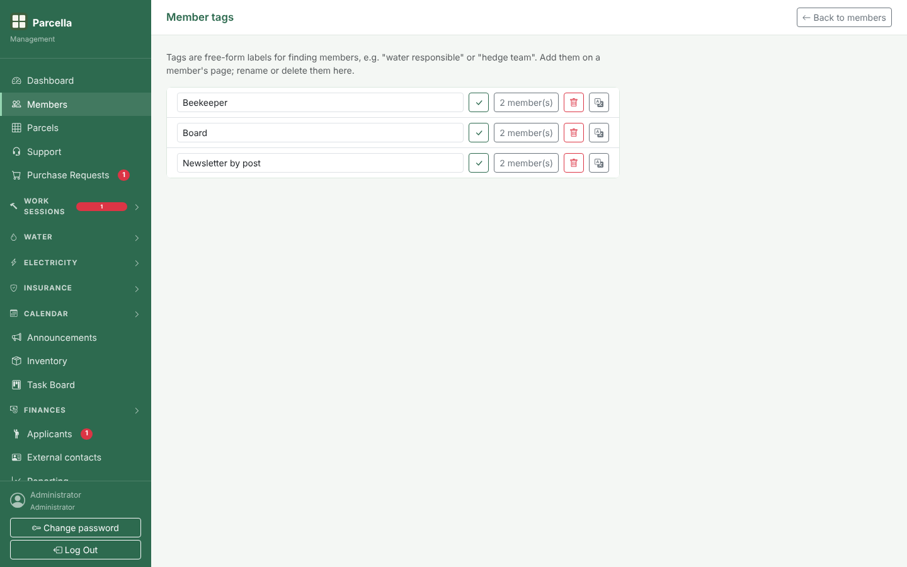

# Členové {#members}

!!! warning "Zatím neaktualizováno"
    Tato stránka popisuje starší stav. Aktuální je anglická verze (jazyk přepnete nahoře).

!!! note "Strojový překlad"
    Tato stránka byla strojově přeložena z angličtiny a dosud nebyla zkontrolována. Pokud je něco nejasné, platí anglická verze (jazyk přepnete nahoře).

Seznam členů je srdcem Parcelly: všichni, kdo patří do vašeho spolku, s
adresou, bankovními údaji, kontaktními údaji a parcelami, které drží.
Faktury, pracovní hodiny, rozesílky, seznam narozenin i prezenční
listina ze schůze z něj čerpají.

!!! info "Kdo to může používat"
    Členové jsou součástí jádra a jsou vždy zapnutí. Vypnout je nelze.

    - **Každý, kdo se může přihlásit,** si může prohlížet seznam členů,
      stránky členů, seznam štítků, export CSV a prezenční listinu.
    - **Přidávání a úpravy** členů, telefonních čísel, e-mailových
      adres, štítků a přidělení parcel vyžadují oprávnění k *zápisu* u
      **Členové a parcely**.
    - **Smazání** člena, telefonního čísla, e-mailové adresy nebo štítku
      vyžaduje oprávnění k *mazání* u **Členové a parcely**.

    Členové výboru a administrátoři mají všechna tato oprávnění. Kdokoli
    jiný získá zápis nebo mazání přes skupinu (viz
    [Role, skupiny a oprávnění](../getting-started/roles-and-permissions.md)).

## Seznam členů {#member-list}

Otevřete **Členové** v hlavním menu. Seznam ukazuje aktivní členy,
seřazené podle příjmení a pak jména. Zápatí ukazuje, kolik členů je
právě v seznamu.

### Tlačítka nahoře {#buttons-at-the-top}

| Tlačítko | Co dělá |
|---|---|
| **CSV import** | Otevře dialog importu souboru CSV (viz [Import členů ze souboru CSV](#importing-members-from-a-csv-file)). Vyžaduje oprávnění k zápisu. |
| **CSV export** | Stáhne *právě zobrazené* členy jako soubor CSV. Uplatní se hledání, zaškrtávací políčka i filtr štítku (viz [Export CSV](#csv-export)). |
| **Napsat těmto členům (*N*)** | Zahájí nové oznámení přesně členům ve vyfiltrovaném seznamu. Zobrazí se, jen když jste hledali nebo filtrovali, dokud je zapnutý modul **Oznámení**, a jen členům výboru a administrátorům. Chcete-li napsat všem, zahajte oznámení místo toho z [Oznámení](announcements.md). |
| **Spravovat štítky** | Otevře stránku [Štítky členů](#member-tags). |
| **Prezenční listina** | Otevře [Prezenční listinu ze schůze](#meeting-sign-in-sheet). |
| **Nový člen** | Otevře prázdný [formulář člena](#new-member-and-edit-member). Vyžaduje oprávnění k zápisu. |

### Hledání a filtry {#search-and-filters}

| Pole / tlačítko | Co dělá |
|---|---|
| Pole hledání | Najde členy podle jména nebo příjmení, ulice, PSČ, města, IBAN, poznámek, e-mailové adresy, telefonního čísla a čísla parcely. Číslo parcely najde jen *současné* nájemce parcely -- pokud není zaškrtnuto **Zobrazit pouze neaktivní**, pak najde i bývalé nájemce. Protože se prohledávají i poznámky, najde člena i číslo tiketu, které jste si u něj poznamenali. |
| **Zobrazit pouze neaktivní** | Ukáže *jen* členy, kteří nejsou aktivní: jejich datum **Členem do** uplynulo, nebo jejich datum **Členem od** je ještě v budoucnosti. Použijte to k vyhledání bývalých nebo zemřelých členů. |
| **Pouze potvrzení aktivní** | Ukáže jen aktivní členy, kteří mají datum **Členem od**. Členové bez data začátku (zobrazení jako *čekající*) se vynechají. |
| **Pouze se souhlasem s e-mailem = ano** | Ukáže jen členy, kteří zaškrtli **Může dostávat informace e-mailem**. |
| Rozbalovací seznam štítků (**Všechny štítky**) | Ukáže jen členy se zvoleným štítkem. Seznam se objeví, jakmile existuje alespoň jeden štítek. Filtrovat lze vždy jen podle jednoho štítku. |
| **Hledat** | Použije hledaný text. Zaškrtávací políčka a rozbalovací seznam štítků se uplatní, jakmile je změníte. |
| **Zrušit filtr** | Zruší všechny filtry. Zobrazí se, jen dokud je filtr aktivní. |

Když je zaškrtnuto **Zobrazit pouze neaktivní**, má přednost před
**Pouze potvrzení aktivní**. Modré upozornění nad tabulkou připomíná,
který z obou filtrů je zapnutý.

Váš filtr zůstává s vámi: pokud otevřete člena z vyfiltrovaného
seznamu, tlačítka **Předchozí** a **Další** na stránce člena procházejí
stejným vyfiltrovaným seznamem a **Zpět** vás do něj vrátí.

### Sloupce {#columns}

| Sloupec | Co ukazuje |
|---|---|
| Zaškrtávací políčko | Vybere člena pro **Exportovat vybrané** nebo **Napsat vybraným** (viz níže). |
| **Jméno** | Příjmení, jméno -- kliknutím otevřete člena. Štítky člena se zobrazují jako malé šedé popisky vedle jména; kliknutím na popisek podle něj seznam vyfiltrujete. |
| **Členem od** | Začátek členství, nebo „–“, pokud není zaznamenán. |
| **Parcely** | Čísla parcel přidělených členovi. <!-- TODO(verify): the list shows every parcel assignment of the member, including tenancies that have already ended -- confirm whether former parcels are meant to appear here. --> |
| **Stav** | **aktivní**, **neaktivní** nebo **čekající** (viz níže). |
| Tlačítko s okem | Otevře stránku člena, stejně jako kliknutí na jméno. |

Odznak stavu znamená:

- **aktivní** -- členství začalo a neskončilo.
- **čekající** -- zatím není zaznamenáno datum **Členem od**. Čekající
  člen se všude jinde počítá jako aktivní (faktury, prezenční listina,
  počty na dashboardu); odznak vám jen říká, že datum začátku nebylo
  potvrzeno.
- **neaktivní** -- členství skončilo, nebo ještě nezačalo. Pokud
  existuje datum **Členem do**, odznak ukazuje „od“ tohoto data.

### Ruční výběr členů {#picking-members-by-hand}

Každý řádek má zaškrtávací políčko, takže můžete ze seznamu vybrat
několik členů -- například vyfiltrovat všechny, kdo povolují informace
e-mailem, a pak 12 z nich zaškrtnout.

| Tlačítko | Co dělá |
|---|---|
| **Vybrat vše** | Zaškrtne každého člena v aktuálním seznamu. |
| **Zrušit výběr** | Zruší všechna zaškrtnutí. |
| **Vybráno: *N*** | Počítá zaškrtnuté členy. |
| **Exportovat vybrané** | Stáhne soubor CSV jen se zaškrtnutými členy. Neaktivní, dokud někoho nezaškrtnete. |
| **Napsat vybraným** | Zahájí nové oznámení jen zaškrtnutým členům. Zobrazí se, jen dokud je zapnutý modul **Oznámení**, a jen členům výboru a administrátorům. |

!!! warning "Změnou filtru se zaškrtnutí ztratí"
    Změna hledání, zaškrtávacího políčka nebo rozbalovacího seznamu
    štítků stránku znovu načte a vaše zaškrtnutí zmizí. Nejprve
    nastavte filtr, pak zaškrtávejte.

Když přejdete na seznam členů z oznámení, které bylo odesláno vybraným
členům, seznam ukáže jen tyto členy s upozorněním „Zobrazeni jsou jen
vybraní členové (*N*).“ Kliknutím na **Zobrazit celý seznam** se vrátíte
k běžnému seznamu. Najednou lze vybrat až 2 000 členů.

### Export CSV {#csv-export}

**CSV export** stáhne soubor `members.csv`, oddělený středníky, s jedním
řádkem na člena v aktuálním seznamu. Záhlaví sloupců jsou německy, aby
šel soubor znovu importovat tak, jak je:

Vorname, Nachname, Strasse, PLZ, Ort, Geburtsdatum, IBAN, Member seit,
Member bis, E-Mail-Benachrichtigungen, E-Mail-Adressen, Telefonnummern,
Parzellen, Notizen, Tags.

- Data se zapisují jako rok-měsíc-den (2024-03-01).
- E-mailové informace se zapisují jako „Ja“ nebo „Nein“.
- Více e-mailových adres, telefonních čísel, parcel nebo štítků sdílí
  jednu buňku, oddělené středníky.
- Štítky se exportují s názvem, který jste napsali, ne s překladem.
- Zda člen odmítá narozeninové dárky, se neexportuje.

!!! tip "Tip"
    Export vždy odpovídá tomu, co je na obrazovce. Chcete-li exportovat
    všechny aktivní členy, nejprve klikněte na **Zrušit filtr**. Chcete-li
    exportovat bývalé členy, nejprve zaškrtněte **Zobrazit pouze
    neaktivní**.

## Import členů ze souboru CSV {#importing-members-from-a-csv-file}

Importem převedete existující seznam členů -- z tabulky nebo staršího
programu -- do Parcelly. Funguje ve dvou krocích: nahrajete soubor, pak
Parcelle řeknete, který sloupec obsahuje co. Před potvrzením druhého
kroku se nic neuloží.

Postup prvního importu krok za krokem viz
[Import členů a parcel](../guides/csv-import.md).

### Krok 1: nahrání souboru {#step-1-upload-the-file}

Klikněte na **CSV import** v seznamu členů. Otevře se dialog **CSV
import**.

| Pole / tlačítko | Co dělá |
|---|---|
| Pole souboru | Vyberte soubor `.csv`. |
| **Importovat** | Nahraje soubor a otevře přiřazení sloupců. Zatím se nic neuloží. |

Dialog uvádí sloupce, kterým Parcella rozumí. Tato záhlaví používat
nemusíte -- sloupce přiřadíte v dalším kroku. Co je dobré o souboru
vědět:

- Sloupce mohou být odděleny středníky nebo čárkami. Parcella pozná
  kterými; pokud to nepozná, předpokládá středníky.
- První řádek musí být řádek záhlaví.
- Data lze psát jako 2024-03-01, 01.03.2024 nebo 01.03.24.
- Více e-mailových adres nebo telefonních čísel v jedné buňce se odděluje
  středníky.
- Nejjednodušší šablonou je **CSV export** ze samotné Parcelly -- odkaz
  v dialogu stáhne úplný, nefiltrovaný export.

Pokud je soubor prázdný, budete vráceni na seznam se zprávou „Tento
soubor CSV se zdá být prázdný.“

### Krok 2: přiřazení sloupců {#step-2-map-the-columns}

<!-- TODO(verify): no screenshot -- this page is only reached by uploading a file, which the screenshot tool can't do. -->

Stránka **Mapování sloupců CSV** ukazuje každý sloupec vašeho souboru se
záhlavím a pod ním prvních pět řádků dat, abyste viděli, co obsahuje. Nad
každým sloupcem je rozbalovací seznam.

| Pole / tlačítko | Co dělá |
|---|---|
| Rozbalovací seznam u každého sloupce | Vyberte pole Parcelly, ke kterému sloupec patří: **Jméno**, **Příjmení**, **Ulice**, **PSČ**, **Město**, **Datum narození**, **IBAN**, **Členem od**, **Členem do**, **E-mailová upozornění**, **E-mailové adresy**, **Telefonní čísla**, **Poznámky** -- nebo **— Ignorovat —** pro přeskočení sloupce. Parcella předvybere pole, když záhlaví rozpozná (anglicky nebo německy, např. „Nachname“ nebo „Last name“). |
| **Importovat** | Importuje řádky a vrátí vás na seznam členů. **Jméno** a **Příjmení** musí být každé přiřazeno ke sloupci, jinak dostanete „Před importem prosím přiřaďte sloupce jména a příjmení.“ |
| **Zpět** | Vrátí se na seznam členů bez importu. |

### Co se při importu stane {#what-happens-on-import}

U každého řádku hledá Parcella existujícího člena se stejným jménem a
příjmením. Pokud jste přiřadili sloupec **Datum narození** a řádek má
datum narození, musí se shodovat také.

- **Žádná shoda**: vytvoří se nový člen, včetně e-mailových adres a
  telefonních čísel z řádku.
- **Shoda**: existující člen se aktualizuje, ale jen tím, co řádek
  skutečně obsahuje (viz níže). E-mailové adresy a telefonní čísla se
  při aktualizaci **nemění** -- přidávejte nebo odebírejte je na stránce
  člena.
- **Více členů s tímto jménem**: Parcella použije datum narození,
  e-mailové adresy a telefonní čísla z řádku k nalezení toho správného.
  Aktualizuje se člen, který má jeden z těchto údajů; na velikosti
  písmen, mezerách a pomlčkách nezáleží („0171 234-5678“ je totéž co
  „01712345678“). Pokud řádek stále odpovídá více než jednomu členovi,
  přeskočí se se zprávou jako „Řádek 4: více členů se jmenuje Jan
  Novák, přeskočeno.“ a nikdo se nezmění. Samotná e-mailová adresa nebo
  telefonní číslo nikdy nespáruje člena s jiným jménem, protože páry je
  často sdílejí.
- **Prázdné jméno nebo příjmení**: řádek se přeskočí.

**Aktualizace mění jen to, co uvádí soubor.** Sloupec nastavený na **—
Ignorovat —** nebo prázdná buňka ponechá uloženou hodnotu člena beze
změny. Soubor jen se jmény a novými adresami tedy aktualizuje adresy a
nic jiného.

Sloupec **E-mailová upozornění** se počítá jako „ne“, když obsahuje
*nein*, *no*, *false* nebo *0*, a jako „ano“ pro cokoli jiného
vyplněného. U existujícího člena prázdná buňka nebo chybějící sloupec
ponechá jeho volbu beze změny -- kdo se odhlásil, zůstane odhlášen. Nový
člen bez hodnoty dostane „ano“.

Poté seznam členů ukáže souhrn jako „12 nově importováno, 3
aktualizováno“. Pokud byly řádky přeskočeny, souhrn přidá počet chyb a
podrobnosti prvních tří.

!!! tip "Členové se stejným jménem"
    Pokud má váš spolek členy se shodnými jmény, přiřaďte sloupec
    **Datum narození**, **E-mailové adresy** nebo **Telefonní čísla**:
    pak každý řádek aktualizuje správnou osobu. Bez nich se takové
    řádky přeskočí, místo aby se hádalo.

## Stránka člena {#member-page}

Kliknutím na jméno v seznamu členů otevřete stránku člena. Ukazuje vše,
co Parcella o členovi ví, a umožňuje přímo přidávat telefonní čísla,
e-mailové adresy, štítky a parcely.

### Tlačítka nahoře {#buttons-at-the-top_1}

| Tlačítko | Co dělá |
|---|---|
| **Upravit** | Otevře [formulář úprav](#new-member-and-edit-member). Vyžaduje oprávnění k zápisu. |
| **Předchozí** / **Další** | Skočí na předchozího nebo dalšího člena *v seznamu, ze kterého jste přišli*, se stejným filtrem. Můžete také stisknout ++ctrl+left++ a ++ctrl+right++ (ne při psaní do pole). Na Macu může tyto klávesy používat systém k přepínání ploch. |
| **Zpět** | Vrátí se na seznam členů s vaším filtrem. |

### Hlavní údaje {#master-data}

Ukazuje **Jméno**, **Datum narození**, **Adresa**, **IBAN**, **Členem
od**, **Členem do**, **Souhlas s e-mailem** (zda člen smí dostávat informace
e-mailem) a **Nepřeje si narozeninové dárky**. Chcete-li cokoli z toho
změnit, klikněte na **Upravit**.

### Štítky {#tags}

Vypisuje štítky člena. Kliknutím na štítek uvidíte všechny členy s tímto
štítkem.

| Pole / tlačítko | Co dělá |
|---|---|
| **×** vedle štítku | Odebere štítek tomuto členovi (**Odebrat štítek**). Samotný štítek zůstane pro ostatní členy. Vyžaduje oprávnění k zápisu. |
| **Přidat štítek, např. odpovědný za vodu** | Napište název štítku a klikněte na **+** (**Přidat štítek**). Pokud štítek tohoto názvu už existuje -- na velkých písmenech a nadbytečných mezerách nezáleží --, použije se znovu; jinak se vytvoří nový. Pole při psaní navrhuje existující štítky. Vyžaduje oprávnění k zápisu. |
| **Spravovat štítky** | Otevře stránku [Štítky členů](#member-tags). |

Odebrání štítku členovi nezanechá záznam v historii: štítky jsou popisky
pro hledání lidí, ne záznamy spolku.

### Telefonní čísla a e-mailové adresy {#phone-numbers-and-email-addresses}

| Pole / tlačítko | Co dělá |
|---|---|
| Pole telefonního čísla + **+** | Přidá další telefonní číslo. Vyžaduje oprávnění k zápisu. |
| Pole e-mailu + **+** | Přidá další e-mailovou adresu. Musí vypadat jako e-mailová adresa. Vyžaduje oprávnění k zápisu. |
| Tlačítko koše | Odebere toto telefonní číslo nebo e-mailovou adresu (**Odebrat**). Vyžaduje oprávnění k mazání. |

Kliknutím na e-mailovou adresu napíšete členovi ze svého poštovního
programu.

### Přidělené parcely {#assigned-parcels}

Vypisuje parcely přidělené členovi.

| Sloupec | Co ukazuje |
|---|---|
| **Číslo parcely** | Kliknutím na něj (nebo na tlačítko šipky) otevřete parcelu. |
| **Rozloha** | Rozloha parcely v metrech čtverečních. |
| **Stav** | Stav parcely: **aktivní**, **ukončená** nebo **smazaná**. |
| **Fakturační adresa** | Zda se adresa tohoto člena používá pro faktury parcely. |
| **Od** | Začátek nájmu. |

<!-- TODO(verify): this table lists every assignment of the member, including ended tenancies, and has no "until" column -- confirm whether former parcels are meant to appear here. Also, a communal parcel would show as "deleted" here because the badge only knows active/terminated. -->

Přidělení parcely členovi (vyžaduje oprávnění k zápisu):

| Pole / tlačítko | Co dělá |
|---|---|
| **Vyberte parcelu…** | Parcela k přidělení. Nabízí se každá parcela, seřazené podle čísla. |
| **Použít jako fakturační adresu** | Ve výchozím stavu zaškrtnuto. Faktury za tuto parcelu jdou na adresu tohoto člena. |
| **Přidělit** | Přidělí parcelu a otevře stránku parcely. |

Nájem začíná bez data. Chcete-li nastavit datum začátku nebo nájem
ukončit, použijte stránku parcely -- viz
[Současní nájemci](parcels.md#current-tenants).

### Procesy {#processes}

Pokud je zapnutý modul [Procesy](processes.md) a smíte procesy vidět,
karta **Procesy** vypisuje procesy týkající se tohoto člena. **Zahájit
proces** pro něj zahájí nový.

### Poznámky {#notes}

Interní poznámky člena, pokud nějaké jsou. Upravíte je ve formuláři
člena.

### Nebezpečná zóna {#danger-zone}

Zobrazí se jen uživatelům s oprávněním k mazání.

**Smazat člena** po potvrzení označí člena jako smazaného. Člen zmizí ze
všech seznamů a hledání. Jeho data zůstávají v databázi a existující
přidělení parcel, pracovní směny a další záznamy zůstávají, jak jsou.

!!! warning "Ukončení členství není smazání"
    U člena, který ze spolku odchází -- nebo zemřel --, nastavte místo
    toho ve formuláři úprav **Členem do** a ukončete jeho nájmy na
    stránce parcely. Pak se přesune do **Zobrazit pouze neaktivní** a
    jeho historie zůstane viditelná. Mazání je určeno pro záznamy, které
    nikdy neměly existovat, například duplikát.
    <!-- TODO(verify): there's no way to restore a deleted member in the app; confirm. Also confirm how a deleted member who is still assigned to a parcel shows up on the parcel page. -->

## Nový člen a úprava člena {#new-member-and-edit-member}

Klikněte na **Nový člen** v seznamu členů nebo na **Upravit** na stránce
člena. Oba formuláře vypadají stejně; formulář nového člena se navíc
ptá na první e-mailovou adresu a telefonní číslo. Pole označená červenou
hvězdičkou jsou povinná.

### Osobní údaje {#personal-data}

| Pole | Co dělá |
|---|---|
| **Jméno** \* | Povinné. |
| **Příjmení** \* | Povinné. |
| **Datum narození** | Používá se pro seznam narozenin a průměrný věk na dashboardu. Pomáhá také importu CSV rozlišit členy se stejným jménem. |
| **IBAN** | Bankovní účet člena, např. pro inkaso. |

### Adresa {#address}

| Pole | Co dělá |
|---|---|
| **Ulice a číslo popisné** | |
| **PSČ** | Nejvýše 10 znaků. |
| **Město** | |

Adresa se používá pro dopisy a faktury. Pokud je člen fakturační adresou
parcely, faktury za tuto parcelu jdou sem.

### Členství {#membership}

| Pole | Co dělá |
|---|---|
| **Členem od** | První den členství. Pokud je prázdné, člen je uveden jako *čekající*, ale stále se počítá jako aktivní. Pokud leží v budoucnosti, člen se do toho dne počítá jako neaktivní. |
| **Členem do** | Poslední den členství. „Ponechte prázdné = aktivní člen“. Ode dne následujícího se člen počítá jako neaktivní. |
| **E-mailová adresa** | Jen u nových členů. Volitelné -- další adresy lze přidat později na stránce člena. |
| **Telefonní číslo** | Jen u nových členů. Volitelné -- další čísla lze přidat později na stránce člena. |
| **Může dostávat informace e-mailem** | U nových členů ve výchozím stavu zaškrtnuto. Odškrtněte, pokud člen nechce informace spolku e-mailem. Seznam členů podle toho umí filtrovat. |
| **Nepřeje si narozeninové dárky** | Zaškrtněte, pokud člen nechce narozeninové dárky. Zobrazuje se na seznamu narozenin, aby to věděl ten, kdo se o dárky stará. |

### Poznámky {#notes_1}

| Pole | Co dělá |
|---|---|
| **Interní poznámky…** | Volný text pro výbor. Hledání v seznamu členů prohledává i poznámky. |

### Štítky {#tags_1}

| Pole | Co dělá |
|---|---|
| Zaškrtávací políčka štítků | Jedno políčko na každý existující štítek. Zaškrtnutím nebo odškrtnutím ho přidáte nebo odeberete. Zobrazí se, až štítky existují. |
| **Nové štítky oddělené čárkou** | Napište nové štítky oddělené čárkami, např. „odpovědný za vodu, tým živého plotu“. Název, který už existuje, se použije znovu. |

### Uložení {#saving}

| Tlačítko | Co dělá |
|---|---|
| **Vytvořit člena** / **Uložit změny** | Uloží člena a otevře stránku člena. |
| **Zrušit** | Odejde bez uložení. |

Pokud nový název štítku není přijat (například je delší než 100 znaků),
zbytek člena se přesto uloží a formulář úprav se znovu otevře, abyste
mohli štítek opravit.
<!-- TODO(verify): in that case the form reopens without an error message. -->

## Štítky členů {#member-tags}

Štítky jsou volné popisky pro opětovné nalezení členů -- „odpovědný za
vodu“, „rozšířený výbor“, „tým živého plotu“. Přidáváte je na stránce
člena nebo ve formuláři člena; zde je přejmenujete nebo smažete. Stránku
otevřete tlačítkem **Spravovat štítky** v seznamu členů nebo na stránce
člena.

Každý štítek má jeden řádek:

| Pole / tlačítko | Co dělá |
|---|---|
| Název štítku + tlačítko zaškrtnutí | Změňte název a klikněte na tlačítko zaškrtnutí (**Přejmenovat**). Nový název se zobrazí u každého člena, který štítek má. Odmítne se, pokud tento název už má jiný štítek. Vyžaduje oprávnění k zápisu; bez něj vidíte jen název. |
| **Členů: *N*** | Otevře seznam členů vyfiltrovaný podle tohoto štítku. |
| Tlačítko koše | Po potvrzení **Smazat štítek**. Štítek se odebere všem členům. Vyžaduje oprávnění k mazání. |
| Tlačítko překladu | Otevře **Překlady** štítku: jeden název pro každý jazyk, který Parcella podporuje. Dokud spolek běží v daném jazyce, ukazují seznamy, formuláře a filtry název štítku v tomto jazyce; prázdné pole ukazuje název, který jste napsali. Uložíte je kliknutím na **Uložit překlady**. Vyžaduje oprávnění k zápisu; bez něj vidíte překlady jako seznam. Malé číslo na tlačítku říká, kolik překladů existuje. |
| **Zpět na členy** | Vrátí se na seznam členů. |

Export CSV vždy používá název, který jste napsali, ne překlad.

## Prezenční listina ze schůze {#meeting-sign-in-sheet}

Otevřete ji tlačítkem **Prezenční listina** v seznamu členů. Vytváří
seznam v PDF k vytištění a přinesení na členskou schůzi: každý současný
nájemce, seskupený podle parcely, s řádkem pro podpis.

| Pole / tlačítko | Co dělá |
|---|---|
| **Nadpis** | Zobrazí se nahoře v PDF. Začíná jako „Členská schůze dne“ plus dnešní datum; změňte ho na cokoli chcete. Pokud ho vyprázdníte, použije se výchozí. |
| **Vytvořit PDF** | Stáhne prezenční listinu jako soubor PDF. |
| **Zrušit** | Vrátí se na seznam členů. |

Co je na listině:

- Jeden řádek na osobu se sloupci **Parcela**, **Jméno** a **Podpis**,
  seřazeno podle čísla parcely a pak podle příjmení.
- Pokud jednu parcelu drží více lidí, číslo parcely se objeví jednou a
  každý z nich dostane vlastní řádek pro podpis.
- Uvedeni jsou jen **aktivní členové**, kteří jsou **současnými
  nájemci** parcely. Členové bez parcely a nájemci, kteří už odešli, na
  listině nejsou.
- PDF nese logo spolku a stejné záhlaví a zápatí jako ostatní dokumenty
  spolku. Dlouhý seznam prostě pokračuje na více stranách.

!!! tip "Tip"
    Členové, kteří nemají parcelu -- například čestní členové --, na
    listině nejsou. Pokud se smějí zúčastnit, dopište je ručně.

## Související {#related}

- [Parcely](parcels.md) -- přidělování a ukončování nájmů
- [Uchazeči](applicants.md) -- jak se z uchazeče stane člen
- [Přijetí nového člena](../guides/new-member.md)
- [Předání parcely](../guides/parcel-handover.md)
- [Import členů a parcel](../guides/csv-import.md)
- [Oznámení](announcements.md) -- psaní vyfiltrovaným nebo vybraným členům
