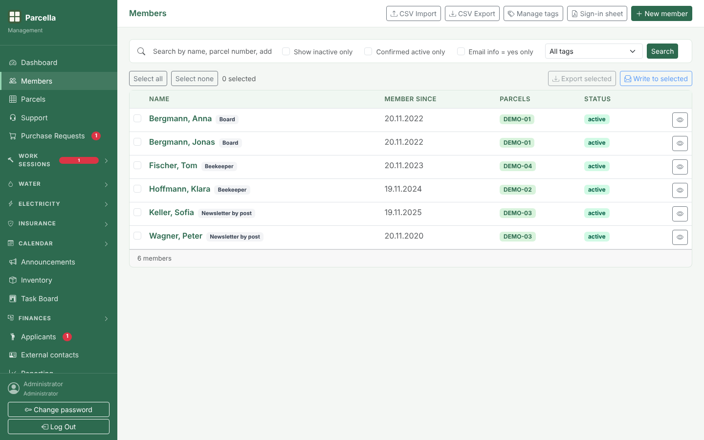
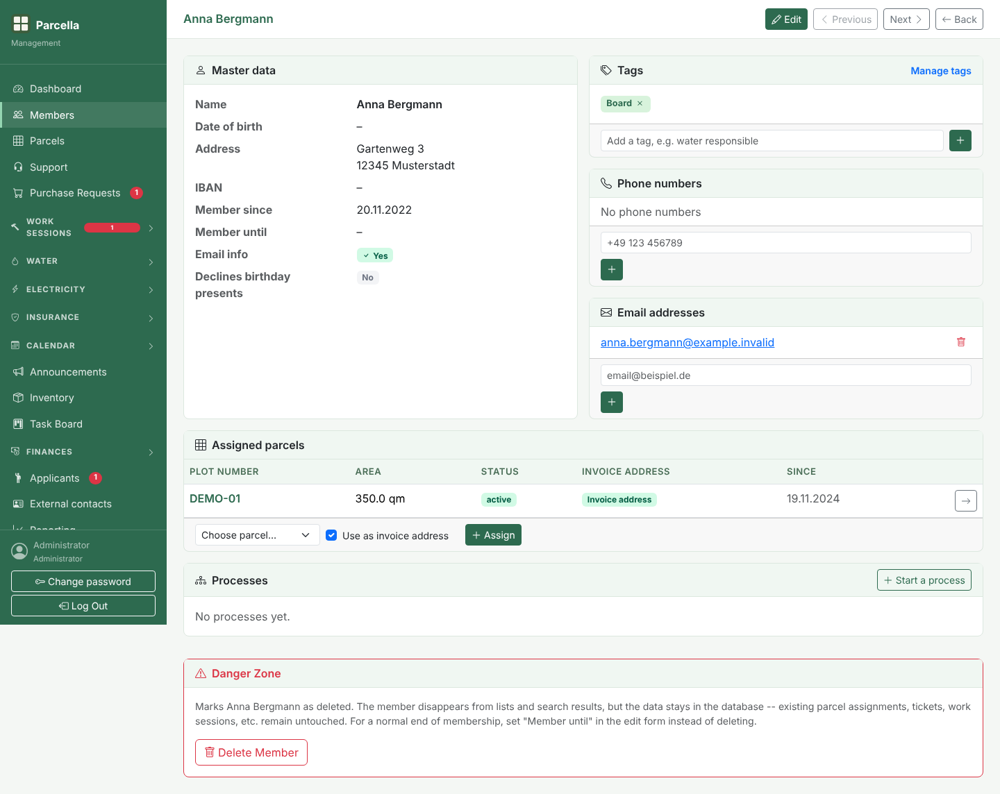
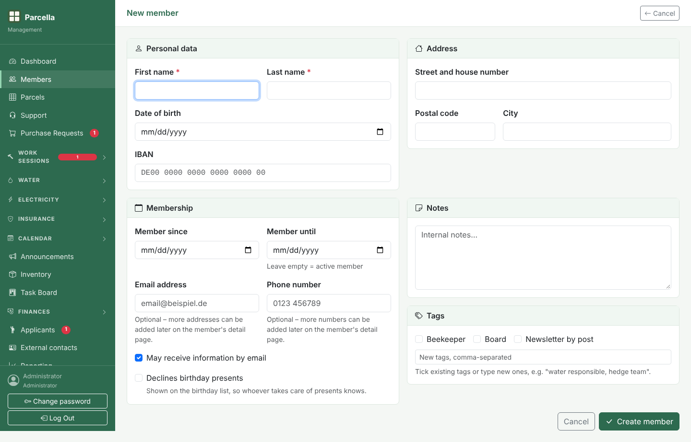

# Mitglieder {#members}

Die Mitgliederliste ist das Herzstück von Parcella: alle, die zu deinem
Verein gehören, mit Adresse, Bankverbindung, Kontaktdaten und ihren
Parzellen. Rechnungen, Arbeitsstunden, Mitteilungen, die Geburtstagsliste
und die Anwesenheitsliste für Versammlungen lesen alle von hier.

!!! info "Wer das nutzen kann"
    Mitglieder gehört zum Kern und ist immer eingeschaltet. Es lässt sich
    nicht abschalten.

    - **Alle, die sich anmelden können**, dürfen die Mitgliederliste, die
      Mitgliederseiten, die Tag-Liste, den CSV-Export und die
      Anwesenheitsliste ansehen.
    - **Anlegen und Bearbeiten** von Mitgliedern, Telefonnummern,
      E-Mail-Adressen, Tags und Parzellenzuordnungen braucht das Recht
      *Schreiben* bei **Mitglieder & Parzellen**.
    - **Löschen** eines Mitglieds, einer Telefonnummer, einer E-Mail-Adresse
      oder eines Tags braucht das Recht *Löschen* bei **Mitglieder &
      Parzellen**.

    Vorstandsmitglieder und Administratoren haben all das. Alle anderen
    bekommen Schreiben oder Löschen über eine Gruppe (siehe
    [Rollen, Gruppen und Rechte](../getting-started/roles-and-permissions.md)).

## Mitgliederliste {#member-list}

Öffne **Mitglieder** im Hauptmenü. Die Liste zeigt die aktiven
Mitglieder, sortiert nach Nachname und dann Vorname. Die Fußzeile zeigt, wie
viele Mitglieder gerade in der Liste sind.

Eine lange Liste wird in Seiten zu je 100 Mitgliedern aufgeteilt. Unter der
Tabelle blätterst du mit **Vorherige** und **Nächste**, „Seite 2 von 17“
zeigt, wo du bist, und „101–200 von 1612“, welche Mitglieder du siehst.
Suche und Filter bleiben beim Blättern erhalten. **Zurück** auf einer
Mitgliedsseite führt auf die Seite, auf der das Mitglied steht.

### Schaltflächen oben {#buttons-at-the-top}

| Schaltfläche | Was sie bewirkt |
|---|---|
| **CSV-Import** | Öffnet den Import-Dialog für eine CSV-Datei (siehe [Mitglieder aus einer CSV-Datei importieren](#importing-members-from-a-csv-file)). Braucht Schreibrecht. |
| **CSV-Export** | Lädt die *gerade angezeigten* Mitglieder als CSV-Datei herunter. Suche, Häkchen und Tag-Filter gelten alle (siehe [CSV-Export](#csv-export)). |
| **Diesen *N* Mitgliedern schreiben** | Beginnt eine neue Mitteilung an genau die Mitglieder der gefilterten Liste. Erscheint erst, wenn du gesucht oder gefiltert hast, solange das Modul **Mitteilungen** eingeschaltet ist, und nur für Vorstandsmitglieder und Administratoren. Um allen zu schreiben, beginn die Mitteilung stattdessen unter [Mitteilungen](announcements.md). |
| **Tags verwalten** | Öffnet die Seite [Mitglieder-Tags](#member-tags). |
| **Anwesenheitsliste** | Öffnet die [Anwesenheitsliste](#meeting-sign-in-sheet). |
| **Neues Mitglied** | Öffnet ein leeres [Mitgliederformular](#new-member-and-edit-member). Braucht Schreibrecht. |

### Suche und Filter {#search-and-filters}

| Feld / Schaltfläche | Was es bewirkt |
|---|---|
| Suchfeld | Findet Mitglieder nach Vor- oder Nachname, Straße, PLZ, Ort, IBAN, Notizen, E-Mail-Adresse, Telefonnummer und Gartennummer. Eine Gartennummer findet nur die *aktuellen* Pächter der Parzelle -- außer **Nur Inaktive anzeigen** ist angehakt, dann auch frühere Pächter. Weil auch Notizen durchsucht werden, findet eine bei einem Mitglied notierte Ticketnummer dieses Mitglied. |
| **Nur Inaktive anzeigen** | Zeigt *nur* Mitglieder, die nicht aktiv sind: ihr Datum **Mitglied bis** ist vorbei oder ihr Datum **Mitglied seit** liegt noch in der Zukunft. Damit schlägst du frühere oder verstorbene Mitglieder nach. |
| **Nur bestätigt aktive** | Zeigt nur aktive Mitglieder mit einem Datum **Mitglied seit**. Mitglieder ohne Beginndatum (angezeigt als *ausstehend*) fallen weg. |
| **Nur mit E-Mail-Einwilligung = ja** | Zeigt nur Mitglieder mit Häkchen bei **Darf per E-Mail Informationen erhalten**. |
| Tag-Auswahl (**Alle Tags**) | Zeigt nur Mitglieder mit dem gewählten Tag. Die Auswahl erscheint, sobald es mindestens einen Tag gibt. Es lässt sich nach einem Tag auf einmal filtern. |
| **– eigenes Feld –** | Erscheint erst, wenn es ein [eigenes Feld](../administration/custom-fields.md) gibt. Wähle ein Feld; daneben wählst du dann, wonach du suchst: **ja**/**nein** bei einem Ja/Nein-Feld oder einer Gruppe, **ausgefüllt**/**leer** bei den anderen Typen, einen der Auswahlwerte oder einen Text, den das Feld enthalten soll. Wirkt zusammen mit allen anderen Filtern, also auch für **Alle … Treffer des Filters auswählen**, den Export und **An Auswahl schreiben**. |
| **Suchen** | Wendet den Suchtext an. Häkchen und Tag-Auswahl wirken, sobald du sie änderst. |
| **Zurücksetzen** | Hebt alle Filter auf. Erscheint nur, solange ein Filter aktiv ist. |

Ist **Nur Inaktive anzeigen** angehakt, hat es Vorrang vor **Nur bestätigt
aktive**. Ein blauer Hinweis über der Tabelle erinnert daran, welcher der
beiden Filter aktiv ist.

Dein Filter bleibt erhalten: Öffnest du ein Mitglied aus einer gefilterten
Liste, gehen die Schaltflächen **Vorherige** und **Nächste** auf der
Mitgliederseite durch dieselbe gefilterte Liste, und **Zurück** führt dich
dorthin zurück.

### Spalten {#columns}

| Spalte | Was sie zeigt |
|---|---|
| Kästchen | Wählt das Mitglied für **Auswahl exportieren** oder **An Auswahl schreiben** (siehe unten). |
| **Name** | Nachname, Vorname -- ein Klick öffnet das Mitglied. Die Tags des Mitglieds stehen als kleine graue Etiketten neben dem Namen; ein Klick darauf filtert die Liste nach diesem Tag. |
| **Mitglied seit** | Der Beginn der Mitgliedschaft oder „–“, wenn keiner erfasst ist. |
| **Parzellen** | Die Gartennummern, die dem Mitglied zugeordnet sind. |
| **Status** | **aktiv**, **inaktiv** oder **ausstehend** (siehe unten). |
| Augen-Schaltfläche | Öffnet die Mitgliederseite, wie ein Klick auf den Namen. |

Das Status-Badge bedeutet:

- **aktiv** -- die Mitgliedschaft hat begonnen und ist nicht beendet.
- **ausstehend** -- noch kein Datum **Mitglied seit** erfasst. Ein
  ausstehendes Mitglied zählt überall sonst als aktiv (Rechnungen,
  Anwesenheitsliste, Zahlen auf dem Dashboard); das Badge sagt nur, dass
  das Beginndatum noch nicht bestätigt ist.
- **inaktiv** -- die Mitgliedschaft ist beendet oder hat noch nicht
  begonnen. Gibt es ein Datum **Mitglied bis**, zeigt das Badge „seit“
  diesem Datum.

### Mitglieder von Hand auswählen {#picking-members-by-hand}

Jede Zeile hat ein Kästchen, damit du einige Mitglieder aus der Liste
herausgreifen kannst -- zum Beispiel alle filtern, die E-Mail-Informationen
erlauben, und dann 12 davon anhaken.

| Schaltfläche | Was sie bewirkt |
|---|---|
| **Alle auswählen** | Hakt jedes Mitglied der aktuellen Seite an. |
| **Alle *N* Treffer des Filters auswählen** | Erscheint nur, wenn die Liste mehr als eine Seite hat, nachdem du **Alle auswählen** geklickt hast. Wählt jedes Mitglied aus, das der Filter findet, auf allen Seiten. Der Zähler zeigt dann „Alle *N* ausgewählt“. |
| **Keine auswählen** | Entfernt alle Häkchen. |
| ***N* ausgewählt** | Zählt die angehakten Mitglieder. |
| **Auswahl exportieren** | Lädt eine CSV-Datei nur mit den angehakten Mitgliedern herunter. Deaktiviert, bis du jemanden anhakst. |
| **An Auswahl schreiben** | Beginnt eine neue Mitteilung nur an die angehakten Mitglieder. Erscheint nur, solange das Modul **Mitteilungen** eingeschaltet ist, und nur für Vorstandsmitglieder und Administratoren. |

!!! warning "Häkchen gehen beim Ändern des Filters oder der Seite verloren"
    Wenn du die Suche, ein Kästchen oder die Tag-Auswahl änderst, lädt die
    Seite neu, und deine Häkchen sind weg. Ebenso beim Blättern. Erst
    filtern, dann anhaken. Für eine große Gruppe grenzt du den Filter ein
    (oder gibst den Mitgliedern einen Tag und filterst danach) und nimmst
    **Alle *N* Treffer des Filters auswählen**, statt Zeile für Zeile
    anzuhaken.

Folgst du dem Link zur Mitgliederliste aus einer Mitteilung, die an
ausgewählte Mitglieder ging, zeigt die Liste nur diese Mitglieder mit dem
Hinweis „Es werden nur die *N* ausgewählten Mitglieder angezeigt.“ **Ganze
Liste anzeigen** führt zur normalen Liste zurück.

### CSV-Export {#csv-export}

**CSV-Export** lädt eine Datei namens `members.csv` herunter, getrennt durch
Semikolons, mit einer Zeile je Mitglied der aktuellen Liste. Die
Spaltenüberschriften sind deutsch, damit sich die Datei unverändert wieder
importieren lässt:

Vorname, Nachname, Strasse, PLZ, Ort, Geburtsdatum, IBAN, Member seit,
Member bis, E-Mail-Benachrichtigungen, E-Mail-Adressen, Telefonnummern,
Parzellen, Notizen, Tags.

- Datumsangaben stehen als Jahr-Monat-Tag (2024-03-01).
- Die E-Mail-Einwilligung steht als „Ja“ oder „Nein“.
- Mehrere E-Mail-Adressen, Telefonnummern, Parzellen oder Tags teilen sich
  eine Zelle, getrennt durch Semikolons.
- Tags werden mit dem eingetippten Namen exportiert, nicht mit einer
  Übersetzung.
- Ob ein Mitglied keine Geburtstagsgeschenke möchte, wird nicht exportiert.

Danach folgt eine Spalte pro [eigenem Feld](../administration/custom-fields.md),
mit der Bezeichnung als Überschrift (ein Feld in einer Gruppe als
„Gruppe: Feld“); Ja/Nein als „Ja“ oder „Nein“.

!!! tip
    Der Export entspricht immer dem, was auf dem Bildschirm steht. Um alle
    aktiven Mitglieder zu exportieren, klick zuerst auf **Zurücksetzen**.
    Für frühere Mitglieder hak zuerst **Nur Inaktive anzeigen** an.

## Mitglieder aus einer CSV-Datei importieren {#importing-members-from-a-csv-file}

Mit dem Import bringst du eine bestehende Mitgliederliste -- aus einer
Tabellenkalkulation oder einem älteren Programm -- nach Parcella. Er läuft in
zwei Schritten: Du lädst die Datei hoch und sagst Parcella dann, welche
Spalte was enthält. Vor dem Bestätigen des zweiten Schritts wird nichts
gespeichert.

Eine Schritt-für-Schritt-Anleitung für den ersten Import findest du unter
[Mitglieder und Parzellen importieren](../guides/csv-import.md).

### Schritt 1: die Datei hochladen {#step-1-upload-the-file}

Klick in der Mitgliederliste auf **CSV-Import**. Der Dialog
**CSV-Import** öffnet sich.

| Feld / Schaltfläche | Was es bewirkt |
|---|---|
| Dateifeld | Eine `.csv`-Datei wählen. |
| **Importieren** | Lädt die Datei hoch und öffnet die Spaltenzuordnung. Noch wird nichts gespeichert. |

Der Dialog listet die Spalten, die Parcella versteht. Diese Überschriften
musst du nicht verwenden -- die Spalten ordnest du im nächsten Schritt zu.
Gut zu wissen:

- Spalten dürfen durch Semikolons oder Kommas getrennt sein. Parcella
  erkennt es; kann es das nicht, nimmt es Semikolons an.
- Die erste Zeile muss die Überschriftenzeile sein.
- Datumsangaben dürfen als 2024-03-01, 01.03.2024 oder 01.03.24 stehen.
- Mehrere E-Mail-Adressen oder Telefonnummern in einer Zelle werden durch
  Semikolons getrennt.
- Die einfachste Vorlage ist ein **CSV-Export** aus Parcella selbst -- der
  Link im Dialog lädt den vollständigen, ungefilterten Export herunter.

Ist die Datei leer, kommst du mit „Diese CSV-Datei scheint leer zu sein.“
zur Liste zurück.

### Schritt 2: die Spalten zuordnen {#step-2-map-the-columns}

Die Seite **CSV-Spalten zuordnen** zeigt jede Spalte deiner Datei mit
Überschrift und den ersten fünf Datenzeilen darunter, damit du siehst, was
darin steht. Über jeder Spalte ist eine Auswahl.

| Feld / Schaltfläche | Was es bewirkt |
|---|---|
| Auswahl je Spalte | Wähl das Parcella-Feld zu dieser Spalte: **Vorname**, **Nachname**, **Straße**, **PLZ**, **Ort**, **Geburtsdatum**, **IBAN**, **Mitglied seit**, **Mitglied bis**, **E-Mail-Benachrichtigungen**, **E-Mail-Adressen**, **Telefonnummern**, **Notizen** -- oder **— Ignorieren —**, um die Spalte zu überspringen. Parcella wählt ein Feld vor, wenn es die Überschrift erkennt (auf Deutsch oder Englisch, z. B. „Nachname“ oder „Last name“). |
| **Importieren** | Importiert die Zeilen und führt zur Mitgliederliste zurück. **Vorname** und **Nachname** müssen je einer Spalte zugeordnet sein, sonst erscheint „Bitte ordne vor dem Import sowohl Vorname als auch Nachname zu.“ |
| **Zurück** | Führt ohne Import zur Mitgliederliste zurück. |

Deine [eigenen Felder](../administration/custom-fields.md) stehen ebenfalls in den Auswahllisten; eine Spalte mit der Bezeichnung oder dem Schlüssel eines Felds als Überschrift wird vorausgewählt. Nur ausgefüllte Zellen ändern einen Wert; ein ausgefülltes Feld einer Gruppe hakt die Gruppe an, und „Nein“ in der Spalte einer Gruppe leert ihre Felder.

### Was beim Import passiert {#what-happens-on-import}

Für jede Zeile sucht Parcella ein bestehendes Mitglied mit demselben Vor-
und Nachnamen. Hast du eine Spalte **Geburtsdatum** zugeordnet und hat die
Zeile ein Geburtsdatum, muss auch das übereinstimmen.

- **Kein Treffer**: Ein neues Mitglied wird angelegt, mit den
  E-Mail-Adressen und Telefonnummern aus der Zeile.
- **Ein Treffer**: Das bestehende Mitglied wird aktualisiert, aber nur mit
  dem, was die Zeile tatsächlich enthält (siehe unten). E-Mail-Adressen und
  Telefonnummern werden beim Aktualisieren **nicht** angefasst -- die fügst
  du auf der Mitgliederseite hinzu oder entfernst sie dort.
- **Mehrere Mitglieder mit diesem Namen**: Parcella nutzt Geburtsdatum,
  E-Mail-Adressen und Telefonnummern der Zeile, um das richtige zu finden.
  Das Mitglied, das eines davon hat, wird aktualisiert; Groß-/Kleinschreibung,
  Leerzeichen und Bindestriche spielen keine Rolle („0171 234-5678“ ist
  dasselbe wie „01712345678“). Passt die Zeile dann immer noch auf mehr als
  ein Mitglied, wird sie mit „Zeile 4: Es gibt mehrere Mitglieder namens
  Hans Meier, übersprungen.“ übersprungen, und niemand wird geändert. Eine
  E-Mail-Adresse oder Telefonnummer allein passt nie auf ein Mitglied mit
  anderem Namen, weil Paare oft eine gemeinsame haben.
- **Vor- oder Nachname leer**: Die Zeile wird übersprungen.

**Ein Update ändert nur, was in der Datei steht.** Eine Spalte, die du auf
**— Ignorieren —** setzt, oder eine leere Zelle lässt den gespeicherten Wert
des Mitglieds, wie er ist. Eine Datei mit nur Namen und neuen Adressen
aktualisiert also die Adressen und sonst nichts.

Die Spalte **E-Mail-Benachrichtigungen** zählt als „nein“, wenn darin
*nein*, *no*, *false* oder *0* steht, und als „ja“ bei allem anderen, was
ausgefüllt ist. Bei einem bestehenden Mitglied lässt eine leere Zelle oder
eine fehlende Spalte seine Wahl unverändert -- wer abgelehnt hat, bleibt
dabei. Ein neues Mitglied ohne Wert bekommt „ja“.

Danach zeigt die Mitgliederliste eine Zusammenfassung wie „12 neu
importiert, 3 aktualisiert“. Wurden Zeilen übersprungen, ergänzt sie die
Zahl der Fehler und die Details der ersten drei.

!!! tip "Mitglieder mit gleichem Namen"
    Hat dein Verein Mitglieder mit identischem Namen, ordne die Spalte
    **Geburtsdatum**, **E-Mail-Adressen** oder **Telefonnummern** zu: Dann
    aktualisiert jede Zeile die richtige Person. Ohne eine davon werden
    solche Zeilen übersprungen statt geraten.

## Mitgliederseite {#member-page}

Ein Klick auf einen Namen in der Mitgliederliste öffnet die Mitgliederseite.
Sie zeigt alles, was Parcella über das Mitglied weiß, und dort fügst du
Telefonnummern, E-Mail-Adressen, Tags und Parzellen direkt hinzu.

### Schaltflächen oben {#buttons-at-the-top_1}

| Schaltfläche | Was sie bewirkt |
|---|---|
| **Bearbeiten** | Öffnet das [Bearbeitungsformular](#new-member-and-edit-member). Braucht Schreibrecht. |
| **Vorherige** / **Nächste** | Springt zum vorherigen oder nächsten Mitglied *der Liste, aus der du kamst*, mit demselben Filter. Auch ++ctrl+left++ und ++ctrl+right++ funktionieren (nicht beim Tippen in einem Feld). Auf dem Mac belegt das System diese Tasten womöglich für den Wechsel der Schreibtische. |
| **Zurück** | Führt zur Mitgliederliste zurück, mit deinem Filter, auf die Seite dieses Mitglieds. |

### Stammdaten {#master-data}

Zeigt **Name**, **Geburtsdatum**, **Adresse**, **IBAN**, **Mitglied seit**,
**Mitglied bis**, **E-Mail-Einwilligung** (ob das Mitglied Informationen per E-Mail
erhalten darf) und **Möchte keine Geburtstagsgeschenke**. Um etwas davon zu
ändern, klick auf **Bearbeiten**.

### Tags {#tags}

Listet die Tags des Mitglieds. Ein Klick auf einen Tag zeigt alle Mitglieder
mit diesem Tag.

| Feld / Schaltfläche | Was es bewirkt |
|---|---|
| **×** neben einem Tag | Entfernt den Tag bei diesem Mitglied (**Tag entfernen**). Für andere Mitglieder bleibt der Tag. Braucht Schreibrecht. |
| **Tag hinzufügen, z. B. Wasserverantwortlicher** | Einen Tag-Namen eintippen und auf **+** klicken (**Tag hinzufügen**). Gibt es schon einen Tag mit diesem Namen -- Großbuchstaben und zusätzliche Leerzeichen spielen keine Rolle --, wird er wiederverwendet; sonst entsteht ein neuer. Das Feld schlägt beim Tippen bestehende Tags vor. Braucht Schreibrecht. |
| **Tags verwalten** | Öffnet die Seite [Mitglieder-Tags](#member-tags). |

Das Entfernen eines Tags hinterlässt keinen Verlaufseintrag: Tags sind
Etiketten zum Wiederfinden, keine Vereinsunterlagen.

### Weitere Angaben {#further-details}

Erscheint erst, wenn es [eigene Felder](../administration/custom-fields.md)
gibt: die eigenen Felder, die bei diesem Mitglied einen Wert haben. Eine
Gruppe erscheint nur, wenn sie angehakt ist, mit ihren Feldern darunter.
Die Werte bearbeitest du im Formular.

### Telefonnummern und E-Mail-Adressen {#phone-numbers-and-email-addresses}

| Feld / Schaltfläche | Was es bewirkt |
|---|---|
| Telefonfeld + **+** | Fügt eine weitere Telefonnummer hinzu. Braucht Schreibrecht. |
| E-Mail-Feld + **+** | Fügt eine weitere E-Mail-Adresse hinzu. Sie muss wie eine E-Mail-Adresse aussehen. Braucht Schreibrecht. |
| Papierkorb-Schaltfläche | Entfernt diese Telefonnummer oder E-Mail-Adresse (**Entfernen**). Braucht Löschrecht. |

Ein Klick auf eine E-Mail-Adresse öffnet dein eigenes E-Mail-Programm, um dem
Mitglied zu schreiben.

### Zugeordnete Parzellen {#assigned-parcels}

Listet die dem Mitglied zugeordneten Parzellen.

| Spalte | Was sie zeigt |
|---|---|
| **Gartennummer** | Ein Klick darauf (oder auf die Pfeil-Schaltfläche) öffnet die Parzelle. |
| **Fläche** | Die Fläche der Parzelle in Quadratmetern. |
| **Status** | Der Status der Parzelle: **aktiv**, **gekündigt** oder **gelöscht**. |
| **Rechnungsadresse** | Ob die Adresse dieses Mitglieds für die Rechnungen der Parzelle verwendet wird. |
| **Seit** | Der Beginn der Pacht. |

Um dem Mitglied eine Parzelle zu geben (braucht Schreibrecht):

| Feld / Schaltfläche | Was es bewirkt |
|---|---|
| **Parzelle wählen…** | Die zuzuordnende Parzelle. Alle Parzellen stehen zur Wahl, sortiert nach Gartennummer. |
| **Als Rechnungsadresse verwenden** | Standardmäßig angehakt. Rechnungen für diese Parzelle gehen an die Adresse dieses Mitglieds. |
| **Zuordnen** | Ordnet die Parzelle zu und öffnet die Parzellenseite. |

Die Pacht beginnt ohne Datum. Ein Beginndatum setzt du auf der
Parzellenseite, und dort beendest du auch eine Pacht -- siehe
[Aktuelle Pächter](parcels.md#current-tenants).

### Vorgänge {#processes}

Ist das Modul [Vorgänge](processes.md) eingeschaltet und darfst du Vorgänge
sehen, listet eine Karte **Vorgänge** die Vorgänge zu diesem Mitglied.
**Vorgang starten** beginnt einen neuen für das Mitglied.

### Notizen {#notes}

Die internen Notizen zum Mitglied, falls es welche gibt. Bearbeitet werden sie
im Mitgliederformular.

### Gefahrenzone {#danger-zone}

Nur für Benutzer mit Löschrecht sichtbar.

**Mitglied löschen** markiert das Mitglied nach deiner Bestätigung als
gelöscht. Es verschwindet aus allen Listen und Suchen. Seine Daten bleiben in
der Datenbank, und bestehende Parzellenzuordnungen, Arbeitseinsätze und
andere Einträge bleiben, wie sie sind.

!!! warning "Eine Mitgliedschaft beenden ist kein Löschen"
    Für ein Mitglied, das den Verein verlässt -- oder verstorben ist --,
    setz stattdessen **Mitglied bis** im Bearbeitungsformular und
    beende seine Pacht auf der Parzellenseite. Es wandert dann zu **Nur
    Inaktive anzeigen**, und sein Verlauf bleibt sichtbar. Löschen ist für
    Einträge gedacht, die es nie hätte geben sollen, etwa eine Dublette.

## Neues Mitglied und Mitglied bearbeiten {#new-member-and-edit-member}

Klick auf **Neues Mitglied** in der Mitgliederliste oder auf
**Bearbeiten** auf einer Mitgliederseite. Beide Formulare sehen gleich aus;
das Formular für ein neues Mitglied fragt zusätzlich nach einer ersten
E-Mail-Adresse und Telefonnummer. Felder mit rotem Stern sind Pflicht.

### Persönliche Daten {#personal-data}

| Feld | Was es bewirkt |
|---|---|
| **Vorname** \* | Pflicht. |
| **Nachname** \* | Pflicht. |
| **Geburtsdatum** | Für die Geburtstagsliste und das Durchschnittsalter auf dem Dashboard. Hilft auch dem CSV-Import, Mitglieder mit gleichem Namen zu unterscheiden. |
| **IBAN** | Das Bankkonto des Mitglieds, z. B. für Lastschriften. |

### Adresse {#address}

| Feld | Was es bewirkt |
|---|---|
| **Straße und Hausnummer** | |
| **PLZ** | Bis zu 10 Zeichen. |
| **Ort** | |

Die Adresse wird für Briefe und Rechnungen verwendet. Ist das Mitglied die
Rechnungsadresse einer Parzelle, gehen die Rechnungen für diese Parzelle
hierhin.

### Mitgliedschaft {#membership}

| Feld | Was es bewirkt |
|---|---|
| **Mitglied seit** | Der erste Tag der Mitgliedschaft. Ist es leer, steht das Mitglied als *ausstehend* in der Liste, zählt aber als aktiv. Liegt es in der Zukunft, zählt das Mitglied bis zu diesem Tag als inaktiv. |
| **Mitglied bis** | Der letzte Tag der Mitgliedschaft. „Leer lassen = aktives Mitglied“. Ab dem Folgetag zählt das Mitglied als inaktiv. |
| **E-Mail-Adresse** | Nur bei neuen Mitgliedern. Freiwillig -- weitere Adressen lassen sich später auf der Mitgliederseite hinzufügen. |
| **Telefonnummer** | Nur bei neuen Mitgliedern. Freiwillig -- weitere Nummern lassen sich später auf der Mitgliederseite hinzufügen. |
| **Darf per E-Mail Informationen erhalten** | Bei neuen Mitgliedern standardmäßig angehakt. Entferne das Häkchen, wenn das Mitglied keine Vereinsinformationen per E-Mail möchte. Die Mitgliederliste kann danach filtern. |
| **Möchte keine Geburtstagsgeschenke** | Anhaken, wenn das Mitglied keine Geburtstagsgeschenke möchte. Es steht auf der Geburtstagsliste, damit die Person, die sich um Geschenke kümmert, Bescheid weiß. |

### Notizen {#notes_1}

| Feld | Was es bewirkt |
|---|---|
| **Interne Notizen…** | Freitext für den Vorstand. Die Suche der Mitgliederliste durchsucht die Notizen. |

### Tags {#tags_1}

| Feld | Was es bewirkt |
|---|---|
| Tag-Kästchen | Ein Kästchen je bestehendem Tag. Anhaken oder abhaken, um ihn hinzuzufügen oder zu entfernen. Erscheint erst, wenn es Tags gibt. |
| **Neue Tags, durch Komma getrennt** | Neue Tags eintippen, getrennt durch Kommas, z. B. „Wasserverantwortlicher, Heckenteam“. Ein schon vorhandener Name wird wiederverwendet. |

### Weitere Angaben {#further-details_1}

Erscheint erst, wenn es [eigene Felder](../administration/custom-fields.md)
gibt. Jedes Feld steht mit Bezeichnung, Einheit und Hilfetext da; mit *
markierte Felder sind Pflicht. Hakst du eine Gruppe an, erscheinen ihre
Felder; nimmst du den Haken weg, werden sie beim Speichern geleert.
Passt ein Wert nicht (z. B. Text in einem Zahlenfeld), wird das
Speichern mit einer Meldung abgelehnt, die das Feld nennt, und nichts
gespeichert.

### Speichern {#saving}

| Schaltfläche | Was sie bewirkt |
|---|---|
| **Mitglied anlegen** / **Änderungen speichern** | Speichert das Mitglied und öffnet die Mitgliederseite. |
| **Abbrechen** | Verlässt das Formular ohne Speichern. |

Wird ein neuer Tag-Name nicht angenommen (zum Beispiel, weil er länger als
100 Zeichen ist), wird der Rest des Mitglieds trotzdem gespeichert, und das
Bearbeitungsformular öffnet sich erneut, damit du den Tag korrigieren
kannst.

## Mitglieder-Tags {#member-tags}

Tags sind freie Etiketten, um Mitglieder wiederzufinden --
„Wasserverantwortlicher“, „erweiterter Vorstand“, „Heckenteam“. Hinzufügen
kannst du sie auf einer Mitgliederseite oder im Mitgliederformular;
umbenennen oder löschen hier. Du öffnest die Seite mit **Tags verwalten** in
der Mitgliederliste oder auf einer Mitgliederseite.

Jeder Tag hat eine Zeile:

| Feld / Schaltfläche | Was es bewirkt |
|---|---|
| Tag-Name + Häkchen-Schaltfläche | Namen ändern und auf die Häkchen-Schaltfläche klicken (**Umbenennen**). Der neue Name erscheint bei allen Mitgliedern mit diesem Tag. Abgelehnt, wenn schon ein anderer Tag so heißt. Braucht Schreibrecht; ohne siehst du nur den Namen. |
| ***N* Mitglied(er)** | Öffnet die Mitgliederliste, gefiltert nach diesem Tag. |
| Papierkorb-Schaltfläche | **Tag löschen** nach deiner Bestätigung. Der Tag wird bei allen Mitgliedern entfernt. Braucht Löschrecht. |
| Übersetzen-Schaltfläche | Öffnet die **Übersetzungen** des Tags: ein Name je Sprache, die Parcella unterstützt. Läuft der Verein in einer Sprache, zeigen Listen, Formulare und Filter den Namen des Tags in dieser Sprache; ein leeres Feld zeigt den eingetippten Namen. **Übersetzungen speichern** speichert sie. Braucht Schreibrecht; ohne siehst du die Übersetzungen als Liste. Die kleine Zahl auf der Schaltfläche sagt, wie viele Übersetzungen es gibt. |
| **Zurück zu den Mitgliedern** | Führt zur Mitgliederliste zurück. |

Der CSV-Export verwendet immer den eingetippten Namen, keine Übersetzung.

## Anwesenheitsliste {#meeting-sign-in-sheet}

Du öffnest sie mit **Anwesenheitsliste** in der Mitgliederliste. Sie erzeugt
eine PDF-Liste zum Ausdrucken für eine Mitgliederversammlung: alle aktuellen
Pächter, gruppiert nach Parzelle, mit einer Unterschriftszeile je Person.

| Feld / Schaltfläche | Was es bewirkt |
|---|---|
| **Überschrift** | Steht oben auf dem PDF. Sie beginnt als „General meeting on“ plus das heutige Datum (noch nicht übersetzt); ändere sie nach Belieben. Leerst du sie, gilt die Vorgabe. |
| **PDF erstellen** | Lädt die Anwesenheitsliste als PDF-Datei herunter. |
| **Abbrechen** | Führt zur Mitgliederliste zurück. |

Was auf der Liste steht:

- Eine Zeile je Person mit den Spalten **Parzelle**, **Name** und
  **Unterschrift**, sortiert nach Gartennummer und dann nach Nachname.
- Teilen sich mehrere Personen eine Parzelle, steht die Gartennummer einmal,
  und jede von ihnen bekommt eine eigene Unterschriftszeile.
- Nur **aktive Mitglieder**, die **aktuelle Pächter** einer Parzelle sind,
  stehen darauf. Mitglieder ohne Parzelle und Pächter, die schon
  ausgeschieden sind, nicht.
- Das PDF trägt das Vereinslogo und dieselbe Kopf- und Fußzeile wie die
  anderen Dokumente des Vereins. Eine lange Liste läuft einfach über mehrere
  Seiten.

!!! tip
    Mitglieder ohne Parzelle -- Ehrenmitglieder zum Beispiel -- stehen nicht
    auf der Liste. Ergänze sie von Hand, wenn sie teilnehmen dürfen.

## Siehe auch {#related}

- [Parzellen](parcels.md) -- Pacht zuordnen und beenden
- [Bewerber](applicants.md) -- aus einem Bewerber ein Mitglied machen
- [Ein neues Mitglied aufnehmen](../guides/new-member.md)
- [Eine Parzelle übergeben](../guides/parcel-handover.md)
- [Mitglieder und Parzellen importieren](../guides/csv-import.md)
- [Mitteilungen](announcements.md) -- an gefilterte oder ausgewählte Mitglieder schreiben
