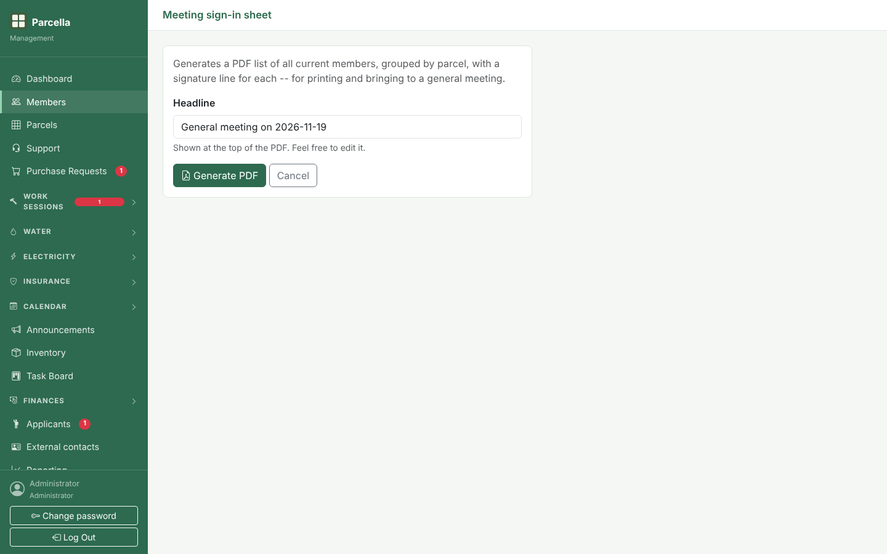

# Członkowie {#members}

!!! warning "Jeszcze niezaktualizowane"
    Ta strona opisuje starszą wersję. Aktualna jest wersja angielska (język zmienisz u góry).

!!! note "Tłumaczenie maszynowe"
    Ta strona została przetłumaczona maszynowo z języka angielskiego i nie została jeszcze sprawdzona. Jeśli coś jest niejasne, obowiązuje wersja angielska (język zmienisz u góry).

Lista członków to serce Parcelli: wszyscy, którzy należą do Twojego
stowarzyszenia, z adresem, danymi bankowymi, danymi kontaktowymi i
działkami, które mają. Faktury, prace społeczne, korespondencja, lista
urodzin i lista obecności na zebraniu korzystają z tych danych.

!!! info "Kto może z tego korzystać"
    Członkowie należą do rdzenia i są zawsze włączeni. Nie można ich
    wyłączyć.

    - **Każdy, kto może się zalogować**, może oglądać listę członków,
      strony członków, listę tagów, eksport CSV i listę obecności.
    - **Dodawanie i edycja** członków, numerów telefonów, adresów
      e-mail, tagów i przypisań działek wymaga prawa *zapisu* w
      **Członkowie i działki**.
    - **Usunięcie** członka, numeru telefonu, adresu e-mail lub tagu
      wymaga prawa *usuwania* w **Członkowie i działki**.

    Członkowie zarządu i administratorzy mają wszystkie te prawa. Każdy
    inny dostaje zapis lub usuwanie przez grupę (zob.
    [Role, grupy i uprawnienia](../getting-started/roles-and-permissions.md)).

## Lista członków {#member-list}

Otwórz **Członkowie** w menu głównym. Lista pokazuje aktywnych członków,
posortowanych według nazwiska, a potem imienia. Stopka pokazuje, ilu
członków jest obecnie na liście.

### Przyciski na górze {#buttons-at-the-top}

| Przycisk | Do czego służy |
|---|---|
| **Import CSV** | Otwiera okno importu pliku CSV (zob. [Import członków z pliku CSV](#importing-members-from-a-csv-file)). Wymaga prawa zapisu. |
| **Eksport CSV** | Pobiera członków *obecnie widocznych* jako plik CSV. Wyszukiwanie, pola wyboru i filtr tagów działają tak samo (zob. [Eksport CSV](#csv-export)). |
| **Napisz do tych członków (*N*)** | Rozpoczyna nowe ogłoszenie do dokładnie tych członków z przefiltrowanej listy. Widoczny tylko po wyszukaniu lub przefiltrowaniu, gdy moduł **Ogłoszenia** jest włączony, i tylko dla członków zarządu i administratorów. Aby napisać do wszystkich, rozpocznij ogłoszenie w [Ogłoszeniach](announcements.md). |
| **Zarządzaj tagami** | Otwiera stronę [Tagi członków](#member-tags). |
| **Lista obecności** | Otwiera [Listę obecności na zebraniu](#meeting-sign-in-sheet). |
| **Nowy członek** | Otwiera pusty [formularz członka](#new-member-and-edit-member). Wymaga prawa zapisu. |

### Wyszukiwanie i filtry {#search-and-filters}

| Pole / przycisk | Do czego służy |
|---|---|
| Pole wyszukiwania | Znajduje członków po imieniu lub nazwisku, ulicy, kodzie pocztowym, miejscowości, IBAN, notatkach, adresie e-mail, numerze telefonu i numerze działki. Numer działki znajduje tylko *obecnych* dzierżawców działki -- chyba że zaznaczono **Pokaż tylko nieaktywnych**, wtedy znajduje też byłych dzierżawców. Ponieważ przeszukiwane są też notatki, numer zgłoszenia zapisany przy członku znajduje tego członka. |
| **Pokaż tylko nieaktywnych** | Pokazuje *tylko* członków, którzy nie są aktywni: ich data **Członek do** minęła albo data **Członek od** jest jeszcze w przyszłości. Użyj tego, aby znaleźć byłych lub zmarłych członków. |
| **Tylko potwierdzeni aktywni** | Pokazuje tylko aktywnych członków, którzy mają datę **Członek od**. Członkowie bez daty początkowej (pokazywani jako *oczekujący*) są pomijani. |
| **Tylko ze zgodą na e-mail = tak** | Pokazuje tylko członków, którzy zaznaczyli **Może otrzymywać informacje e-mailem**. |
| Lista tagów (**Wszystkie tagi**) | Pokazuje tylko członków z wybranym tagiem. Lista pojawia się, gdy istnieje co najmniej jeden tag. Filtrować można po jednym tagu naraz. |
| **Szukaj** | Stosuje tekst wyszukiwania. Pola wyboru i lista tagów działają, gdy tylko je zmienisz. |
| **Wyczyść** | Czyści wszystkie filtry. Widoczny tylko, gdy filtr jest aktywny. |

Gdy zaznaczono **Pokaż tylko nieaktywnych**, ma to pierwszeństwo przed
**Tylko potwierdzeni aktywni**. Niebieska notka nad tabelą przypomina,
który z tych dwóch filtrów jest włączony.

Twój filtr zostaje z Tobą: jeśli otworzysz członka z przefiltrowanej
listy, przyciski **Poprzedni** i **Następny** na stronie członka
przechodzą przez tę samą przefiltrowaną listę, a **Wstecz** do niej
wraca.

### Kolumny {#columns}

| Kolumna | Co pokazuje |
|---|---|
| Pole wyboru | Wybiera członka do **Eksportuj zaznaczonych** lub **Napisz do zaznaczonych** (zob. niżej). |
| **Imię i nazwisko** | Nazwisko, imię -- kliknij, aby otworzyć członka. Tagi członka pojawiają się jako małe szare etykiety obok nazwiska; kliknij etykietę, aby przefiltrować listę po tym tagu. |
| **Członek od** | Początek członkostwa albo „–”, jeśli nie zapisano. |
| **Działki** | Numery działek przypisanych członkowi. <!-- TODO(verify): the list shows every parcel assignment of the member, including tenancies that have already ended -- confirm whether former parcels are meant to appear here. --> |
| **Status** | **aktywny**, **nieaktywny** lub **oczekujący** (zob. niżej). |
| Przycisk oka | Otwiera stronę członka, tak samo jak kliknięcie nazwiska. |

Oznaczenie statusu oznacza:

- **aktywny** -- członkostwo się zaczęło i nie skończyło.
- **oczekujący** -- nie zapisano jeszcze daty **Członek od**. Członek
  oczekujący wszędzie indziej liczy się jako aktywny (faktury, lista
  obecności, liczby na panelu); oznaczenie mówi tylko, że data
  początkowa nie została potwierdzona.
- **nieaktywny** -- członkostwo się skończyło albo jeszcze się nie
  zaczęło. Jeśli jest data **Członek do**, oznaczenie pokazuje „od” tej
  daty.

### Ręczny wybór członków {#picking-members-by-hand}

Każdy wiersz ma pole wyboru, więc możesz wybrać kilku członków z listy
-- np. przefiltrować wszystkich, którzy zgadzają się na informacje
e-mailem, a potem zaznaczyć 12 z nich.

| Przycisk | Do czego służy |
|---|---|
| **Zaznacz wszystkich** | Zaznacza każdego członka na bieżącej liście. |
| **Odznacz wszystkich** | Czyści wszystkie zaznaczenia. |
| **Zaznaczono: *N*** | Liczy zaznaczonych członków. |
| **Eksportuj zaznaczonych** | Pobiera plik CSV tylko z zaznaczonymi członkami. Nieaktywny, dopóki nikogo nie zaznaczysz. |
| **Napisz do zaznaczonych** | Rozpoczyna nowe ogłoszenie tylko do zaznaczonych członków. Widoczny tylko, gdy moduł **Ogłoszenia** jest włączony, i tylko dla członków zarządu i administratorów. |

!!! warning "Zaznaczenia giną przy zmianie filtra"
    Zmiana wyszukiwania, pola wyboru lub listy tagów przeładowuje stronę
    i Twoje zaznaczenia znikają. Najpierw ustaw filtr, potem zaznaczaj.

Gdy przejdziesz za linkiem do listy członków z ogłoszenia wysłanego do
wybranych członków, lista pokazuje tylko tych członków z notką
„Wyświetlani są tylko zaznaczeni członkowie (*N*).” Kliknij **Pokaż
całą listę**, aby wrócić do zwykłej listy. Naraz możesz wybrać do 2000
członków.

### Eksport CSV {#csv-export}

**Eksport CSV** pobiera plik `members.csv`, rozdzielany średnikami, z
jednym wierszem na członka z bieżącej listy. Nagłówki kolumn są po
niemiecku, aby plik można było zaimportować z powrotem bez zmian:

Vorname, Nachname, Strasse, PLZ, Ort, Geburtsdatum, IBAN, Member seit,
Member bis, E-Mail-Benachrichtigungen, E-Mail-Adressen, Telefonnummern,
Parzellen, Notizen, Tags.

- Daty są zapisywane jako rok-miesiąc-dzień (2024-03-01).
- Informacja e-mail jest zapisywana jako „Ja” lub „Nein”.
- Kilka adresów e-mail, numerów telefonów, działek lub tagów dzieli
  jedną komórkę, rozdzielone średnikami.
- Tagi są eksportowane z nazwą, którą wpisano, a nie z tłumaczeniem.
- To, czy członek nie chce prezentów urodzinowych, nie jest eksportowane.

!!! tip
    Eksport zawsze odpowiada temu, co jest na ekranie. Aby wyeksportować
    wszystkich aktywnych członków, najpierw kliknij **Wyczyść**. Aby
    wyeksportować byłych członków, najpierw zaznacz **Pokaż tylko
    nieaktywnych**.

## Import członków z pliku CSV {#importing-members-from-a-csv-file}

Użyj importu, aby przenieść do Parcelli istniejącą listę członków -- z
arkusza kalkulacyjnego lub starszego programu. Działa w dwóch krokach:
przesyłasz plik, a potem mówisz Parcelli, która kolumna zawiera co.
Przed potwierdzeniem drugiego kroku nic nie zostaje zapisane.

Przewodnik po pierwszym imporcie zawiera instrukcja
[Import członków i działek](../guides/csv-import.md).

### Krok 1: przesłanie pliku {#step-1-upload-the-file}

Kliknij **Import CSV** na liście członków. Otwiera się okno **Import
CSV**.

| Pole / przycisk | Do czego służy |
|---|---|
| Pole pliku | Wybierz plik `.csv`. |
| **Importuj** | Przesyła plik i otwiera mapowanie kolumn. Jeszcze nic nie jest zapisywane. |

Okno wymienia kolumny, które rozumie Parcella. Nie musisz używać tych
nagłówków -- kolumny przypiszesz w następnym kroku. Kilka rzeczy o
pliku:

- Kolumny mogą być rozdzielane średnikami lub przecinkami. Parcella to
  rozpoznaje; jeśli nie potrafi, przyjmuje średniki.
- Pierwszy wiersz musi być wierszem nagłówka.
- Daty można zapisywać jako 2024-03-01, 01.03.2024 lub 01.03.24.
- Kilka adresów e-mail lub numerów telefonów w jednej komórce oddziela
  się średnikami.
- Najłatwiejszym wzorem jest **Eksport CSV** z samej Parcelli -- link w
  oknie pobiera pełny, niefiltrowany eksport.

Jeśli plik jest pusty, wracasz na listę z komunikatem „Ten plik CSV
wydaje się być pusty.”

### Krok 2: mapowanie kolumn {#step-2-map-the-columns}

<!-- TODO(verify): no screenshot -- this page is only reached by uploading a file, which the screenshot tool can't do. -->

Strona **Mapowanie kolumn CSV** pokazuje każdą kolumnę pliku z
nagłówkiem i pierwszymi pięcioma wierszami danych pod spodem, abyś
widział, co w niej jest. Nad każdą kolumną jest lista rozwijana.

| Pole / przycisk | Do czego służy |
|---|---|
| Lista rozwijana dla kolumny | Wybierz pole Parcelli, do którego należy ta kolumna: **Imię**, **Nazwisko**, **Ulica**, **Kod pocztowy**, **Miejscowość**, **Data urodzenia**, **IBAN**, **Członek od**, **Członek do**, **Powiadomienia e-mail**, **Adresy e-mail**, **Numery telefonów**, **Notatki** -- albo **— Ignoruj —**, aby pominąć kolumnę. Parcella wybiera pole wstępnie, gdy rozpozna nagłówek (po angielsku lub niemiecku, np. „Nachname” lub „Last name”). |
| **Importuj** | Importuje wiersze i wraca na listę członków. **Imię** i **Nazwisko** muszą być przypisane do kolumny, inaczej dostajesz „Przed importem przypisz kolumny imienia i nazwiska.” |
| **Wstecz** | Wraca na listę członków, niczego nie importując. |

### Co dzieje się przy imporcie {#what-happens-on-import}

Dla każdego wiersza Parcella szuka istniejącego członka o tym samym
imieniu i nazwisku. Jeśli przypisałeś kolumnę **Data urodzenia**, a
wiersz ma datę urodzenia, ona też musi się zgadzać.

- **Brak dopasowania**: tworzony jest nowy członek, łącznie z adresami
  e-mail i numerami telefonów z wiersza.
- **Dopasowanie**: istniejący członek jest aktualizowany, ale tylko o
  to, co wiersz faktycznie zawiera (zob. niżej). Adresy e-mail i numery
  telefonów **nie** są ruszane przy aktualizacji -- dodawaj je lub usuwaj
  na stronie członka.
- **Kilku członków o tym imieniu i nazwisku**: Parcella używa daty
  urodzenia, adresów e-mail i numerów telefonów z wiersza, aby znaleźć
  właściwego. Aktualizowany jest członek, który ma jeden z nich;
  wielkość liter, spacje i myślniki nie mają znaczenia („0171 234-5678”
  to to samo co „01712345678”). Jeśli wiersz nadal pasuje do więcej niż
  jednego członka, jest pomijany z komunikatem „Wiersz 4: kilku członków
  nazywa się Hans Meier, pominięto. ...” i nikt nie jest zmieniany. Sam
  adres e-mail lub numer telefonu nigdy nie dopasowuje członka o innym
  nazwisku, bo pary często dzielą jeden.
- **Puste imię lub nazwisko**: wiersz jest pomijany.

**Aktualizacja zmienia tylko to, co mówi plik.** Kolumna ustawiona na
**— Ignoruj —** albo pusta komórka pozostawia zapisaną wartość członka
bez zmian. Plik z samymi nazwiskami i nowymi adresami aktualizuje więc
adresy i nic więcej.

Kolumna **Powiadomienia e-mail** liczy się jako „nie”, gdy zawiera
*nein*, *no*, *false* lub *0*, i jako „tak” dla wszystkiego innego, co
jest wypełnione. Dla istniejącego członka pusta komórka lub brak takiej
kolumny pozostawia jego wybór bez zmian -- kto zrezygnował, pozostaje
przy rezygnacji. Nowy członek bez wartości dostaje „tak”.

Potem lista członków pokazuje podsumowanie, np. „12 nowo
zaimportowanych, 3 zaktualizowanych”. Jeśli pominięto wiersze,
podsumowanie dodaje liczbę błędów i szczegóły pierwszych trzech.

!!! tip "Członkowie o tym samym imieniu i nazwisku"
    Jeśli Twoje stowarzyszenie ma członków o identycznych imionach i
    nazwiskach, przypisz kolumnę **Data urodzenia**, **Adresy e-mail**
    lub **Numery telefonów**: wtedy każdy wiersz aktualizuje właściwą
    osobę. Bez żadnej z nich takie wiersze są pomijane, a nie zgadywane.

## Strona członka {#member-page}

Kliknij nazwisko na liście członków, aby otworzyć stronę członka.
Pokazuje wszystko, co Parcella wie o członku, i pozwala od razu dodawać
numery telefonów, adresy e-mail, tagi i działki.

### Przyciski na górze {#buttons-at-the-top_1}

| Przycisk | Do czego służy |
|---|---|
| **Edytuj** | Otwiera [formularz edycji](#new-member-and-edit-member). Wymaga prawa zapisu. |
| **Poprzedni** / **Następny** | Przechodzi do poprzedniego lub następnego członka *na liście, z której przyszedłeś*, z tym samym filtrem. Możesz też nacisnąć ++ctrl+left++ i ++ctrl+right++ (nie podczas pisania w polu). Na Macu system może używać tych klawiszy do przełączania biurek. |
| **Wstecz** | Wraca na listę członków, z Twoim filtrem. |

### Dane podstawowe {#master-data}

Pokazuje **Imię i nazwisko**, **Data urodzenia**, **Adres**, **IBAN**,
**Członek od**, **Członek do**, **Zgoda na e-mail** (czy członek może
otrzymywać informacje e-mailem) i **Nie chce prezentów urodzinowych**.
Aby zmienić którekolwiek z nich, kliknij **Edytuj**.

### Tagi {#tags}

Pokazuje tagi członka. Kliknij tag, aby zobaczyć wszystkich członków z
tym tagiem.

| Pole / przycisk | Do czego służy |
|---|---|
| **×** obok tagu | Usuwa tag z tego członka (**Usuń tag**). Sam tag zostaje dla innych członków. Wymaga prawa zapisu. |
| **Dodaj tag, np. odpowiedzialny za wodę** | Wpisz nazwę tagu i kliknij **+** (**Dodaj tag**). Jeśli tag o tej nazwie już istnieje -- wielkie litery i dodatkowe spacje nie mają znaczenia -- jest używany ponownie; w przeciwnym razie tworzony jest nowy tag. Pole podpowiada istniejące tagi podczas pisania. Wymaga prawa zapisu. |
| **Zarządzaj tagami** | Otwiera stronę [Tagi członków](#member-tags). |

Usunięcie tagu z członka nie zostawia wpisu w historii: tagi to
etykiety do znajdowania osób, a nie dokumentacja stowarzyszenia.

### Numery telefonów i adresy e-mail {#phone-numbers-and-email-addresses}

| Pole / przycisk | Do czego służy |
|---|---|
| Pole numeru telefonu + **+** | Dodaje kolejny numer telefonu. Wymaga prawa zapisu. |
| Pole e-mail + **+** | Dodaje kolejny adres e-mail. Musi wyglądać jak adres e-mail. Wymaga prawa zapisu. |
| Przycisk kosza | Usuwa ten numer telefonu lub adres e-mail (**Usuń**). Wymaga prawa usuwania. |

Kliknij adres e-mail, aby napisać do członka z własnego programu
pocztowego.

### Przypisane działki {#assigned-parcels}

Pokazuje działki przypisane członkowi.

| Kolumna | Co pokazuje |
|---|---|
| **Numer działki** | Kliknij (lub przycisk strzałki), aby otworzyć działkę. |
| **Powierzchnia** | Powierzchnia działki w metrach kwadratowych. |
| **Status** | Status działki: **aktywna**, **wypowiedziana** lub **usunięta**. |
| **Adres do faktury** | Czy adres tego członka jest używany do faktur działki. |
| **Od** | Początek dzierżawy. |

<!-- TODO(verify): this table lists every assignment of the member, including ended tenancies, and has no "until" column -- confirm whether former parcels are meant to appear here. Also, a communal parcel would show as "deleted" here because the badge only knows active/terminated. -->

Aby dać członkowi działkę (wymaga prawa zapisu):

| Pole / przycisk | Do czego służy |
|---|---|
| **Wybierz działkę…** | Działka do przypisania. Proponowana jest każda działka, posortowana według numeru działki. |
| **Użyj jako adresu do faktury** | Domyślnie zaznaczone. Faktury za tę działkę trafiają na adres tego członka. |
| **Przypisz** | Przypisuje działkę i otwiera stronę działki. |

Dzierżawa zaczyna się bez daty. Aby ustawić datę początkową lub
zakończyć dzierżawę, użyj strony działki -- zob.
[Obecni dzierżawcy](parcels.md#current-tenants).

### Procesy {#processes}

Jeśli moduł [Procesy](processes.md) jest włączony i możesz widzieć
procesy, karta **Procesy** pokazuje procesy dotyczące tego członka.
**Rozpocznij proces** uruchamia dla niego nowy.

### Notatki {#notes}

Wewnętrzne notatki członka, jeśli są. Edytujesz je w formularzu członka.

### Strefa niebezpieczna {#danger-zone}

Widoczna tylko dla użytkowników z prawem usuwania.

**Usuń członka** po potwierdzeniu oznacza członka jako usuniętego.
Członek znika ze wszystkich list i wyszukiwań. Jego dane zostają w bazie
danych, a istniejące przypisania działek, terminy prac i inne rekordy
pozostają bez zmian.

!!! warning "Zakończenie członkostwa to nie usunięcie"
    Dla członka, który opuszcza stowarzyszenie -- lub zmarł -- ustaw
    zamiast tego **Członek do** w formularzu edycji i zakończ jego
    dzierżawy na stronie działki. Przechodzi wtedy do **Pokaż tylko
    nieaktywnych**, a jego historia pozostaje widoczna. Usuwanie jest
    przeznaczone dla rekordów, które nigdy nie powinny były istnieć, np.
    duplikatu.
    <!-- TODO(verify): there's no way to restore a deleted member in the app; confirm. Also confirm how a deleted member who is still assigned to a parcel shows up on the parcel page. -->

## Nowy członek i edycja członka {#new-member-and-edit-member}

Kliknij **Nowy członek** na liście członków albo **Edytuj** na stronie
członka. Oba formularze wyglądają tak samo; formularz nowego członka
dodatkowo pyta o pierwszy adres e-mail i numer telefonu. Pola oznaczone
czerwoną gwiazdką są wymagane.

### Dane osobowe {#personal-data}

| Pole | Do czego służy |
|---|---|
| **Imię** \* | Wymagane. |
| **Nazwisko** \* | Wymagane. |
| **Data urodzenia** | Używana na liście urodzin i do średniego wieku na panelu. Pomaga też importowi CSV rozróżnić członków o tym samym imieniu i nazwisku. |
| **IBAN** | Rachunek bankowy członka, np. do poleceń zapłaty. |

### Adres {#address}

| Pole | Do czego służy |
|---|---|
| **Ulica i numer domu** | |
| **Kod pocztowy** | Do 10 znaków. |
| **Miejscowość** | |

Adres jest używany do listów i faktur. Jeśli członek jest adresem do
faktury działki, faktury za tę działkę trafiają tutaj.

### Członkostwo {#membership}

| Pole | Do czego służy |
|---|---|
| **Członek od** | Pierwszy dzień członkostwa. Jeśli jest puste, członek jest pokazywany jako *oczekujący*, ale nadal liczy się jako aktywny. Jeśli leży w przyszłości, członek liczy się jako nieaktywny do tego dnia. |
| **Członek do** | Ostatni dzień członkostwa. „Pozostaw puste = aktywny członek”. Od następnego dnia członek liczy się jako nieaktywny. |
| **Adres e-mail** | Tylko dla nowych członków. Opcjonalny -- kolejne adresy można dodać później na stronie członka. |
| **Numer telefonu** | Tylko dla nowych członków. Opcjonalny -- kolejne numery można dodać później na stronie członka. |
| **Może otrzymywać informacje e-mailem** | Domyślnie zaznaczone dla nowych członków. Odznacz, jeśli członek nie chce informacji stowarzyszenia e-mailem. Lista członków może po tym filtrować. |
| **Nie chce prezentów urodzinowych** | Zaznacz, jeśli członek nie chce prezentów urodzinowych. Pokazuje się to na liście urodzin, aby osoba zajmująca się prezentami o tym wiedziała. |

### Notatki {#notes_1}

| Pole | Do czego służy |
|---|---|
| **Notatki wewnętrzne…** | Dowolny tekst dla zarządu. Notatki są przeszukiwane przez wyszukiwanie na liście członków. |

### Tagi {#tags_1}

| Pole | Do czego służy |
|---|---|
| Pola wyboru tagów | Jedno pole wyboru na istniejący tag. Zaznacz lub odznacz, aby go dodać lub usunąć. Widoczne tylko, gdy istnieją tagi. |
| **Nowe tagi, oddzielone przecinkami** | Wpisz nowe tagi, rozdzielone przecinkami, np. „odpowiedzialny za wodę, zespół żywopłotu”. Istniejąca nazwa jest używana ponownie. |

### Zapisywanie {#saving}

| Przycisk | Do czego służy |
|---|---|
| **Utwórz członka** / **Zapisz zmiany** | Zapisuje członka i otwiera stronę członka. |
| **Anuluj** | Wychodzi bez zapisywania. |

Jeśli nowa nazwa tagu nie zostanie przyjęta (np. jest dłuższa niż 100
znaków), reszta członka i tak zostaje zapisana, a formularz edycji
otwiera się ponownie, abyś mógł poprawić tag.
<!-- TODO(verify): in that case the form reopens without an error message. -->

## Tagi członków {#member-tags}

Tagi to dowolne etykiety do ponownego znajdowania członków --
„odpowiedzialny za wodę”, „rozszerzony zarząd”, „zespół żywopłotu”.
Dodajesz je na stronie członka lub w formularzu członka; zmieniasz nazwę
lub usuwasz tutaj. Otwórz stronę przyciskiem **Zarządzaj tagami** na
liście członków lub na stronie członka.

Każdy tag ma jeden wiersz:

| Pole / przycisk | Do czego służy |
|---|---|
| Nazwa tagu + przycisk haczyka | Zmień nazwę i kliknij przycisk haczyka (**Zmień nazwę**). Nowa nazwa pojawia się u każdego członka z tym tagiem. Odrzucane, jeśli inny tag ma już tę nazwę. Wymaga prawa zapisu; bez niego widzisz tylko nazwę. |
| **Członkowie: *N*** | Otwiera listę członków przefiltrowaną po tym tagu. |
| Przycisk kosza | **Usuń tag** po potwierdzeniu. Tag jest usuwany u każdego członka. Wymaga prawa usuwania. |
| Przycisk tłumaczenia | Otwiera **Tłumaczenia** tagu: jedna nazwa na każdy język obsługiwany przez Parcellę. Gdy stowarzyszenie działa w danym języku, listy, formularze i filtry pokazują nazwę tagu w tym języku; puste pole pokazuje nazwę, którą wpisano. Kliknij **Zapisz tłumaczenia**, aby je zapisać. Wymaga prawa zapisu; bez niego widzisz tłumaczenia jako listę. Mała liczba na przycisku mówi, ile tłumaczeń istnieje. |
| **Powrót do członków** | Wraca na listę członków. |

Eksport CSV zawsze używa nazwy, którą wpisano, a nie tłumaczenia.

## Lista obecności na zebraniu {#meeting-sign-in-sheet}

Otwierasz ją przyciskiem **Lista obecności** na liście członków. Tworzy
listę PDF do wydrukowania i zabrania na walne zebranie: każdy obecny
dzierżawca, pogrupowany według działki, z linią na podpis dla każdego.

| Pole / przycisk | Do czego służy |
|---|---|
| **Nagłówek** | Pokazywany na górze pliku PDF. Na początku brzmi „General meeting on” plus dzisiejsza data (ten domyślny tekst nie jest jeszcze przetłumaczony); zmień go na dowolny. Jeśli go opróżnisz, użyty zostanie domyślny. |
| **Generuj PDF** | Pobiera listę obecności jako plik PDF. |
| **Anuluj** | Wraca na listę członków. |

Co jest na liście:

- Jeden wiersz na osobę, z kolumnami **Działka**, **Imię i nazwisko** i
  **Podpis**, posortowany według numeru działki, a potem nazwiska.
- Jeśli działkę ma kilka osób, numer działki pojawia się raz, a każda z
  nich dostaje własną linię na podpis.
- Wymienieni są tylko **aktywni członkowie**, którzy są **obecnymi
  dzierżawcami** działki. Członkowie bez działki i dzierżawcy, którzy
  już odeszli, nie są na liście.
- PDF ma logo stowarzyszenia oraz ten sam nagłówek i stopkę co inne
  dokumenty stowarzyszenia. Długa lista po prostu zajmuje kilka stron.

!!! tip
    Członkowie bez działki -- np. członkowie honorowi -- nie są na
    liście. Dopisz ich ręcznie, jeśli mogą uczestniczyć.

## Powiązane {#related}

- [Działki](parcels.md) -- przypisywanie i kończenie dzierżaw
- [Kandydaci](applicants.md) -- zamiana kandydata w członka
- [Przyjęcie nowego członka](../guides/new-member.md)
- [Przekazanie działki](../guides/parcel-handover.md)
- [Import członków i działek](../guides/csv-import.md)
- [Ogłoszenia](announcements.md) -- pisanie do przefiltrowanych lub wybranych członków
