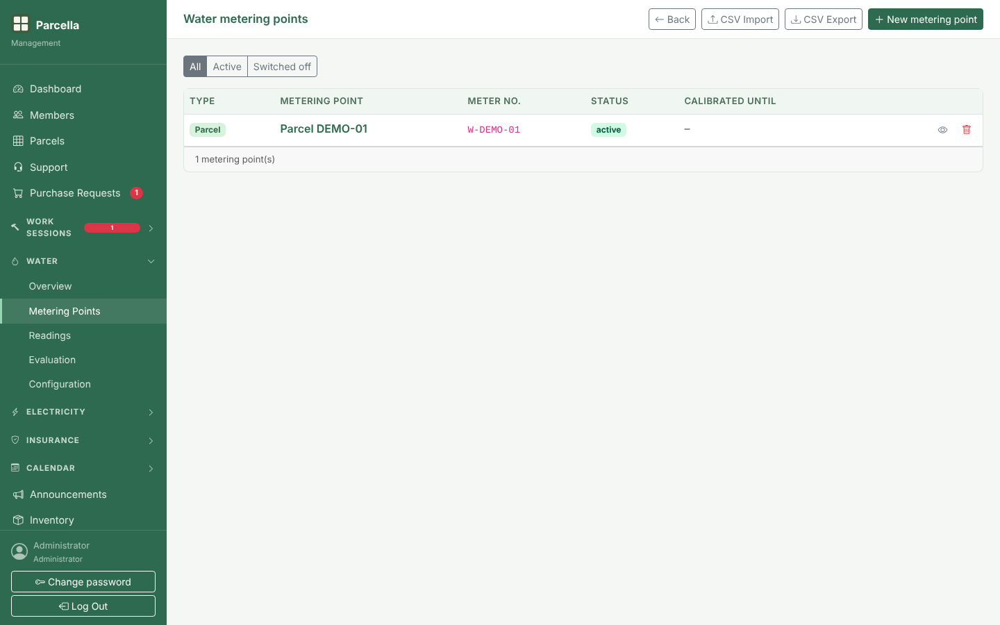

# Wasser und Strom {#water-and-electricity}

Viele Vereine beziehen Wasser und Strom über einen Hauptanschluss und geben
sie über Unterzähler an die Parzellen weiter. Dieses Kapitel behandelt die
Module **Wasser** und **Strom**. Sie verwalten deine Zähler, sammeln die
jährlichen Zählerstände, berechnen den Verbrauch jeder Parzelle und zeigen,
ob die Zähler der Parzellen zusammen das ergeben, was der Hauptzähler sagt.
Den Jahrespreis je Einheit, den du hier einträgst, nutzen die Rechnungen
für den Verbrauch.

Die beiden Module funktionieren genau gleich. Nur das hier unterscheidet
sich:

| | Wasser | Strom |
|---|---|---|
| Menü | **Wasser** | **Strom** |
| Einheit | m³ | kWh |
| Zählerstände werden eingetragen mit | einer Nachkommastelle (z. B. 145,0) | ganzen Zahlen (z. B. 950) |
| Modulschalter | **Wasserverwaltung** | **Stromverwaltung** |
| Gruppenrecht | **Wasser** | **Strom** |

Wasser- und Stromdaten sind völlig getrennt: Eine Parzelle kann einen
Wasser- und einen Stromzählpunkt haben, und jeder hat seine eigenen Zähler,
Zählerstände, Preise und Rechte. Die Bildschirmfotos unten zeigen das
Wassermodul. Im Strommodul steht alles an derselben Stelle, mit kWh statt
m³.

!!! info "Wer das nutzen kann"
    Beide Module sind standardmäßig eingeschaltet. Schalte das aus, das dein
    Verein nicht verwaltet, unter **Administration → Einstellungen**
    (**Wasserverwaltung**, **Stromverwaltung**) -- siehe
    [Module ein- und ausschalten](../administration/modules.md). Die Daten
    bleiben und sind wieder da, wenn du das Modul wieder einschaltest.

    Admin- und Vorstandsbenutzer können alles. Andere Benutzer brauchen eine
    [Gruppe](../administration/groups.md) mit Rechten für **Wasser** oder
    **Strom**: *Lesen*, um die Seiten zu sehen und CSV-Dateien
    herunterzuladen, *Schreiben*, um Zählpunkte anzulegen, Zählerstände zu
    erfassen, Zähler zu tauschen, zu importieren und Preise festzulegen,
    *Löschen*, um Zählpunkte, Zählerstände und Preise zu löschen.

Im Seitenmenü hat jedes Modul die Einträge **Übersicht**, **Zählpunkte**,
**Ablesung**, **Auswertung** und **Konfiguration**.

## Zählpunkte und Zähler {#metering-points-and-meters}

Zwei Begriffe kommen überall vor:

- Ein **Zählpunkt** ist eine Stelle, an der Verbrauch gemessen wird. Es gibt
  drei Typen:
    - **Hauptzähler** -- die Übergabestelle des Versorgers, an der der
      Verein Wasser oder Strom bekommt,
    - **Parzelle** -- der Anschluss einer Parzelle,
    - **Verein** -- ein vereinseigener Anschluss, etwa das Vereinsheim oder
      ein Waschplatz.
- Ein **Zähler** ist das Gerät an einem Zählpunkt, mit eigener Nummer. Wird
  ein Zähler ersetzt, bleibt der Zählpunkt und bekommt einen neuen Zähler;
  der alte bleibt im Verlauf.

## Wie Zählerstände und Verbrauch funktionieren {#how-readings-and-consumption-work}

Diese Regeln gelten überall, wo Zählerstände eingetragen werden -- auf der
Ablesungsseite, auf der Seite eines Zählpunkts und beim CSV-Import.

- **Ein Zählerstand je Zähler und Jahr.** Jeder Zählerstand gehört zu einem
  Jahr (dem Abrechnungsjahr) und hat ein Datum. Erfasst du einen Stand für
  ein Jahr, das schon einen hat, werden der alte Wert, das Datum und die
  Notiz **ersetzt**. So korrigierst du auch einen Fehler.
- **Verbrauch** eines Jahres = Zählerstand dieses Jahres minus letzter
  Zählerstand eines früheren Jahres. Gibt es keinen früheren Stand, wird der
  **Anfangsstand** des Zählers genommen. Ohne Zählerstand für das Jahr gibt
  es keinen Verbrauch („keine Ablesung“ oder „–“).
- **Das Jahr wird nicht aus dem Datum genommen.** Ein im Januar abgelesener
  Stand kann noch zum Ablesezyklus des Vorjahres gehören. Das Jahr wählst
  du immer selbst.

### Plausibilitätswarnungen {#plausibility-warnings}

Ein Zähler zählt normalerweise nur aufwärts. Parcella warnt dich -- **speichert
den Zählerstand aber trotzdem** --, wenn:

- der Stand **kleiner als der vorherige Stand** desselben Zählers ist (das
  letzte frühere Jahr oder der Anfangsstand), oder
- der Stand **größer als ein schon erfasster späterer Stand** desselben
  Zählers ist.

Direkt nach dem Speichern siehst du ein gelbes Banner, zum Beispiel
**Zählerstand gespeichert, bitte aber prüfen: Der Zählerstand (110.0) ist
kleiner als der vorherige Stand (120.5) …**. Die Warnung bleibt neben dem
Zählerstand auf der Seite des Zählpunkts und auf der Ablesungsseite
sichtbar, bis die Werte zusammenpassen.

!!! tip "Warum nur gewarnt wird"
    Wurde der Stand des Vorjahres zu hoch geschätzt, ist der echte Stand
    dieses Jahres niedriger. Ihn zu sperren, würde es unmöglich machen, den
    echten Wert einzutragen. Erfass den echten Stand und korrigier dann den
    geschätzten.

Eine zweite Prüfung vergleicht Summen: Haben Parzellen und
Vereinsanschlüsse in einem Jahr zusammen **mehr** verbraucht als der
Hauptzähler, sagt ein rotes Banner auf der Übersicht und in der Auswertung
das. Das ist ein Hinweis, kein Fehler: Solange noch abgelesen wird, sind die
Zahlen oft unvollständig.

### Zählertausch {#meter-exchange}

Wird ein Zähler ersetzt -- zum Beispiel weil seine Eichung abgelaufen ist
--, nimm **Zähler tauschen** auf der
[Seite des Zählpunkts](#metering-point-page). Der alte Zähler wird nicht
gelöscht: Er wird als ausgebaut markiert und unter **Frühere Zähler** mit
seinem letzten Stand gelistet. Der neue Zähler beginnt mit seinem eigenen
**Anfangsstand**, sodass alte und neue Zählerstände nie vermischt werden.

**Endstand des alten Zählers.** Trag ein, was der alte Zähler am Ausbautag
zeigt. Er wird als Stand des alten Zählers für dieses Jahr gespeichert, und
der Jahresverbrauch des Zählpunkts zählt dann beide Zähler zusammen: den
alten bis zu seinem Endstand, den neuen ab seinem Anfangsstand. Rechnung und
**Auswertung** nutzen diese Summe; die Auswertung markiert so einen Zählpunkt
mit „inkl. getauschtem Zähler“. Ohne Endstand zählt für dieses Jahr nur der
neue Zähler.

**Tauschen** ist für einen echten Wechsel. Hast du dich nur bei der
Zählernummer oder einem Datum vertippt, nimm stattdessen **Zähler
bearbeiten** -- das korrigiert den aktuellen Zähler, ohne einen neuen
anzulegen.

### Faktor {#factor}

Manche Zähler zeigen nur einen Teil dessen, was wirklich durch sie
hindurchfließt. Ein großer Stromzähler hinter Stromwandlern zählt vielleicht
1/20 der Energie; seine Anzeige muss also mit 20 multipliziert werden. Für
so einen Zählpunkt setzt du den **Faktor** (meist 1):

- Zählerstände werden weiter genau so eingetragen, wie die Anzeige sie
  zeigt; die Plausibilitätsprüfung arbeitet mit diesen Werten.
- Der Verbrauch in diesem Modul wird mit dem Faktor multipliziert (auf zwei
  Nachkommastellen gerundet, wenn der Faktor nicht 1 ist). Der Faktor gehört
  zum Zählpunkt, übersteht also einen Zählertausch, und eine Änderung gilt
  für alle Jahre.
- Zählpunkte mit einem Faktor ungleich 1 zeigen ein Badge wie **×20**.

!!! warning "Der Faktor wird auf Rechnungen nicht verwendet"
    Rechnungen berechnen die reine Differenz der Zählerstände, ohne Faktor.

### Einen Zählpunkt abschalten {#switching-a-metering-point-off}

Hat ein Anschluss eine Zeit lang keine Versorgung -- Wasser abgedreht, Strom
einer Parzelle abgeklemmt --, **schalte ihn ab**, statt ihn zu löschen. Ein
abgeschalteter Zählpunkt:

- erscheint nicht mehr auf der Ablesungsseite, im CSV-Export der
  Zählerstände oder bei „haben noch keine Ablesung“ -- **außer er hat schon
  einen Zählerstand für dieses Jahr**, damit ein Endstand sichtbar und
  bearbeitbar bleibt,
- ist in der Liste grau mit einem Badge **Abgeschaltet**,
- behält alle seine Zähler und Zählerstände.

Für die Abrechnung ist nichts Besonderes nötig: Ohne Zählerstand für das
Jahr gibt es keinen Verbrauch, also wird nichts berechnet. Wieder
einschalten holt ihn zurück.

## Übersicht {#overview}

Die Startseite des Moduls, mit dem Titel **Wasser** (oder **Strom**) und dem
Jahr. Hier siehst du, ob alle Zählerstände eines Jahres da sind und ob die
Zahlen aufgehen.

| Feld / Schaltfläche | Was es bewirkt |
|---|---|
| Jahresauswahl | Wechselt das Jahr. Listet jedes Jahr mit Zählerständen und das aktuelle Jahr. |
| **Ablesung erfassen** | Öffnet die [Ablesungsseite](#readings) für dieses Jahr. |
| Rotes Banner | Parzellen und Vereinsanschlüsse haben in diesem Jahr zusammen mehr verbraucht als der Hauptzähler. |
| Blaues Banner | **… Zählpunkt(e) haben für … noch keine Ablesung.**, mit **Jetzt erfassen →**. Zählt aktive Zählpunkte mit Zähler und ohne Zählerstand für das Jahr. |
| Kachel **Hauptzähler** | Verbrauch des oder der Hauptzähler und wie viele es sind. **Anzeigen** listet sie. |
| Kachel **Parzellen** | Gesamtverbrauch aller Parzellen-Zählpunkte und wie viele es sind. **Anzeigen** listet sie. |
| Kachel **Vereinsanschlüsse** | Dasselbe für Vereinsanschlüsse. |
| Kachel **Differenz** | Hauptzähler minus Parzellen und Verein (**Haupt − Verteilung**): das Wasser oder der Strom, der sich nicht zuordnen lässt, z. B. durch Lecks oder zu langsam laufende Zähler. Rot, wenn negativ. |
| Kachel **Fehlende Zählpunkte** | Wie viele Parzellen für dieses Medium keinen Zählpunkt haben. **Anzeigen** listet sie. Gekündigte Parzellen zählen mit -- sie brauchen eine Erfassung, bis der nächste Pächter einzieht. |
| **Alle Zählpunkte** | Öffnet die [Liste](#metering-points). |
| **Neuer Zählpunkt** | Öffnet das [Formular](#new-metering-point). Braucht Schreibrecht. |
| **Jahresauswertung** | Öffnet die [Auswertung](#evaluation) für dieses Jahr. |

## Zählpunkte {#metering-points}

Alle Zählpunkte dieses Mediums: zuerst Hauptzähler, dann Parzellen nach
Parzellennummer, dann Vereinsanschlüsse nach Bezeichnung.

| Feld / Schaltfläche | Was es bewirkt |
|---|---|
| **Zurück** | Führt zur Übersicht zurück. |
| **CSV-Import** | Öffnet einen Dialog zum Hochladen einer CSV-Datei (siehe [Zählpunkte importieren](#importing-metering-points)). Braucht Schreibrecht. |
| **CSV Export** | Lädt alle Zählpunkte herunter (siehe unten). |
| **Neuer Zählpunkt** | Öffnet das [Formular](#new-metering-point). Braucht Schreibrecht. |
| **Alle** / **Aktiv** / **Abgeschaltet** | Zeigt alle, nur aktive oder nur abgeschaltete Zählpunkte. |
| Filter-Banner | Kommst du von einer Kachel der Übersicht, nennt ein graues Banner den Filter (z. B. **Parzelle**). **Filter zurücksetzen** zeigt wieder alles. |

| Spalte | Was sie zeigt / bewirkt |
|---|---|
| **Typ** | **Hauptzähler**, **Parzelle** oder **Verein**. |
| **Zählpunkt** | „Parzelle“ plus Parzellennummer oder die Bezeichnung. Verlinkt auf die [Seite des Zählpunkts](#metering-point-page). |
| **Zähler-Nr.** | Die Nummer des aktuellen Zählers, mit einem Badge **×**, wenn ein Faktor gesetzt ist; **kein aktiver Zähler**, wenn es keinen gibt. |
| **Status** | **aktiv**, **Abgeschaltet** (mit der Maus darüber siehst du, seit wann) oder **ohne Zähler**. |
| **Geeicht bis** | Das Jahr, in dem die Eichung des aktuellen Zählers abläuft. Ein Warndreieck heißt **Eichung abgelaufen** -- das Jahr ist erreicht. |
| Augen-Schaltfläche | Öffnet die Seite des Zählpunkts. |
| Papierkorb | Löscht den Zählpunkt nach der Warnung **Zählpunkt wirklich löschen? Alle zugehörigen Zähler und Zählerstände werden ebenfalls gelöscht.** Braucht Löschrecht. |

Die Zahl der Zählpunkte steht unter der Tabelle.

!!! warning "Löschen entfernt den ganzen Verlauf"
    Ein Zählpunkt wird mit all seinen Zählern und Zählerständen gelöscht;
    auch der vergangene Verbrauch verschwindet. Ist der Anschluss nur außer
    Betrieb, [schalte ihn stattdessen ab](#switching-a-metering-point-off).

### Fehlende Zählpunkte {#missing-metering-points}

Geöffnet mit **Anzeigen** auf der Kachel **Fehlende Zählpunkte**. Statt der
Tabelle listet die Seite jede Parzelle ohne Zählpunkt für dieses Medium --
gekündigte Parzellen sind mit **(gekündigt)** markiert. **Zählpunkt
anlegen** öffnet das [Formular](#new-metering-point) mit dieser Parzelle
schon gewählt (Schreibrecht). Fehlt nichts, steht dort **Jede Parzelle hat
einen Zählpunkt.**

### CSV-Export (Zählpunkte) {#csv-export-metering-points}

Eine Datei mit Semikolons, eine Zeile je Zählpunkt mit seinem aktuellen
Zähler: Type, Parcel number, Label, Meter number, Installed on, Calibrated
until, Initial reading, Active, Inactive since, Factor. Sie hat dasselbe
Format, das der Import erwartet; du kannst also exportieren, in einer
Tabellenkalkulation bearbeiten und neue Zählpunkte wieder importieren.

## Zählpunkte importieren {#importing-metering-points}

Praktisch, um das Modul zum ersten Mal einzurichten. Klick in der
Zählpunktliste auf **CSV-Import**, wähl eine `.csv`-Datei und klick auf
**Importieren**. Die Spalten brauchen keine besonderen Namen -- du ordnest
sie auf der nächsten Seite zu. Semikolons und Kommas werden beide erkannt,
und auch Dateien aus älteren Excel-Versionen (nicht UTF-8) funktionieren.

### CSV-Spalten zuordnen {#map-csv-columns}

Ein Bildschirmfoto dieser Seite gibt es nicht, weil sie erst nach dem
Hochladen einer Datei erscheint.

Die Seite zeigt jede Spalte deiner Datei mit ihren ersten fünf Zeilen. Über
jeder Spalte wählst du, zu welchem Feld sie gehört, oder **— Ignorieren —**.
Parcella errät die Zuordnung aus den Spaltenüberschriften, auf Englisch oder
Deutsch (zum Beispiel wird „Zählernummer“ zu **Zählernummer**).

| Feld | Was es bedeutet |
|---|---|
| **Typ** | `MAIN_METER`, `PARCEL` oder `CLUB`. Ordnest du gar keine Typ-Spalte zu, gilt jede Zeile als Parzelle -- typisch für eine einfache Liste von Parzellenzählern. |
| **Parzellennummer** | Bei Parzellenzeilen: die Nummer einer bestehenden Parzelle. |
| **Bezeichnung** | Der Name eines Hauptzählers oder Vereinsanschlusses. |
| **Zählernummer** | Die Nummer des Zählers. |
| **Eingebaut am** | Datum als 2026-09-18 oder 18.09.2026. |
| **Geeicht bis** | Ein Jahr, zum Beispiel 2032. Ein Datum geht auch; sein Jahr wird genommen. Ein Wert ohne vierstellige Jahreszahl überspringt die Zeile. |
| **Anfangsstand** | Der Stand des Zählers beim Einbau; leer = 0. |
| **Faktor** | Leer = 1. |
| **Importieren** | Legt die Zählpunkte an. Mindestens eine Spalte muss zugeordnet sein. |

Was passiert:

- Es werden nur **neue** Zählpunkte angelegt; bestehende werden nie
  geändert. Eine Parzellenzeile wird übersprungen, wenn die Parzelle schon
  einen Zählpunkt hat, eine Hauptzähler- oder Vereinszeile, wenn es einen
  mit derselben Bezeichnung gibt -- dieselbe Datei zweimal zu importieren,
  schadet also nicht. Zeilen für Hauptzähler oder Vereinsanschlüsse ohne
  Bezeichnung lassen sich nicht prüfen und werden immer angelegt.
- Zeilen werden übersprungen, wenn der Typ ungültig ist, die
  Parzellennummer nicht existiert oder der Faktor ungültig ist.
- Neue Zählpunkte beginnen aktiv.

Danach zeigt die Liste eine Zusammenfassung wie **12 importiert, 2
übersprungen**, mit den Gründen für die ersten drei übersprungenen Zeilen.

## Neuer Zählpunkt {#new-metering-point}

Geöffnet von der Übersicht, aus der Liste oder mit **Zählpunkt anlegen** bei
einer Parzelle ohne Zählpunkt. Braucht Schreibrecht. Die erste Karte
beschreibt den Zählpunkt, die zweite seinen Zähler.

| Feld | Was es bewirkt |
|---|---|
| **Typ** | **Parzelle**, **Vereinseigene Anschlussstelle** oder **Hauptzähler (Übergabe vom Versorger)**. |
| **Parzelle** | Erscheint bei Parzellen-Zählpunkten. Listet aktive und gekündigte Parzellen. |
| **Bezeichnung** | Erscheint bei Vereins- und Hauptzählerpunkten, zum Beispiel „Vereinsheim“. |
| **Notizen** | Alles Wissenswerte, z. B. wo der Zähler ist. |
| **Nummer** | Pflicht. Die Nummer des Zählers. Dieselbe Nummer darf mehrfach vorkommen -- Parcella prüft nicht auf Doppelte. |
| **Geeicht bis (Jahr)** | Das Jahr, in dem die Eichung abläuft, z. B. 2032. |
| **Eingebaut am** | Vorbelegt mit heute. |
| **Anfangsstand** | Der Stand des Zählers beim Einbau; daraus wird der Verbrauch des ersten Jahres berechnet. Vorgabe 0. |
| **Faktor** | Multiplikator von der Anzeige zum echten Verbrauch, meist 1 (siehe [Faktor](#factor)). Muss größer als 0 sein, höchstens 100.000, mit höchstens vier Nachkommastellen. |
| **Abbrechen** / **Zählpunkt anlegen** | Speichern öffnet die Seite des neuen Zählpunkts. |

!!! tip
    **Parzelle** und **Bezeichnung** sind als Pflicht markiert, aber das
    Formular hält dich nicht auf, wenn du sie leer lässt. Füll sie immer
    aus, sonst lassen sich Zählerstände für diesen Zählpunkt beim CSV-Import
    nicht zuordnen, und der Zählpunkt ist in Listen schwer zu finden.

## Seite des Zählpunkts {#metering-point-page}

Alles zu einem Zählpunkt: seine Angaben, sein aktueller Zähler, die
Zählerstände und frühere Zähler.

| Schaltfläche (oben) | Was sie bewirkt |
|---|---|
| **Vorherige** / **Nächste** | Zum vorherigen oder nächsten Zählpunkt in der Reihenfolge der Liste. Auch mit Strg+← und Strg+→. |
| **Zurück** | Führt zur Liste zurück. |

### Zählpunkt {#metering-point}

Zeigt **Typ**, **Status** (**aktiv** oder **Abgeschaltet** mit Datum
**seit**), **Parzelle** (verlinkt), **Faktor**, wenn nicht 1, und
**Notizen**.

Mit Schreibrecht kannst du ändern:

| Feld / Schaltfläche | Was es bewirkt |
|---|---|
| **Bezeichnung** | Freiwillig bei Parzellen-Zählpunkten (z. B. „Ost-Zugang“); der Name von Vereins- und Hauptzählerpunkten. |
| **Notizen** | Freitext. |
| **Faktor** | Siehe [Faktor](#factor). Ändert den Verbrauch für alle Jahre, auch vergangene. Ungültige Werte werden mit einer Erklärung abgelehnt. |
| **Speichern** | Speichert diese drei Felder. |
| **Abschalten ab** + **Abschalten** | Schaltet den Zählpunkt ab dem gewählten Datum ab (Vorgabe heute). Siehe [Einen Zählpunkt abschalten](#switching-a-metering-point-off). |
| **Wieder einschalten** | Erscheint bei abgeschalteten Zählpunkten. |

### Aktueller Zähler {#current-meter}

Zeigt **Nummer**, **Eingebaut am**, **Geeicht bis** (mit einem Badge
**Eichung abgelaufen**, sobald das Jahr erreicht ist) und **Anfangsstand**.
Gibt es keinen: **Kein aktiver Zähler für diesen Zählpunkt.**

Mit Schreibrecht gibt es zwei Schaltflächen:

**Zähler bearbeiten** -- korrigiert den aktuellen Zähler direkt, für
Tippfehler:

| Feld | Was es bewirkt |
|---|---|
| **Nummer** | Pflicht. |
| **Eingebaut am**, **Geeicht bis**, **Anfangsstand** | Ändern die gespeicherten Werte. Eine Änderung des Anfangsstands ändert den Verbrauch im ersten Jahr des Zählers. |
| **Speichern** | Speichert, ohne einen neuen Zähler anzulegen. |

**Zähler tauschen** -- hält einen echten Zählerwechsel fest (siehe
[Zählertausch](#meter-exchange)):

| Feld | Was es bewirkt |
|---|---|
| **Alter Zähler ausgebaut am** | Pflicht, Vorgabe heute. |
| **Endstand des alten Zählers** | Was der alte Zähler am Ausbautag zeigt. Wird als sein Stand für dieses Jahr gespeichert, damit sein Verbrauch bis zum Tausch abgerechnet wird. „Am Ausbautag. Ohne ihn wird der Verbrauch des alten Zählers seit der letzten Ablesung nicht abgerechnet.“ |
| **Neuer Zähler eingebaut am** | Pflicht, Vorgabe heute. |
| **Neue Nummer** | Pflicht. |
| **Geeicht bis** | Das Eichjahr des neuen Zählers. |
| **Anfangsstand** | Der Stand des neuen Zählers beim Einbau, Vorgabe 0. |
| **Tauschen** | Nach der Bestätigung **Zähler wirklich tauschen? Der alte Zähler wird deaktiviert.** wandert der alte Zähler zu **Frühere Zähler**. |

### Zählerstände {#readings}

Die Zählerstände des aktuellen Zählers, das neueste Jahr zuerst.

| Spalte | Was sie zeigt / bewirkt |
|---|---|
| **Jahr** | Das Abrechnungsjahr. |
| **Datum** | Das Ablesedatum. |
| **Stand (m³)** | Der Wert, wie er auf dem Zähler steht, mit einer gelben Plausibilitätswarnung, wenn er nicht passt. |
| **Verbrauch (m³)** | Verbrauch in diesem Jahr, multipliziert mit dem Faktor (als Badge in der Überschrift). |
| **Notiz** | Deine Notiz. |
| Papierkorb | Löscht den Zählerstand nach einer Bestätigung. Braucht Löschrecht. |

**Einen Zählerstand erfassen** (Schreibrecht), unter der Tabelle:

| Feld | Was es bewirkt |
|---|---|
| **Jahr** | Pflicht, Vorgabe das aktuelle Jahr. |
| **Datum** | Pflicht, Vorgabe heute. |
| **Zählerstand (m³)** | Pflicht. Komma und Punkt gehen beide als Dezimaltrenner. |
| **Notiz** | Freiwillig, z. B. „geschätzt“. |
| **Ablesung erfassen** | Speichert den Zählerstand. Hat das Jahr schon einen, wird er ersetzt. Ein Text, der keine Zahl ist, wird mit **Ungültiger Zählerstand** abgelehnt. |

### Frühere Zähler {#former-meters}

Ersetzte Zähler, die zuletzt ausgebauten zuerst, mit **Nummer**,
**Eingebaut**, **Ausgebaut** und **Letzter Stand**.

## Ablesung {#readings_1}

Die Seite zum Sammeln der jährlichen Zählerstände, gebaut fürs Handy, während
du über die Anlage gehst. Du öffnest sie mit **Ablesung** im Menü oder
**Ablesung erfassen** auf der Übersicht. Der Titel zeigt Medium und Jahr,
z. B. **Wasser-Ablesung 2026**.

| Feld / Schaltfläche | Was es bewirkt |
|---|---|
| Jahresauswahl | Das Jahr, für das du erfasst: nächstes Jahr, dieses Jahr oder eines der drei Jahre davor. |
| **CSV-Import** | Zählerstände aus einer Datei hochladen (siehe [Zählerstände importieren](#importing-readings)). Braucht Schreibrecht. |
| **CSV Export** | Lädt die Liste dieses Jahres herunter (siehe unten). |
| **Zurück** | Führt zur Übersicht zurück. |

Die Seite listet jeden Zählpunkt, der in diesem Jahr einen Zählerstand
braucht, in drei Gruppen: **Hauptzähler**, **Parzellen** (nach
Parzellennummer) und **Vereinsanschlüsse**. Abgeschaltete Zählpunkte
erscheinen nur, wenn sie schon einen Stand für das Jahr haben. Jede Zeile
zeigt:

- Namen und Zählernummer des Zählpunkts,
- **Vorjahr**: den letzten Stand vor diesem Jahr oder den Anfangsstand --
  der neue Wert sollte nicht kleiner sein,
- ist schon ein Stand da: den Wert mit **erfasst** und gegebenenfalls eine
  Plausibilitätswarnung,
- sonst, mit Schreibrecht, ein Eingabefeld und eine Häkchen-Schaltfläche.
  Wert eintippen und die Schaltfläche drücken; das Datum wird auf heute
  gesetzt. Ohne Schreibrecht: **Noch nicht erfasst**.

!!! tip "Einen erfassten Wert korrigieren"
    Ist ein Wert erfasst, lässt er sich auf dieser Seite nicht mehr ändern.
    Öffne die Seite des Zählpunkts und erfass den Stand für dasselbe Jahr
    noch einmal -- er ersetzt den alten.

### CSV-Export (Zählerstände) {#csv-export-readings}

Eine Datei mit Semikolons für das gewählte Jahr, eine Zeile je Zählpunkt,
der einen Zählerstand braucht: Type, Parcel number, Label, Meter number,
Year, Date, Reading, Note. Datum und Stand sind leer, wo noch nichts erfasst
ist -- praktisch als Formular für die Person, die abliest, das du ausfüllen
und wieder importieren kannst.

## Zählerstände importieren {#importing-readings}

Klick auf der Ablesungsseite auf **CSV-Import**, wähl eine Datei und klick
auf **Importieren**. Eine Datei kann Zählerstände für mehrere Jahre
enthalten.

### CSV-Spalten zuordnen {#map-csv-columns_1}

Ein Bildschirmfoto dieser Seite gibt es nicht, weil sie erst nach dem
Hochladen einer Datei erscheint.

Wie bei den Zählpunkten wählst du für jede Spalte, zu welchem Feld sie
gehört, oder **— Ignorieren —**.

| Feld | Was es bedeutet |
|---|---|
| **Typ** | `MAIN_METER`, `PARCEL` oder `CLUB`. Nicht zugeordnet, gilt jede Zeile als Parzelle. |
| **Parzellennummer** / **Bezeichnung** | Findet den Zählpunkt: Parzellennummer bei Parzellen, Bezeichnung bei Hauptzählern und Vereinsanschlüssen. |
| **Zählernummer** | Freiwillige Gegenprobe: Passt sie nicht zum **aktuellen** Zähler des Zählpunkts, wird die Zeile übersprungen, weil der Stand zu einem inzwischen ersetzten Zähler gehören könnte. |
| **Jahr** | Das Abrechnungsjahr der Zeile. |
| **Datum** | Pflicht. 2026-09-18 oder 18.09.2026. |
| **Zählerstand** | Pflicht. |
| **Notiz** | Freiwillig. |
| **Standardjahr (optional)** | Gilt für jede Zeile, bei der Jahr nicht zugeordnet oder leer ist. Das eigene Jahr einer Zeile hat immer Vorrang. Parcella errät das Jahr nie aus dem Datum. |
| **Importieren** | Erfasst die Zählerstände. Mindestens eine Spalte muss zugeordnet sein. |

Was passiert:

- Zählerstände kommen nur zu **bestehenden** Zählpunkten; der Import legt nie
  einen an.
- Ein Stand für ein Jahr, das schon einen hat, ersetzt ihn.
- Zeilen werden übersprungen, wenn der Zählpunkt nicht gefunden wird, er
  keinen aktiven Zähler hat, die Zählernummer nicht passt oder Jahr, Datum
  oder Stand fehlen oder ungültig sind.
- Unplausible Stände werden trotzdem erfasst, genau wie von Hand
  eingetragene.

Danach zeigt die Ablesungsseite eine Zusammenfassung wie **40 Zählerstände
erfasst, 2 übersprungen (Zählpunkt nicht gefunden)** mit den ersten Gründen
und -- falls nötig -- ein gelbes Banner **… Zählerstand/Zählerstände mit
Plausibilitätswarnung erfasst**, das die betroffenen Zeilen nennt.

## Auswertung {#evaluation}

Der jährliche Verbrauchsbericht, z. B. mit dem Titel **Wasser-Auswertung
2026**. Du öffnest ihn mit **Auswertung** im Menü oder **Jahresauswertung**
auf der Übersicht.

| Feld / Schaltfläche | Was es bewirkt |
|---|---|
| Jahresauswahl | Listet jedes Jahr mit Zählerständen und das aktuelle Jahr. |
| **CSV Export** | Lädt den Bericht herunter (siehe unten). |
| **Zurück** | Führt zur Übersicht zurück. |
| Rotes Banner | **Verteilverbrauch (…) übersteigt Hauptzähler-Verbrauch (…).** -- siehe [Plausibilitätswarnungen](#plausibility-warnings). |

Drei Kacheln zeigen **Hauptzähler**, **Parzellen gesamt** und **Verein
gesamt**. Darunter stehen drei Tabellen -- **Hauptzähler**, **Parzellen**
und **Vereinsanschlüsse** --, jede mit **Zählpunkt** (verlinkt),
**Zähler-Nr.** und **Verbrauch (m³)** oder *keine Ablesung*, wo der Stand
des Jahres fehlt. Der Verbrauch enthält den Faktor.

Der CSV-Export (Semikolons) nutzt die Spaltenüberschriften der Seite in der
Sprache des Vereins: Typ, Zählpunkt, Zähler-Nr., Zählerstand und Verbrauch
(mit Einheit).

## Preiskonfiguration {#price-configuration}

Der Preis je m³ oder kWh für jedes Jahr. Rechnungsläufe nutzen ihn für die
Positionen **Wasserverbrauch (aus Modul)** und **Stromverbrauch (aus
Modul)**: Verbrauch × Preis des Jahres des Laufs. Ist für dieses Jahr kein
Preis gesetzt, berechnen diese Positionen nichts. Jedes Jahr behält seinen
eigenen Preis; vergangene Rechnungsläufe bleiben also richtig, wenn sich
der Preis ändert. Öffne **Konfiguration** im Menü.

### Preis neu/aktualisieren {#newupdate-price}

Braucht Schreibrecht.

| Feld | Was es bewirkt |
|---|---|
| **Jahr** | Pflicht, vorbelegt mit dem aktuellen Jahr. |
| **Preis pro m³** (oder **pro kWh**) | Pflicht, z. B. 2,50. Mit zwei Nachkommastellen gespeichert. |
| **Notiz** | Z. B. „Tarifänderung des Versorgers“. |
| **Speichern** | Speichert den Preis. Hat das Jahr schon einen, wird er **überschrieben**. |

### Preisverlauf {#price-history}

Alle Jahre, die neuesten zuerst, mit **Jahr**, **Preis** (je Einheit) und
**Notiz**. Der Stift öffnet [Preis bearbeiten](#edit-price)
(Schreibrecht); der Papierkorb löscht den Preis des Jahres nach einer
Bestätigung (Löschrecht).

## Preis bearbeiten {#edit-price}

Ein Bildschirmfoto dieser Seite gibt es nicht, weil die Beispieldaten keine
Preise enthalten.

Geöffnet mit dem Stift im Preisverlauf. Felder: **Jahr**, **Preis pro m³**
(oder **pro kWh**) und **Notiz**, mit **Abbrechen** und **Speichern**.
Änderst du das Jahr auf eines, das schon einen Preis hat, lehnt Parcella mit
**Für … existiert bereits eine andere Preiskonfiguration.** ab.

## Siehe auch {#related}

- [Zählerstände ablesen](../guides/meter-readings.md) -- der jährliche
  Ablauf Schritt für Schritt
- [Rechnungsläufe](finances/invoice-runs.md) und
  [Die Jahresrechnungen erstellen](../guides/annual-invoicing.md) -- den
  Verbrauch abrechnen
- [Parzellen](parcels.md) -- die Parzellen, zu denen Zählpunkte gehören
- [Mitglieder und Parzellen importieren](../guides/csv-import.md) --
  dieselbe Art der Spaltenzuordnung für andere Importe
- [Auswertungen](reporting.md)
