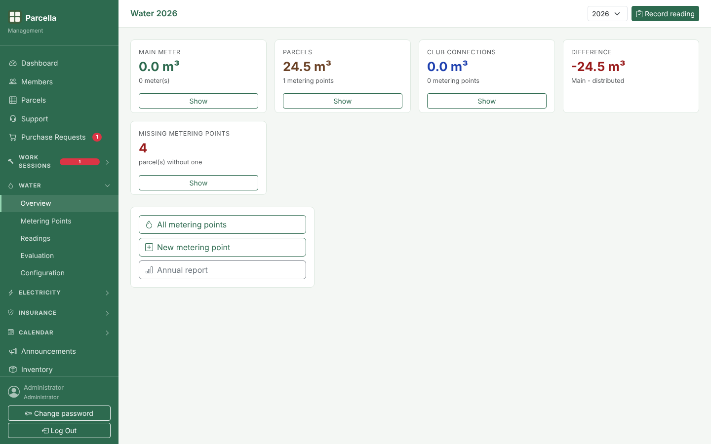
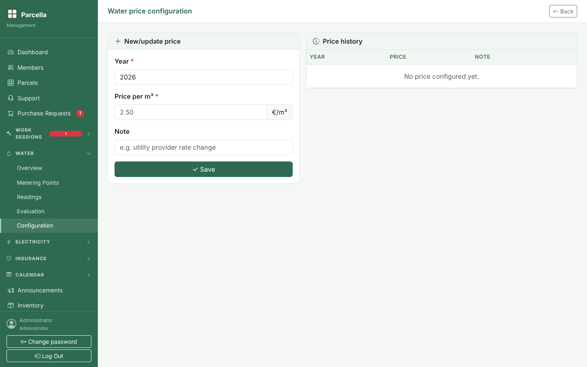

# Eau et électricité {#water-and-electricity}

!!! note "Traduction automatique"
    Cette page a été traduite automatiquement de l'anglais et n'a pas encore été relue. En cas de doute, la version anglaise fait foi (changez de langue en haut de la page).

Beaucoup d'associations achètent l'eau et l'électricité par un seul
raccordement principal et les redistribuent aux parcelles via des
sous-compteurs. Ce chapitre couvre à la fois le module **Eau** et le
module **Électricité**. Ils suivent vos compteurs, recueillent les
relevés annuels, calculent la consommation de chaque parcelle, et
montrent si les compteurs des parcelles correspondent à ce qu'indique le
compteur principal. Le prix annuel par unité saisi ici est utilisé quand
les factures facturent la consommation.

Les deux modules fonctionnent exactement de la même façon. Seuls ces
points diffèrent :

| | Eau | Électricité |
|---|---|---|
| Menu | **Eau** | **Électricité** |
| Unité | m³ | kWh |
| Les relevés se saisissent avec | une décimale (par ex. 145,0) | des nombres entiers (par ex. 950) |
| Interrupteur du module | **Gestion de l'eau** | **Gestion de l'électricité** |
| Droit de groupe | **Eau** | **Électricité** |

Les données d'eau et d'électricité sont complètement séparées : une
parcelle peut avoir un point de mesure d'eau et un point de mesure
d'électricité, et chacun a ses propres compteurs, relevés, prix et
droits. Les captures d'écran ci-dessous montrent le module eau. Dans le
module électricité, tout est au même endroit, avec des kWh au lieu de
m³.

!!! info "Qui peut l'utiliser"
    Les deux modules sont activés par défaut. Désactivez celui que votre
    association ne gère pas sous **Administration → Paramètres**
    (**Gestion de l'eau**, **Gestion de l'électricité**) -- voir
    [Activer et désactiver les modules](../administration/modules.md).
    Les données restent et réapparaissent quand vous réactivez le module.

    Les utilisateurs Administrateur et Conseil d'administration peuvent
    tout faire. Les autres utilisateurs ont besoin d'un
    [groupe](../administration/groups.md) avec des droits sur **Eau** ou
    **Électricité** : *lecture* pour voir les pages et télécharger les
    fichiers CSV, *écriture* pour créer des points de mesure, saisir des
    relevés, échanger des compteurs, importer et fixer les prix,
    *suppression* pour supprimer des points de mesure, des relevés et des
    prix.

Dans le menu latéral, chaque module a les entrées **Aperçu**, **Points
de mesure**, **Relevés**, **Évaluation** et **Configuration**.

## Points de mesure et compteurs {#metering-points-and-meters}

Deux mots sont utilisés partout :

- Un **point de mesure** est un endroit où la consommation est mesurée.
  Il est de l'un de trois types :
    - **Compteur principal** -- le point de livraison du fournisseur, où
      l'association reçoit l'eau ou l'électricité,
    - **Parcelle** -- le raccordement d'une parcelle,
    - **Club** -- un raccordement appartenant à l'association, comme le
      local ou une aire de lavage.
- Un **compteur** est l'appareil physique à un point de mesure, avec son
  propre numéro. Quand un compteur est remplacé, le point de mesure reste
  et reçoit un nouveau compteur ; l'ancien est conservé dans
  l'historique.

## Comment fonctionnent les relevés et la consommation {#how-readings-and-consumption-work}

Ces règles s'appliquent partout où des relevés sont saisis -- sur la
page des relevés, sur la page d'un point de mesure, et dans l'import
CSV.

- **Un relevé par compteur et par an.** Chaque relevé appartient à une
  année (l'année de facturation) et a une date. Si vous saisissez un
  relevé pour une année qui en a déjà un, l'ancienne valeur, la date et
  la note sont **remplacées**. C'est aussi ainsi que vous corrigez une
  erreur.
- **La consommation** d'une année = le relevé de cette année moins le
  dernier relevé d'une année antérieure. S'il n'y a pas de relevé
  antérieur, le **Relevé initial** du compteur est utilisé. Sans relevé
  pour l'année, il n'y a pas de consommation (« pas de relevé » ou
  « – »).
- **L'année n'est pas tirée de la date.** Un relevé fait en janvier peut
  encore appartenir au cycle de l'année précédente. C'est toujours vous
  qui choisissez l'année.

### Avertissements de plausibilité {#plausibility-warnings}

Un compteur ne fait normalement qu'augmenter. Parcella vous avertit --
mais **enregistre quand même le relevé** -- quand :

- le relevé est **inférieur au relevé précédent** du même compteur
  (la dernière année antérieure, ou le relevé initial), ou
- le relevé est **supérieur à un relevé ultérieur déjà enregistré** du
  même compteur.

Juste après l'enregistrement, vous voyez un bandeau jaune, par exemple
**Relevé enregistré, mais veuillez le vérifier : Le relevé de compteur
(110.0) est inférieur au relevé précédent (120.5) du même compteur. Un
relevé antérieur a-t-il été estimé ? Veuillez vérifier.** L'avertissement
reste visible à côté du relevé sur la page du point de mesure et sur la
page des relevés jusqu'à ce que les valeurs concordent.

!!! tip "Pourquoi un simple avertissement"
    Si le relevé de l'an dernier a été estimé trop haut, le vrai relevé
    de cette année est plus bas. Le bloquer rendrait impossible la saisie
    de la valeur réelle. Enregistrez le vrai relevé, puis corrigez celui
    qui avait été estimé.

Un second contrôle compare les totaux : si les parcelles et les
raccordements de l'association ont consommé ensemble **plus** que le
compteur principal sur une année, un bandeau rouge sur l'aperçu et
l'évaluation le signale. C'est une indication, pas une erreur : tant
que les relevés sont en cours de collecte, les chiffres sont souvent
incomplets.

### Échange de compteur {#meter-exchange}

Quand un compteur est remplacé -- par exemple parce que son étalonnage
a expiré -- utilisez **Échanger le compteur** sur la
[page du point de mesure](#metering-point-page). L'ancien compteur n'est
pas supprimé : il est marqué comme retiré et listé sous **Anciens
compteurs** avec son dernier relevé. Le nouveau compteur démarre avec son
propre **Relevé initial**, si bien que les anciens et nouveaux relevés ne
sont jamais mélangés.

**Relevé final de l'ancien compteur.** Saisissez ce qu'affiche l'ancien
compteur le jour du retrait. Il est enregistré comme relevé de l'ancien
compteur pour cette année, et la consommation annuelle du point de
mesure additionne alors les deux compteurs : l'ancien jusqu'à son relevé
final, le nouveau à partir de son relevé initial. La facture et
l'**Évaluation** utilisent ce total ; l'évaluation marque un tel point
« y compris compteur remplacé ». Sans relevé final, seul le nouveau
compteur compte pour cette année.

**Échanger** sert à un vrai remplacement. Si vous avez seulement mal
tapé le numéro du compteur ou une date, utilisez plutôt **Modifier le
compteur** -- cela corrige le compteur actuel sans en créer un nouveau.

### Facteur {#factor}

Certains compteurs n'affichent qu'une partie de ce qui passe réellement.
Un gros compteur d'électricité derrière des transformateurs de courant
peut compter 1/20 de l'énergie, si bien que son affichage doit être
multiplié par 20. Pour un tel point de mesure, réglez le **Facteur**
(généralement 1) :

- Les relevés sont toujours saisis exactement tels que l'afficheur les
  montre ; le contrôle de plausibilité travaille avec ces valeurs.
- La consommation dans ce module est multipliée par le facteur (arrondie
  à deux décimales si le facteur n'est pas 1). Le facteur appartient au
  point de mesure : il survit donc à un échange de compteur, et le
  modifier s'applique à toutes les années.
- Les points avec un facteur différent de 1 affichent un badge comme
  **×20**.

!!! warning "Le facteur n'est pas utilisé sur les factures"
    Les factures facturent la simple différence entre les relevés, sans
    le facteur.

### Désactiver un point de mesure {#switching-a-metering-point-off}

Si un raccordement n'est pas alimenté pendant un certain temps -- eau
coupée, électricité d'une parcelle déconnectée -- **désactivez-le** au
lieu de le supprimer. Un point désactivé :

- n'apparaît plus sur la page des relevés, dans l'export CSV des
  relevés, ni dans le compte « n'ont pas encore de relevé » -- **sauf
  s'il a déjà un relevé pour cette année**, pour qu'un relevé final reste
  visible et modifiable,
- est grisé avec un badge **Désactivé** dans la liste,
- conserve tous ses compteurs et relevés.

Rien de particulier n'est nécessaire pour la facturation : sans relevé
pour l'année, il n'y a pas de consommation, donc rien n'est facturé. Le
réactiver le fait revenir.

## Aperçu {#overview}

La page d'accueil du module, intitulée **Eau** (ou **Électricité**) et
l'année. Venez ici pour voir si tous les relevés d'une année sont saisis
et si les chiffres concordent.

| Champ / bouton | Ce qu'il fait |
|---|---|
| Sélecteur d'année | Change d'année. Liste chaque année ayant des relevés, plus l'année en cours. |
| **Enregistrer un relevé** | Ouvre la [page des relevés](#readings_1) pour cette année. |
| Bandeau rouge | Les parcelles et les raccordements de l'association ont consommé ensemble plus que le compteur principal cette année. |
| Bandeau bleu | **... point(s) de mesure n'ont pas encore de relevé pour ...**, avec **Enregistrer maintenant →**. Compte les points actifs avec un compteur et sans relevé pour l'année. |
| Tuile **Compteur principal** | Consommation du ou des compteurs principaux, et leur nombre. **Afficher** les liste. |
| Tuile **Parcelles** | Consommation totale de tous les points de mesure des parcelles, et leur nombre. **Afficher** les liste. |
| Tuile **Raccordements du club** | La même chose pour les raccordements de l'association. |
| Tuile **Écart** | Compteur principal moins parcelles et association (**Principal - distribué**) : l'eau ou l'électricité non comptabilisée, par ex. à cause de fuites ou de compteurs qui sous-comptent. Rouge si négatif. |
| Tuile **Points de comptage manquants** | Combien de parcelles n'ont pas de point de mesure pour ce fluide. **Afficher** les liste. Les parcelles résiliées comptent aussi -- elles doivent encore être suivies jusqu'à l'arrivée du prochain locataire. |
| **Tous les points de mesure** | Ouvre la [liste](#metering-points). |
| **Nouveau point de mesure** | Ouvre le [formulaire](#new-metering-point). Nécessite le droit d'écriture. |
| **Rapport annuel** | Ouvre l'[Évaluation](#evaluation) pour cette année. |

## Points de mesure {#metering-points}

Tous les points de mesure de ce fluide : compteurs principaux d'abord,
puis parcelles par numéro, puis raccordements de l'association par
libellé.

| Champ / bouton | Ce qu'il fait |
|---|---|
| **Retour** | Revient à l'aperçu. |
| **Import CSV** | Ouvre une boîte de dialogue pour téléverser un fichier CSV (voir [Importer des points de mesure](#importing-metering-points)). Nécessite le droit d'écriture. |
| **Export CSV** | Télécharge tous les points de mesure (voir ci-dessous). |
| **Nouveau point de mesure** | Ouvre le [formulaire](#new-metering-point). Nécessite le droit d'écriture. |
| **Tous** / **Actif** / **Désactivé** | Affiche tous les points, seulement les actifs ou seulement les désactivés. |
| Bandeau de filtre | Quand vous venez d'une tuile de l'aperçu, un bandeau gris nomme le filtre (par ex. **Parcelle**). **Effacer le filtre** réaffiche tout. |

| Colonne | Ce qu'elle affiche / fait |
|---|---|
| **Type** | **Compteur principal**, **Parcelle** ou **Club**. |
| **Point de mesure** | « Parcelle » plus le numéro, ou le libellé. Renvoie vers la [page du point de mesure](#metering-point-page). |
| **N° de compteur** | Le numéro du compteur actuel, avec un badge **×** si un facteur est défini ; **aucun compteur actif** s'il n'y en a pas. |
| **Statut** | **actif**, **Désactivé** (survolez pour voir depuis quand), ou **pas de compteur**. |
| **Étalonné jusqu'au** | L'année où l'étalonnage du compteur actuel expire. Un triangle d'avertissement signifie **Étalonnage expiré** -- l'année est atteinte. |
| Bouton œil | Ouvre la page du point de mesure. |
| Corbeille | Supprime le point de mesure après l'avertissement **Voulez-vous vraiment supprimer ce point de mesure ? Tous les compteurs et relevés associés seront également supprimés.** Nécessite le droit de suppression. |

Le nombre de points de mesure est affiché sous le tableau.

!!! warning "La suppression efface tout l'historique"
    Supprimer un point de mesure supprime aussi tous ses compteurs et
    relevés, donc la consommation passée disparaît aussi. Si le
    raccordement est seulement hors service,
    [désactivez-le](#switching-a-metering-point-off) plutôt.

### Points de mesure manquants {#missing-metering-points}

S'ouvre avec **Afficher** sur la tuile **Points de comptage manquants**.
Au lieu du tableau, la page liste chaque parcelle sans point de mesure
pour ce fluide -- les parcelles résiliées sont marquées **(résilié)**.
**Ajouter un point de comptage** ouvre le [formulaire](#new-metering-point)
avec cette parcelle déjà choisie (droit d'écriture). Si rien ne manque,
elle indique **Chaque parcelle dispose d'un point de comptage.**

### Export CSV (points de mesure) {#csv-export-metering-points}

Un fichier séparé par des points-virgules avec une ligne par point de
mesure et son compteur actuel : Type, Numéro de parcelle, Libellé,
Numéro de compteur, Installé le, Étalonné jusqu'au, Relevé initial,
Actif, Inactif depuis, Facteur. Il a le même format que celui attendu
par l'import : vous pouvez donc exporter, modifier dans un tableur et
réimporter de nouveaux points.

## Importer des points de mesure {#importing-metering-points}

Utile pour configurer le module la première fois. Cliquez sur **Import
CSV** dans la liste des points de mesure, choisissez un fichier `.csv`
et cliquez sur **Importer**. Les colonnes n'ont pas besoin de noms
particuliers -- vous les associez à la page suivante. Les
points-virgules et les virgules sont tous deux reconnus, et les fichiers
des anciennes versions d'Excel (pas en UTF-8) fonctionnent aussi.

### Associer les colonnes CSV {#map-csv-columns}

Il n'y a pas de capture d'écran de cette page, car elle n'apparaît
qu'après le téléversement d'un fichier.

La page affiche chaque colonne de votre fichier avec ses cinq premières
lignes. Au-dessus de chaque colonne, choisissez à quel champ elle
appartient, ou **— Ignorer —**. Parcella devine l'association à partir
des en-têtes de colonnes, en anglais ou en allemand (par exemple
« Zählernummer » devient **Numéro de compteur**).

| Champ | Ce qu'il signifie |
|---|---|
| **Type** | `MAIN_METER`, `PARCEL` ou `CLUB`. Si vous n'associez aucune colonne Type, chaque ligne est traitée comme une parcelle -- typique d'une simple liste de compteurs de parcelles. |
| **Numéro de parcelle** | Pour les lignes de parcelles : le numéro d'une parcelle existante. |
| **Libellé** | Le nom d'un compteur principal ou d'un raccordement de l'association. |
| **Numéro de compteur** | Le numéro du compteur. |
| **Installé le** | Date au format 2026-09-18 ou 18.09.2026. |
| **Étalonné jusqu'au** | Une année, par exemple 2032. Une date fonctionne aussi ; son année est utilisée. Une valeur sans année à quatre chiffres fait ignorer la ligne. |
| **Relevé initial** | Le relevé du compteur à son installation ; vide = 0. |
| **Facteur** | Vide = 1. |
| **Importer** | Crée les points de mesure. Au moins une colonne doit être associée. |

Ce qui se passe :

- Seuls de **nouveaux** points de mesure sont créés ; les existants ne
  sont jamais modifiés. Une ligne de parcelle est ignorée si la parcelle
  a déjà un point de mesure, et une ligne de compteur principal ou de
  l'association si un point de même libellé existe -- importer deux fois
  le même fichier ne fait donc pas de dégâts. Les lignes de compteurs
  principaux ou de raccordements de l'association sans libellé ne
  peuvent pas être vérifiées et sont toujours créées.
- Les lignes sont ignorées si le type est invalide, si le numéro de
  parcelle n'existe pas, ou si le facteur est invalide.
- Les nouveaux points démarrent actifs.

Ensuite, la liste affiche un résumé comme **12 importé(s), 2
ignoré(s)**, avec les raisons des trois premières lignes ignorées.

## Nouveau point de mesure {#new-metering-point}

S'ouvre depuis l'aperçu, la liste, ou **Ajouter un point de comptage**
pour une parcelle qui n'en a pas. Nécessite le droit d'écriture. La
première carte décrit le point de mesure, la seconde son compteur.

| Champ | Ce qu'il fait |
|---|---|
| **Type** | **Parcelle**, **Point de raccordement appartenant au club** ou **Compteur principal (point de livraison des services publics)**. |
| **Parcelle** | Affiché pour les points de parcelle. Liste les parcelles actives et résiliées. |
| **Libellé** | Affiché pour les points de l'association et les compteurs principaux, par exemple « local ». |
| **Notes** | Tout ce qui est utile à savoir, par ex. où se trouve le compteur. |
| **Numéro** | Obligatoire. Le numéro du compteur. Le même numéro peut apparaître plusieurs fois -- Parcella ne vérifie pas les doublons. |
| **Étalonné jusqu'au (année)** | L'année où l'étalonnage expire, par ex. 2032. |
| **Installé le** | Prérempli avec la date du jour. |
| **Relevé initial** | Le relevé du compteur à l'installation ; la consommation de la première année en est calculée. 0 par défaut. |
| **Facteur** | Multiplicateur entre l'affichage et la consommation réelle, généralement 1 (voir [Facteur](#factor)). Doit être supérieur à 0, au plus 100 000, avec au plus quatre décimales. |
| **Annuler** / **Créer un point de mesure** | L'enregistrement ouvre la page du nouveau point de mesure. |

!!! tip
    **Parcelle** et **Libellé** sont marqués comme obligatoires, mais le
    formulaire ne vous empêche pas de les laisser vides. Remplissez-les
    toujours, sinon les relevés de ce point ne pourront pas être associés
    lors d'un import CSV et le point sera difficile à trouver dans les
    listes.

## Page du point de mesure {#metering-point-page}

Tout ce qui concerne un point de mesure : ses détails, son compteur
actuel, les relevés et les anciens compteurs.

| Bouton (en haut) | Ce qu'il fait |
|---|---|
| **Précédent** / **Suivant** | Va au point de mesure précédent ou suivant dans l'ordre de la liste. Aussi avec Ctrl+← et Ctrl+→. |
| **Retour** | Revient à la liste. |

### Point de mesure {#metering-point}

Affiche **Type**, **Statut** (**actif** ou **Désactivé** avec la date
**depuis**), **Parcelle** (avec lien), **Facteur** s'il n'est pas 1, et
**Notes**.

Avec le droit d'écriture, vous pouvez modifier :

| Champ / bouton | Ce qu'il fait |
|---|---|
| **Libellé** | Facultatif pour les points de parcelle (par ex. « Entrée est ») ; le nom des points de l'association et des compteurs principaux. |
| **Notes** | Texte libre. |
| **Facteur** | Voir [Facteur](#factor). Change la consommation de toutes les années, y compris passées. Les valeurs invalides sont refusées avec une explication. |
| **Enregistrer** | Enregistre ces trois champs. |
| **Désactiver à partir du** + **Désactiver** | Désactive le point à partir de la date choisie (aujourd'hui par défaut). Voir [Désactiver un point de mesure](#switching-a-metering-point-off). |
| **Réactiver** | Affiché pour les points désactivés. |

### Compteur actuel {#current-meter}

Affiche **Numéro**, **Installé le**, **Étalonné jusqu'au** (avec un
badge **Étalonnage expiré** une fois cette année atteinte) et **Relevé
initial**. S'il n'y en a pas : **Aucun compteur actif pour ce point de
mesure.**

Avec le droit d'écriture, il y a deux boutons :

**Modifier le compteur** -- corrige le compteur actuel sur place, en cas
de faute de frappe :

| Champ | Ce qu'il fait |
|---|---|
| **Numéro** | Obligatoire. |
| **Installé le**, **Étalonné jusqu'au**, **Relevé initial** | Modifient les valeurs enregistrées. Changer le relevé initial change la consommation de la première année du compteur. |
| **Enregistrer** | Enregistre sans créer de nouveau compteur. |

**Échanger le compteur** -- enregistre un remplacement physique de
compteur (voir [Échange de compteur](#meter-exchange)) :

| Champ | Ce qu'il fait |
|---|---|
| **Ancien compteur retiré le** | Obligatoire, aujourd'hui par défaut. |
| **Relevé final de l'ancien compteur** | Ce qu'affiche l'ancien compteur le jour du retrait. Enregistré comme son relevé pour cette année, pour que sa consommation jusqu'à l'échange soit facturée. « Le jour du démontage. Sans lui, la consommation de l'ancien compteur depuis son dernier relevé n'est pas facturée. » |
| **Nouveau compteur installé le** | Obligatoire, aujourd'hui par défaut. |
| **Nouveau numéro** | Obligatoire. |
| **Étalonné jusqu'au** | L'année d'étalonnage du nouveau compteur. |
| **Relevé initial** | Le relevé du nouveau compteur à l'installation, 0 par défaut. |
| **Échanger** | Après la confirmation **Voulez-vous vraiment échanger le compteur ? L'ancien compteur sera désactivé.**, l'ancien compteur passe sous **Anciens compteurs**. |

### Relevés {#readings}

Les relevés du compteur actuel, l'année la plus récente en premier.

| Colonne | Ce qu'elle affiche / fait |
|---|---|
| **Année** | L'année de facturation. |
| **Date** | La date du relevé. |
| **Relevé (m³)** | La valeur telle qu'affichée sur le compteur, avec un avertissement de plausibilité jaune si elle ne concorde pas. |
| **Consommation (m³)** | La consommation de cette année, multipliée par le facteur (affiché comme badge dans l'en-tête). |
| **Note** | Votre note. |
| Corbeille | Supprime le relevé après confirmation. Nécessite le droit de suppression. |

**Saisir un relevé** (droit d'écriture), sous le tableau :

| Champ | Ce qu'il fait |
|---|---|
| **Année** | Obligatoire, l'année en cours par défaut. |
| **Date** | Obligatoire, aujourd'hui par défaut. |
| **Relevé du compteur (m³)** | Obligatoire. Une virgule ou un point comme séparateur décimal fonctionnent tous deux. |
| **Note** | Facultatif, par ex. « estimé ». |
| **Enregistrer un relevé** | Enregistre le relevé. Si l'année en a déjà un, il est remplacé. Un texte qui n'est pas un nombre est refusé avec **Relevé de compteur invalide**. |

### Anciens compteurs {#former-meters}

Les compteurs remplacés, le plus récemment retiré en premier, avec
**Numéro**, **Installé**, **Retiré** et **Dernier relevé**.

## Relevés {#readings_1}

La page pour recueillir les relevés annuels, conçue pour fonctionner sur
un téléphone pendant que vous faites le tour du terrain. Ouvrez-la avec
**Relevés** dans le menu ou **Enregistrer un relevé** sur l'aperçu. Le
titre affiche le fluide et l'année, par ex. **Eau relevé 2026**.

| Champ / bouton | Ce qu'il fait |
|---|---|
| Sélecteur d'année | L'année pour laquelle vous saisissez : l'année prochaine, cette année, ou l'une des trois années précédentes. |
| **Import CSV** | Téléverser des relevés depuis un fichier (voir [Importer des relevés](#importing-readings)). Nécessite le droit d'écriture. |
| **Export CSV** | Télécharge la liste de cette année (voir ci-dessous). |
| **Retour** | Revient à l'aperçu. |

La page liste chaque point de mesure qui a besoin d'un relevé cette
année, en trois groupes : **Compteur principal**, **Parcelles** (par
numéro) et **Raccordements du club**. Les points désactivés n'apparaissent
que s'ils ont déjà un relevé pour l'année. Chaque ligne affiche :

- le nom du point de mesure et le numéro du compteur,
- **Année précédente** : le dernier relevé avant cette année, ou le
  relevé initial -- la nouvelle valeur ne devrait pas être inférieure,
- si un relevé est déjà saisi : la valeur avec **enregistré**, et un
  éventuel avertissement de plausibilité,
- sinon, avec le droit d'écriture, un champ de saisie et un bouton de
  coche. Tapez la valeur et appuyez sur le bouton ; la date est fixée à
  aujourd'hui. Sans droit d'écriture : **Pas encore renseigné**.

!!! tip "Corriger une valeur enregistrée"
    Une fois enregistrée, une valeur ne peut plus être modifiée sur cette
    page. Ouvrez la page du point de mesure et saisissez à nouveau le
    relevé pour la même année -- il remplace l'ancien.

### Export CSV (relevés) {#csv-export-readings}

Un fichier séparé par des points-virgules pour l'année choisie avec une
ligne par point de mesure qui a besoin d'un relevé : Type, Numéro de
parcelle, Libellé, Numéro de compteur, Année, Date, Relevé, Note. La date
et le relevé sont vides là où rien n'est encore enregistré -- pratique
comme formulaire pour la personne qui relève les compteurs, que vous
pouvez remplir et réimporter.

## Importer des relevés {#importing-readings}

Cliquez sur **Import CSV** sur la page des relevés, choisissez un
fichier et cliquez sur **Importer**. Un fichier peut contenir des
relevés de plusieurs années.

### Associer les colonnes CSV {#map-csv-columns_1}

Il n'y a pas de capture d'écran de cette page, car elle n'apparaît
qu'après le téléversement d'un fichier.

Comme pour les points de mesure, choisissez pour chaque colonne le champ
auquel elle appartient, ou **— Ignorer —**.

| Champ | Ce qu'il signifie |
|---|---|
| **Type** | `MAIN_METER`, `PARCEL` ou `CLUB`. S'il n'est pas associé, chaque ligne compte comme une parcelle. |
| **Numéro de parcelle** / **Libellé** | Trouvent le point de mesure : numéro de parcelle pour les parcelles, libellé pour les compteurs principaux et les raccordements de l'association. |
| **Numéro de compteur** | Contrôle facultatif : s'il ne correspond pas au compteur **actuel** du point, la ligne est ignorée, car le relevé pourrait appartenir à un compteur remplacé depuis. |
| **Année** | L'année de facturation de la ligne. |
| **Date** | Obligatoire. 2026-09-18 ou 18.09.2026. |
| **Relevé** | Obligatoire. |
| **Note** | Facultatif. |
| **Année par défaut (facultatif)** | Utilisée pour toute ligne où l'Année n'est pas associée ou est laissée vide. L'Année propre à une ligne a toujours la priorité. Parcella ne devine jamais l'année à partir de la date. |
| **Importer** | Enregistre les relevés. Au moins une colonne doit être associée. |

Ce qui se passe :

- Les relevés ne sont ajoutés qu'à des points de mesure **existants** ;
  l'import n'en crée jamais.
- Un relevé pour une année qui en a déjà un le remplace.
- Les lignes sont ignorées si le point de mesure est introuvable, s'il
  n'a pas de compteur actif, si le numéro de compteur ne correspond pas,
  ou si l'année, la date ou le relevé manquent ou sont invalides.
- Les relevés invraisemblables sont quand même enregistrés, comme lors
  d'une saisie à la main.

Ensuite, la page des relevés affiche un résumé comme **40 relevé(s)
enregistré(s), 2 ignoré(s) (point de comptage introuvable)** avec les
premières raisons, et -- si nécessaire -- un bandeau jaune **...
relevé(s) enregistré(s) avec un avertissement de plausibilité** nommant
les lignes concernées.

## Évaluation {#evaluation}

Le rapport de consommation annuel, intitulé par ex. **Eau rapport
2026**. Ouvrez-le avec **Évaluation** dans le menu ou **Rapport annuel**
sur l'aperçu.

| Champ / bouton | Ce qu'il fait |
|---|---|
| Sélecteur d'année | Liste chaque année ayant des relevés, plus l'année en cours. |
| **Export CSV** | Télécharge le rapport (voir ci-dessous). |
| **Retour** | Revient à l'aperçu. |
| Bandeau rouge | **La consommation distribuée ... dépasse la consommation du compteur principal ...** -- voir [Avertissements de plausibilité](#plausibility-warnings). |

Trois tuiles affichent le **Compteur principal**, le **Total parcelles**
et le **Total club**. En dessous se trouvent trois tableaux --
**Compteur principal**, **Parcelles** et **Raccordements du club** --
chacun avec **Point de mesure** (avec lien), **N° de compteur** et
**Consommation (m³)**, ou *pas de relevé* là où le relevé de l'année
manque. La consommation inclut le facteur.

L'export CSV (points-virgules) utilise les en-têtes de colonnes de la
page dans la langue de l'association : Type, Point de mesure, N° de
compteur, Relevé et Consommation (avec l'unité).

## Configuration du prix {#price-configuration}

Le prix par m³ ou kWh pour chaque année. Les séries de factures
l'utilisent pour les articles **Consommation d'eau (depuis le module)**
et **Consommation d'électricité (depuis le module)** : consommation × le
prix de l'année de la série. Si aucun prix n'est fixé pour cette année,
ces articles ne facturent rien. Chaque année garde son propre prix : les
séries de factures passées restent donc justes quand le prix change.
Ouvrez **Configuration** dans le menu.

### Nouveau/mise à jour du prix {#newupdate-price}

Nécessite le droit d'écriture.

| Champ | Ce qu'il fait |
|---|---|
| **Année** | Obligatoire, préremplie avec l'année en cours. |
| **Prix par m³** (ou **par kWh**) | Obligatoire, par ex. 2.50. Enregistré avec deux décimales. |
| **Note** | Par ex. « changement de tarif du fournisseur ». |
| **Enregistrer** | Enregistre le prix. Si l'année en a déjà un, il est **écrasé**. |

### Historique des prix {#price-history}

Toutes les années, la plus récente en premier, avec **Année**, **Prix**
(par unité) et **Note**. Le crayon ouvre [Modifier le prix](#edit-price)
(droit d'écriture) ; la corbeille supprime le prix de l'année après
confirmation (droit de suppression).

## Modifier le prix {#edit-price}

Il n'y a pas de capture d'écran de cette page, car les données
d'exemple ne contiennent pas de prix.

S'ouvre avec le crayon dans l'historique des prix. Champs : **Année**,
**Prix par m³** (ou **par kWh**) et **Note**, avec **Annuler** et
**Enregistrer**. Si vous changez l'année pour une année qui a déjà un
prix, Parcella refuse avec **Une autre configuration du prix existe déjà
pour ...**.

<!-- TODO(verify): confirm that already-created invoices keep their amounts when a year's price is changed afterwards. -->

## Voir aussi {#related}

- [Relever les compteurs](../guides/meter-readings.md) -- la routine
  annuelle pas à pas
- [Séries de factures](finances/invoice-runs.md) et
  [Établir les factures annuelles](../guides/annual-invoicing.md) --
  facturer la consommation
- [Parcelles](parcels.md) -- les parcelles auxquelles appartiennent les
  points de mesure
- [Importer des membres et des parcelles](../guides/csv-import.md) -- le
  même type d'association des colonnes pour les autres imports
- [Rapports](reporting.md)
