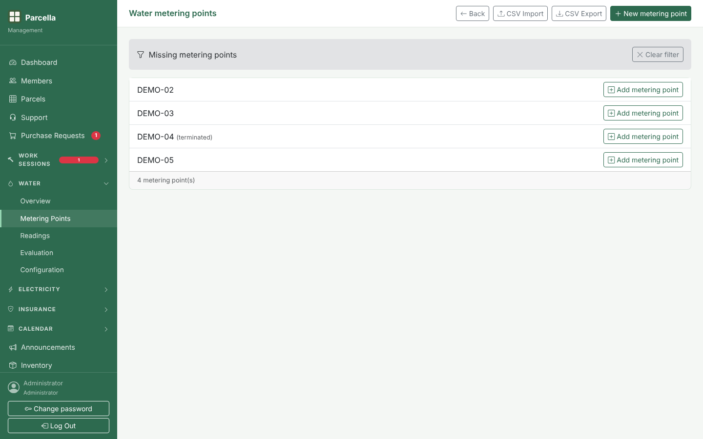
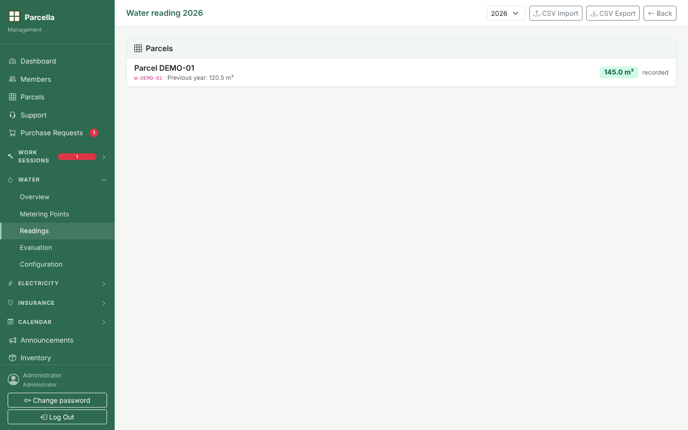

# Water en elektriciteit {#water-and-electricity}

!!! note "Machinevertaling"
    Deze pagina is machinaal vertaald uit het Engels en nog niet nagekeken. Als iets onduidelijk is, geldt de Engelse versie (taal wisselt u bovenaan).

Veel verenigingen kopen water en elektriciteit via één hoofdaansluiting
in en verdelen het via tussenmeters over de percelen. Dit hoofdstuk
behandelt zowel de module **Water** als **Elektriciteit**. Ze houden uw
meters bij, verzamelen de jaarlijkse meterstanden, berekenen het
verbruik van elk perceel en laten zien of de meters van de percelen
optellen tot wat de hoofdmeter aangeeft. De jaarprijs per eenheid die u
hier invult, wordt gebruikt wanneer facturen het verbruik factureren.

De twee modules werken precies hetzelfde. Alleen dit verschilt:

| | Water | Elektriciteit |
|---|---|---|
| Menu | **Water** | **Elektriciteit** |
| Eenheid | m³ | kWh |
| Meterstanden worden ingevoerd met | één decimaal (bijv. 145,0) | hele getallen (bijv. 950) |
| Moduleschakelaar | **Waterbeheer** | **Elektriciteitsbeheer** |
| Groepsrecht | **Water** | **Elektriciteit** |

Water- en elektriciteitsgegevens staan volledig los van elkaar: een
perceel kan een meetpunt voor water en een voor elektriciteit hebben, en
elk heeft eigen meters, meterstanden, prijzen en rechten. De schermafbeeldingen
hieronder tonen de watermodule. In de elektriciteitsmodule staat alles
op dezelfde plek, met kWh in plaats van m³.

!!! info "Wie kan dit gebruiken"
    Beide modules staan standaard aan. Schakel de module die uw
    vereniging niet beheert uit onder **Administratie → Instellingen**
    (**Waterbeheer**, **Elektriciteitsbeheer**) -- zie
    [Modules in- en uitschakelen](../administration/modules.md). De
    gegevens blijven bewaard en verschijnen weer als u de module opnieuw
    inschakelt.

    Gebruikers met de rol Beheerder of Bestuur kunnen alles. Andere
    gebruikers hebben een [groep](../administration/groups.md) met rechten
    op **Water** of **Elektriciteit** nodig: *lezen* om de pagina's te
    zien en CSV-bestanden te downloaden, *schrijven* om meetpunten aan te
    maken, meterstanden vast te leggen, meters te wisselen, te importeren
    en prijzen in te stellen, *verwijderen* om meetpunten, meterstanden en
    prijzen te verwijderen.

In het zijmenu heeft elke module de items **Overzicht**, **Meetpunten**,
**Meterstanden**, **Evaluatie** en **Configuratie**.

## Meetpunten en meters {#metering-points-and-meters}

Twee woorden komen overal terug:

- Een **meetpunt** is een plek waar verbruik wordt gemeten. Het is een
  van drie typen:
    - **Hoofdmeter** -- het overdrachtspunt van het nutsbedrijf, waar de
      vereniging water of stroom ontvangt,
    - **Perceel** -- de aansluiting van één perceel,
    - **Vereniging** -- een aansluiting van de vereniging zelf, zoals het
      clubhuis of een wasplaats.
- Een **meter** is het fysieke apparaat op een meetpunt, met een eigen
  nummer. Wordt een meter vervangen, dan blijft het meetpunt bestaan en
  krijgt het een nieuwe meter; de oude blijft in de geschiedenis
  bewaard.

## Hoe meterstanden en verbruik werken {#how-readings-and-consumption-work}

Deze regels gelden overal waar meterstanden worden ingevoerd -- op de
pagina met meterstanden, op de pagina van een meetpunt en in de
CSV-import.

- **Eén meterstand per meter per jaar.** Elke meterstand hoort bij een
  jaar (het factuurjaar) en heeft een datum. Legt u een meterstand vast
  voor een jaar dat er al een heeft, dan worden de oude waarde, datum en
  notitie **vervangen**. Zo corrigeert u ook een vergissing.
- **Verbruik** van een jaar = de meterstand van dat jaar min de laatste
  meterstand van een eerder jaar. Is er geen eerdere meterstand, dan
  wordt de **Beginstand** van de meter gebruikt. Zonder meterstand voor
  het jaar is er geen verbruik („geen stand“ of „–“).
- **Het jaar wordt niet uit de datum afgeleid.** Een meterstand uit
  januari kan nog bij de cyclus van vorig jaar horen. U kiest het jaar
  altijd zelf.

### Plausibiliteitswaarschuwingen {#plausibility-warnings}

Een meter telt normaal alleen op. Parcella waarschuwt u -- maar **slaat
de meterstand toch op** -- als:

- de meterstand **lager is dan de vorige meterstand** van dezelfde meter
  (het laatste eerdere jaar, of de beginstand), of
- de meterstand **hoger is dan een al vastgelegde latere meterstand** van
  dezelfde meter.

Direct na het opslaan ziet u een gele balk, bijvoorbeeld **Meterstand
opgeslagen, maar controleer hem a.u.b.: De meterstand (110.0) is lager
dan de vorige stand (120.5) van dezelfde meter. Is een eerdere stand
geschat? Controleer dit a.u.b.** De waarschuwing blijft naast de
meterstand zichtbaar op de pagina van het meetpunt en op de pagina met
meterstanden, tot de waarden bij elkaar passen.

!!! tip "Waarom alleen een waarschuwing"
    Was de stand van vorig jaar te hoog geschat, dan is de echte stand
    van dit jaar lager. Blokkeren zou het onmogelijk maken de echte
    waarde in te voeren. Leg de echte stand vast en corrigeer daarna de
    geschatte.

Een tweede controle vergelijkt totalen: verbruikten de percelen en
verenigingsaansluitingen samen in een jaar **meer** dan de hoofdmeter,
dan zegt een rode balk op het overzicht en de evaluatie dat. Dat is een
aanwijzing, geen fout: zolang de standen nog worden verzameld, zijn de
getallen vaak onvolledig.

### Meterwissel {#meter-exchange}

Wordt een meter vervangen -- bijvoorbeeld omdat de kalibratie is
verlopen --, gebruik dan **Meter wisselen** op de
[pagina van het meetpunt](#metering-point-page). De oude meter wordt niet
verwijderd: hij wordt als verwijderd gemarkeerd en staat onder **Eerdere
meters** met zijn laatste stand. De nieuwe meter begint met een eigen
**Beginstand**, zodat oude en nieuwe standen nooit door elkaar raken.

**Eindstand van de oude meter.** Vul in wat de oude meter op de dag van
verwijderen aangeeft. Die wordt opgeslagen als stand van de oude meter
voor dat jaar, en het jaarverbruik van het meetpunt telt dan beide meters
op: de oude tot zijn eindstand, de nieuwe vanaf zijn beginstand. De
factuur en de **Evaluatie** gebruiken dat totaal; de evaluatie markeert
zo'n punt met „incl. vervangen meter“. Zonder eindstand telt voor dat
jaar alleen de nieuwe meter.

**Wisselen** is voor een echte vervanging. Hebt u alleen het meternummer
of een datum verkeerd getypt, gebruik dan **Meter bewerken** -- dat
corrigeert de huidige meter zonder een nieuwe aan te maken.

### Factor {#factor}

Sommige meters tonen maar een deel van wat er werkelijk doorheen gaat.
Een grote elektriciteitsmeter achter stroomtransformatoren telt
bijvoorbeeld 1/20 van de energie, dus de display moet met 20 worden
vermenigvuldigd. Stel voor zo'n meetpunt de **Factor** in (meestal 1):

- Meterstanden worden nog steeds precies ingevoerd zoals de display ze
  toont; de plausibiliteitscontrole werkt met die waarden.
- Het verbruik in deze module wordt met de factor vermenigvuldigd
  (afgerond op twee decimalen als de factor niet 1 is). De factor hoort
  bij het meetpunt, blijft dus bij een meterwissel bestaan, en een
  wijziging geldt voor alle jaren.
- Punten met een andere factor dan 1 tonen een badge zoals **×20**.

!!! warning "De factor wordt niet op facturen gebruikt"
    Facturen factureren het gewone verschil tussen de standen, zonder de
    factor.

### Een meetpunt uitschakelen {#switching-a-metering-point-off}

Heeft een aansluiting een tijd geen levering -- water dicht, stroom van
een perceel afgesloten --, **schakel haar dan uit** in plaats van haar te
verwijderen. Een uitgeschakeld meetpunt:

- verschijnt niet meer op de pagina met meterstanden, in de CSV-export
  van de meterstanden of in de telling van punten zonder stand --
  **tenzij het voor dat jaar al een stand heeft**, zodat een eindstand
  zichtbaar en bewerkbaar blijft,
- staat grijs met een badge **Uitgeschakeld** in de lijst,
- houdt al zijn meters en meterstanden.

Voor de facturatie is niets bijzonders nodig: zonder stand voor het jaar
is er geen verbruik, dus wordt er niets gefactureerd. Weer inschakelen
brengt het punt terug.

## Overzicht {#overview}

De startpagina van de module, met de titel **Water** (of
**Elektriciteit**) en het jaar. Hier ziet u of alle standen voor een
jaar binnen zijn en of de getallen kloppen.

| Veld / knop | Wat het doet |
|---|---|
| Jaarkeuze | Wisselt het jaar. Toont elk jaar met meterstanden, plus het huidige jaar. |
| **Meterstand opnemen** | Opent de [pagina met meterstanden](#readings_1) voor dit jaar. |
| Rode balk | De percelen en verenigingsaansluitingen verbruikten dit jaar samen meer dan de hoofdmeter. |
| Blauwe balk | **... meetpunt(en) hebben nog geen stand voor ....**, met **Nu opnemen →**. Telt actieve punten met een meter en zonder stand voor het jaar. |
| Tegel **Hoofdmeter** | Verbruik van de hoofdmeter(s), en hoeveel er zijn. **Toon** toont ze. |
| Tegel **Percelen** | Totaal verbruik van alle meetpunten van percelen, en hoeveel er zijn. **Toon** toont ze. |
| Tegel **Verenigingsaansluitingen** | Hetzelfde voor verenigingsaansluitingen. |
| Tegel **Verschil** | Hoofdmeter min percelen en vereniging (**Hoofd - verdeeld**): het water of de stroom die niet is verantwoord, bijv. door lekken of meters die te langzaam lopen. Rood als het negatief is. |
| Tegel **Ontbrekende meetpunten** | Hoeveel percelen geen meetpunt voor dit medium hebben. **Toon** toont ze. Beëindigde percelen tellen ook mee -- ze moeten worden bijgehouden tot de volgende huurder komt. |
| **Alle meetpunten** | Opent de [lijst](#metering-points). |
| **Nieuw meetpunt** | Opent het [formulier](#new-metering-point). Vraagt schrijfrecht. |
| **Jaarverslag** | Opent de [Evaluatie](#evaluation) voor dit jaar. |

## Meetpunten {#metering-points}

Alle meetpunten van dit medium: eerst hoofdmeters, dan percelen op
perceelnummer, dan verenigingsaansluitingen op omschrijving.

| Veld / knop | Wat het doet |
|---|---|
| **Terug** | Terug naar het overzicht. |
| **CSV-import** | Opent een venster om een CSV-bestand te uploaden (zie [Meetpunten importeren](#importing-metering-points)). Vraagt schrijfrecht. |
| **CSV-export** | Downloadt alle meetpunten (zie hieronder). |
| **Nieuw meetpunt** | Opent het [formulier](#new-metering-point). Vraagt schrijfrecht. |
| **Alle** / **Actief** / **Uitgeschakeld** | Toont alle punten, alleen actieve of alleen uitgeschakelde. |
| Filterbalk | Kwam u van een tegel op het overzicht, dan noemt een grijze balk het filter (bijv. **Perceel**). **Filter wissen** toont weer alles. |

| Kolom | Wat ze toont / doet |
|---|---|
| **Type** | **Hoofdmeter**, **Perceel** of **Vereniging**. |
| **Meetpunt** | „Perceel“ plus perceelnummer, of de omschrijving. Linkt naar de [pagina van het meetpunt](#metering-point-page). |
| **Meter nr.** | Het nummer van de huidige meter, met een badge **×** als er een factor is ingesteld; **geen actieve meter** als er geen is. |
| **Status** | **actief**, **Uitgeschakeld** (beweeg de muis erover om te zien sinds wanneer) of **geen meter**. |
| **Gekalibreerd tot** | Het jaar waarin de kalibratie van de huidige meter afloopt. Een waarschuwingsdriehoek betekent **Kalibratie verlopen** -- het jaar is bereikt. |
| Oogknop | Opent de pagina van het meetpunt. |
| Prullenbak | Verwijdert het meetpunt na de waarschuwing **Dit meetpunt echt verwijderen? Alle bijbehorende meters en meterstanden worden ook verwijderd.** Vraagt verwijderrecht. |

Het aantal meetpunten staat onder de tabel.

!!! warning "Verwijderen haalt de hele geschiedenis weg"
    Een meetpunt verwijderen verwijdert ook al zijn meters en
    meterstanden, dus ook het verbruik uit het verleden verdwijnt. Is de
    aansluiting alleen buiten gebruik, [schakel haar dan
    uit](#switching-a-metering-point-off).

### Ontbrekende meetpunten {#missing-metering-points}

Geopend met **Toon** op de tegel **Ontbrekende meetpunten**. In plaats
van de tabel toont de pagina elk perceel zonder meetpunt voor dit medium
-- beëindigde percelen zijn gemarkeerd. **Meetpunt toevoegen** opent het
[formulier](#new-metering-point) met dat perceel al gekozen
(schrijfrecht). Ontbreekt er niets, dan staat er **Elk perceel heeft een
meetpunt.**

### CSV-export (meetpunten) {#csv-export-metering-points}

Een bestand gescheiden door puntkomma's met één rij per meetpunt en zijn
huidige meter: Type, Parcel number, Label, Meter number, Installed on,
Calibrated until, Initial reading, Active, Inactive since, Factor. Het
heeft hetzelfde formaat dat de import verwacht, dus u kunt exporteren,
in een spreadsheet bewerken en nieuwe punten weer importeren.

## Meetpunten importeren {#importing-metering-points}

Handig om de module voor het eerst in te richten. Klik op **CSV-import**
in de lijst met meetpunten, kies een `.csv`-bestand en klik op
**Importeren**. De kolommen hebben geen speciale namen nodig -- u koppelt
ze op de volgende pagina. Puntkomma's en komma's worden allebei
herkend, en bestanden uit oudere Excel-versies (niet UTF-8) werken ook.

### CSV-kolommen koppelen {#map-csv-columns}

Van deze pagina is er geen schermafbeelding, omdat ze pas verschijnt
nadat u een bestand hebt geüpload.

De pagina toont elke kolom van uw bestand met de eerste vijf rijen. Kies
boven elke kolom bij welk veld ze hoort, of **— Negeren —**. Parcella
raadt de koppeling uit de kolomkoppen, in het Engels of Duits
(bijvoorbeeld „Zählernummer“ wordt **Meternummer**).

| Veld | Wat het betekent |
|---|---|
| **Type** | `MAIN_METER`, `PARCEL` of `CLUB`. Koppelt u helemaal geen kolom Type, dan wordt elke rij als perceel behandeld -- typisch voor een gewone lijst met perceelmeters. |
| **Perceelnummer** | Voor perceelrijen: het perceelnummer van een bestaand perceel. |
| **Omschrijving** | De naam van een hoofdmeter of verenigingsaansluiting. |
| **Meternummer** | Het nummer van de meter. |
| **Geïnstalleerd op** | Datum als 2026-09-18 of 18.09.2026. |
| **Gekalibreerd tot** | Een jaartal, bijvoorbeeld 2032. Een datum werkt ook; het jaar daarvan wordt gebruikt. Een waarde zonder viercijferig jaartal slaat die rij over. |
| **Beginstand** | De stand van de meter bij installatie; leeg = 0. |
| **Factor** | Leeg = 1. |
| **Importeren** | Maakt de meetpunten aan. Er moet minstens één kolom gekoppeld zijn. |

Wat er gebeurt:

- Alleen **nieuwe** meetpunten worden aangemaakt; bestaande worden nooit
  gewijzigd. Een perceelrij wordt overgeslagen als het perceel al een
  meetpunt heeft, en een rij voor een hoofdmeter of
  verenigingsaansluiting als er al een met dezelfde omschrijving bestaat
  -- hetzelfde bestand twee keer importeren kan dus geen kwaad. Rijen
  voor hoofdmeters of verenigingsaansluitingen zonder omschrijving kunnen
  niet worden gecontroleerd en worden altijd aangemaakt.
- Rijen worden overgeslagen als het type ongeldig is, het perceelnummer
  niet bestaat of de factor ongeldig is.
- Nieuwe punten beginnen als actief.

Daarna toont de lijst een samenvatting zoals **12 geïmporteerd, 2
overgeslagen**, met de redenen voor de eerste drie overgeslagen rijen.

## Nieuw meetpunt {#new-metering-point}

Geopend vanuit het overzicht, de lijst, of **Meetpunt toevoegen** bij een
perceel zonder meetpunt. Vraagt schrijfrecht. De eerste kaart beschrijft
het meetpunt, de tweede de meter.

| Veld | Wat het doet |
|---|---|
| **Type** | **Perceel**, **Verenigingseigen aansluitpunt** of **Hoofdmeter (nutsvoorziening overdrachtspunt)**. |
| **Perceel** | Getoond bij perceelpunten. Toont actieve en beëindigde percelen. |
| **Label** | Getoond bij verenigings- en hoofdmeterpunten, bijvoorbeeld „clubhuis“. |
| **Notities** | Alles wat het weten waard is, bijv. waar de meter zit. |
| **Nummer** | Verplicht. Het nummer van de meter. Hetzelfde nummer mag vaker voorkomen -- Parcella controleert niet op dubbele. |
| **Gekalibreerd tot (jaar)** | Het jaar waarin de kalibratie afloopt, bijv. 2032. |
| **Geïnstalleerd op** | Vooraf ingevuld met vandaag. |
| **Beginstand** | De stand van de meter bij installatie; het verbruik van het eerste jaar wordt ervan berekend. Standaard 0. |
| **Factor** | Vermenigvuldiger van de display naar het echte verbruik, meestal 1 (zie [Factor](#factor)). Moet groter zijn dan 0, hoogstens 100.000, met hoogstens vier decimalen. |
| **Annuleren** / **Meetpunt aanmaken** | Opslaan opent de pagina van het nieuwe meetpunt. |

!!! tip
    **Perceel** en **Label** zijn als verplicht gemarkeerd, maar het
    formulier houdt u niet tegen als u ze leeg laat. Vul ze altijd in,
    anders kunnen standen voor dit punt in een CSV-import niet worden
    gekoppeld en is het punt in lijsten moeilijk te vinden.

## Pagina van een meetpunt {#metering-point-page}

Alles over één meetpunt: de gegevens, de huidige meter, de meterstanden
en eerdere meters.

| Knop (bovenaan) | Wat het doet |
|---|---|
| **Vorige** / **Volgende** | Naar het vorige of volgende meetpunt in de volgorde van de lijst. Ook met Ctrl+← en Ctrl+→. |
| **Terug** | Terug naar de lijst. |

### Meetpunt {#metering-point}

Toont **Type**, **Status** (**actief** of **Uitgeschakeld** met
**sinds**-datum), **Perceel** (gelinkt), **Factor** als die niet 1 is, en
**Notities**.

Met schrijfrecht kunt u wijzigen:

| Veld / knop | Wat het doet |
|---|---|
| **Label** | Optioneel bij perceelpunten (bijv. „Oost-ingang“); de naam van verenigings- en hoofdmeterpunten. |
| **Notities** | Vrije tekst. |
| **Factor** | Zie [Factor](#factor). Wijzigt het verbruik voor alle jaren, ook eerdere. Ongeldige waarden worden met een uitleg geweigerd. |
| **Opslaan** | Slaat deze drie velden op. |
| **Uitschakelen per** + **Uitschakelen** | Schakelt het punt uit vanaf de gekozen datum (standaard vandaag). Zie [Een meetpunt uitschakelen](#switching-a-metering-point-off). |
| **Weer inschakelen** | Getoond bij uitgeschakelde punten. |

### Huidige meter {#current-meter}

Toont **Nummer**, **Geïnstalleerd op**, **Gekalibreerd tot** (met een
badge **Kalibratie verlopen** zodra dat jaar is bereikt) en
**Beginstand**. Is er geen: **Geen actieve meter voor dit meetpunt.**

Met schrijfrecht zijn er twee knoppen:

**Meter bewerken** -- corrigeert de huidige meter ter plekke, bij
typefouten:

| Veld | Wat het doet |
|---|---|
| **Nummer** | Verplicht. |
| **Geïnstalleerd op**, **Gekalibreerd tot**, **Beginstand** | Wijzigen de opgeslagen waarden. Een andere beginstand wijzigt het verbruik van het eerste jaar van de meter. |
| **Opslaan** | Slaat op zonder een nieuwe meter aan te maken. |

**Meter wisselen** -- legt een fysieke vervanging van de meter vast (zie
[Meterwissel](#meter-exchange)):

| Veld | Wat het doet |
|---|---|
| **Oude meter verwijderd op** | Verplicht, standaard vandaag. |
| **Eindstand van de oude meter** | Wat de oude meter op de dag van verwijderen aangeeft. Opgeslagen als zijn stand voor dat jaar, zodat zijn verbruik tot de wissel wordt gefactureerd. „Op de dag van verwijderen. Zonder deze wordt het verbruik van de oude meter sinds de laatste aflezing niet gefactureerd.“ |
| **Nieuwe meter geïnstalleerd op** | Verplicht, standaard vandaag. |
| **Nieuw nummer** | Verplicht. |
| **Gekalibreerd tot** | Het kalibratiejaar van de nieuwe meter. |
| **Beginstand** | De stand van de nieuwe meter bij installatie, standaard 0. |
| **Wisselen** | Na de bevestiging **Weet u zeker dat u de meter wilt wisselen? De oude meter wordt gedeactiveerd.** gaat de oude meter naar **Eerdere meters**. |

### Meterstanden {#readings}

De meterstanden van de huidige meter, het nieuwste jaar eerst.

| Kolom | Wat ze toont / doet |
|---|---|
| **Jaar** | Het factuurjaar. |
| **Datum** | De datum van de aflezing. |
| **Stand (m³)** | De waarde zoals de meter die toont, met een gele plausibiliteitswaarschuwing als ze niet past. |
| **Verbruik (m³)** | Verbruik in dat jaar, vermenigvuldigd met de factor (als badge in de kop getoond). |
| **Notitie** | Uw notitie. |
| Prullenbak | Verwijdert de meterstand na bevestiging. Vraagt verwijderrecht. |

**Een meterstand vastleggen** (schrijfrecht), onder de tabel:

| Veld | Wat het doet |
|---|---|
| **Jaar** | Verplicht, standaard het huidige jaar. |
| **Datum** | Verplicht, standaard vandaag. |
| **Meterstand (m³)** | Verplicht. Een komma of een punt als decimaalteken werkt allebei. |
| **Notitie** | Optioneel, bijv. „geschat“. |
| **Meterstand opnemen** | Slaat de meterstand op. Heeft het jaar er al een, dan wordt die vervangen. Een tekst die geen getal is, wordt geweigerd met **Ongeldige meterstand**. |

### Eerdere meters {#former-meters}

Vervangen meters, de laatst verwijderde eerst, met **Nummer**,
**Geïnstalleerd**, **Verwijderd** en **Laatste stand**.

## Meterstanden {#readings_1}

De pagina om de jaarlijkse meterstanden te verzamelen, gemaakt om op een
telefoon te werken terwijl u over het terrein loopt. Open haar met
**Meterstanden** in het menu of **Meterstand opnemen** op het overzicht.
De titel toont het medium en het jaar.

| Veld / knop | Wat het doet |
|---|---|
| Jaarkeuze | Het jaar waarvoor u vastlegt: volgend jaar, dit jaar of een van de drie jaren ervoor. |
| **CSV-import** | Meterstanden uit een bestand uploaden (zie [Meterstanden importeren](#importing-readings)). Vraagt schrijfrecht. |
| **CSV-export** | Downloadt de lijst van dit jaar (zie hieronder). |
| **Terug** | Terug naar het overzicht. |

De pagina toont elk meetpunt dat dit jaar een stand nodig heeft, in drie
groepen: **Hoofdmeter**, **Percelen** (op perceelnummer) en
**Verenigingsaansluitingen**. Uitgeschakelde punten verschijnen alleen
als ze al een stand voor het jaar hebben. Elke rij toont:

- de naam van het meetpunt en het meternummer,
- **Vorig jaar**: de laatste stand vóór dit jaar, of de beginstand -- de
  nieuwe waarde mag niet lager zijn,
- als er al een stand is: de waarde met **geregistreerd**, en een
  eventuele plausibiliteitswaarschuwing,
- anders, met schrijfrecht, een invoerveld en een vinkknop. Typ de
  waarde en druk op de knop; de datum wordt op vandaag gezet. Zonder
  schrijfrecht: **Nog niet ingevoerd**.

!!! tip "Een vastgelegde waarde corrigeren"
    Eenmaal vastgelegd kan een waarde op deze pagina niet meer worden
    gewijzigd. Open de pagina van het meetpunt en leg de stand voor
    hetzelfde jaar opnieuw vast -- die vervangt de oude.

### CSV-export (meterstanden) {#csv-export-readings}

Een bestand gescheiden door puntkomma's voor het gekozen jaar, met één
rij per meetpunt dat een stand nodig heeft: Type, Parcel number, Label,
Meter number, Year, Date, Reading, Note. Datum en stand zijn leeg waar
nog niets is vastgelegd -- handig als formulier voor wie de meters
afleest, dat u kunt invullen en weer importeren.

## Meterstanden importeren {#importing-readings}

Klik op **CSV-import** op de pagina met meterstanden, kies een bestand en
klik op **Importeren**. Eén bestand kan meterstanden voor meerdere jaren
bevatten.

### CSV-kolommen koppelen {#map-csv-columns_1}

Van deze pagina is er geen schermafbeelding, omdat ze pas verschijnt
nadat u een bestand hebt geüpload.

Kies, net als bij meetpunten, voor elke kolom bij welk veld ze hoort, of
**— Negeren —**.

| Veld | Wat het betekent |
|---|---|
| **Type** | `MAIN_METER`, `PARCEL` of `CLUB`. Niet gekoppeld: elke rij telt als perceel. |
| **Perceelnummer** / **Omschrijving** | Vinden het meetpunt: perceelnummer voor percelen, omschrijving voor hoofdmeters en verenigingsaansluitingen. |
| **Meternummer** | Optionele controle: komt het niet overeen met de **huidige** meter van het punt, dan wordt de rij overgeslagen, omdat de stand misschien bij een meter hoort die intussen is vervangen. |
| **Jaar** | Het factuurjaar van de rij. |
| **Datum** | Verplicht. 2026-09-18 of 18.09.2026. |
| **Meterstand** | Verplicht. |
| **Notitie** | Optioneel. |
| **Standaardjaar (optioneel)** | Gebruikt voor elke rij waarin Jaar niet is gekoppeld of leeg is. Een eigen Jaar van de rij heeft altijd voorrang. Parcella raadt het jaar nooit uit de datum. |
| **Importeren** | Legt de meterstanden vast. Er moet minstens één kolom gekoppeld zijn. |

Wat er gebeurt:

- Meterstanden worden alleen aan **bestaande** meetpunten toegevoegd; de
  import maakt er nooit een aan.
- Een stand voor een jaar dat er al een heeft, vervangt die.
- Rijen worden overgeslagen als het meetpunt niet wordt gevonden, het
  geen actieve meter heeft, het meternummer niet overeenkomt, of jaar,
  datum of stand ontbreken of ongeldig zijn.
- Onwaarschijnlijke standen worden toch vastgelegd, net als bij invoer
  met de hand.

Daarna toont de pagina met meterstanden een samenvatting zoals **40
standen geregistreerd, 2 overgeslagen (meetpunt niet gevonden)** met de
eerste redenen, en -- indien nodig -- een gele balk **...
meterstand(en) vastgelegd met een plausibiliteitswaarschuwing** die de
betrokken rijen noemt.

## Evaluatie {#evaluation}

Het jaarlijkse verbruiksrapport. Open het met **Evaluatie** in het menu
of **Jaarverslag** op het overzicht.

| Veld / knop | Wat het doet |
|---|---|
| Jaarkeuze | Toont elk jaar met meterstanden, plus het huidige jaar. |
| **CSV-export** | Downloadt het rapport (zie hieronder). |
| **Terug** | Terug naar het overzicht. |
| Rode balk | **Verdeeld verbruik (...) overschrijdt hoofdmeterverbruik (...).** -- zie [Plausibiliteitswaarschuwingen](#plausibility-warnings). |

Drie tegels tonen **Hoofdmeter**, **Percelen totaal** en **Vereniging
totaal**. Daaronder staan drie tabellen -- **Hoofdmeter**, **Percelen**
en **Verenigingsaansluitingen** -- elk met **Meetpunt** (gelinkt),
**Meter nr.** en **Verbruik (m³)**, of *geen stand* waar de stand van het
jaar ontbreekt. Het verbruik is inclusief de factor.

De CSV-export (puntkomma's) gebruikt de kolomkoppen van de pagina in de
taal van de vereniging: Type, Meetpunt, Meter nr., Meterstand en
Verbruik (met de eenheid).

## Prijsconfiguratie {#price-configuration}

De prijs per m³ of kWh voor elk jaar. Factuurrondes gebruiken haar voor
de posten **Waterverbruik (uit module)** en **Stroomverbruik (uit
module)**: verbruik × de prijs van het jaar van de ronde. Is er voor dat
jaar geen prijs ingesteld, dan factureren die posten niets. Elk jaar
houdt zijn eigen prijs, dus eerdere factuurrondes blijven kloppen als de
prijs verandert. Open **Configuratie** in het menu.

### Nieuwe/bijgewerkte prijs {#newupdate-price}

Vraagt schrijfrecht.

| Veld | Wat het doet |
|---|---|
| **Jaar** | Verplicht, vooraf ingevuld met het huidige jaar. |
| **Prijs per m³** (of **per kWh**) | Verplicht, bijv. 2.50. Opgeslagen met twee decimalen. |
| **Notitie** | Bijv. „tariefwijziging leverancier“. |
| **Opslaan** | Slaat de prijs op. Heeft het jaar er al een, dan wordt die **overschreven**. |

### Prijsgeschiedenis {#price-history}

Alle jaren, het nieuwste eerst, met **Jaar**, **Prijs** (per eenheid) en
**Notitie**. Het potlood opent [Prijs bewerken](#edit-price)
(schrijfrecht); de prullenbak verwijdert de prijs van het jaar na
bevestiging (verwijderrecht).

## Prijs bewerken {#edit-price}

Van deze pagina is er geen schermafbeelding, omdat de voorbeeldgegevens
geen prijzen bevatten.

Geopend met het potlood in de prijsgeschiedenis. Velden: **Jaar**,
**Prijs per m³** (of **per kWh**) en **Notitie**, met **Annuleren** en
**Opslaan**. Wijzigt u het jaar naar een jaar dat al een prijs heeft, dan
weigert Parcella met **Er bestaat al een andere prijsconfiguratie voor
....**

<!-- TODO(verify): confirm that already-created invoices keep their amounts when a year's price is changed afterwards. -->

## Gerelateerd {#related}

- [Meterstanden opnemen](../guides/meter-readings.md) -- de jaarlijkse
  routine stap voor stap
- [Factuurrondes](finances/invoice-runs.md) en
  [De jaarfacturen opmaken](../guides/annual-invoicing.md) -- verbruik
  factureren
- [Percelen](parcels.md) -- de percelen waar meetpunten bij horen
- [Leden en percelen importeren](../guides/csv-import.md) -- hetzelfde
  soort kolomkoppeling bij andere imports
- [Rapportages](reporting.md)
