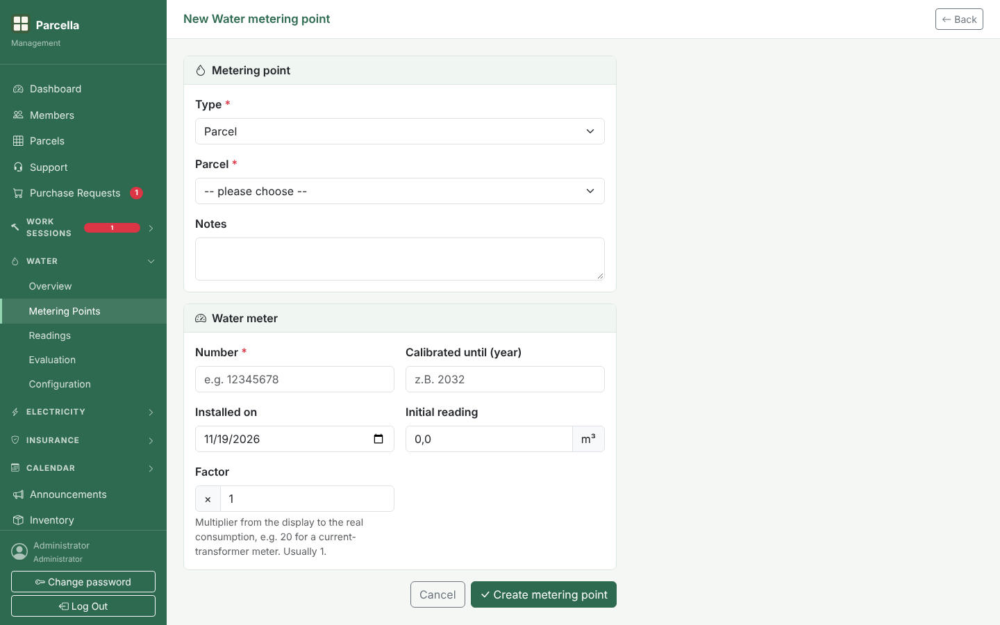
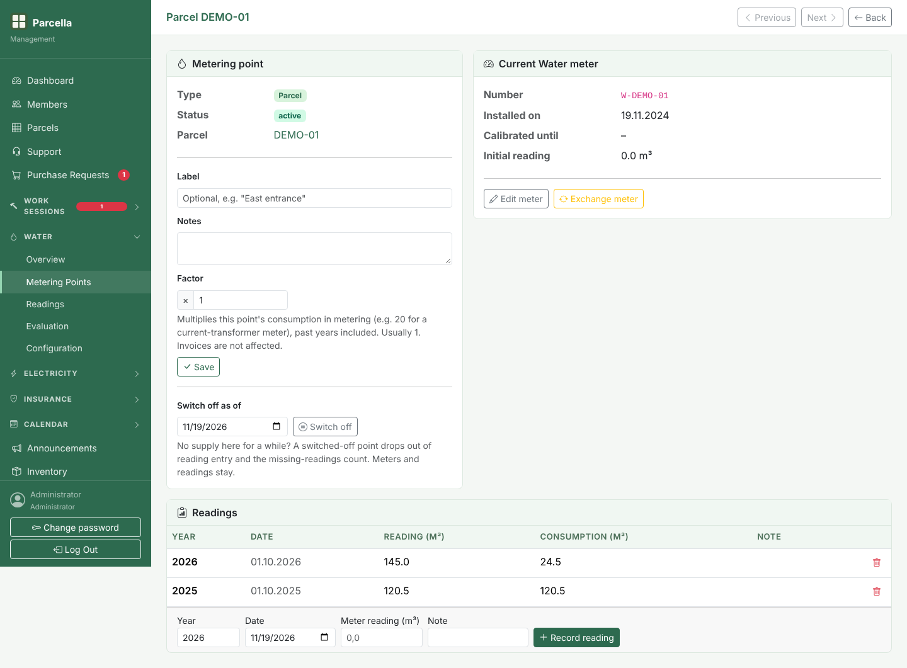

# Woda i prąd {#water-and-electricity}

!!! note "Tłumaczenie maszynowe"
    Ta strona została przetłumaczona maszynowo z języka angielskiego i nie została jeszcze sprawdzona. Jeśli coś jest niejasne, obowiązuje wersja angielska (język zmienisz u góry).

Wiele stowarzyszeń kupuje wodę i prąd przez jedno przyłącze główne i
rozprowadza je na działki przez podliczniki. Ten rozdział obejmuje
oba moduły: **Woda** i **Prąd**. Śledzą one Twoje liczniki, zbierają
roczne odczyty, obliczają zużycie każdej działki i pokazują, czy
liczniki działek sumują się do tego, co pokazuje licznik główny. Roczna
cena za jednostkę, którą tu wpisujesz, jest używana, gdy faktury
rozliczają zużycie.

Oba moduły działają dokładnie tak samo. Różnią się tylko tym:

| | Woda | Prąd |
|---|---|---|
| Menu | **Woda** | **Prąd** |
| Jednostka | m³ | kWh |
| Odczyty wpisuje się | z jednym miejscem po przecinku (np. 145,0) | jako liczby całkowite (np. 950) |
| Przełącznik modułu | **Zarządzanie wodą** | **Zarządzanie prądem** |
| Uprawnienie grupy | **Woda** | **Prąd** |

Dane wody i prądu są całkowicie oddzielne: działka może mieć punkt
pomiarowy wody i punkt pomiarowy prądu, a każdy ma własne liczniki,
odczyty, ceny i uprawnienia. Zrzuty ekranu poniżej pokazują moduł wody.
W module prądu wszystko jest w tym samym miejscu, z kWh zamiast m³.

!!! info "Kto może z tego korzystać"
    Oba moduły są domyślnie włączone. Wyłącz ten, którym Twoje
    stowarzyszenie nie zarządza, w **Administracja → Ustawienia**
    (**Zarządzanie wodą**, **Zarządzanie prądem**) -- zob.
    [Włączanie i wyłączanie modułów](../administration/modules.md). Dane
    zostają i wracają po ponownym włączeniu modułu.

    Użytkownicy Administrator i Zarząd mogą wszystko. Inni użytkownicy
    potrzebują [grupy](../administration/groups.md) z uprawnieniami
    **Woda** lub **Prąd**: *odczyt*, aby oglądać strony i pobierać pliki
    CSV, *zapis*, aby tworzyć punkty pomiarowe, zapisywać odczyty,
    wymieniać liczniki, importować i ustawiać ceny, *usuwanie*, aby
    usuwać punkty pomiarowe, odczyty i ceny.

W menu bocznym każdy moduł ma pozycje **Przegląd**, **Punkty
pomiarowe**, **Odczyty**, **Rozliczenie** i **Konfiguracja**.

## Punkty pomiarowe i liczniki {#metering-points-and-meters}

W całym rozdziale używa się dwóch słów:

- **Punkt pomiarowy** to miejsce, w którym mierzy się zużycie. Jest
  jednego z trzech typów:
    - **Licznik główny** -- punkt przekazania od dostawcy, w którym
      stowarzyszenie odbiera wodę lub prąd,
    - **Działka** -- przyłącze jednej działki,
    - **Stowarzyszenie** -- przyłącze należące do stowarzyszenia, np.
      świetlica lub myjnia.
- **Licznik** to fizyczne urządzenie w punkcie pomiarowym, z własnym
  numerem. Gdy licznik zostaje wymieniony, punkt pomiarowy zostaje i
  dostaje nowy licznik; stary jest zachowywany w historii.

## Jak działają odczyty i zużycie {#how-readings-and-consumption-work}

Te zasady obowiązują wszędzie, gdzie wpisuje się odczyty -- na stronie
odczytów, na stronie punktu pomiarowego i w imporcie CSV.

- **Jeden odczyt na licznik na rok.** Każdy odczyt należy do roku (roku
  rozliczeniowego) i ma datę. Jeśli zapiszesz odczyt dla roku, który już
  ma odczyt, stara wartość, data i notatka zostają **zastąpione**. Tak
  też poprawia się pomyłkę.
- **Zużycie** w roku = odczyt z tego roku minus ostatni odczyt z
  wcześniejszego roku. Jeśli nie ma wcześniejszego odczytu, używany jest
  **Stan początkowy** licznika. Bez odczytu za dany rok nie ma zużycia
  („brak odczytu” lub „–”).
- **Rok nie jest brany z daty.** Odczyt zrobiony w styczniu może nadal
  należeć do cyklu zeszłego roku. Rok wybierasz zawsze sam.

### Ostrzeżenia o wiarygodności {#plausibility-warnings}

Licznik normalnie tylko rośnie. Parcella ostrzega -- ale **i tak
zapisuje odczyt** -- gdy:

- odczyt jest **mniejszy niż poprzedni odczyt** tego samego licznika
  (ostatni wcześniejszy rok lub stan początkowy), albo
- odczyt jest **większy niż już zapisany późniejszy odczyt** tego
  samego licznika.

Zaraz po zapisaniu widzisz żółty baner, np. **Odczyt zapisany, ale
proszę go sprawdzić: Stan licznika (110.0) jest mniejszy niż poprzedni
stan (120.5) tego samego licznika. Czy wcześniejszy odczyt był
szacowany? Proszę sprawdzić.** Ostrzeżenie pozostaje widoczne obok
odczytu na stronie punktu pomiarowego i na stronie odczytów, dopóki
wartości do siebie nie pasują.

!!! tip "Dlaczego tylko ostrzega"
    Jeśli zeszłoroczny odczyt został oszacowany za wysoko, tegoroczny
    rzeczywisty odczyt jest niższy. Blokowanie go uniemożliwiłoby
    wpisanie rzeczywistej wartości. Zapisz rzeczywisty odczyt, a potem
    popraw szacowany.

Druga kontrola porównuje sumy: jeśli działki i przyłącza stowarzyszenia
razem zużyły w danym roku **więcej** niż licznik główny, mówi o tym
czerwony baner w przeglądzie i w rozliczeniu. To wskazówka, nie błąd:
podczas zbierania odczytów liczby są często niekompletne.

### Wymiana licznika {#meter-exchange}

Gdy licznik zostaje wymieniony -- np. bo wygasła jego legalizacja --
użyj **Wymień licznik** na [stronie punktu pomiarowego](#metering-point-page).
Stary licznik nie jest usuwany: zostaje oznaczony jako zdemontowany i
wymieniony w **Poprzednie liczniki** z ostatnim odczytem. Nowy licznik
zaczyna od własnego **Stan początkowy**, więc stare i nowe odczyty nigdy
się nie mieszają.

**Stan końcowy starego licznika.** Wpisz, co stary licznik pokazuje w
dniu demontażu. Jest zapisywany jako odczyt starego licznika za ten rok,
a zużycie punktu pomiarowego w tym roku sumuje wtedy oba liczniki:
stary do jego stanu końcowego, nowy od jego stanu początkowego. Faktura
i **Rozliczenie** używają tej sumy; rozliczenie oznacza taki punkt „z
wymienionym licznikiem”. Bez stanu końcowego za ten rok liczy się tylko
nowy licznik.

**Wymiana** jest na prawdziwą zamianę. Jeśli tylko pomyliłeś się w
numerze licznika lub dacie, użyj zamiast tego **Edytuj licznik** --
poprawia obecny licznik bez tworzenia nowego.

### Mnożnik {#factor}

Niektóre liczniki pokazują tylko część tego, co faktycznie przez nie
przepływa. Duży licznik prądu za przekładnikami prądowymi może liczyć
1/20 energii, więc jego wskazanie trzeba pomnożyć przez 20. Dla takiego
punktu pomiarowego ustaw **Mnożnik** (zwykle 1):

- Odczyty nadal wpisuje się dokładnie tak, jak pokazuje wyświetlacz;
  kontrola wiarygodności działa na tych wartościach.
- Zużycie w tym module jest mnożone przez mnożnik (zaokrąglane do dwóch
  miejsc po przecinku, jeśli mnożnik nie wynosi 1). Mnożnik należy do
  punktu pomiarowego, więc przetrwa wymianę licznika, a jego zmiana
  dotyczy wszystkich lat.
- Punkty z mnożnikiem innym niż 1 pokazują oznaczenie, np. **×20**.

!!! warning "Mnożnik nie jest używany na fakturach"
    Faktury rozliczają zwykłą różnicę odczytów, bez mnożnika.

### Wyłączanie punktu pomiarowego {#switching-a-metering-point-off}

Jeśli przyłącze przez jakiś czas nie ma dostaw -- woda zakręcona, prąd
na działce odłączony -- **wyłącz** je zamiast usuwać. Wyłączony punkt:

- nie pojawia się już na stronie odczytów, w eksporcie CSV odczytów ani
  w liczbie „nie mają jeszcze odczytu” -- **chyba że ma już odczyt za
  ten rok**, więc odczyt końcowy pozostaje widoczny i edytowalny,
- jest wyszarzony z oznaczeniem **Wyłączony** na liście,
- zachowuje wszystkie swoje liczniki i odczyty.

Do rozliczeń nie trzeba niczego specjalnego: bez odczytu za rok nie ma
zużycia, więc nic nie jest fakturowane. Ponowne włączenie przywraca go.

## Przegląd {#overview}

Strona startowa modułu, z tytułem **Woda** (lub **Prąd**) i rokiem.
Przychodź tu, aby sprawdzić, czy wszystkie odczyty za dany rok są
zebrane i czy liczby się zgadzają.

| Pole / przycisk | Do czego służy |
|---|---|
| Wybór roku | Przełącza rok. Pokazuje każdy rok z odczytami plus bieżący rok. |
| **Zarejestruj odczyt** | Otwiera [stronę odczytów](#readings) dla tego roku. |
| Czerwony baner | Działki i przyłącza stowarzyszenia zużyły razem w tym roku więcej niż licznik główny. |
| Niebieski baner | **... punkt(y) pomiarowe nie mają jeszcze odczytu za ...**, z **Zarejestruj teraz →**. Liczy aktywne punkty z licznikiem bez odczytu za rok. |
| Kafelek **Licznik główny** | Zużycie licznika (liczników) głównego i ile ich jest. **Pokaż** je wymienia. |
| Kafelek **Działki** | Łączne zużycie wszystkich punktów pomiarowych działek i ile ich jest. **Pokaż** je wymienia. |
| Kafelek **Przyłącza stowarzyszenia** | To samo dla przyłączy stowarzyszenia. |
| Kafelek **Różnica** | Licznik główny minus działki i stowarzyszenie (**Główny − rozdzielone**): woda lub prąd, które się nie odnalazły, np. przez wycieki lub liczniki chodzące za wolno. Na czerwono, gdy ujemna. |
| Kafelek **Brakujące punkty pomiarowe** | Ile działek nie ma punktu pomiarowego dla tego medium. **Pokaż** je wymienia. Wypowiedziane działki też się liczą -- nadal trzeba je śledzić, dopóki nie wprowadzi się następny dzierżawca. |
| **Wszystkie punkty pomiarowe** | Otwiera [listę](#metering-points). |
| **Nowy punkt pomiarowy** | Otwiera [formularz](#new-metering-point). Wymaga prawa zapisu. |
| **Rozliczenie roczne** | Otwiera [Rozliczenie](#evaluation) za ten rok. |

## Punkty pomiarowe {#metering-points}

Wszystkie punkty pomiarowe tego medium: najpierw liczniki główne, potem
działki według numeru działki, potem przyłącza stowarzyszenia według
etykiety.

| Pole / przycisk | Do czego służy |
|---|---|
| **Wstecz** | Wraca do przeglądu. |
| **Import CSV** | Otwiera okno przesyłania pliku CSV (zob. [Import punktów pomiarowych](#importing-metering-points)). Wymaga prawa zapisu. |
| **Eksport CSV** | Pobiera wszystkie punkty pomiarowe (zob. niżej). |
| **Nowy punkt pomiarowy** | Otwiera [formularz](#new-metering-point). Wymaga prawa zapisu. |
| **Wszystkie** / **Aktywne** / **Wyłączone** | Pokazuje wszystkie punkty, tylko aktywne albo tylko wyłączone. |
| Baner filtra | Gdy przychodzisz z kafelka przeglądu, szary baner nazywa filtr (np. **Działka**). **Wyczyść filtr** znowu pokazuje wszystko. |

| Kolumna | Co pokazuje / robi |
|---|---|
| **Typ** | **Licznik główny**, **Działka** lub **Stowarzyszenie**. |
| **Punkt pomiarowy** | „Działka” plus numer działki albo etykieta. Prowadzi do [strony punktu pomiarowego](#metering-point-page). |
| **Nr licznika** | Numer obecnego licznika, z oznaczeniem **×**, jeśli ustawiono mnożnik; **brak aktywnego licznika**, jeśli go nie ma. |
| **Status** | **aktywny**, **Wyłączony** (najedź, aby zobaczyć od kiedy) lub **bez licznika**. |
| **Legalizacja do** | Rok, w którym wygasa legalizacja obecnego licznika. Trójkąt ostrzegawczy oznacza **Legalizacja wygasła** -- rok został osiągnięty. |
| Przycisk oka | Otwiera stronę punktu pomiarowego. |
| Kosz | Usuwa punkt pomiarowy po ostrzeżeniu **Czy na pewno usunąć ten punkt pomiarowy? Wszystkie powiązane liczniki i odczyty zostaną również usunięte.** Wymaga prawa usuwania. |

Liczba punktów pomiarowych jest pokazana pod tabelą.

!!! warning "Usunięcie kasuje całą historię"
    Usunięcie punktu pomiarowego kasuje też wszystkie jego liczniki i
    odczyty, więc znika także dawne zużycie. Jeśli przyłącze jest tylko
    nieużywane, zamiast tego [wyłącz je](#switching-a-metering-point-off).

### Brakujące punkty pomiarowe {#missing-metering-points}

Otwierane przez **Pokaż** na kafelku **Brakujące punkty pomiarowe**.
Zamiast tabeli strona wymienia każdą działkę bez punktu pomiarowego dla
tego medium -- wypowiedziane działki są odpowiednio oznaczone. **Dodaj
punkt pomiarowy** otwiera [formularz](#new-metering-point) z już
wybraną działką (prawo zapisu). Jeśli niczego nie brakuje, mówi
**Każda działka ma punkt pomiarowy.**

### Eksport CSV (punkty pomiarowe) {#csv-export-metering-points}

Plik rozdzielany średnikami z jednym wierszem na punkt pomiarowy i jego
obecny licznik: typ, numer działki, etykieta, numer licznika, data
montażu, legalizacja do, stan początkowy, aktywny, nieaktywny od,
mnożnik. Ma ten sam format, którego oczekuje import, więc możesz
wyeksportować, edytować w arkuszu kalkulacyjnym i zaimportować nowe
punkty z powrotem.

## Import punktów pomiarowych {#importing-metering-points}

Przydatny przy pierwszej konfiguracji modułu. Kliknij **Import CSV** na
liście punktów pomiarowych, wybierz plik `.csv` i kliknij **Importuj**.
Kolumny nie muszą mieć specjalnych nazw -- dopasujesz je na następnej
stronie. Rozpoznawane są średniki i przecinki, działają też pliki ze
starszych wersji Excela (nie UTF-8).

### Mapowanie kolumn CSV {#map-csv-columns}

Nie ma zrzutu ekranu tej strony, bo pojawia się dopiero po przesłaniu
pliku.

Strona pokazuje każdą kolumnę pliku z pierwszymi pięcioma wierszami.
Nad każdą kolumną wybierz, do którego pola należy, albo **— Ignoruj —**.
Parcella zgaduje przypisanie z nagłówków kolumn, po angielsku lub
niemiecku (np. „Zählernummer” staje się **Numer licznika**).

| Pole | Co oznacza |
|---|---|
| **Typ** | `MAIN_METER`, `PARCEL` lub `CLUB`. Jeśli w ogóle nie przypiszesz kolumny Typ, każdy wiersz jest traktowany jako działka -- typowe dla zwykłej listy liczników działek. |
| **Numer działki** | Dla wierszy działek: numer istniejącej działki. |
| **Etykieta** | Nazwa licznika głównego lub przyłącza stowarzyszenia. |
| **Numer licznika** | Numer licznika. |
| **Data montażu** | Data jako 2026-09-18 lub 18.09.2026. |
| **Legalizacja do** | Rok, np. 2032. Data też działa; używany jest jej rok. Wartość bez czterocyfrowego roku powoduje pominięcie wiersza. |
| **Stan początkowy** | Stan licznika przy montażu; puste = 0. |
| **Mnożnik** | Puste = 1. |
| **Importuj** | Tworzy punkty pomiarowe. Co najmniej jedna kolumna musi być przypisana. |

Co się dzieje:

- Tworzone są tylko **nowe** punkty pomiarowe; istniejące nigdy nie są
  zmieniane. Wiersz działki jest pomijany, jeśli działka ma już punkt
  pomiarowy, a wiersz licznika głównego lub stowarzyszenia, jeśli istnieje
  już punkt o tej samej etykiecie -- więc dwukrotny import tego samego
  pliku nie szkodzi. Wierszy liczników głównych lub przyłączy
  stowarzyszenia bez etykiety nie da się sprawdzić i są zawsze tworzone.
- Wiersze są pomijane, jeśli typ jest nieprawidłowy, numer działki nie
  istnieje lub mnożnik jest nieprawidłowy.
- Nowe punkty zaczynają jako aktywne.

Potem lista pokazuje podsumowanie, np. **12 zaimportowanych, 2
pominiętych**, z przyczynami dla pierwszych trzech pominiętych wierszy.

## Nowy punkt pomiarowy {#new-metering-point}

Otwierany z przeglądu, z listy albo przez **Dodaj punkt pomiarowy** dla
działki bez punktu. Wymaga prawa zapisu. Pierwsza karta opisuje punkt
pomiarowy, druga jego licznik.

| Pole | Do czego służy |
|---|---|
| **Typ** | **Działka**, **Przyłącze stowarzyszenia** lub **Licznik główny (od dostawcy)**. |
| **Działka** | Widoczne dla punktów działek. Pokazuje aktywne i wypowiedziane działki. |
| **Etykieta** | Widoczne dla punktów stowarzyszenia i liczników głównych, np. „świetlica”. |
| **Notatki** | Wszystko, co warto wiedzieć, np. gdzie jest licznik. |
| **Numer** | Wymagany. Numer licznika. Ten sam numer może wystąpić więcej niż raz -- Parcella nie sprawdza duplikatów. |
| **Legalizacja do (rok)** | Rok, w którym wygasa legalizacja, np. 2032. |
| **Data montażu** | Wstępnie wypełniona dzisiejszą datą. |
| **Stan początkowy** | Stan licznika przy montażu; z niego oblicza się zużycie w pierwszym roku. Domyślnie 0. |
| **Mnożnik** | Mnożnik od wyświetlacza do rzeczywistego zużycia, zwykle 1 (zob. [Mnożnik](#factor)). Musi być większy od 0, najwyżej 100 000, z najwyżej czterema miejscami po przecinku. |
| **Anuluj** / **Utwórz punkt pomiarowy** | Zapisanie otwiera stronę nowego punktu pomiarowego. |

!!! tip
    **Działka** i **Etykieta** są oznaczone jako wymagane, ale formularz
    nie zatrzymuje Cię, jeśli zostawisz je puste. Zawsze je wypełniaj, w
    przeciwnym razie odczytów dla tego punktu nie da się dopasować w
    imporcie CSV, a punkt trudno znaleźć na listach.

## Strona punktu pomiarowego {#metering-point-page}

Wszystko o jednym punkcie pomiarowym: jego dane, obecny licznik, odczyty
i poprzednie liczniki.

| Przycisk (na górze) | Do czego służy |
|---|---|
| **Poprzedni** / **Następny** | Przechodzi do poprzedniego lub następnego punktu pomiarowego w kolejności listy. Także Ctrl+← i Ctrl+→. |
| **Wstecz** | Wraca do listy. |

### Punkt pomiarowy {#metering-point}

Pokazuje **Typ**, **Status** (**aktywny** lub **Wyłączony** z datą
**od**), **Działka** (z linkiem), **Mnożnik**, jeśli nie 1, i
**Notatki**.

Z prawem zapisu możesz zmienić:

| Pole / przycisk | Do czego służy |
|---|---|
| **Etykieta** | Opcjonalna dla punktów działek (np. „Wejście wschodnie”); nazwa punktów stowarzyszenia i liczników głównych. |
| **Notatki** | Dowolny tekst. |
| **Mnożnik** | Zob. [Mnożnik](#factor). Zmienia zużycie dla wszystkich lat, łącznie z minionymi. Nieprawidłowe wartości są odrzucane z wyjaśnieniem. |
| **Zapisz** | Zapisuje te trzy pola. |
| **Wyłącz od** + **Wyłącz** | Wyłącza punkt od wybranej daty (domyślnie dziś). Zob. [Wyłączanie punktu pomiarowego](#switching-a-metering-point-off). |
| **Włącz ponownie** | Widoczne przy wyłączonych punktach. |

### Aktualny licznik {#current-meter}

Pokazuje **Numer**, **Data montażu**, **Legalizacja do** (z
oznaczeniem **Legalizacja wygasła**, gdy ten rok zostanie osiągnięty) i
**Stan początkowy**. Jeśli go nie ma: **Brak aktywnego licznika dla tego
punktu pomiarowego.**

Z prawem zapisu są dwa przyciski:

**Edytuj licznik** -- poprawia obecny licznik w miejscu, w razie
literówek:

| Pole | Do czego służy |
|---|---|
| **Numer** | Wymagany. |
| **Data montażu**, **Legalizacja do**, **Stan początkowy** | Zmieniają zapisane wartości. Zmiana stanu początkowego zmienia zużycie w pierwszym roku licznika. |
| **Zapisz** | Zapisuje bez tworzenia nowego licznika. |

**Wymień licznik** -- zapisuje fizyczną wymianę licznika (zob.
[Wymiana licznika](#meter-exchange)):

| Pole | Do czego służy |
|---|---|
| **Stary licznik zdemontowano dnia** | Wymagane, domyślnie dziś. |
| **Stan końcowy starego licznika** | Co stary licznik pokazuje w dniu demontażu. Zapisywany jako jego odczyt za ten rok, aby jego zużycie do wymiany zostało rozliczone. „W dniu demontażu. Bez niego zużycie starego licznika od ostatniego odczytu nie zostanie rozliczone.” |
| **Nowy licznik zainstalowano dnia** | Wymagane, domyślnie dziś. |
| **Nowy numer** | Wymagany. |
| **Legalizacja do** | Rok legalizacji nowego licznika. |
| **Stan początkowy** | Stan nowego licznika przy montażu, domyślnie 0. |
| **Wymień** | Po potwierdzeniu **Czy na pewno wymienić licznik? Stary licznik zostanie dezaktywowany.** stary licznik przechodzi do **Poprzednie liczniki**. |

### Odczyty {#readings}

Odczyty obecnego licznika, od najnowszego roku.

| Kolumna | Co pokazuje / robi |
|---|---|
| **Rok** | Rok rozliczeniowy. |
| **Data** | Data odczytu. |
| **Stan (m³)** | Wartość taka, jak pokazuje licznik, z żółtym ostrzeżeniem o wiarygodności, jeśli nie pasuje. |
| **Zużycie (m³)** | Zużycie w tym roku, pomnożone przez mnożnik (pokazany jako oznaczenie w nagłówku). |
| **Notatka** | Twoja notatka. |
| Kosz | Usuwa odczyt po potwierdzeniu. Wymaga prawa usuwania. |

**Zapisanie odczytu** (prawo zapisu), pod tabelą:

| Pole | Do czego służy |
|---|---|
| **Rok** | Wymagany, domyślnie bieżący rok. |
| **Data** | Wymagana, domyślnie dziś. |
| **Stan licznika (m³)** | Wymagany. Przecinek lub kropka jako separator dziesiętny -- oba działają. |
| **Notatka** | Opcjonalna, np. „szacowany”. |
| **Zarejestruj odczyt** | Zapisuje odczyt. Jeśli rok już ma odczyt, zostaje on zastąpiony. Tekst, który nie jest liczbą, jest odrzucany z komunikatem **Nieprawidłowy stan licznika**. |

### Poprzednie liczniki {#former-meters}

Wymienione liczniki, od ostatnio zdemontowanego, z kolumnami **Numer**,
**Zainstalowano**, **Zdemontowano** i **Ostatni stan**.

## Odczyty {#readings_1}

Strona do zbierania rocznych odczytów, zbudowana tak, aby działała na
telefonie podczas obchodu terenu. Otwórz ją przez **Odczyty** w menu
albo **Zarejestruj odczyt** w przeglądzie. Tytuł pokazuje medium i rok,
np. **Woda – odczyty 2026**.

| Pole / przycisk | Do czego służy |
|---|---|
| Wybór roku | Rok, dla którego zapisujesz: następny rok, ten rok albo jeden z trzech poprzednich. |
| **Import CSV** | Przesyła odczyty z pliku (zob. [Import odczytów](#importing-readings)). Wymaga prawa zapisu. |
| **Eksport CSV** | Pobiera listę za ten rok (zob. niżej). |
| **Wstecz** | Wraca do przeglądu. |

Strona wymienia każdy punkt pomiarowy, który potrzebuje odczytu w tym
roku, w trzech grupach: **Licznik główny**, **Działki** (według numeru
działki) i **Przyłącza stowarzyszenia**. Wyłączone punkty pojawiają się
tylko, jeśli mają już odczyt za ten rok. Każdy wiersz pokazuje:

- nazwę punktu pomiarowego i numer licznika,
- **Poprzedni rok**: ostatni odczyt przed tym rokiem albo stan
  początkowy -- nowa wartość nie powinna być niższa,
- jeśli odczyt już jest: wartość z oznaczeniem **zarejestrowano** i
  ewentualne ostrzeżenie o wiarygodności,
- w przeciwnym razie, z prawem zapisu, pole do wpisania i przycisk
  haczyka. Wpisz wartość i naciśnij przycisk; data zostaje ustawiona na
  dziś. Bez prawa zapisu: **Jeszcze nie wprowadzono**.

!!! tip "Poprawianie zapisanej wartości"
    Raz zapisanej wartości nie można zmienić na tej stronie. Otwórz
    stronę punktu pomiarowego i zapisz odczyt za ten sam rok jeszcze raz
    -- zastąpi stary.

### Eksport CSV (odczyty) {#csv-export-readings}

Plik rozdzielany średnikami za wybrany rok, z jednym wierszem na punkt
pomiarowy, który potrzebuje odczytu: typ, numer działki, etykieta,
numer licznika, rok, data, odczyt, notatka. Data i odczyt są puste tam,
gdzie jeszcze nic nie zapisano -- przydatne jako formularz dla osoby
odczytującej liczniki, który możesz wypełnić i zaimportować z
powrotem.

## Import odczytów {#importing-readings}

Kliknij **Import CSV** na stronie odczytów, wybierz plik i kliknij
**Importuj**. Jeden plik może zawierać odczyty za kilka lat.

### Mapowanie kolumn CSV {#map-csv-columns_1}

Nie ma zrzutu ekranu tej strony, bo pojawia się dopiero po przesłaniu
pliku.

Tak jak przy punktach pomiarowych wybierz dla każdej kolumny, do
którego pola należy, albo **— Ignoruj —**.

| Pole | Co oznacza |
|---|---|
| **Typ** | `MAIN_METER`, `PARCEL` lub `CLUB`. Jeśli nie przypisano, każdy wiersz liczy się jako działka. |
| **Numer działki** / **Etykieta** | Znajdują punkt pomiarowy: numer działki dla działek, etykieta dla liczników głównych i przyłączy stowarzyszenia. |
| **Numer licznika** | Opcjonalna kontrola: jeśli nie zgadza się z **obecnym** licznikiem punktu, wiersz jest pomijany, bo odczyt może należeć do licznika, który został od tego czasu wymieniony. |
| **Rok** | Rok rozliczeniowy wiersza. |
| **Data** | Wymagana. 2026-09-18 lub 18.09.2026. |
| **Odczyt** | Wymagany. |
| **Notatka** | Opcjonalna. |
| **Rok domyślny (opcjonalnie)** | Używany dla każdego wiersza, w którym Rok nie jest przypisany lub jest pusty. Własny Rok wiersza ma zawsze pierwszeństwo. Parcella nigdy nie zgaduje roku z daty. |
| **Importuj** | Zapisuje odczyty. Co najmniej jedna kolumna musi być przypisana. |

Co się dzieje:

- Odczyty są dodawane tylko do **istniejących** punktów pomiarowych;
  import nigdy nie tworzy punktu.
- Odczyt za rok, który już ma odczyt, zastępuje go.
- Wiersze są pomijane, jeśli punkt pomiarowy nie zostanie znaleziony,
  nie ma aktywnego licznika, numer licznika się nie zgadza albo brakuje
  roku, daty lub odczytu albo są nieprawidłowe.
- Niewiarygodne odczyty i tak są zapisywane, tak samo jak przy
  ręcznym wpisaniu.

Potem strona odczytów pokazuje podsumowanie, np. **40 odczytów
zapisanych, 2 pominiętych (punktu pomiarowego nie znaleziono)** z
pierwszymi przyczynami i -- w razie potrzeby -- żółty baner **Zapisano
... odczyt(ów) z ostrzeżeniem o wiarygodności** wymieniający dotknięte
wiersze.

## Rozliczenie {#evaluation}

Roczne zestawienie zużycia, z tytułem np. **Woda – rozliczenie 2026**.
Otwórz je przez **Rozliczenie** w menu albo **Rozliczenie roczne** w
przeglądzie.

| Pole / przycisk | Do czego służy |
|---|---|
| Wybór roku | Pokazuje każdy rok z odczytami plus bieżący rok. |
| **Eksport CSV** | Pobiera zestawienie (zob. niżej). |
| **Wstecz** | Wraca do przeglądu. |
| Czerwony baner | **Zużycie rozdzielone (...) przekracza zużycie z licznika głównego (...).** -- zob. [Ostrzeżenia o wiarygodności](#plausibility-warnings). |

Trzy kafelki pokazują **Licznik główny**, **Działki razem** i
**Stowarzyszenie razem**. Poniżej są trzy tabele -- **Licznik główny**,
**Działki** i **Przyłącza stowarzyszenia** -- każda z kolumnami **Punkt
pomiarowy** (z linkiem), **Nr licznika** i **Zużycie (m³)** albo *brak
odczytu*, gdy brakuje odczytu za ten rok. Zużycie uwzględnia mnożnik.

Eksport CSV (średniki) używa nagłówków kolumn ze strony w języku
stowarzyszenia: typ, punkt pomiarowy, nr licznika, odczyt i zużycie (z
jednostką).

## Konfiguracja ceny {#price-configuration}

Cena za m³ lub kWh na każdy rok. Serie faktur używają jej dla pozycji
**Zużycie wody (z modułu)** i **Zużycie energii (z modułu)**: zużycie ×
cena z roku serii. Jeśli dla tego roku nie ustawiono ceny, te pozycje
nic nie fakturują. Każdy rok ma własną cenę, więc dawne serie faktur
pozostają poprawne, gdy cena się zmienia. Otwórz **Konfiguracja** w
menu.

### Nowa/aktualizacja ceny {#newupdate-price}

Wymaga prawa zapisu.

| Pole | Do czego służy |
|---|---|
| **Rok** | Wymagany, wstępnie wypełniony bieżącym rokiem. |
| **Cena za m³** (lub **za kWh**) | Wymagana, np. 2.50. Zapisywana z dwoma miejscami po przecinku. |
| **Notatka** | Np. „zmiana taryfy dostawcy”. |
| **Zapisz** | Zapisuje cenę. Jeśli rok już ma cenę, zostaje ona **nadpisana**. |

### Historia cen {#price-history}

Wszystkie lata, od najnowszych, z kolumnami **Rok**, **Cena** (za
jednostkę) i **Notatka**. Ołówek otwiera [Edytuj cenę](#edit-price)
(prawo zapisu); kosz usuwa cenę roku po potwierdzeniu (prawo usuwania).

## Edytuj cenę {#edit-price}

Nie ma zrzutu ekranu tej strony, bo dane przykładowe nie zawierają cen.

Otwierana ołówkiem w historii cen. Pola: **Rok**, **Cena za m³** (lub
**za kWh**) i **Notatka**, z **Anuluj** i **Zapisz**. Jeśli zmienisz rok
na taki, który już ma cenę, Parcella odmawia z komunikatem **Inna
konfiguracja ceny na ... już istnieje.**

<!-- TODO(verify): confirm that already-created invoices keep their amounts when a year's price is changed afterwards. -->

## Powiązane {#related}

- [Zbieranie odczytów liczników](../guides/meter-readings.md) -- roczna
  rutyna krok po kroku
- [Serie faktur](finances/invoice-runs.md) i
  [Roczne fakturowanie](../guides/annual-invoicing.md) -- rozliczanie
  zużycia
- [Działki](parcels.md) -- działki, do których należą punkty pomiarowe
- [Import członków i działek](../guides/csv-import.md) -- ten sam rodzaj
  mapowania kolumn dla innych importów
- [Raporty](reporting.md)
