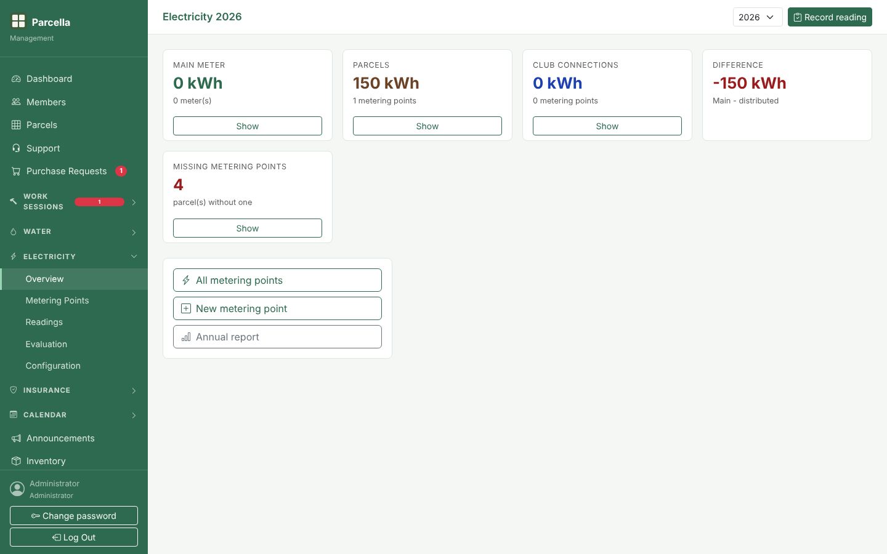
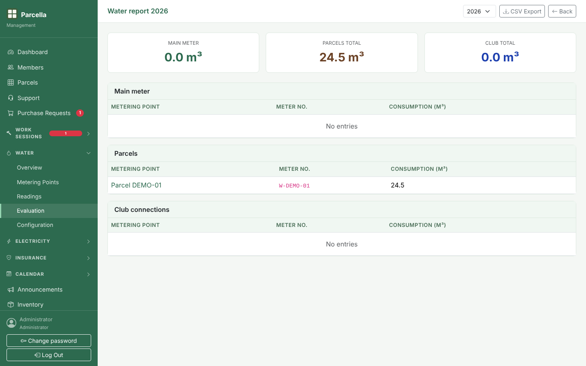

# Voda a elektrina {#water-and-electricity}

!!! note "Strojový preklad"
    Táto stránka bola strojovo preložená z angličtiny a zatiaľ nebola skontrolovaná. Ak je niečo nejasné, platí anglická verzia (jazyk prepnete hore).

Mnohé spolky nakupujú vodu a elektrinu cez jednu hlavnú prípojku a
ďalej ich rozdeľujú parcelám cez podružné meradlá. Táto kapitola
opisuje oba moduly, **Voda** aj **Elektrina**. Sledujú vaše meradlá,
zbierajú ročné odpočty, počítajú spotrebu každej parcely a ukazujú, či
meradlá parciel dávajú dokopy to, čo ukazuje hlavný merač. Ročná cena
za jednotku, ktorú tu zadáte, sa používa, keď faktúry účtujú spotrebu.

Oba moduly fungujú úplne rovnako. Líšia sa len v týchto veciach:

| | Voda | Elektrina |
|---|---|---|
| Menu | **Voda** | **Elektrina** |
| Jednotka | m³ | kWh |
| Odpočty sa zadávajú s | jedným desatinným miestom (napr. 145,0) | celými číslami (napr. 950) |
| Prepínač modulu | **Správa vody** | **Správa elektriny** |
| Oprávnenie skupiny | **Voda** | **Elektrina** |

Dáta o vode a elektrine sú úplne oddelené: parcela môže mať merací bod
vody aj merací bod elektriny a každý má vlastné meradlá, odpočty, ceny
a oprávnenia. Snímky obrazovky nižšie ukazujú modul vody. V module
elektriny je všetko na tom istom mieste, s kWh namiesto m³.

!!! info "Kto to môže používať"
    Oba moduly sú predvolene zapnuté. Ten, ktorý váš spolok nespravuje,
    vypnite v **Administrácia → Nastavenia** (**Správa vody**, **Správa
    elektriny**) -- pozri
    [Zapínanie a vypínanie modulov](../administration/modules.md). Dáta
    zostanú a znova sa objavia, keď modul zapnete.

    Používatelia Admin a Výbor môžu všetko. Ostatní používatelia
    potrebujú [skupinu](../administration/groups.md) s oprávneniami
    **Voda** alebo **Elektrina**: *čítanie* na zobrazenie stránok a
    sťahovanie súborov CSV, *zápis* na vytváranie meracích bodov,
    zaznamenávanie odpočtov, výmenu meradiel, import a nastavovanie
    cien, *mazanie* na mazanie meracích bodov, odpočtov a cien.

V bočnom menu má každý modul položky **Prehľad**, **Meracie body**,
**Odpočty**, **Hodnotenie** a **Konfigurácia**.

## Meracie body a meradlá {#metering-points-and-meters}

Všade sa používajú dve slová:

- **Merací bod** je miesto, kde sa meria spotreba. Je jedného z troch
  typov:
    - **Hlavný merač** -- odovzdávacie miesto dodávateľa, kde spolok
      preberá vodu alebo elektrinu,
    - **Parcela** -- prípojka jednej parcely,
    - **Spolok** -- prípojka vo vlastníctve spolku, napríklad klubovňa
      alebo umývacia stanica.
- **Meradlo** je fyzické zariadenie v meracom bode s vlastným číslom.
  Keď sa meradlo vymení, merací bod zostane a dostane nové meradlo;
  staré sa zachová v histórii.

## Ako fungujú odpočty a spotreba {#how-readings-and-consumption-work}

Tieto pravidlá platia všade, kde sa zadávajú odpočty -- na stránke
odpočtov, na stránke meracieho bodu aj v importe CSV.

- **Jeden odpočet na meradlo a rok.** Každý odpočet patrí k roku
  (zúčtovaciemu roku) a má dátum. Ak zaznamenáte odpočet za rok, ktorý
  už nejaký má, stará hodnota, dátum a poznámka sa **nahradia**. Takto
  sa aj opravuje chyba.
- **Spotreba** roka = odpočet tohto roka mínus posledný odpočet
  skoršieho roka. Ak skorší odpočet neexistuje, použije sa
  **Počiatočný stav** meradla. Bez odpočtu za rok spotreba nie je
  („žiadny odpočet“ alebo „–“).
- **Rok sa neberie z dátumu.** Odpočet urobený v januári môže stále
  patriť k cyklu minulého roka. Rok si vždy vyberáte sami.

### Upozornenia na nevierohodnosť {#plausibility-warnings}

Meradlo normálne len pripočítava. Parcella vás upozorní -- ale
**odpočet aj tak uloží** --, keď:

- je odpočet **menší ako predchádzajúci odpočet** toho istého meradla
  (posledný skorší rok alebo počiatočný stav), alebo
- je odpočet **väčší ako už zaznamenaný neskorší odpočet** toho istého
  meradla.

Hneď po uložení uvidíte žltý pruh, napríklad **Odpočet uložený, ale
skontrolujte ho, prosím: Odpočet merača (110.0) je menší ako
predchádzajúci odpočet (120.5) toho istého merača. Bol skorší odpočet
odhadnutý? Skontrolujte to, prosím.** Upozornenie zostáva viditeľné pri
odpočte na stránke meracieho bodu a na stránke odpočtov, kým hodnoty
nesedia.

!!! tip "Prečo len upozorňuje"
    Ak bol minuloročný odpočet odhadnutý príliš vysoko, tohtoročný
    skutočný odpočet je nižší. Zablokovanie by znemožnilo zadať
    skutočnú hodnotu. Zaznamenajte skutočný odpočet a potom opravte ten
    odhadnutý.

Druhá kontrola porovnáva súčty: ak parcely a prípojky spolku spolu
spotrebovali za rok **viac** ako hlavný merač, červený pruh v prehľade a
v hodnotení to povie. Je to náznak, nie chyba: kým sa odpočty ešte
zbierajú, čísla sú často neúplné.

### Výmena meradla {#meter-exchange}

Keď sa meradlo vymieňa -- napríklad preto, že mu vypršala kalibrácia --,
použite **Vymeniť merač** na [stránke meracieho bodu](#metering-point-page).
Staré meradlo sa nezmaže: označí sa ako odstránené a uvedie sa v
**Predchádzajúce merače** so svojím posledným odpočtom. Nové meradlo
začína vlastným **Počiatočný stav**, takže staré a nové odpočty sa
nikdy nepomiešajú.

**Konečný stav starého meradla.** Zadajte, čo staré meradlo ukazuje v
deň demontáže. Uloží sa ako odpočet starého meradla za daný rok a
spotreba meracieho bodu za tento rok potom sčíta obe meradlá: staré po
jeho konečný stav, nové od jeho počiatočného stavu. Faktúra aj
**Hodnotenie** používajú tento súčet; hodnotenie takýto bod označí „vr.
vymeneného meradla“. Bez konečného stavu sa za daný rok počíta len nové
meradlo.

**Vymeniť** je na skutočnú výmenu. Ak ste sa len pomýlili v čísle
meradla alebo v dátume, použite namiesto toho **Upraviť merač** --
opraví aktuálne meradlo bez vytvorenia nového.

### Násobiteľ {#factor}

Niektoré meradlá ukazujú len časť toho, čo cez ne naozaj tečie. Veľký
elektromer za meracími transformátormi môže počítať 1/20 energie, takže
jeho údaj treba vynásobiť 20. Pre takýto merací bod nastavte
**Násobiteľ** (zvyčajne 1):

- Odpočty sa stále zadávajú presne tak, ako ich ukazuje displej;
  kontrola vierohodnosti pracuje s týmito hodnotami.
- Spotreba v tomto module sa násobí násobiteľom (zaokrúhlená na dve
  desatinné miesta, ak násobiteľ nie je 1). Násobiteľ patrí meraciemu
  bodu, takže prežije výmenu meradla, a jeho zmena platí pre všetky
  roky.
- Body s násobiteľom iným ako 1 ukazujú odznak, napríklad **×20**.

!!! warning "Násobiteľ sa na faktúrach nepoužíva"
    Faktúry účtujú obyčajný rozdiel medzi odpočtami, bez násobiteľa.

### Vypnutie meracieho bodu {#switching-a-metering-point-off}

Ak prípojka nejaký čas nemá dodávku -- voda je zastavená, elektrina
parcely odpojená --, merací bod **vypnite** namiesto zmazania. Vypnutý
bod:

- sa už nezobrazuje na stránke odpočtov, v exporte odpočtov CSV ani v
  počte „ešte nemá odpočet“ -- **pokiaľ už nemá odpočet za daný rok**,
  takže konečný odpočet zostane viditeľný a upraviteľný,
- je v zozname sivý s odznakom **Vypnuté**,
- si ponechá všetky svoje meradlá a odpočty.

Pre fakturáciu netreba nič zvláštne: bez odpočtu za rok nie je spotreba,
takže sa nič neúčtuje. Opätovné zapnutie ho vráti späť.

## Prehľad {#overview}

Úvodná stránka modulu s nadpisom **Voda** (alebo **Elektrina**) a
rokom. Príďte sem, aby ste videli, či sú všetky odpočty za rok zadané a
či čísla sedia.

| Pole / tlačidlo | Čo robí |
|---|---|
| Výber roka | Prepne rok. Uvádza každý rok, ktorý má odpočty, plus aktuálny rok. |
| **Zaznamenať odpočet** | Otvorí [stránku odpočtov](#readings) pre tento rok. |
| Červený pruh | Parcely a prípojky spolku spolu spotrebovali v tomto roku viac ako hlavný merač. |
| Modrý pruh | **... merací(é) bod(y) ešte nemá(ú) odpočet pre ...** s **Zaznamenať teraz →**. Počíta aktívne body s meradlom a bez odpočtu za rok. |
| Dlaždica **Hlavný merač** | Spotreba hlavného merača (meračov) a koľko ich je. **Zobraziť** ich vypíše. |
| Dlaždica **Parcely** | Celková spotreba všetkých meracích bodov parciel a koľko ich je. **Zobraziť** ich vypíše. |
| Dlaždica **Prípojky spolku** | To isté pre prípojky spolku. |
| Dlaždica **Rozdiel** | Hlavný merač mínus parcely a spolok (**Hlavný - rozdelený**): voda alebo energia, ktorá sa nepodarila zaúčtovať, napr. únikmi alebo pomaly idúcimi meradlami. Červená, keď je záporná. |
| Dlaždica **Chýbajúce merné body** | Koľko parciel nemá merací bod pre toto médium. **Zobraziť** ich vypíše. Počítajú sa aj ukončené parcely -- stále ich treba sledovať, kým sa nasťahuje ďalší nájomca. |
| **Všetky meracie body** | Otvorí [zoznam](#metering-points). |
| **Nový merací bod** | Otvorí [formulár](#new-metering-point). Potrebuje oprávnenie na zápis. |
| **Výročná správa** | Otvorí [Hodnotenie](#evaluation) za tento rok. |

## Meracie body {#metering-points}

Všetky meracie body tohto média: najprv hlavné merače, potom parcely
podľa čísla parcely, potom prípojky spolku podľa označenia.

| Pole / tlačidlo | Čo robí |
|---|---|
| **Späť** | Vráti sa na prehľad. |
| **CSV import** | Otvorí dialóg na nahratie súboru CSV (pozri [Import meracích bodov](#importing-metering-points)). Potrebuje oprávnenie na zápis. |
| **CSV export** | Stiahne všetky meracie body (pozri nižšie). |
| **Nový merací bod** | Otvorí [formulár](#new-metering-point). Potrebuje oprávnenie na zápis. |
| **Všetky** / **Aktívne** / **Vypnuté** | Ukáže všetky body, len aktívne alebo len vypnuté. |
| Pruh filtra | Keď ste prišli z dlaždice prehľadu, sivý pruh pomenuje filter (napr. **Parcela**). **Zrušiť filter** znova ukáže všetko. |

| Stĺpec | Čo ukazuje / robí |
|---|---|
| **Typ** | **Hlavný merač**, **Parcela** alebo **Spolok**. |
| **Merací bod** | „Parcela“ plus číslo parcely alebo označenie. Odkazuje na [stránku meracieho bodu](#metering-point-page). |
| **Číslo merača** | Číslo aktuálneho meradla s odznakom **×**, ak je nastavený násobiteľ; **žiadny aktívny merač**, ak žiadne nie je. |
| **Stav** | **aktívny**, **Vypnuté** (podržte myš a uvidíte odkedy) alebo **bez merača**. |
| **Kalibrovaný do** | Rok, keď aktuálnemu meradlu vyprší kalibrácia. Výstražný trojuholník znamená **Kalibrácia vypršala** -- rok bol dosiahnutý. |
| Tlačidlo s okom | Otvorí stránku meracieho bodu. |
| Kôš | Zmaže merací bod po varovaní **Naozaj vymazať tento merací bod? Všetky súvisiace merače a odpočty budú tiež vymazané.** Potrebuje oprávnenie na mazanie. |

Počet meracích bodov je uvedený pod tabuľkou.

!!! warning "Zmazanie odstráni celú históriu"
    Zmazanie meracieho bodu zmaže aj všetky jeho meradlá a odpočty,
    takže zmizne aj minulá spotreba. Ak je prípojka len mimo prevádzky,
    namiesto toho ju [vypnite](#switching-a-metering-point-off).

### Chýbajúce merné body {#missing-metering-points}

Otvorí sa tlačidlom **Zobraziť** na dlaždici **Chýbajúce merné body**.
Namiesto tabuľky stránka uvádza každú parcelu bez meracieho bodu pre
toto médium -- ukončené parcely sú označené **(ukončená)**. **Pridať
merný bod** otvorí [formulár](#new-metering-point) s už vybranou
parcelou (oprávnenie na zápis). Ak nič nechýba, hovorí **Každá parcela
má merný bod.**

### CSV export (meracie body) {#csv-export-metering-points}

Súbor oddelený bodkočiarkami s jedným riadkom na merací bod a jeho
aktuálne meradlo: Type, Parcel number, Label, Meter number, Installed
on, Calibrated until, Initial reading, Active, Inactive since, Factor.
Má rovnaký formát, aký očakáva import, takže môžete exportovať, upraviť
v tabuľke a nové body znova importovať.

## Import meracích bodov {#importing-metering-points}

Užitočné pri prvom nastavení modulu. Kliknite na **CSV import** v
zozname meracích bodov, vyberte súbor `.csv` a kliknite na
**Importovať**. Stĺpce nepotrebujú špeciálne názvy -- priradíte ich na
ďalšej stránke. Rozpoznajú sa bodkočiarky aj čiarky a fungujú aj súbory
zo starších verzií Excelu (nie UTF-8).

### Mapovanie stĺpcov CSV {#map-csv-columns}

Z tejto stránky nie je snímka obrazovky, pretože sa objaví až po
nahratí súboru.

Stránka ukazuje každý stĺpec vášho súboru s jeho prvými piatimi
riadkami. Nad každým stĺpcom vyberte, ku ktorému poľu patrí, alebo
**— Ignorovať —**. Parcella priradenie odhadne z nadpisov stĺpcov, po
anglicky alebo po nemecky (napríklad „Zählernummer“ sa stane **Číslo
meradla**).

| Pole | Čo znamená |
|---|---|
| **Typ** | `MAIN_METER`, `PARCEL` alebo `CLUB`. Ak stĺpec Typ vôbec nepriradíte, každý riadok sa považuje za parcelu -- typické pre obyčajný zoznam meradiel parciel. |
| **Číslo parcely** | Pri riadkoch parciel: číslo existujúcej parcely. |
| **Označenie** | Názov hlavného merača alebo prípojky spolku. |
| **Číslo meradla** | Číslo meradla. |
| **Inštalované** | Dátum ako 2026-09-18 alebo 18.09.2026. |
| **Kalibrovaný do** | Rok, napríklad 2032. Funguje aj dátum; použije sa jeho rok. Hodnota bez štvorciferného roka riadok preskočí. |
| **Počiatočný stav** | Odpočet meradla pri inštalácii; prázdne = 0. |
| **Násobiteľ** | Prázdne = 1. |
| **Importovať** | Vytvorí meracie body. Aspoň jeden stĺpec musí byť priradený. |

Čo sa stane:

- Vytvárajú sa len **nové** meracie body; existujúce sa nikdy nemenia.
  Riadok parcely sa preskočí, ak parcela už merací bod má, a riadok
  hlavného merača alebo spolku, ak existuje jeden s rovnakým
  označením -- takže dvojitý import toho istého súboru neuškodí. Riadky
  hlavných meračov alebo prípojok spolku bez označenia sa nedajú
  skontrolovať a vždy sa vytvoria.
- Riadky sa preskočia, ak je typ neplatný, číslo parcely neexistuje
  alebo je násobiteľ neplatný.
- Nové body začínajú ako aktívne.

Potom zoznam ukáže zhrnutie ako **12 importovaných, 2 preskočených** s
dôvodmi pre prvé tri preskočené riadky.

## Nový merací bod {#new-metering-point}

Otvorí sa z prehľadu, zo zoznamu alebo tlačidlom **Pridať merný bod**
pri parcele bez neho. Potrebuje oprávnenie na zápis. Prvá karta opisuje
merací bod, druhá jeho meradlo.

| Pole | Čo robí |
|---|---|
| **Typ** | **Parcela**, **Prípojný bod vo vlastníctve spolku** alebo **Hlavný merač (bod odovzdania energií)**. |
| **Parcela** | Zobrazí sa pri bodoch parciel. Uvádza aktívne a ukončené parcely. |
| **Označenie** | Zobrazí sa pri bodoch spolku a hlavného merača, napríklad „klubovňa“. |
| **Poznámky** | Čokoľvek užitočné, napr. kde je meradlo. |
| **Číslo** | Povinné. Číslo meradla. To isté číslo sa môže vyskytnúť viackrát -- Parcella duplicity nekontroluje. |
| **Kalibrovaný do (rok)** | Rok, keď vyprší kalibrácia, napr. 2032. |
| **Inštalovaný dňa** | Predvyplnené dnešným dňom. |
| **Počiatočný odpočet** | Odpočet meradla pri inštalácii; z neho sa počíta spotreba prvého roka. Predvolene 0. |
| **Násobiteľ** | Násobiteľ medzi údajom na displeji a skutočnou spotrebou, zvyčajne 1 (pozri [Násobiteľ](#factor)). Musí byť väčší ako 0, najviac 100 000, s najviac štyrmi desatinnými miestami. |
| **Zrušiť** / **Vytvoriť merací bod** | Uloženie otvorí stránku nového meracieho bodu. |

!!! tip
    **Parcela** a **Označenie** sú označené ako povinné, ale formulár
    vás nezastaví, ak ich necháte prázdne. Vždy ich vyplňte, inak sa
    odpočty pre tento bod nedajú v importe CSV priradiť a bod sa v
    zoznamoch ťažko hľadá.

## Stránka meracieho bodu {#metering-point-page}

Všetko o jednom meracom bode: jeho údaje, aktuálne meradlo, odpočty a
predchádzajúce meradlá.

| Tlačidlo (hore) | Čo robí |
|---|---|
| **Predchádzajúci** / **Ďalší** | Prejde na predchádzajúci alebo ďalší merací bod v poradí zoznamu. Aj klávesmi Ctrl+← a Ctrl+→. |
| **Späť** | Vráti sa do zoznamu. |

### Merací bod {#metering-point}

Ukazuje **Typ**, **Stav** (**aktívny** alebo **Vypnuté** s dátumom
**od**), **Parcela** (s odkazom), **Násobiteľ**, ak nie je 1, a
**Poznámky**.

S oprávnením na zápis môžete meniť:

| Pole / tlačidlo | Čo robí |
|---|---|
| **Označenie** | Voliteľné pri bodoch parciel (napr. „Východný vchod“); názov bodov spolku a hlavného merača. |
| **Poznámky** | Voľný text. |
| **Násobiteľ** | Pozri [Násobiteľ](#factor). Mení spotrebu pre všetky roky, vrátane minulých. Neplatné hodnoty sa odmietnu s vysvetlením. |
| **Uložiť** | Uloží tieto tri polia. |
| **Vypnúť od** + **Vypnúť** | Vypne bod od zvoleného dátumu (predvolene dnes). Pozri [Vypnutie meracieho bodu](#switching-a-metering-point-off). |
| **Znova zapnúť** | Zobrazí sa pri vypnutých bodoch. |

### Aktuálne meradlo {#current-meter}

Ukazuje **Číslo**, **Inštalovaný dňa**, **Kalibrovaný do** (s odznakom
**Kalibrácia vypršala**, keď sa ten rok dosiahne) a **Počiatočný
odpočet**. Ak žiadne nie je: **Pre tento merací bod neexistuje aktívny
merač.**

S oprávnením na zápis sú tu dve tlačidlá:

**Upraviť merač** -- opraví aktuálne meradlo na mieste, pri preklepoch:

| Pole | Čo robí |
|---|---|
| **Číslo** | Povinné. |
| **Inštalovaný dňa**, **Kalibrovaný do**, **Počiatočný odpočet** | Zmenia uložené hodnoty. Zmena počiatočného odpočtu zmení spotrebu prvého roka meradla. |
| **Uložiť** | Uloží bez vytvorenia nového meradla. |

**Vymeniť merač** -- zaznamená fyzickú výmenu meradla (pozri
[Výmena meradla](#meter-exchange)):

| Pole | Čo robí |
|---|---|
| **Starý merač odstránený dňa** | Povinné, predvolene dnes. |
| **Konečný stav starého meradla** | Čo staré meradlo ukazuje v deň demontáže. Uloží sa ako jeho odpočet za daný rok, takže sa vyúčtuje jeho spotreba až po výmenu. „Ku dňu demontáže. Bez neho sa spotreba starého meradla od posledného odpočtu nevyúčtuje.“ |
| **Nový merač nainštalovaný dňa** | Povinné, predvolene dnes. |
| **Nové číslo** | Povinné. |
| **Kalibrovaný do** | Rok kalibrácie nového meradla. |
| **Počiatočný odpočet** | Odpočet nového meradla pri inštalácii, predvolene 0. |
| **Vymeniť** | Po potvrdení **Naozaj chcete vymeniť merač? Starý merač bude deaktivovaný.** sa staré meradlo presunie do **Predchádzajúce merače**. |

### Odpočty {#readings}

Odpočty aktuálneho meradla, najnovší rok prvý.

| Stĺpec | Čo ukazuje / robí |
|---|---|
| **Rok** | Zúčtovací rok. |
| **Dátum** | Dátum odpočtu. |
| **Odpočet (m³)** | Hodnota, ako ju ukazuje meradlo, so žltým upozornením na nevierohodnosť, ak nesedí. |
| **Spotreba (m³)** | Spotreba v danom roku, vynásobená násobiteľom (zobrazeným ako odznak v nadpise). |
| **Poznámka** | Vaša poznámka. |
| Kôš | Po potvrdení zmaže odpočet. Potrebuje oprávnenie na mazanie. |

**Zaznamenanie odpočtu** (oprávnenie na zápis), pod tabuľkou:

| Pole | Čo robí |
|---|---|
| **Rok** | Povinné, predvolene aktuálny rok. |
| **Dátum** | Povinné, predvolene dnes. |
| **Odpočet merača (m³)** | Povinné. Ako desatinný oddeľovač funguje čiarka aj bodka. |
| **Poznámka** | Voliteľné, napr. „odhadnuté“. |
| **Zaznamenať odpočet** | Uloží odpočet. Ak rok už nejaký má, nahradí sa. Text, ktorý nie je číslo, sa odmietne hlásením **Neplatný odpočet merača**. |

### Predchádzajúce meradlá {#former-meters}

Vymenené meradlá, naposledy odstránené prvé, s **Číslo**,
**Inštalovaný**, **Odstránený** a **Posledný odpočet**.

## Odpočty {#readings_1}

Stránka na zber ročných odpočtov, urobená tak, aby fungovala v telefóne
počas obchôdzky areálu. Otvoríte ju cez **Odpočty** v menu alebo
**Zaznamenať odpočet** v prehľade. Nadpis ukazuje médium a rok, napr.
**Voda odpočet 2026**.

| Pole / tlačidlo | Čo robí |
|---|---|
| Výber roka | Rok, za ktorý zaznamenávate: budúci rok, tento rok alebo jeden z troch predchádzajúcich rokov. |
| **CSV import** | Nahrá odpočty zo súboru (pozri [Import odpočtov](#importing-readings)). Potrebuje oprávnenie na zápis. |
| **CSV export** | Stiahne zoznam tohto roka (pozri nižšie). |
| **Späť** | Vráti sa na prehľad. |

Stránka uvádza každý merací bod, ktorý tento rok potrebuje odpočet, v
troch skupinách: **Hlavný merač**, **Parcely** (podľa čísla parcely) a
**Prípojky spolku**. Vypnuté body sa zobrazia, len ak už majú odpočet
za daný rok. Každý riadok ukazuje:

- názov meracieho bodu a číslo meradla,
- **Predchádzajúci rok**: posledný odpočet pred týmto rokom alebo
  počiatočný stav -- nová hodnota by nemala byť nižšia,
- ak je odpočet už zadaný: hodnotu so **zaznamenané** a prípadné
  upozornenie na nevierohodnosť,
- inak, s oprávnením na zápis, vstupné pole a tlačidlo s fajkou.
  Napíšte hodnotu a stlačte tlačidlo; dátum sa nastaví na dnes. Bez
  oprávnenia na zápis: **Zatiaľ nezadané**.

!!! tip "Oprava zaznamenanej hodnoty"
    Raz zaznamenanú hodnotu na tejto stránke nemožno zmeniť. Otvorte
    stránku meracieho bodu a zaznamenajte odpočet za ten istý rok
    znova -- nahradí ten starý.

### CSV export (odpočty) {#csv-export-readings}

Súbor oddelený bodkočiarkami za vybraný rok s jedným riadkom na každý
merací bod, ktorý potrebuje odpočet: Type, Parcel number, Label, Meter
number, Year, Date, Reading, Note. Dátum a odpočet sú prázdne tam, kde
zatiaľ nič nie je zaznamenané -- hodí sa ako formulár pre osobu, ktorá
odčítava meradlá, ktorý môžete vyplniť a znova importovať.

## Import odpočtov {#importing-readings}

Kliknite na **CSV import** na stránke odpočtov, vyberte súbor a
kliknite na **Importovať**. Jeden súbor môže obsahovať odpočty za viac
rokov.

### Mapovanie stĺpcov CSV {#map-csv-columns_1}

Z tejto stránky nie je snímka obrazovky, pretože sa objaví až po
nahratí súboru.

Rovnako ako pri meracích bodoch vyberte pre každý stĺpec, ku ktorému
poľu patrí, alebo **— Ignorovať —**.

| Pole | Čo znamená |
|---|---|
| **Typ** | `MAIN_METER`, `PARCEL` alebo `CLUB`. Ak nie je priradený, každý riadok sa počíta ako parcela. |
| **Číslo parcely** / **Označenie** | Nájdu merací bod: číslo parcely pri parcelách, označenie pri hlavných meračoch a prípojkách spolku. |
| **Číslo meradla** | Voliteľná kontrola: ak nezodpovedá **aktuálnemu** meradlu bodu, riadok sa preskočí, pretože odpočet by mohol patriť meradlu, ktoré bolo medzitým vymenené. |
| **Rok** | Zúčtovací rok riadku. |
| **Dátum** | Povinné. 2026-09-18 alebo 18.09.2026. |
| **Stav meradla** | Povinné. |
| **Poznámka** | Voliteľné. |
| **Predvolený rok (voliteľné)** | Použije sa pre každý riadok, kde stĺpec Rok nie je priradený alebo je prázdny. Vlastný Rok riadku má vždy prednosť. Parcella nikdy neháda rok z dátumu. |
| **Importovať** | Zaznamená odpočty. Aspoň jeden stĺpec musí byť priradený. |

Čo sa stane:

- Odpočty sa pridávajú len k **existujúcim** meracím bodom; import nikdy
  nevytvorí merací bod.
- Odpočet za rok, ktorý už nejaký má, ho nahradí.
- Riadky sa preskočia, ak sa merací bod nenájde, nemá aktívne meradlo,
  číslo meradla nesedí alebo rok, dátum či odpočet chýba alebo je
  neplatný.
- Nevierohodné odpočty sa aj tak zaznamenajú, rovnako ako pri ručnom
  zadaní.

Potom stránka odpočtov ukáže zhrnutie ako **40 odpočtov zaznamenaných,
2 preskočených (meracie miesto nenájdené)** s prvými dôvodmi a -- ak
treba -- žltý pruh **... odpočet/odpočtov zaznamenaných s upozornením na
nevierohodnosť** s dotknutými riadkami.

## Hodnotenie {#evaluation}

Ročná správa o spotrebe s nadpisom napr. **Voda správa 2026**. Otvoríte
ju cez **Hodnotenie** v menu alebo **Výročná správa** v prehľade.

| Pole / tlačidlo | Čo robí |
|---|---|
| Výber roka | Uvádza každý rok s odpočtami, plus aktuálny rok. |
| **CSV export** | Stiahne správu (pozri nižšie). |
| **Späť** | Vráti sa na prehľad. |
| Červený pruh | **Rozdelená spotreba ... presahuje spotrebu hlavného merača ...** -- pozri [Upozornenia na nevierohodnosť](#plausibility-warnings). |

Tri dlaždice ukazujú **Hlavný merač**, **Parcely celkom** a **Spolok
celkom**. Pod nimi sú tri tabuľky -- **Hlavný merač**, **Parcely** a
**Prípojky spolku** --, každá s **Merací bod** (s odkazom), **Číslo
merača** a **Spotreba (m³)** alebo *žiadny odpočet*, kde odpočet za rok
chýba. Spotreba zahŕňa násobiteľ.

Export CSV (bodkočiarky) používa nadpisy stĺpcov stránky v jazyku
spolku: Typ, Merací bod, Číslo merača, Odpočet a Spotreba (s jednotkou).

## Konfigurácia cien {#price-configuration}

Cena za m³ alebo kWh pre každý rok. Vyúčtovania ju používajú pre
položky **Spotreba vody (z modúlu)** a **Spotreba elektriny (z
modúlu)**: spotreba × cena roka vyúčtovania. Ak pre daný rok nie je
nastavená cena, tieto položky neúčtujú nič. Každý rok si ponechá svoju
cenu, takže minulé vyúčtovania zostanú správne, aj keď sa cena zmení.
Otvorte **Konfigurácia** v menu.

### Nová/aktualizovaná cena {#newupdate-price}

Potrebuje oprávnenie na zápis.

| Pole | Čo robí |
|---|---|
| **Rok** | Povinné, predvyplnené aktuálnym rokom. |
| **Cena za m³** (alebo **za kWh**) | Povinné, napr. 2.50. Ukladá sa na dve desatinné miesta. |
| **Poznámka** | Napr. „zmena tarify dodávateľa“. |
| **Uložiť** | Uloží cenu. Ak rok už nejakú má, **prepíše sa**. |

### História cien {#price-history}

Všetky roky, najnovšie prvé, s **Rok**, **Cena** (za jednotku) a
**Poznámka**. Ceruzka otvorí [Upraviť cenu](#edit-price) (oprávnenie na
zápis); kôš po potvrdení zmaže cenu roka (oprávnenie na mazanie).

## Upraviť cenu {#edit-price}

Z tejto stránky nie je snímka obrazovky, pretože ukážkové dáta
neobsahujú žiadne ceny.

Otvorí sa ceruzkou v histórii cien. Polia: **Rok**, **Cena za m³**
(alebo **za kWh**) a **Poznámka**, s tlačidlami **Zrušiť** a
**Uložiť**. Ak zmeníte rok na taký, ktorý už cenu má, Parcella to
odmietne hlásením **Pre rok ... už existuje iná konfigurácia ceny.**

<!-- TODO(verify): confirm that already-created invoices keep their amounts when a year's price is changed afterwards. -->

## Súvisiace {#related}

- [Odpočty meradiel](../guides/meter-readings.md) -- ročný postup krok
  za krokom
- [Vyúčtovania](finances/invoice-runs.md) a
  [Ročné vyúčtovanie](../guides/annual-invoicing.md) -- účtovanie
  spotreby
- [Parcely](parcels.md) -- parcely, ku ktorým meracie body patria
- [Import členov a parciel](../guides/csv-import.md) -- rovnaký druh
  priradenia stĺpcov pri iných importoch
- [Prehľady](reporting.md)
