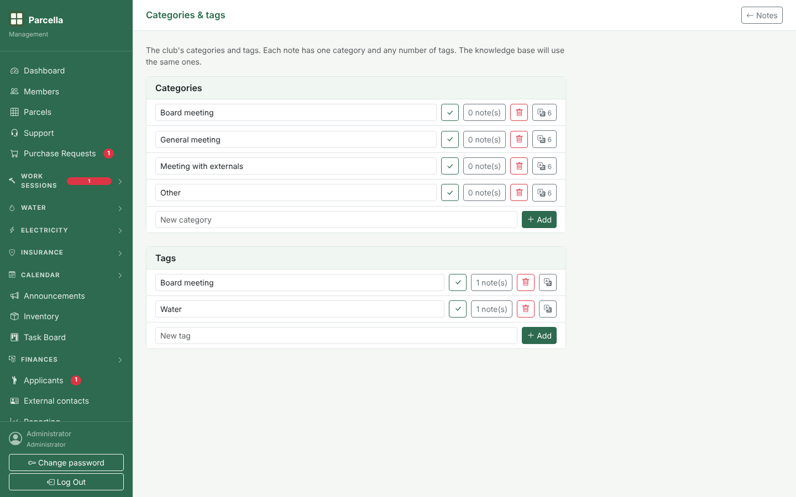

# Notizen {#notes}

Protokolle von Mitgliederversammlungen, Vorstandssitzungen, Treffen mit
Externen und alles andere, was festgehalten werden soll. Notizen werden in
Markdown geschrieben, einer Kategorie und Schlagworten zugeordnet und lassen
sich durchsuchen, filtern und sortieren. Nutzt dein Verein einen
Cloud-Speicher, kann jede Notiz dort als `.md`-Datei liegen, die du auch in
der Cloud öffnen und bearbeiten kannst.

!!! info "Wer das nutzen kann"
    - Der Modulschalter ist **Notizen** unter **Administration → Module ein-
      und ausschalten**. Er ist standardmäßig **an**.
    - Die Rollen **Vorstand** und **Administrator** sowie Mitglieder einer
      Gruppe mit **Voller Zugriff auf jedes Modul** können alles.
    - Alle anderen brauchen das Recht **Notizen** in einer ihrer
      [Gruppen](../administration/groups.md):
        - *Lesen*: Liste und Notizen sehen, sie herunterladen, **Abgleichen**
          ausführen;
        - *Schreiben*: Notizen anlegen und bearbeiten, Lesezeichen
          importieren, Kategorien und Schlagworte hinzufügen, umbenennen und
          übersetzen;
        - *Löschen*: Notizen, Kategorien und Schlagworte löschen.
    - Notizen in der Cloud abzulegen braucht außerdem das Modul
      **Cloud-Speicher** und einen Notizen-Ordner, siehe
      [Notizen in der Cloud](#notes-in-the-cloud).

## Notizliste {#note-list}

Öffne **Notizen** im Menü.

### Schaltflächen oben {#buttons-at-the-top}

| Schaltfläche | Was sie bewirkt |
|---|---|
| **Abgleichen** | Erscheint nur, wenn ein Notizen-Ordner eingerichtet ist. Liest jetzt die Änderungen aus dem Cloud-Ordner ein (siehe [Notizen in der Cloud](#notes-in-the-cloud)). |
| **Kategorien & Schlagworte** | Öffnet [Kategorien & Schlagworte](#categories-tags). |
| **Lesezeichen importieren** | Öffnet [Lesezeichen importieren](#import-bookmarks). Braucht *Schreiben*. |
| **Neue Notiz** | Öffnet ein leeres [Notizformular](#writing-a-note). Braucht *Schreiben*. |

### Suche und Filter {#search-and-filters}

| Feld / Schaltfläche | Was es bewirkt |
|---|---|
| **Suche** | Durchsucht Titel, Text und die Namen der Schlagworte. Groß- und Kleinschreibung spielen keine Rolle. |
| **Kategorie** | **Alle**, **Keine Kategorie** oder eine Kategorie. |
| **Schlagworte** | **Alle** oder ein Schlagwort. |
| **Von** / **Bis** | Nur Notizen, deren Datum in diesen Zeitraum fällt. |
| **Sortierung** | **Datum, neueste zuerst** (Vorgabe), **Datum, älteste zuerst**, **Titel**, **Zuletzt geändert**. |
| **Anwenden** | Wendet Suche, Filter und Sortierung an. |
| **Zurücksetzen** | Erscheint, sobald etwas gesetzt ist. Zurück zu allen Notizen, die neuesten zuerst. |

### Spalten {#columns}

| Spalte | Was sie zeigt |
|---|---|
| **Datum** | Der Tag, um den es in der Notiz geht (bei Protokollen: der Tag der Sitzung). |
| **Titel** | Verlinkt auf die Notiz. Ein Pfeil-Symbol öffnet den Quell-Link der Notiz in einem neuen Tab (Lesezeichen). Ein oranges Wolken-Symbol heißt **Noch nicht in der Cloud gespeichert**. |
| **Kategorie** | Ein Klick filtert die Liste danach. |
| **Schlagworte** | Ein Klick auf eines filtert die Liste danach. |
| **Geändert** | Wann die Notiz zuletzt gespeichert wurde (auf kleinen Bildschirmen ausgeblendet). |

Ist die Liste leer, steht dort **Noch keine Notizen.** oder, mit gesetztem
Filter, **Keine Notizen passen zu diesen Filtern.**

## Eine Notiz lesen {#reading-a-note}

Klick auf den Titel einer Notiz. Du siehst Titel, Datum, Kategorie und
Schlagworte (jeweils anklickbar, um die Liste zu filtern), bei einem
Lesezeichen die **Quelle (Link)**, und den formatierten Text. Die Fußzeile
zeigt, wer die Notiz angelegt und wer sie zuletzt geändert hat, und mit
einem Cloud-Ordner den Dateipfad der Notiz.

| Schaltfläche | Was sie bewirkt |
|---|---|
| **Alle Notizen** | Zurück zur Liste. |
| **.md herunterladen** | Lädt die Notiz als Markdown-Datei herunter, mit Titel, Datum, Kategorie und Schlagworten in einem Kopfteil oben. |
| **PDF herunterladen** | Lädt die Notiz als PDF mit dem Briefkopf deines Vereins herunter. Bilder, die nur aus dem Web verlinkt sind, fehlen. |
| **Bearbeiten** | Öffnet das Formular. Braucht *Schreiben*. |
| **Notiz löschen** | Braucht *Löschen*. Fragt **Diese Notiz löschen? Die zugehörige Datei in der Cloud wird ebenfalls gelöscht.** |

Beim Öffnen liest Parcella die Datei der Notiz zuerst neu aus der Cloud, du
siehst also immer den aktuellen Text. Klappt das nicht, zeigt die Seite
**Die Cloud-Datei konnte nicht gelesen werden, angezeigt wird der zuletzt
abgeglichene Stand: ...** mit dem Grund.

## Eine Notiz schreiben {#writing-a-note}

**Neue Notiz** oder **Bearbeiten** öffnet das Formular (**Neue Notiz** /
**Notiz bearbeiten**).

| Feld / Schaltfläche | Was es bewirkt |
|---|---|
| **Titel** | Pflicht, bis zu 255 Zeichen. |
| **Datum** | Pflicht. Der Tag, um den es in der Notiz geht, nicht der Tag, an dem du sie schreibst. |
| **Kategorie** | **Keine Kategorie** oder eine der Kategorien des Vereins. |
| **Schlagworte** | Bestehende Schlagworte anhaken. |
| **Neue Schlagworte, durch Komma getrennt** | Neue Schlagworte eintippen, getrennt durch Kommas. Sie entstehen beim Speichern und kommen in die Schlagwortliste des Vereins. |
| **Quelle (Link)** | Freiwillig: die Webseite, um die es in dieser Notiz geht. Eine Notiz mit Quelle ist ein Lesezeichen. Muss mit `http://` oder `https://` beginnen. |
| **Notiz** | Der Text, in Markdown. Mit einem Cloud-Ordner sagt das Feld, wo die Datei gespeichert wird. |
| **Speichern** | Speichert die Notiz. |
| **Abbrechen** | Zurück ohne Speichern. |

Der Editor hat eine Werkzeugleiste für fett, kursiv, durchgestrichen,
Überschrift, Zitat, Listen, Code, Link, Tabelle und Trennlinie. Das
Augen-Symbol zeigt eine Vorschau, das geteilte Symbol Text und Vorschau
nebeneinander, die Pfeile schalten auf Vollbild, und das Fragezeichen öffnet
eine Markdown-Anleitung.

Mögliche Meldungen: **Bitte einen Titel eingeben.**, **Bitte ein Datum
eingeben.**, **Die Quelle muss eine Webadresse sein, die mit http:// oder
https:// beginnt.**, **Diese Kategorie gibt es (nicht mehr).**, **Dieses
Schlagwort gibt es (nicht mehr).**

## Notizen in der Cloud {#notes-in-the-cloud}

Ist das Modul **Cloud-Speicher** eingeschaltet und hat ein Administrator
einen **Notizen-Ordner** unter **Administration → Integrationen →
Cloud-Speicher (Parzellendokumente, Rechnungen, Sicherungen)** festgelegt, ist
der Text jeder Notiz eine Markdown-Datei in diesem Ordner.

!!! note "Die Datei ist das Original des Texts"
    Der Text in der Cloud-Datei gewinnt. Du und andere könnt diese Dateien
    mit jedem Editor in der Cloud öffnen und ändern (Nextcloud Text,
    Obsidian und so weiter); die Änderungen erscheinen in Parcella. Titel,
    Datum, Kategorie, Schlagworte und Quelle gibt es nur in Parcella, sie
    werden nicht in die Datei geschrieben.

So funktioniert es in der Praxis:

- **Speichern** schreibt zuerst die Datei. Lässt sie sich nicht schreiben,
  wird die Notiz nicht gespeichert, und du siehst **Nicht gespeichert, die
  Cloud-Datei konnte nicht geschrieben werden: ...**, dein Text bleibt im
  Formular. Änderst du nur Titel, Datum, Schlagworte oder Quelle, wird die
  Datei gar nicht angefasst.
- **Unterordner sind Kategorien.** Eine Notiz im Ordner „Vorstandssitzung/“
  bekommt die Kategorie „Vorstandssitzung“ (bei Bedarf angelegt). Speicherst
  du eine Notiz mit anderer Kategorie, wandert ihre Datei in den Ordner
  dieser Kategorie. Notizen ohne Kategorie liegen direkt im Notizen-Ordner.
- **Neue Dateien** werden nach Datum und Titel benannt, z. B.
  `20261108-vorstandssitzung.md`. Parcella benennt eine Datei danach nie um.
- **In der Cloud angelegte Dateien** werden zu Notizen. Ihr Datum kommt vom
  Anfang des Dateinamens (`2026-11-08`, `20261108` oder `202506` für den
  1. dieses Monats), sonst vom Änderungsdatum der Datei.
- **Abgleichen**: Die Notizliste liest beim Öffnen Änderungen aus der Cloud
  im Hintergrund ein, höchstens einmal pro Minute; sie erscheinen beim
  nächsten Öffnen der Liste. **Abgleichen** tut es sofort und meldet
  **Abgeglichen: … neu, … geändert, … entfernt, … hochgeladen.** Eine in
  der Cloud gelöschte Datei entfernt ihre Notiz aus der Liste.
- **Löschen** einer Notiz in Parcella löscht auch ihre Datei. Klappt das
  nicht, wird die Notiz nicht gelöscht: **Nicht gelöscht, die Cloud-Datei
  konnte nicht gelöscht werden: ...**
- **Noch kein Ordner?** Notizen liegen dann nur in Parcella und sind mit
  **Noch nicht in der Cloud gespeichert** markiert. Sie werden beim ersten
  Abgleich hochgeladen, nachdem ein Ordner festgelegt ist.

### Wenn jemand die Datei gleichzeitig geändert hat {#when-someone-changed-the-file-at-the-same-time}

Wurde die Datei in der Cloud geändert, während du bearbeitet hast, bricht
das Speichern mit **Nicht gespeichert: Die Notiz wurde inzwischen in der
Cloud geändert.** ab. Eine gelbe Karte **Inzwischen in der Cloud geändert**
zeigt die Cloud-Fassung (mit **Als Markdown anzeigen** für den Rohtext), und
dein eigener Text bleibt im Formular darunter. Übernimm, was du brauchst, und
klick erneut auf **Speichern**, um die Cloud-Fassung zu überschreiben.

Wurde eine Notiz sowohl in Parcella (solange kein Ordner gesetzt war) als
auch in der Cloud geändert, behält der Abgleich die Cloud-Fassung und
speichert deine als eigene Notiz mit dem Vermerk „Konfliktkopie“. **Abgleichen**
sagt dann, wie viele solcher Kopien entstanden sind. Es geht nichts
verloren.

## Kategorien & Schlagworte {#categories-tags}

**Kategorien & Schlagworte** zeigt die Kategorien und Schlagworte des
Vereins. Jede Notiz hat eine Kategorie und beliebig viele Schlagworte.
Dieselben Kategorien und Schlagworte soll auch die künftige Wissensdatenbank
nutzen. Neue Installationen beginnen mit vier Kategorien:
„Mitgliederversammlung“, „Vorstandssitzung“, „Treffen mit Externen“ und
„Sonstiges“. **Notizen** (oben rechts) führt zurück.

Die Seite hat zwei Karten, **Kategorien** und **Schlagworte**, die gleich
funktionieren:

| Feld / Schaltfläche | Was es bewirkt |
|---|---|
| Name + Häkchen-Schaltfläche | Benennt die Kategorie oder das Schlagwort um. Braucht *Schreiben*; sonst wird der Name nur angezeigt. Das Umbenennen einer Kategorie verschiebt die Dateien ihrer Notizen beim nächsten Abgleich in einen Ordner mit dem neuen Namen; der alte, leere Ordner bleibt zurück. |
| „… Notiz(en)“ | Öffnet die Notizliste, danach gefiltert. |
| Übersetzen-Schaltfläche | Öffnet die Namen je Sprache. Mit *Schreiben* kannst du für jede Sprache, die Parcella unterstützt, einen Namen eintragen und auf **Übersetzungen speichern** klicken; leere Felder zeigen den Hauptnamen. |
| Papierkorb-Schaltfläche | Löscht die Kategorie oder das Schlagwort nach **"…" löschen? Die Notizen bleiben erhalten, nur ohne diesen Eintrag.** Braucht *Löschen*. |
| **Neue Kategorie** / **Neues Schlagwort** + **Hinzufügen** | Fügt eines hinzu. Braucht *Schreiben*. |

## Lesezeichen importieren {#import-bookmarks}

Sammelt dein Verein nützliche Links (Lieferanten, Behörden, Anleitungen) in
Nextcloud Bookmarks oder einem Browser, kannst du sie auf einen Schlag zu
Notizen machen. Jedes Lesezeichen wird eine Notiz mit dem Link als Quelle.

1. Exportiere deine Lesezeichen als HTML-Datei. Nextcloud Bookmarks und
   jeder Browser können eine erzeugen.
2. Klick auf **Lesezeichen importieren**, wähl die Datei und klick auf
   **Vorschau anzeigen**. Noch wird nichts gespeichert.
3. Die Vorschau sagt, wie viele „neu“ sind, „schon eine Notiz“ (eine Notiz
   mit demselben Link gibt es -- übersprungen) und „kein Weblink“
   (übersprungen). Die Tabelle listet für jedes Lesezeichen **Datum**,
   **Titel** (mit Link und Beschreibung), **Schlagworte** und **Status**.
4. Klick auf **… Lesezeichen importieren** oder **Andere Datei wählen**.

Die neuen Notizen bekommen keine Kategorie; mit einem Cloud-Ordner werden sie
im Hauptordner der Notizen gespeichert. Die Ordner der Lesezeichen werden zu
Schlagworten, die Beschreibung wird zum Text, und das Datum, an dem das
Lesezeichen angelegt wurde, wird zum Datum der Notiz. Parcella öffnet die
verlinkten Seiten nie.

Enthält die Datei keine Lesezeichen: **In dieser Datei wurden keine
Lesezeichen gefunden.**

## Notizen und KI-Assistenten {#notes-and-ai-assistants}

Ein Administrator kann das Modul **MCP-Connector für KI-Clients**
einschalten. Ein KI-Assistent wie Claude kann dann Notizen durchsuchen, lesen
und schreiben -- aber nur Notizen mit dem Freigabe-Schlagwort (standardmäßig
`ki-freigegeben`). Jede andere Notiz bleibt für ihn unsichtbar. Notizen, die
die KI schreibt, bekommen ein Schlagwort (standardmäßig `ki-erstellt`), damit
du weißt, was du prüfen solltest. Standardmäßig ist das aus, weil es
Vereinsnotizen an einen externen Dienst gibt.

## Siehe auch {#related}

- [Integrationen](../administration/integrations.md) -- Cloud-Speicher und
  der Notizen-Ordner.
- [API-Tokens](../administration/api-tokens.md)
- [Gruppen](../administration/groups.md) -- jemandem Rechte für Notizen
  geben.
- [Module ein- und ausschalten](../administration/modules.md)
