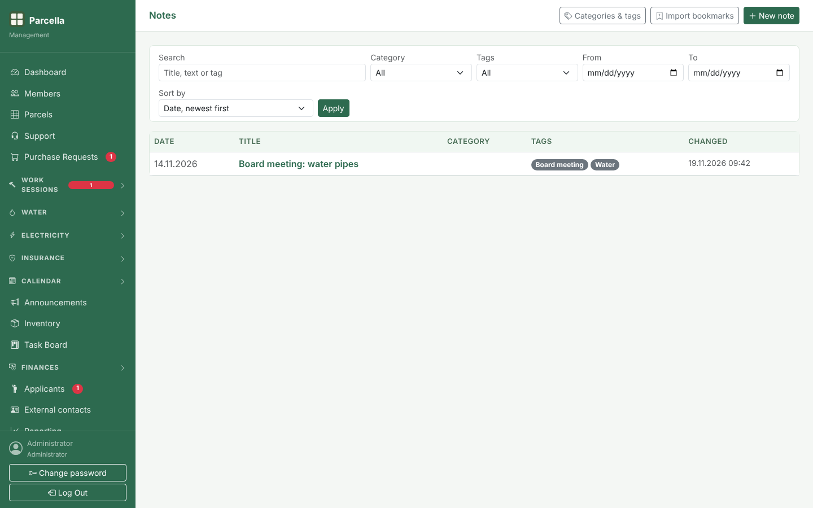
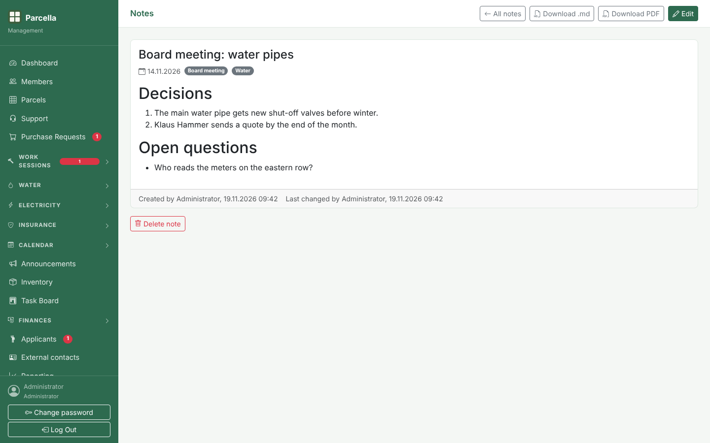

# Notities {#notes}

!!! note "Machinevertaling"
    Deze pagina is machinaal vertaald uit het Engels en nog niet nagekeken. Als iets onduidelijk is, geldt de Engelse versie (taal wisselt u bovenaan).

Notulen van algemene ledenvergaderingen, bestuursvergaderingen,
gesprekken met mensen van buiten, en alles wat verder het opschrijven
waard is. Notities worden in Markdown geschreven, onder een categorie en
labels opgeborgen, en kunnen worden doorzocht, gefilterd en gesorteerd.
Gebruikt uw vereniging een cloudopslag, dan kan elke notitie daar als
`.md`-bestand staan dat u ook in de cloud kunt openen en bewerken.

!!! info "Wie kan dit gebruiken"
    - De moduleschakelaar is **Notities** onder **Administratie → Modules
      in- en uitschakelen**. Ze staat standaard **aan**.
    - De rollen **Bestuur** en **Beheerder**, en leden van een groep met
      **Volledige toegang tot elke module**, kunnen alles.
    - Alle anderen hebben het recht **Notities** in een van hun
      [groepen](../administration/groups.md) nodig:
        - *lezen*: de lijst en de notities zien, ze downloaden,
          **Synchroniseren** uitvoeren;
        - *schrijven*: notities aanmaken en bewerken, bladwijzers
          importeren, categorieën en labels toevoegen, hernoemen en
          vertalen;
        - *verwijderen*: notities, categorieën en labels verwijderen.
    - Notities in de cloud bewaren vraagt ook de module **Cloudopslag**
      en een notitiemap, zie [Notities in de cloud](#notes-in-the-cloud).

## Lijst met notities {#note-list}

Open **Notities** in het menu.

### Knoppen bovenaan {#buttons-at-the-top}

| Knop | Wat het doet |
|---|---|
| **Synchroniseren** | Alleen zichtbaar als er een notitiemap is ingericht. Leest nu de wijzigingen uit de cloudmap (zie [Notities in de cloud](#notes-in-the-cloud)). |
| **Categorieën & labels** | Opent [Categorieën & labels](#categories-tags). |
| **Bladwijzers importeren** | Opent [Bladwijzers importeren](#import-bookmarks). Vraagt *schrijven*. |
| **Nieuwe notitie** | Opent een leeg [notitieformulier](#writing-a-note). Vraagt *schrijven*. |

### Zoeken en filters {#search-and-filters}

| Veld / knop | Wat het doet |
|---|---|
| **Zoeken** | Doorzoekt de titel, de tekst en de namen van de labels. Hoofd-/kleine letters maken niet uit. |
| **Categorie** | **Alle**, **Geen categorie**, of één categorie. |
| **Labels** | **Alle** of één label. |
| **Van** / **Tot** | Alleen notities waarvan de datum in dit bereik valt. |
| **Sorteren op** | **Datum, nieuwste eerst** (standaard), **Datum, oudste eerst**, **Titel**, **Laatst gewijzigd**. |
| **Toepassen** | Past zoekopdracht, filters en sortering toe. |
| **Wissen** | Getoond zodra er iets is ingesteld. Terug naar alle notities, de nieuwste eerst. |

### Kolommen {#columns}

| Kolom | Wat ze toont |
|---|---|
| **Datum** | De dag waar de notitie over gaat (bij notulen: de dag van de vergadering). |
| **Titel** | Gelinkt aan de notitie. Een pijlpictogram opent de bronlink van de notitie in een nieuw tabblad (bladwijzers). Een oranje wolkpictogram betekent **Nog niet in de cloud opgeslagen**. |
| **Categorie** | Klik om de lijst erop te filteren. |
| **Labels** | Klik op een label om de lijst erop te filteren. |
| **Gewijzigd** | Wanneer de notitie voor het laatst is opgeslagen (verborgen op kleine schermen). |

Is de lijst leeg, dan staat er **Nog geen notities.**, of **Geen notities
voldoen aan deze filters.** als er een filter is ingesteld.

## Een notitie lezen {#reading-a-note}

Klik op de titel van een notitie. U ziet de titel, de datum, categorie en
labels (elk klikbaar om de lijst te filteren), de **Bron (link)** als het
een bladwijzer is, en de opgemaakte tekst. Onderaan staat wie de notitie
heeft aangemaakt en wie haar het laatst heeft gewijzigd, en, met een
cloudmap, het bestandspad van de notitie.

| Knop | Wat het doet |
|---|---|
| **Alle notities** | Terug naar de lijst. |
| **.md downloaden** | Downloadt de notitie als Markdown-bestand, met titel, datum, categorie en labels in een kop bovenaan. |
| **PDF downloaden** | Downloadt de notitie als PDF met het briefhoofd van uw vereniging. Afbeeldingen die alleen van het web zijn gelinkt, worden weggelaten. |
| **Bewerken** | Opent het formulier. Vraagt *schrijven*. |
| **Notitie verwijderen** | Vraagt *verwijderen*. Vraagt **Deze notitie verwijderen? Het bestand in de cloud wordt ook verwijderd.** |

Een notitie openen leest eerst haar bestand opnieuw uit de cloud, zodat u
altijd de actuele tekst ziet. Mislukt dat, dan toont de pagina **Het
cloudbestand kon niet worden gelezen, de laatst gesynchroniseerde versie
wordt getoond: ...** met de reden.

## Een notitie schrijven {#writing-a-note}

**Nieuwe notitie** of **Bewerken** opent het formulier (**Nieuwe
notitie** / **Notitie bewerken**).

| Veld / knop | Wat het doet |
|---|---|
| **Titel** | Verplicht, maximaal 255 tekens. |
| **Datum** | Verplicht. De dag waar de notitie over gaat, niet de dag waarop u haar schrijft. |
| **Categorie** | **Geen categorie** of een van de categorieën van de vereniging. |
| **Labels** | Vink bestaande labels aan. |
| **Nieuwe labels, gescheiden door komma's** | Typ nieuwe labels, gescheiden door komma's. Ze worden bij het opslaan aangemaakt en aan de labellijst van de vereniging toegevoegd. |
| **Bron (link)** | Optioneel: de webpagina waar deze notitie over gaat. Een notitie met een bron is een bladwijzer. Moet beginnen met `http://` of `https://`. |
| **Notitie** | De tekst, in Markdown. Met een cloudmap zegt het veld waar het bestand wordt opgeslagen. |
| **Opslaan** | Slaat de notitie op. |
| **Annuleren** | Terug zonder op te slaan. |

De editor heeft een werkbalk voor vet, cursief, doorgehaald, kop, citaat,
lijsten, code, link, tabel en horizontale lijn. Het oogpictogram toont
een voorbeeld, het splitspictogram toont tekst en voorbeeld naast
elkaar, de pijlen schakelen naar volledig scherm, en het vraagteken opent
een Markdown-gids.

Mogelijke meldingen: **Vul een titel in.**, **Vul een datum in.**, **De
bron moet een webadres zijn dat begint met http:// of https://.**,
**Deze categorie bestaat niet (meer).**, **Dit label bestaat niet
(meer).**

## Notities in de cloud {#notes-in-the-cloud}

Staat de module **Cloudopslag** aan en heeft een beheerder een
**Notitiemap** ingesteld onder **Administratie → Integraties →
Cloudopslag (perceeldocumenten, facturen, back-ups)**, dan is de tekst
van elke notitie een Markdown-bestand in die map.

!!! note "Het bestand is het origineel van de tekst"
    De tekst in het cloudbestand wint. U en anderen kunnen deze bestanden
    met elke editor in de cloud openen en wijzigen (Nextcloud Text,
    Obsidian enzovoort); de wijzigingen verschijnen in Parcella. Titel,
    datum, categorie, labels en bron bestaan alleen in Parcella en
    worden niet in het bestand geschreven.

Zo werkt het in de praktijk:

- **Opslaan** schrijft eerst het bestand. Kan het bestand niet worden
  geschreven, dan wordt de notitie niet opgeslagen en ziet u **Niet
  opgeslagen, het cloudbestand kon niet worden geschreven: ...** met uw
  tekst nog in het formulier. Alleen titel, datum, labels of bron
  wijzigen raakt het bestand helemaal niet.
- **Submappen zijn categorieën.** Een notitie in de map
  „Bestuursvergadering/“ krijgt de categorie „Bestuursvergadering“
  (zo nodig aangemaakt). Een notitie met een andere categorie opslaan
  verplaatst haar bestand naar de map van die categorie. Notities zonder
  categorie staan direct in de notitiemap.
- **Nieuwe bestanden** worden genoemd naar datum en titel, bijv.
  `20261108-board-meeting.md`. Parcella hernoemt een bestand achteraf
  nooit.
- **Bestanden die in de cloud zijn aangemaakt** worden notities. Hun
  datum komt uit het begin van de bestandsnaam (`2026-11-08`,
  `20261108`, of `202506` voor de 1e van die maand), anders uit de datum
  waarop het bestand het laatst is gewijzigd.
- **Synchroniseren**: de lijst met notities openen leest op de
  achtergrond wijzigingen uit de cloud, hooguit eens per minuut; ze
  verschijnen de volgende keer dat u de lijst opent. **Synchroniseren**
  doet het nu en meldt **Gesynchroniseerd: {n} nieuw, {n} gewijzigd,
  {n} verwijderd, {n} geüpload.** Een bestand dat in de cloud is
  verwijderd, haalt zijn notitie uit de lijst.
- **Verwijderen** van een notitie in Parcella verwijdert ook haar
  bestand. Mislukt dat, dan wordt de notitie niet verwijderd: **Niet
  verwijderd, het cloudbestand kon niet worden verwijderd: ...**
- **Nog geen map?** Notities worden alleen in Parcella bewaard en
  gemarkeerd als **Nog niet in de cloud opgeslagen**. Ze worden bij de
  eerste synchronisatie na het instellen van een map geüpload.

### Als iemand het bestand tegelijk heeft gewijzigd {#when-someone-changed-the-file-at-the-same-time}

Is het bestand in de cloud gewijzigd terwijl u aan het bewerken was, dan
stopt het opslaan met **Niet opgeslagen: de notitie is intussen in de
cloud gewijzigd.** Een gele kaart **Intussen gewijzigd in de cloud**
toont de cloudversie (met **Als Markdown tonen** voor de ruwe tekst), en
uw eigen tekst blijft in het formulier eronder. Neem over wat u nodig
hebt en klik opnieuw op **Opslaan** om de cloudversie te overschrijven.

Is een notitie zowel in Parcella (terwijl er geen map was ingesteld) als
in de cloud gewijzigd, dan houdt de synchronisatie de cloudversie en
slaat ze de uwe op als aparte notitie met de toevoeging „conflict copy“.
**Synchroniseren** zegt dan hoeveel van zulke kopieën er zijn gemaakt. Er
gaat niets verloren.

## Categorieën & labels {#categories-tags}

**Categorieën & labels** toont de categorieën en labels van de
vereniging. Elke notitie heeft één categorie en willekeurig veel labels.
Dezelfde categorieën en labels zijn ook bedoeld voor de toekomstige
kennisbank. Nieuwe installaties beginnen met vier categorieën: „General
meeting“, „Board meeting“, „Meeting with externals“ en „Other“.
**Notities** (rechtsboven) brengt u terug.

De pagina heeft twee kaarten, **Categorieën** en **Labels**, die op
dezelfde manier werken:

| Veld / knop | Wat het doet |
|---|---|
| Naam + vinkknop | Hernoemt de categorie of het label. Vraagt *schrijven*; anders wordt de naam alleen getoond. Een categorie hernoemen verplaatst bij de volgende synchronisatie de bestanden van haar notities naar een map met de nieuwe naam; de oude, lege map blijft achter. |
| „{aantal} notitie(s)“ | Opent de lijst met notities gefilterd op dit item. |
| Vertaalknop | Opent de namen per taal. Met *schrijven* kunt u voor elke taal die Parcella ondersteunt een naam invullen en op **Vertalingen opslaan** klikken; lege velden tonen de hoofdnaam. |
| Prullenbakknop | Verwijdert de categorie of het label na **"{naam}" verwijderen? De notities blijven bestaan, alleen zonder dit item.** Vraagt *verwijderen*. |
| **Nieuwe categorie** / **Nieuw label** + **Toevoegen** | Voegt er een toe. Vraagt *schrijven*. |

## Bladwijzers importeren {#import-bookmarks}

Verzamelt uw vereniging nuttige links (leveranciers, instanties,
handleidingen) in Nextcloud Bookmarks of een browser, dan kunt u ze in
één keer in notities omzetten. Elke bladwijzer wordt een notitie met de
link als bron.

1. Exporteer uw bladwijzers als HTML-bestand. Nextcloud Bookmarks en elke
   browser kunnen dat maken.
2. Klik op **Bladwijzers importeren**, kies het bestand en klik op
   **Voorbeeld tonen**. Er wordt nog niets opgeslagen.
3. Het voorbeeld zegt hoeveel er „nieuw“ zijn, „al een notitie“ (er
   bestaat al een notitie met dezelfde link -- overgeslagen) en „geen
   weblink“ (overgeslagen). De tabel toont **Datum**, **Titel** (met link
   en beschrijving), **Labels** en **Status** voor elke bladwijzer.
4. Klik op **{aantal} bladwijzer(s) importeren**, of op **Ander bestand
   kiezen**.

De nieuwe notities krijgen geen categorie; met een cloudmap worden ze in
de hoofdmap van de notitiemap opgeslagen. De mappen van de bladwijzers
worden labels, de beschrijving wordt de tekst, en de datum waarop de
bladwijzer is toegevoegd wordt de datum van de notitie. Parcella opent de
gelinkte pagina's nooit.

Bevat het bestand geen bladwijzers: **Geen bladwijzers gevonden in dit
bestand.**

## Notities en AI-assistenten {#notes-and-ai-assistants}

Een beheerder kan de module **MCP-connector voor AI-clients**
inschakelen. Een AI-assistent zoals Claude kan dan notities doorzoeken,
lezen en schrijven -- maar alleen notities met het vrijgavelabel
(standaard `ki-freigegeben`). Elke andere notitie blijft voor hem
onzichtbaar. Notities die de AI schrijft, krijgen een label (standaard
`ki-erstellt`), zodat u weet wat u moet nakijken. Dit staat standaard
uit, omdat het verenigingsnotities aan een externe dienst geeft.

<!-- TODO(verify): where the release and created tag names are configured in the UI (stored as club settings); and link to the API tokens page section on "MCP connector only" tokens. -->

## Gerelateerd {#related}

- [Integraties](../administration/integrations.md) -- cloudopslag en de
  notitiemap.
- [API-tokens](../administration/api-tokens.md)
- [Groepen](../administration/groups.md) -- iemand rechten op notities
  geven.
- [Modules in- en uitschakelen](../administration/modules.md)
