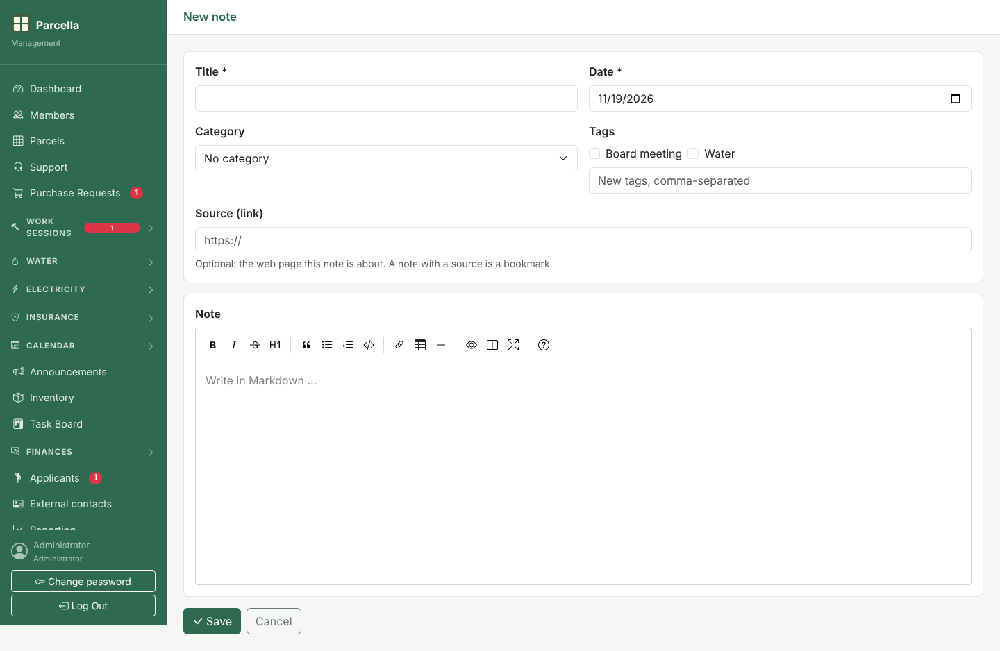
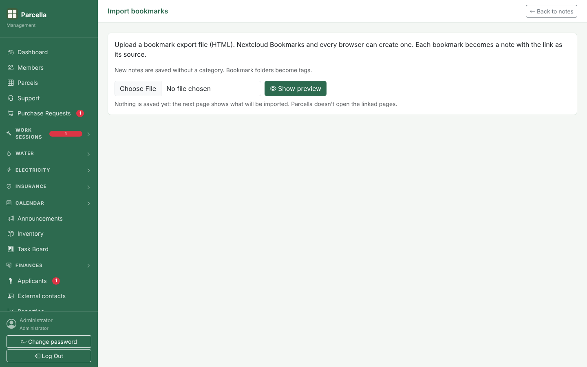

# Poznámky {#notes}

!!! note "Strojový preklad"
    Táto stránka bola strojovo preložená z angličtiny a zatiaľ nebola skontrolovaná. Ak je niečo nejasné, platí anglická verzia (jazyk prepnete hore).

Zápisnice z členských schôdzí, schôdzí výboru, stretnutí s ľuďmi
zvonka a čokoľvek iné, čo stojí za zapísanie. Poznámky sa píšu v
Markdowne, zaraďujú sa do kategórie a štítkov a dajú sa vyhľadávať,
filtrovať a zoraďovať. Ak váš spolok používa cloudové úložisko, každá
poznámka môže byť uložená ako súbor `.md`, ktorý môžete otvoriť a
upraviť aj v cloude.

!!! info "Kto to môže používať"
    - Prepínač modulu je **Poznámky** v časti **Administrácia →
      Zapínanie a vypínanie modulov**. Predvolene je **zapnutý**.
    - Roly **Výbor** a **Administrátor** a členovia skupiny s **Plný
      prístup ku každému modulu** môžu všetko.
    - Všetci ostatní potrebujú oprávnenie **Poznámky** v niektorej zo
      svojich [skupín](../administration/groups.md):
        - *čítanie*: vidieť zoznam a poznámky, sťahovať ich, spustiť
          **Synchronizovať**;
        - *zápis*: vytvárať a upravovať poznámky, importovať záložky,
          pridávať, premenovávať a prekladať kategórie a štítky;
        - *mazanie*: mazať poznámky, kategórie a štítky.
    - Ukladanie poznámok v cloude potrebuje aj modul **Cloudové
      úložisko** a priečinok poznámok, pozri [Poznámky v
      cloude](#notes-in-the-cloud).

## Zoznam poznámok {#note-list}

Otvorte **Poznámky** v menu.

### Tlačidlá hore {#buttons-at-the-top}

| Tlačidlo | Čo robí |
|---|---|
| **Synchronizovať** | Zobrazí sa, len keď je nastavený priečinok poznámok. Hneď načíta zmeny z cloudového priečinka (pozri [Poznámky v cloude](#notes-in-the-cloud)). |
| **Kategórie a štítky** | Otvorí [Kategórie a štítky](#categories-tags). |
| **Importovať záložky** | Otvorí [Importovať záložky](#import-bookmarks). Potrebuje *zápis*. |
| **Nová poznámka** | Otvorí prázdny [formulár poznámky](#writing-a-note). Potrebuje *zápis*. |

### Vyhľadávanie a filtre {#search-and-filters}

| Pole / tlačidlo | Čo robí |
|---|---|
| **Hľadať** | Hľadá v názve, texte a názvoch štítkov. Na veľkosti písmen nezáleží. |
| **Kategória** | **Všetky**, **Bez kategórie** alebo jedna kategória. |
| **Štítky** | **Všetky** alebo jeden štítok. |
| **Od** / **Do** | Len poznámky, ktorých dátum spadá do tohto rozsahu. |
| **Zoradiť podľa** | **Dátum, najnovšie prvé** (predvolené), **Dátum, najstaršie prvé**, **Názov**, **Posledná zmena**. |
| **Použiť** | Použije vyhľadávanie, filtre a zoradenie. |
| **Zrušiť filter** | Zobrazí sa, keď je niečo nastavené. Späť na všetky poznámky, najnovšie prvé. |

### Stĺpce {#columns}

| Stĺpec | Čo ukazuje |
|---|---|
| **Dátum** | Deň, ktorého sa poznámka týka (pri zápisniciach: deň schôdze). |
| **Názov** | Odkaz na poznámku. Ikona šípky otvorí zdrojový odkaz poznámky v novej karte (záložky). Oranžová ikona oblaku znamená **Zatiaľ neuložené v cloude**. |
| **Kategória** | Kliknutím podľa nej zoznam vyfiltrujete. |
| **Štítky** | Kliknutím na niektorý podľa neho zoznam vyfiltrujete. |
| **Zmenené** | Kedy bola poznámka naposledy uložená (na malých obrazovkách skryté). |

Keď je zoznam prázdny, hovorí **Zatiaľ žiadne poznámky.** alebo, keď je
nastavený filter, **Týmto filtrom nezodpovedá žiadna poznámka.**

## Čítanie poznámky {#reading-a-note}

Kliknite na názov poznámky. Uvidíte názov, dátum, kategóriu a štítky
(každý klikateľný na filtrovanie zoznamu), **Zdroj (odkaz)**, ak ide o
záložku, a formátovaný text. Päta ukazuje, kto poznámku vytvoril a kto
ju naposledy zmenil, a pri cloudovom priečinku cestu k súboru poznámky.

| Tlačidlo | Čo robí |
|---|---|
| **Všetky poznámky** | Späť do zoznamu. |
| **Stiahnuť .md** | Stiahne poznámku ako súbor Markdown s názvom, dátumom, kategóriou a štítkami v hlavičke na začiatku. |
| **Stiahnuť PDF** | Stiahne poznámku ako PDF s hlavičkou vášho spolku. Obrázky, ktoré sú len odkazované z webu, sa vynechajú. |
| **Upraviť** | Otvorí formulár. Potrebuje *zápis*. |
| **Zmazať poznámku** | Potrebuje *mazanie*. Pýta sa **Zmazať túto poznámku? Zmaže sa aj jej súbor v cloude.** |

Otvorenie poznámky najprv znova načíta jej súbor z cloudu, takže vždy
vidíte aktuálny text. Ak sa to nepodarí, stránka ukáže **Súbor v cloude
sa nepodarilo prečítať, zobrazená je naposledy synchronizovaná verzia:
...** s dôvodom.

## Písanie poznámky {#writing-a-note}

**Nová poznámka** alebo **Upraviť** otvorí formulár (**Nová poznámka** /
**Upraviť poznámku**).

| Pole / tlačidlo | Čo robí |
|---|---|
| **Názov** | Povinné, najviac 255 znakov. |
| **Dátum** | Povinné. Deň, ktorého sa poznámka týka, nie deň, keď ju píšete. |
| **Kategória** | **Bez kategórie** alebo jedna z kategórií spolku. |
| **Štítky** | Zaškrtnite existujúce štítky. |
| **Nové štítky, oddelené čiarkou** | Napíšte nové štítky oddelené čiarkami. Vytvoria sa pri uložení a pridajú sa do zoznamu štítkov spolku. |
| **Zdroj (odkaz)** | Voliteľné: webová stránka, ktorej sa poznámka týka. Poznámka so zdrojom je záložka. Musí začínať `http://` alebo `https://`. |
| **Poznámka** | Text v Markdowne. Pri cloudovom priečinku pole hovorí, kde sa súbor ukladá. |
| **Uložiť** | Uloží poznámku. |
| **Zrušiť** | Späť bez uloženia. |

Editor má panel nástrojov pre tučné písmo, kurzívu, preškrtnutie,
nadpis, citát, zoznamy, kód, odkaz, tabuľku a vodorovnú čiaru. Ikona
oka ukáže náhľad, ikona rozdelenia ukáže text a náhľad vedľa seba,
šípky prepnú na celú obrazovku a otáznik otvorí návod k Markdownu.

Možné hlásenia: **Zadajte názov.**, **Zadajte dátum.**, **Zdroj musí
byť webová adresa začínajúca http:// alebo https://.**, **Táto
kategória (už) neexistuje.**, **Tento štítok (už) neexistuje.**

## Poznámky v cloude {#notes-in-the-cloud}

Keď je zapnutý modul **Cloudové úložisko** a administrátor nastavil
**Priečinok poznámok** v časti **Administrácia → Integrácie → Cloudové
úložisko (dokumenty parciel, faktúry, zálohy)**, text každej poznámky
je súbor Markdown v tomto priečinku.

!!! note "Súbor je hlavnou kópiou textu"
    Text v cloudovom súbore má prednosť. Vy aj iní môžete tieto súbory
    otvárať a meniť akýmkoľvek editorom v cloude (Nextcloud Text,
    Obsidian a podobne); zmeny sa objavia v Parcelle. Názov, dátum,
    kategória, štítky a zdroj sú len v Parcelle a do súboru sa
    nezapisujú.

Ako to funguje v praxi:

- **Uloženie** najprv zapíše súbor. Ak sa súbor nedá zapísať, poznámka
  sa neuloží a uvidíte **Neuložené, súbor v cloude sa nepodarilo
  zapísať: ...**, pričom váš text zostane vo formulári. Zmena len
  názvu, dátumu, štítkov alebo zdroja sa súboru vôbec nedotkne.
- **Podpriečinky sú kategórie.** Poznámka v priečinku „Schôdza výboru/“
  dostane kategóriu „Schôdza výboru“ (vytvorí sa, ak treba). Uloženie
  poznámky s inou kategóriou presunie jej súbor do priečinka tejto
  kategórie. Poznámky bez kategórie sú priamo v priečinku poznámok.
- **Nové súbory** sa pomenúvajú podľa dátumu a názvu, napr.
  `20261108-schodza-vyboru.md`. Parcella súbor potom nikdy
  nepremenuje.
- **Súbory vytvorené v cloude** sa stanú poznámkami. Ich dátum sa
  vezme zo začiatku názvu súboru (`2026-11-08`, `20261108` alebo
  `202506` pre 1. deň toho mesiaca), inak z dátumu poslednej zmeny
  súboru.
- **Synchronizácia**: otvorenie zoznamu poznámok načíta zmeny z cloudu
  na pozadí, najviac raz za minútu; objavia sa pri ďalšom otvorení
  zoznamu. **Synchronizovať** to urobí hneď a ohlási
  **Synchronizované: {n} nových, {n} zmenených, {n} odstránených, {n}
  nahraných.** Súbor zmazaný v cloude odstráni svoju poznámku zo
  zoznamu.
- **Zmazanie** poznámky v Parcelle zmaže aj jej súbor. Ak sa to
  nepodarí, poznámka sa nezmaže: **Nezmazané, súbor v cloude sa
  nepodarilo zmazať: ...**
- **Ešte nie je priečinok?** Poznámky sa uchovávajú len v Parcelle a
  sú označené **Zatiaľ neuložené v cloude**. Nahrajú sa pri prvej
  synchronizácii po nastavení priečinka.

### Keď niekto zmenil súbor v rovnakom čase {#when-someone-changed-the-file-at-the-same-time}

Ak bol súbor zmenený v cloude, kým ste ho upravovali, uloženie sa
zastaví s hlásením **Neuložené: poznámka bola medzitým zmenená v
cloude.** Žltá karta **Medzitým zmenené v cloude** ukáže verziu z
cloudu (s **Zobraziť ako Markdown** pre surový text) a váš vlastný text
zostane vo formulári pod ňou. Prekopírujte, čo potrebujete, a kliknite
znova na **Uložiť**, aby ste verziu v cloude prepísali.

Ak bola poznámka zmenená v Parcelle (kým nebol nastavený priečinok) aj
v cloude, synchronizácia ponechá verziu z cloudu a vašu uloží ako
samostatnú poznámku označenú ako „konfliktná kópia“. **Synchronizovať**
potom povie, koľko takých kópií vzniklo. Nič sa nestratí.

## Kategórie a štítky {#categories-tags}

**Kategórie a štítky** ukazuje kategórie a štítky spolku. Každá
poznámka má jednu kategóriu a ľubovoľný počet štítkov. Tie isté
kategórie a štítky má používať aj budúca znalostná báza. Nové
inštalácie začínajú so štyrmi kategóriami: „Členská schôdza“, „Schôdza
výboru“, „Stretnutie s externými“ a „Ostatné“. **Poznámky** (vpravo
hore) vás vráti späť.

Stránka má dve karty, **Kategórie** a **Štítky**, ktoré fungujú
rovnako:

| Pole / tlačidlo | Čo robí |
|---|---|
| Názov + tlačidlo s fajkou | Premenuje kategóriu alebo štítok. Potrebuje *zápis*; inak sa názov len zobrazí. Premenovanie kategórie pri ďalšej synchronizácii presunie súbory jej poznámok do priečinka s novým názvom; starý, prázdny priečinok zostane. |
| „Poznámky: {count}“ | Otvorí zoznam poznámok filtrovaný podľa neho. |
| Tlačidlo prekladu | Otvorí názvy pre jednotlivé jazyky. So *zápisom* môžete zadať názov pre každý jazyk, ktorý Parcella podporuje, a kliknúť na **Uložiť preklady**; prázdne polia ukazujú hlavný názov. |
| Tlačidlo koša | Zmaže kategóriu alebo štítok po otázke **Zmazať "{name}"? Poznámky zostanú, len bez tejto položky.** Potrebuje *mazanie*. |
| **Nová kategória** / **Nový štítok** + **Pridať** | Pridá nový. Potrebuje *zápis*. |

## Importovať záložky {#import-bookmarks}

Ak váš spolok zbiera užitočné odkazy (dodávatelia, úrady, návody) v
Nextcloud Bookmarks alebo v prehliadači, môžete z nich naraz urobiť
poznámky. Každá záložka sa stane poznámkou s odkazom ako zdrojom.

1. Exportujte svoje záložky ako súbor HTML. Vytvoriť ho vie Nextcloud
   Bookmarks aj každý prehliadač.
2. Kliknite na **Importovať záložky**, vyberte súbor a kliknite na
   **Zobraziť náhľad**. Zatiaľ sa nič neuloží.
3. Náhľad uvedie, koľko je „nových“, koľko „už je poznámkou“
   (poznámka s rovnakým odkazom existuje -- preskočí sa) a koľko „nie
   je webový odkaz“ (preskočí sa). Tabuľka uvádza pre každú záložku
   **Dátum**, **Názov** (s odkazom a popisom), **Štítky** a **Stav**.
4. Kliknite na **Importovať záložky ({count})** alebo **Vybrať iný
   súbor**.

Nové poznámky nedostanú kategóriu; pri cloudovom priečinku sa uložia
do koreňa priečinka poznámok. Priečinky záložky sa stanú štítkami,
popis sa stane textom a dátum pridania záložky dátumom poznámky.
Parcella odkazované stránky nikdy neotvára.

Ak súbor neobsahuje žiadne záložky: **V tomto súbore sa nenašli žiadne
záložky.**

## Poznámky a AI asistenti {#notes-and-ai-assistants}

Administrátor môže zapnúť modul **Konektor MCP pre klientov AI**. AI
asistent, napríklad Claude, potom môže vyhľadávať, čítať a zapisovať
poznámky -- ale len poznámky so štítkom uvoľnenia (predvolene
`ki-freigegeben`). Každá iná poznámka pre neho zostáva neviditeľná.
Poznámky, ktoré AI napíše, dostanú štítok (predvolene `ki-erstellt`),
aby ste vedeli, čo skontrolovať. Predvolene je to vypnuté, pretože to
odovzdáva poznámky spolku externej službe.

<!-- TODO(verify): where the release and created tag names are configured in the UI (stored as club settings); and link to the API tokens page section on "MCP connector only" tokens. -->

## Súvisiace {#related}

- [Integrácie](../administration/integrations.md) -- cloudové úložisko
  a priečinok poznámok.
- [API tokeny](../administration/api-tokens.md)
- [Skupiny](../administration/groups.md) -- udelenie oprávnení pre
  poznámky.
- [Zapínanie a vypínanie modulov](../administration/modules.md)
