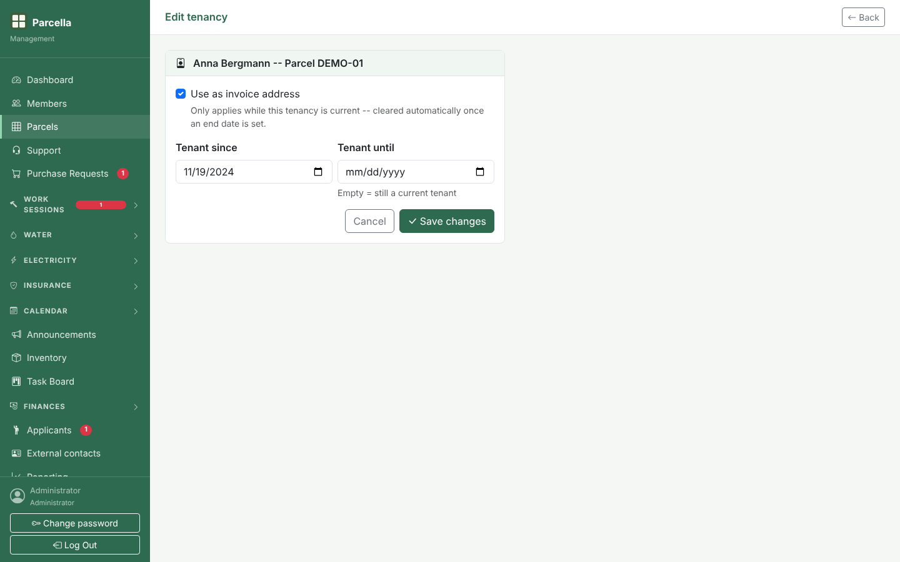

# Parcely {#parcels}

!!! note "Strojový překlad"
    Tato stránka byla strojově přeložena z angličtiny a dosud nebyla zkontrolována. Pokud je něco nejasné, platí anglická verze (jazyk přepnete nahoře).

Seznam parcel obsahuje každou zahrádku vašeho spolku: její číslo,
rozlohu, stav a kdo ji drží. Každá parcela si uchovává úplnou historii
nájmů, takže i po letech vidíte, kdo měl kterou zahrádku a kdy.

!!! info "Kdo to může používat"
    Parcely jsou součástí jádra a jsou vždy zapnuté. Vypnout je nelze.

    - **Každý, kdo se může přihlásit,** si může prohlížet seznam parcel,
      stránky parcel a export CSV.
    - **Přidávání a úpravy** parcel a přidělování, úpravy a ukončování
      nájmů vyžadují oprávnění k *zápisu* u **Členové a parcely**.
    - **Smazání** záznamu bývalého nájmu nebo trvalé smazání parcely
      vyžaduje oprávnění k *mazání* u **Členové a parcely**.
    - Karta **Dokumenty (cloudové úložiště)** na stránce parcely je jen
      pro členy výboru a administrátory, a jen dokud je zapnutý modul
      **Cloudové úložiště** (ve výchozím stavu vypnutý).

    Viz [Role, skupiny a oprávnění](../getting-started/roles-and-permissions.md).

## Stavy parcel {#parcel-statuses}

Každá parcela má jeden ze čtyř stavů:

| Stav | Význam |
|---|---|
| **aktivní** | Běžná, pronajatá parcela. |
| **ukončená** | Nájem byl vypovězen -- parcela čeká na nového nájemce. Jen ukončené parcely lze [předat uchazečům](applicants.md#assign-a-parcel). |
| **společná** | Společná plocha, kterou spolek spravuje sám -- cesty, hřiště, trávník u klubovny. Evidujete ji jako parcelu, s rozlohou, ale nepronajímá se členům. Pokud se spolek přece jen rozhodne ji pronajmout, můžete ji přepnout zpět na **aktivní**. |
| **smazaná** | Parcela už neexistuje, např. po sloučení dvou zahrádek. Její historie se zachová. |

Stav měníte ve [formuláři parcely](#new-parcel-and-edit-parcel). Každá
změna se zaznamená s datem a uživatelem do historie změn parcely, takže
nepotřebujete samostatné datum výpovědi.

## Seznam parcel {#parcel-list}

Otevřete **Parcely** v hlavním menu. Seznam ukazuje každou parcelu,
seřazenou podle čísla parcely -- včetně smazaných, pokud nefiltrujete
podle stavu.

### Tlačítka nahoře {#buttons-at-the-top}

| Tlačítko | Co dělá |
|---|---|
| **CSV import** | Otevře dialog importu (viz [Import parcel ze souboru CSV](#importing-parcels-from-a-csv-file)). Vyžaduje oprávnění k zápisu. |
| **CSV export** | Stáhne všechny parcely jako soubor CSV (viz [Export CSV](#csv-export)). |
| **Nová parcela** | Otevře prázdný [formulář parcely](#new-parcel-and-edit-parcel). Vyžaduje oprávnění k zápisu. |

### Hledání a filtr {#search-and-filter}

| Pole / tlačítko | Co dělá |
|---|---|
| **Hledat číslo parcely…** | Najde parcely, jejichž číslo obsahuje zadaný text. Chcete-li parcelu najít podle jména nájemce, hledejte místo toho v [seznamu členů](members.md#search-and-filters). |
| **Všechny stavy** | Ukáže jen parcely se zvoleným stavem. Použije se, jakmile ho změníte. |
| **Hledat** | Použije hledaný text. |
| **Zrušit filtr** | Zruší hledání i filtr stavu. Zobrazí se, jen dokud je jeden z nich aktivní. |

Stejně jako v seznamu členů zachovávají **Předchozí**, **Další** a
**Zpět** na stránce parcely filtr, ze kterého jste přišli.

### Sloupce {#columns}

| Sloupec | Co ukazuje |
|---|---|
| Zaškrtávací políčko | Vybere parcelu pro **Exportovat vybrané** nebo **Napsat nájemcům** (viz níže). |
| **Číslo parcely** | Kliknutím parcelu otevřete. |
| **Rozloha** | Rozloha v metrech čtverečních, nebo „–“. |
| **Stav** | **aktivní**, **ukončená**, **společná** nebo **smazaná**. |
| **Nájemce** | Současní nájemci. Kliknutím na jméno otevřete člena. Bývalí a budoucí nájemci se zde nezobrazují. |
| Tlačítko s okem | Otevře stránku parcely. |

Zápatí ukazuje počet parcel v seznamu a, pokud jsou rozlohy zaznamenány,
jejich celkovou rozlohu -- hodí se ke kontrole vyfiltrovaného výběru,
např. celkové rozlohy všech aktivních parcel.

### Výběr parcel a psaní jejich nájemcům {#picking-parcels}

Každý řádek má zaškrtávací políčko, takže můžete parcely vybrat ručně --
například všechny parcely podél jednoho vodovodního potrubí -- a poslat
oznámení lidem, kteří je mají pronajaté.

| Tlačítko | Co dělá |
|---|---|
| **Vybrat vše** | Zaškrtne každou parcelu v aktuálním seznamu. |
| **Zrušit výběr** | Zruší všechna zaškrtnutí. |
| **Vybráno: *N*** | Počítá zaškrtnuté parcely. |
| **Exportovat vybrané** | Stáhne soubor CSV (viz níže) jen se zaškrtnutými parcelami. Neaktivní, dokud jednu nezaškrtnete. |
| **Napsat nájemcům** | Zahájí nové [oznámení](announcements.md) **současným** nájemcům zaškrtnutých parcel. Zobrazí se, jen dokud je zapnutý modul **Oznámení**, a jen členům výboru a administrátorům. |

Oznámení parcelám se týká **nájmu**, ne členství ve spolku: je
adresováno nájemcům každé parcely společně, jako roční faktura. Tedy:

- **Jedno oznámení na parcelu.** Kdo má pronajaté dvě ze zaškrtnutých
  parcel, dostane dvě oznámení, jedno za každý nájem. Každý e-mail a
  dopis uvádí svou parcelu („Parcela 12“).
- **E-mail** každému nájemci, který povoluje informace e-mailem (**Může
  dostávat informace e-mailem**) a má adresu.
- **Dopis** ostatním nájemcům: jeden na poštovní adresu, s uvedením
  všech tam bez e-mailu -- i když někdo, s kým bydlí, dostal e-mail. S
  **Poslat dopis i členům, kteří dostanou e-mail** dostane dopis každý s
  poštovní adresou.
- Bývalí a budoucí nájemci se vynechávají.

Pro zprávy členům (novinky spolku, pozvánky na členskou schůzi) použijte
místo toho [seznam členů](members.md).

### Export CSV {#csv-export}

**CSV export** stáhne soubor `parcels.csv`, oddělený středníky, se
*všemi* parcelami -- hledání a filtr stavu se neuplatní. **Exportovat
vybrané** (výše) zapíše stejný soubor jen se zaškrtnutými parcelami.
Záhlaví sloupců jsou německy, aby šel soubor znovu importovat:

Gartennummer (číslo parcely), Fläche (qm) (rozloha), Breitengrad
(zeměpisná šířka), Längengrad (zeměpisná délka), Status (stav),
Kündigungsnotiz (poznámka k ukončení), Mitglieder (členové), Notizen
(poznámky).

- Čísla používají desetinnou čárku (312,5).
- Stav se zapisuje jako ACTIVE, TERMINATED, COMMUNAL nebo DELETED.
- Sloupec členů uvádí nájemce parcely oddělené středníky, ti označení
  jako fakturační adresa první a s `*` za jménem.
  <!-- TODO(verify): the members column includes former tenants as well, not only current ones. -->

## Import parcel ze souboru CSV {#importing-parcels-from-a-csv-file}

Importem vytvoříte všechny parcely najednou, například z tabulky.
Funguje jako import členů: nahrajete soubor, přiřadíte jeho sloupce a
potvrdíte. Postup krok za krokem viz
[Import členů a parcel](../guides/csv-import.md).

!!! tip "Nejprve importujte parcely, pak členy"
    Import vytváří jen parcely -- nepřiděluje nájemce. Nájemce přidělte
    potom na stránce každé parcely nebo člena.

### Krok 1: nahrání souboru {#step-1-upload-the-file}

Klikněte na **CSV import** v seznamu parcel. V dialogu **CSV import**
vyberte soubor `.csv` a klikněte na **Importovat**. Zatím se nic
neuloží.

- Sloupce mohou být odděleny středníky nebo čárkami; Parcella pozná
  kterými.
- První řádek musí být řádek záhlaví. Záhlaví nemusí přesně odpovídat --
  přiřadíte je v dalším kroku.

Pokud je soubor prázdný, budete vráceni se zprávou „Tento soubor CSV se
zdá být prázdný.“

### Krok 2: přiřazení sloupců {#step-2-map-the-columns}

<!-- TODO(verify): no screenshot -- this page is only reached by uploading a file, which the screenshot tool can't do. -->

Stránka **Mapování sloupců CSV** ukazuje každý sloupec vašeho souboru se
záhlavím a prvními pěti řádky dat.

| Pole / tlačítko | Co dělá |
|---|---|
| Rozbalovací seznam u každého sloupce | Vyberte **Číslo parcely**, **Rozloha (m²)**, **Zeměpisná šířka**, **Zeměpisná délka**, **Stav**, **Poznámky** -- nebo **— Ignorovat —**. Parcella předvybere pole, když záhlaví rozpozná (anglicky nebo německy, např. „Gartennummer“ nebo „Plot number“). |
| **Importovat** | Importuje řádky a vrátí se na seznam parcel. **Číslo parcely** musí být přiřazeno ke sloupci, jinak dostanete „Před importem prosím přiřaďte sloupec s číslem parcely.“ |
| **Zpět** | Vrátí se na seznam parcel bez importu. |

### Co se při importu stane {#what-happens-on-import}

- Čísla parcel se převedou na velká písmena, stejně jako ve formuláři.
- Řádek, jehož číslo parcely **už existuje, se přeskočí** -- existující
  parcely import nikdy nemění.
- Řádek bez čísla parcely se ignoruje.
- Rozloha, zeměpisná šířka a délka mohou používat desetinnou tečku nebo
  čárku. Hodnota, která není číslo, zůstane prázdná.
- **Stav** musí být ACTIVE, TERMINATED, COMMUNAL nebo DELETED (na
  velkých písmenech nezáleží). Cokoli jiného nebo prázdná buňka se stane
  **aktivní**.

Seznam parcel pak ukáže souhrn jako „40 importováno, 2 přeskočeno“ a
kolik řádků bylo ignorováno kvůli chybějícímu číslu parcely.

## Stránka parcely {#parcel-page}

Kliknutím na číslo parcely otevřete stránku parcely. Ukazuje údaje
parcely, kdo ji drží teď, kdo ji držel dříve a co se změnilo.

### Tlačítka nahoře {#buttons-at-the-top_1}

| Tlačítko | Co dělá |
|---|---|
| **Upravit** | Otevře [formulář úprav](#new-parcel-and-edit-parcel). Vyžaduje oprávnění k zápisu. |
| **Předchozí** / **Další** | Skočí na předchozí nebo další parcelu v seznamu, ze kterého jste přišli. Můžete také stisknout ++ctrl+left++ a ++ctrl+right++ (ne při psaní do pole). |
| **Zpět** | Vrátí se na seznam parcel s vaším filtrem. |

### Podrobnosti parcely {#parcel-details}

| Řádek | Co ukazuje |
|---|---|
| **Číslo parcely** | |
| **Rozloha** | V metrech čtverečních. |
| **Souřadnice** | Jen pokud je zaznamenána zeměpisná šířka i délka. **Zobrazit na mapě** otevře místo na OpenStreetMap v nové záložce. |
| **Stav** | Aktuální stav. |
| **Ukončena dne** | Kdy byl stav naposledy nastaven na **ukončená**, převzato z historie změn. |
| **Poznámka k ukončení** | Důvod nebo poznámky, pokud jsou zaznamenány. |
| **Vytvořeno** | Kdy byla parcela zadána do Parcelly. |
| **Poznámky** | Interní poznámky parcely, pokud nějaké jsou. |

Pod podrobnostmi karta **Procesy** vypisuje [procesy](processes.md)
týkající se této parcely, pokud je tento modul zapnutý a smíte procesy
vidět. **Zahájit proces** zahájí nový.

### Současní nájemci {#current-tenants}

Členové, kteří parcelu drží teď, plus kdokoli, kdo ji převezme k
budoucímu datu.

| Sloupec | Co ukazuje |
|---|---|
| **Člen** | Jméno nájemce -- kliknutím otevřete člena. Modrý odznak **od *datum*** označuje budoucího nájemce, který k tomuto datu přebírá. Odznak **do *datum*** označuje nájemce, který dal výpověď a k tomuto datu odchází. |
| **Fakturační adresa** | Zda faktury za tuto parcelu jdou na adresu tohoto člena. |
| **Od** | Začátek nájmu, nebo „–“, pokud nebyl zadán. |
| Tlačítko tužky | Otevře [Upravit nájem](#edit-tenancy) pro změnu dat nebo fakturační adresy. Vyžaduje oprávnění k zápisu. |
| Tlačítko kalendáře | **Ukončit nájem** (viz níže). Vyžaduje oprávnění k zápisu. |

Pokud parcelu nikdo nedrží, karta uvádí „Žádní současní nájemci“.

#### Přidělení nájemce {#assigning-a-tenant}

Dole na kartě (vyžaduje oprávnění k zápisu):

| Pole / tlačítko | Co dělá |
|---|---|
| **Vyberte člena…** | Začněte psát jméno; vyberte člena ze zobrazeného seznamu. Nabízejí se jen aktivní členové. Pokud nevyberete ze seznamu, dostanete „Vyberte prosím člena ze seznamu“. |
| Pole data | První den nájmu. Volitelné. |
| **Použít jako fakturační adresu** | Ve výchozím stavu zaškrtnuto. Faktury za tuto parcelu jdou na adresu tohoto člena. |
| **Přidělit** | Přidá člena jako nájemce. |

K jedné parcele můžete přidělit více členů -- například pár nebo
rodinu. Všichni se počítají jako nájemci se stejnými právy; „hlavní“
nájemce neexistuje. **Použít jako fakturační adresu** můžete zaškrtnout
i u více z nich.

!!! note "Opětovné přidělení bývalého nájemce"
    Pokud člen tuto parcelu měl už dříve, Parcella místo vytvoření
    druhého nájmu znovu otevře jeho starý nájem. Nové datum začátku
    nahradí staré (dnešek, pokud datum necháte prázdné) a dřívější
    období se už neobjevuje v **Bývalí nájemci**.

!!! tip "Předání parcely novému nájemci"
    Pokud nový nájemce přichází z pořadníku, použijte místo toho
    **Přidělit parcelu** na [stránce uchazeče](applicants.md#assign-a-parcel).
    V jednom kroku ukončí staré nájmy, vytvoří nového člena a parcelu
    znovu aktivuje. Viz také [Předání parcely](../guides/parcel-handover.md).

#### Ukončení nájmu {#ending-a-tenancy}

Klikněte na tlačítko kalendáře vedle nájemce a potvrďte „Ukončit toto
nájemné? (historie zůstává zachována)“.

- Nájem končí **dnes**. Člen se ihned přesune do **Bývalí nájemci** s
  dnešním datem jako datem konce.
- Člen už není fakturační adresou této parcely.
- Nic se nesmaže: nájem zůstává viditelný v historii parcely a lze ho
  později opravit.
- **Členství** se neukončí. Pokud člen ze spolku odchází, nastavte
  **Členem do** na jeho [stránce člena](members.md#membership).
- **Stav** parcely se nemění. Pokud teď parcela čeká na nového nájemce,
  nastavte ji ve formuláři parcely na **ukončená**.
- Pokud parcela teď nemá žádného současného ani budoucího nájemce, její
  složka dokumentů v cloudovém úložišti (pokud je nastavena) se vyřadí.

Tlačítko funguje jen u nájmu bez data konce. U nájemce, který už dal
výpověď k budoucímu datu, změňte datum místo toho v
[Upravit nájem](#edit-tenancy).

!!! tip "Ukončení k jinému dni než dnes"
    Chcete-li zaznamenat nájem, který skončil (nebo skončí) k jinému
    dni, otevřete tlačítko tužky a zadejte **Nájemce do**.

### Bývalí nájemci {#former-tenants}

Zobrazí se, jen pokud parcela dříve měla nájemce. Vypisuje každý
ukončený nájem, nejnovější první.

| Sloupec / tlačítko | Co ukazuje |
|---|---|
| **Člen** | Kliknutím na jméno otevřete člena. |
| **Od** / **Do** | Období nájmu. |
| Tlačítko tužky | **Opravit období** -- otevře [Upravit nájem](#edit-tenancy), např. pro opravu chybného data. Vyžaduje oprávnění k zápisu. |
| Tlačítko koše | **Smazat záznam** po potvrzení „Opravdu trvale smazat tento záznam? Tuto akci nelze vrátit zpět.“ Vyžaduje oprávnění k mazání. |

!!! warning "Mazání bývalého nájmu je jen pro chyby"
    Smazání záznam natrvalo odstraní -- je určeno pro přidělení zadané
    omylem nebo dvakrát. Při běžné změně nájemce nájem ukončete, nikdy
    ho nemažte. Smazat lze jen ukončené nájmy; současný se musí nejprve
    ukončit.

### Dokumenty (cloudové úložiště) {#documents-cloud-storage}

Zobrazí se jen členům výboru a administrátorům, dokud je zapnutý modul
**Cloudové úložiště**. Propojuje parcelu se složkou v cloudovém
úložišti vašeho spolku (například Nextcloud), kde uchováváte nájemní
smlouvy a další dokumenty současných nájemců. Úložiště nejprve nastavte
v [Integrace](../administration/integrations.md).

| Pole / tlačítko | Co dělá |
|---|---|
| **Cesta ke složce** | Cesta ke složce, která patří k současnému nájmu, např. „kgv_dokumente/parzellen/G016/2024-03_016_Mueller“. Složka už musí existovat a být ve vašem cloudovém úložišti nasdílená s nájemci. |
| **Procházet…** | Otevře **Vyberte složku**: proklikejte se složkami (nebo pište do **Filtrovat složky…**), pak klikněte na **Použít tuto složku**. Dvojklikem na složku ji vyberete hned. Samotný kořen úložiště vybrat nelze -- „Nejprve otevřete složku, než ji vyberete.“ |
| **Uložit** | Uloží cestu ke složce. |
| Seznam souborů | Ukazuje soubory a podsložky složky s údaji **Název** a **Naposledy změněno**. Kliknutím na podsložku ji otevřete; cesta nad seznamem vede zpět. Tlačítko stažení soubor stáhne. |
| Pole souboru + **Nahrát** | Nahraje soubor do složky, kterou si právě prohlížíte. |

Když nájem skončí a parcelu už nikdo nedrží, složka se automaticky
vyřadí, aby další nájemci neviděli staré dokumenty. Po předání s
budoucím datem vám upozornění řekne, kdy se aktuální složka vyřadí a
která složka ji ten den nahradí.

### Historie změn {#change-history}

Zobrazí se, až se něco změní. Zaznamenává se každá změna čísla parcely,
rozlohy, souřadnic, stavu, poznámky k ukončení nebo poznámek:

| Sloupec | Co ukazuje |
|---|---|
| **Časová značka** | Datum a čas změny. |
| **Pole** | Technický název změněného pole, např. *status* nebo *area_sqm*. |
| **Původní hodnota** / **Nová hodnota** | Hodnota před a po. |
| **Změnil** | Uživatel, který změnu provedl, nebo **Neznámý**. |

Změny nájmů se zde nezobrazují -- ukazují se v tabulkách nájemců výše.

## Nová parcela a úprava parcely {#new-parcel-and-edit-parcel}

Klikněte na **Nová parcela** v seznamu parcel nebo na **Upravit** na
stránce parcely. Formulář úprav má o několik polí více než formulář nové
parcely.

| Pole | Co dělá |
|---|---|
| **Číslo parcely** \* | Povinné, např. „G093“ nebo „G26/27“. Automaticky se převede na velká písmena. Musí být jedinečné: pokud ho už má jiná parcela, dostanete „Číslo parcely '…' již existuje.“ |
| **Rozloha (m²)** | Rozloha v metrech čtverečních. Funguje desetinná tečka i čárka. Používá se pro poplatky podle plochy a statistiky. |
| **Zeměpisná šířka** / **Zeměpisná délka** | Volitelná poloha GPS parcely, např. 51.339695 a 12.373075. S oběma vyplněnými odkazuje stránka parcely na mapu. Zeměpisná šířka musí ležet mezi -90 a 90, délka mezi -180 a 180. Poloha se nikdy nezobrazuje na veřejných stránkách. |
| **Stav** | Jen ve formuláři úprav. **aktivní**, **ukončená**, **společná** nebo **smazaná** -- viz [Stavy parcel](#parcel-statuses). Čas změny se zaznamená automaticky. Nové parcely vždy začínají jako **aktivní**. |
| **Poznámka k ukončení** | Jen ve formuláři úprav. Důvod nebo poznámky k ukončení. |
| **Poznámky** | Interní poznámky k parcele. |

| Tlačítko | Co dělá |
|---|---|
| **Vytvořit parcelu** / **Uložit změny** | Uloží a otevře stránku parcely. |
| **Zrušit** | Odejde bez uložení. |

<!-- TODO(verify): an area or coordinate that isn't a number is silently left empty instead of showing an error. -->

### Nebezpečná zóna {#danger-zone}

Formulář úprav končí oddílem **Nebezpečná zóna**. **Trvale smazat
parcelu** po potvrzení odstraní parcelu z databáze. Všechny nájmy
parcely -- současné i bývalé -- se odstraní s ní. Vodovodní přípojky se
zachovají, ale už nejsou propojené s parcelou. Nelze to vrátit zpět a
vyžaduje to oprávnění k mazání.

!!! warning "Použijte raději stav smazaná"
    Trvalé smazání je určeno pro parcely vytvořené omylem, jako jsou
    testovací záznamy. U parcely, která už neexistuje, nastavte stav
    **smazaná** -- parcela i celá její historie zůstanou dostupné.

## Upravit nájem {#edit-tenancy}

Otevírá se tlačítkem tužky vedle současného nebo bývalého nájemce.
Nadpis uvádí člena a parcelu. Vyžaduje oprávnění k zápisu.

| Pole | Co dělá |
|---|---|
| **Použít jako fakturační adresu** | Faktury za tuto parcelu jdou na adresu tohoto člena. „Platí pouze, dokud je tento nájem aktuální -- automaticky se zruší, jakmile skončí (datum ukončení dnes nebo dříve). Nájemce, který dal výpověď, si ji do té doby ponechá.“ Zaškrtávací políčko je zašedlé, jakmile je **Nájemce do** dnes nebo dříve; datum v budoucnosti ho ponechá, jak je. |
| **Nájemce od** | První den nájmu. |
| **Nájemce do** | Den, kdy nájem končí. „Prázdné = stále současný nájemce“. Datum v budoucnosti znamená, že nájemce dal výpověď: zůstává současným nájemcem do toho dne a dostane odznak **do *datum***. Od toho dne je uveden v **Bývalí nájemci**. |

| Tlačítko | Co dělá |
|---|---|
| **Uložit změny** | Uloží a vrátí se na stránku parcely. Pokud parcela teď nemá žádného současného ani budoucího nájemce, její cloudová složka dokumentů se vyřadí. |
| **Zrušit** / **Zpět** | Vrátí se na stránku parcely bez uložení. |

Vymazáním **Nájemce do** u bývalého nájmu se nájem stane opět
současným.

## Související {#related}

- [Členové](members.md) -- údaje členů a přidělování parcel ze strany člena
- [Uchazeči](applicants.md) -- předání ukončené parcely lidem z pořadníku
- [Předání parcely](../guides/parcel-handover.md)
- [Import členů a parcel](../guides/csv-import.md)
- [Voda a elektřina](metering.md) -- měřidla patří k parcelám
- [Integrace](../administration/integrations.md) -- nastavení cloudového úložiště
