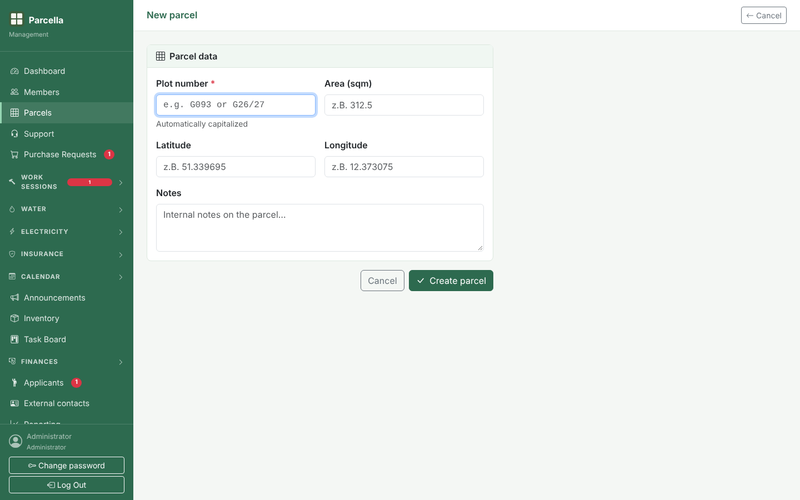

# Parcelles {#parcels}

!!! note "Traduction automatique"
    Cette page a été traduite automatiquement de l'anglais et n'a pas encore été relue. En cas de doute, la version anglaise fait foi (changez de langue en haut de la page).

La liste des parcelles contient chaque jardin de votre association : son
numéro, sa superficie, son statut et qui l'occupe. Chaque parcelle
conserve un historique complet des baux, si bien que des années plus
tard vous pouvez encore voir qui avait quelle parcelle, et quand.

!!! info "Qui peut l'utiliser"
    Les parcelles font partie du cœur de l'application et sont toujours
    activées. Elles ne peuvent pas être désactivées.

    - **Toute personne pouvant se connecter** peut consulter la liste
      des parcelles, les pages des parcelles et l'export CSV.
    - **Ajouter et modifier** des parcelles, et attribuer, modifier et
      terminer des baux, nécessite le droit d'*écriture* sur **Membres et
      parcelles**.
    - **Supprimer** une entrée d'ancien bail ou supprimer définitivement
      une parcelle nécessite le droit de *suppression* sur **Membres et
      parcelles**.
    - La carte **Documents (stockage cloud)** sur la page d'une parcelle
      est réservée aux membres du bureau et aux administrateurs, et
      seulement tant que le module **Stockage cloud** est activé (il est
      désactivé par défaut).

    Voir [Rôles, groupes et droits](../getting-started/roles-and-permissions.md).

## Statuts des parcelles {#parcel-statuses}

Chaque parcelle a l'un de quatre statuts :

| Statut | Signification |
|---|---|
| **actif** | Une parcelle normale, louée. |
| **résilié** | Le bail a été résilié -- la parcelle attend un nouveau locataire. Seules les parcelles résiliées peuvent être [remises à des candidats](applicants.md#assign-a-parcel). |
| **communale** | Un espace commun que l'association gère elle-même -- chemins, aire de jeux, pelouse du local. Vous l'enregistrez comme une parcelle, avec sa superficie, mais elle n'est pas louée aux membres. Vous pouvez la repasser à **actif** si l'association décide finalement de la louer. |
| **supprimé** | La parcelle n'existe plus, par ex. après la fusion de deux parcelles. Son historique est conservé. |

Vous changez le statut dans le [formulaire de la parcelle](#new-parcel-and-edit-parcel).
Chaque changement est enregistré avec la date et l'utilisateur dans
l'historique des modifications de la parcelle : vous n'avez donc pas
besoin d'une date de résiliation séparée.

## Liste des parcelles {#parcel-list}

Ouvrez **Parcelles** dans le menu principal. La liste affiche chaque
parcelle, triée par numéro -- y compris les parcelles supprimées, sauf si
vous filtrez par statut.

### Boutons en haut {#buttons-at-the-top}

| Bouton | Ce qu'il fait |
|---|---|
| **Import CSV** | Ouvre la boîte de dialogue d'import (voir [Importer des parcelles depuis un fichier CSV](#importing-parcels-from-a-csv-file)). Nécessite le droit d'écriture. |
| **Export CSV** | Télécharge toutes les parcelles sous forme de fichier CSV (voir [Export CSV](#csv-export)). |
| **Nouvelle parcelle** | Ouvre un [formulaire de parcelle](#new-parcel-and-edit-parcel) vide. Nécessite le droit d'écriture. |

### Recherche et filtre {#search-and-filter}

| Champ / bouton | Ce qu'il fait |
|---|---|
| **Rechercher un numéro de parcelle…** | Trouve les parcelles dont le numéro contient le texte. Pour trouver une parcelle par le nom de son locataire, cherchez plutôt dans la [liste des membres](members.md#search-and-filters). |
| **Tous les statuts** | N'affiche que les parcelles au statut choisi. S'applique dès que vous le changez. |
| **Rechercher** | Applique le texte de recherche. |
| **Réinitialiser** | Efface la recherche et le filtre de statut. Affiché seulement tant que l'un d'eux est actif. |

Comme dans la liste des membres, **Précédent**, **Suivant** et
**Retour** sur la page d'une parcelle conservent le filtre d'où vous
venez.

### Colonnes {#columns}

| Colonne | Ce qu'elle affiche |
|---|---|
| Case à cocher | Sélectionne la parcelle pour **Exporter la sélection** ou **Écrire aux locataires** (voir ci-dessous). |
| **Numéro de parcelle** | Cliquez dessus pour ouvrir la parcelle. |
| **Superficie** | Superficie en mètres carrés, ou « – ». |
| **Statut** | **actif**, **résilié**, **communale** ou **supprimé**. |
| **Locataire** | Les locataires actuels. Cliquez sur un nom pour ouvrir le membre. Les anciens locataires et ceux à venir ne sont pas affichés ici. |
| Bouton œil | Ouvre la page de la parcelle. |

Le pied indique le nombre de parcelles de la liste et, si des superficies
sont enregistrées, leur superficie totale -- pratique pour vérifier une
sélection filtrée, par ex. la superficie totale de toutes les parcelles
actives.

### Choisir des parcelles et écrire à leurs locataires {#picking-parcels}

Chaque ligne a une case à cocher : vous pouvez donc choisir des
parcelles à la main -- par exemple toutes les parcelles le long d'une
conduite d'eau -- et envoyer un avis aux personnes qui les louent.

| Bouton | Ce qu'il fait |
|---|---|
| **Tout sélectionner** | Coche chaque parcelle de la liste actuelle. |
| **Tout désélectionner** | Efface toutes les coches. |
| ***N* sélectionné(s)** | Compte les parcelles cochées. |
| **Exporter la sélection** | Télécharge le fichier CSV (voir ci-dessous) avec seulement les parcelles cochées. Désactivé tant que vous n'en avez coché aucune. |
| **Écrire aux locataires** | Démarre une nouvelle [annonce](announcements.md) aux locataires **actuels** des parcelles cochées. Affiché seulement tant que le module **Annonces** est activé, et seulement aux membres du bureau et aux administrateurs. |

Un avis aux parcelles concerne le **bail**, pas l'adhésion à
l'association : il s'adresse aux locataires de chaque parcelle ensemble,
comme la facture annuelle. Donc :

- **Un avis par parcelle.** Quelqu'un qui loue deux des parcelles
  cochées reçoit deux avis, un pour chaque bail. Chaque e-mail et chaque
  courrier nomme sa parcelle (« Parcelle 12 »).
- **E-mail** à chaque locataire qui accepte les informations par e-mail
  (**Peut recevoir des informations par e-mail**) et a une adresse.
- **Courrier** aux autres locataires : un par adresse postale, nommant
  toutes les personnes sans e-mail qui y vivent -- même quand quelqu'un
  qui vit avec elles a reçu l'e-mail. Avec **Envoyer aussi un courrier
  aux membres qui reçoivent l'e-mail**, toutes les personnes ayant une
  adresse postale reçoivent un courrier.
- Les anciens locataires et ceux à venir sont laissés de côté.

Pour les messages aux membres (nouvelles de l'association, convocations
à une assemblée générale), utilisez plutôt la
[liste des membres](members.md).

### Export CSV {#csv-export}

**Export CSV** télécharge un fichier appelé `parcels.csv`, séparé par des
points-virgules, avec *toutes* les parcelles -- la recherche et le filtre
de statut ne s'appliquent pas. **Exporter la sélection** (ci-dessus)
écrit le même fichier avec seulement les parcelles cochées. Les en-têtes
de colonnes sont en allemand, pour que le fichier puisse être
réimporté :

Gartennummer (numéro de parcelle), Fläche (qm) (superficie),
Breitengrad (latitude), Längengrad (longitude), Status,
Kündigungsnotiz (note de résiliation), Mitglieder (membres),
Notizen (notes).

- Les nombres utilisent une virgule décimale (312,5).
- Le statut est écrit ACTIVE, TERMINATED, COMMUNAL ou DELETED.
- La colonne des membres liste les locataires de la parcelle séparés par
  des points-virgules, ceux marqués comme adresse de facturation en
  premier et avec un `*` après leur nom.
  <!-- TODO(verify): the members column includes former tenants as well, not only current ones. -->

## Importer des parcelles depuis un fichier CSV {#importing-parcels-from-a-csv-file}

Utilisez l'import pour créer toutes vos parcelles d'un coup, par exemple
à partir d'un tableur. Cela fonctionne comme l'import des membres : vous
téléversez le fichier, associez ses colonnes, puis confirmez. Pour un
pas-à-pas, voir [Importer des membres et des parcelles](../guides/csv-import.md).

!!! tip "Importez d'abord les parcelles, puis les membres"
    L'import ne crée que des parcelles -- il n'attribue pas de
    locataires. Attribuez ensuite les locataires sur la page de chaque
    parcelle ou de chaque membre.

### Étape 1 : téléverser le fichier {#step-1-upload-the-file}

Cliquez sur **Import CSV** dans la liste des parcelles. Dans la boîte de
dialogue **Import CSV**, choisissez un fichier `.csv` et cliquez sur
**Importer**. Rien n'est encore enregistré.

- Les colonnes peuvent être séparées par des points-virgules ou des
  virgules ; Parcella détecte lequel.
- La première ligne doit être la ligne d'en-tête. Les en-têtes n'ont pas
  besoin de correspondre exactement -- vous les associez à l'étape
  suivante.

Si le fichier est vide, vous êtes renvoyé avec « Ce fichier CSV semble
vide. »

### Étape 2 : associer les colonnes {#step-2-map-the-columns}

<!-- TODO(verify): no screenshot -- this page is only reached by uploading a file, which the screenshot tool can't do. -->

La page **Associer les colonnes CSV** affiche chaque colonne de votre
fichier avec son en-tête et les cinq premières lignes de données.

| Champ / bouton | Ce qu'il fait |
|---|---|
| Liste déroulante par colonne | Choisissez **Numéro de parcelle**, **Superficie (m²)**, **Latitude**, **Longitude**, **Statut**, **Notes** -- ou **— Ignorer —**. Parcella présélectionne un champ quand il reconnaît l'en-tête (en anglais ou en allemand, par ex. « Gartennummer » ou « Plot number »). |
| **Importer** | Importe les lignes et revient à la liste des parcelles. **Numéro de parcelle** doit être associé à une colonne, sinon vous obtenez « Veuillez associer la colonne du numéro de parcelle avant d'importer. » |
| **Retour** | Revient à la liste des parcelles sans importer. |

### Ce qui se passe à l'import {#what-happens-on-import}

- Les numéros de parcelle sont mis en majuscules, comme dans le
  formulaire.
- Une ligne dont le numéro de parcelle **existe déjà est ignorée** -- les
  parcelles existantes ne sont jamais modifiées par un import.
- Une ligne sans numéro de parcelle est ignorée.
- La superficie, la latitude et la longitude peuvent utiliser un point
  ou une virgule décimale. Une valeur qui n'est pas un nombre est laissée
  vide.
- **Statut** doit valoir ACTIVE, TERMINATED, COMMUNAL ou DELETED (les
  majuscules n'ont pas d'importance). Toute autre valeur, ou une cellule
  vide, devient **actif**.

La liste des parcelles affiche ensuite un résumé comme « 40 importé(s),
2 ignoré(s) », plus le nombre de lignes ignorées faute de numéro de
parcelle.

## Page de la parcelle {#parcel-page}

Cliquez sur un numéro de parcelle pour ouvrir la page de la parcelle.
Elle affiche les détails de la parcelle, qui l'occupe maintenant, qui
l'occupait avant et ce qui a changé.

### Boutons en haut {#buttons-at-the-top_1}

| Bouton | Ce qu'il fait |
|---|---|
| **Modifier** | Ouvre le [formulaire de modification](#new-parcel-and-edit-parcel). Nécessite le droit d'écriture. |
| **Précédent** / **Suivant** | Passe à la parcelle précédente ou suivante dans la liste d'où vous venez. Vous pouvez aussi appuyer sur ++ctrl+left++ et ++ctrl+right++ (pas pendant la saisie dans un champ). |
| **Retour** | Revient à la liste des parcelles, avec votre filtre. |

### Détails de la parcelle {#parcel-details}

| Ligne | Ce qu'elle affiche |
|---|---|
| **Numéro de parcelle** | |
| **Superficie** | En mètres carrés. |
| **Coordonnées** | Seulement si la latitude et la longitude sont toutes deux enregistrées. **Voir sur la carte** ouvre l'emplacement sur OpenStreetMap dans un nouvel onglet. |
| **Statut** | Le statut actuel. |
| **Résilié le** | Quand le statut a été mis pour la dernière fois à **résilié**, tiré de l'historique des modifications. |
| **Note de résiliation** | Le motif ou les remarques, s'ils sont enregistrés. |
| **Créée le** | Quand la parcelle a été saisie dans Parcella. |
| **Notes** | Les notes internes de la parcelle, s'il y en a. |

Sous les détails, une carte **Procédures** liste les
[procédures](processes.md) concernant cette parcelle, si ce module est
activé et que vous pouvez voir les procédures. **Démarrer une
procédure** en démarre une nouvelle.

### Locataires actuels {#current-tenants}

Les membres qui occupent la parcelle maintenant, plus toute personne qui
la reprendra à une date future.

| Colonne | Ce qu'elle affiche |
|---|---|
| **Membre** | Le nom du locataire -- cliquez dessus pour ouvrir le membre. Un badge bleu **à partir du *date*** marque un locataire à venir qui prend possession à cette date. Un badge **jusqu'au *date*** marque un locataire qui a donné son congé et part à cette date. |
| **Adresse de facturation** | Si les factures de cette parcelle vont à l'adresse de ce membre. |
| **Depuis** | Le début du bail, ou « – » si aucun n'a été saisi. |
| Bouton crayon | Ouvre [Modifier la location](#edit-tenancy) pour changer les dates ou l'adresse de facturation. Nécessite le droit d'écriture. |
| Bouton calendrier | **Mettre fin à la location** (voir ci-dessous). Nécessite le droit d'écriture. |

Si personne n'occupe la parcelle, la carte indique « Aucun locataire
actuel ».

#### Attribuer un locataire {#assigning-a-tenant}

En bas de la carte (nécessite le droit d'écriture) :

| Champ / bouton | Ce qu'il fait |
|---|---|
| **Choisir un membre…** | Commencez à taper un nom ; choisissez le membre dans la liste qui apparaît. Seuls les membres actifs sont proposés. Si vous ne choisissez pas dans la liste, vous obtenez « Veuillez sélectionner un membre dans la liste ». |
| Champ de date | Le premier jour du bail. Facultatif. |
| **Utiliser comme adresse de facturation** | Coché par défaut. Les factures de cette parcelle vont à l'adresse de ce membre. |
| **Attribuer** | Ajoute le membre comme locataire. |

Vous pouvez attribuer plusieurs membres à une parcelle -- un couple ou
une famille, par exemple. Tous comptent comme locataires à droits
égaux ; il n'y a pas de locataire « principal ». Vous pouvez aussi cocher
**Utiliser comme adresse de facturation** pour plusieurs d'entre eux.

!!! note "Attribuer à nouveau un ancien locataire"
    Si le membre a déjà occupé cette parcelle, Parcella rouvre son ancien
    bail au lieu d'en créer un second. La nouvelle date de début remplace
    l'ancienne (aujourd'hui, si vous laissez la date vide), et la période
    précédente n'apparaît plus sous **Anciens locataires**.

!!! tip "Remettre une parcelle à un nouveau locataire"
    Si le nouveau locataire vient de la liste d'attente, utilisez plutôt
    **Attribuer une parcelle** sur la
    [page du candidat](applicants.md#assign-a-parcel). Cela termine les
    anciens baux, crée le nouveau membre et réactive la parcelle en une
    étape. Voir aussi [Transmettre une parcelle](../guides/parcel-handover.md).

#### Terminer un bail {#ending-a-tenancy}

Cliquez sur le bouton calendrier à côté d'un locataire et confirmez
« Mettre fin à cette location ? (l'historique est conservé) ».

- Le bail se termine **aujourd'hui**. Le membre passe immédiatement sous
  **Anciens locataires**, avec aujourd'hui comme date de fin.
- Le membre n'est plus l'adresse de facturation de cette parcelle.
- Rien n'est supprimé : le bail reste visible dans l'historique de la
  parcelle et peut être corrigé plus tard.
- L'**adhésion** n'est pas terminée. Si le membre quitte l'association,
  renseignez **Membre jusqu'au** sur sa [page de membre](members.md#membership).
- Le **statut** de la parcelle ne change pas. Si la parcelle attend
  maintenant un nouveau locataire, passez-la à **résilié** dans le
  formulaire de la parcelle.
- Si la parcelle n'a plus de locataire actuel ni à venir, son dossier de
  documents dans le stockage cloud (s'il est défini) est retiré.

Le bouton ne fonctionne que pour un bail sans date de fin. Pour un
locataire qui a déjà donné son congé pour une date future, changez
plutôt la date dans [Modifier la location](#edit-tenancy).

!!! tip "Terminer à une autre date qu'aujourd'hui"
    Pour enregistrer un bail qui s'est terminé (ou se terminera) un autre
    jour, ouvrez le bouton crayon et saisissez **Locataire jusqu'au**.

### Anciens locataires {#former-tenants}

Affiché seulement si la parcelle a eu des locataires auparavant. Liste
chaque bail terminé, le plus récent en premier.

| Colonne / bouton | Ce qu'elle affiche |
|---|---|
| **Membre** | Cliquez sur le nom pour ouvrir le membre. |
| **Du** / **Au** | La période du bail. |
| Bouton crayon | **Corriger la période** -- ouvre [Modifier la location](#edit-tenancy), par ex. pour corriger une date erronée. Nécessite le droit d'écriture. |
| Bouton corbeille | **Supprimer l'entrée** après confirmation de « Vraiment supprimer définitivement cette entrée ? Cette action est irréversible. » Nécessite le droit de suppression. |

!!! warning "Supprimer un ancien bail est réservé aux erreurs"
    La suppression retire l'entrée définitivement -- elle est destinée à
    une attribution saisie par erreur ou en double. Pour un changement
    de locataire normal, terminez le bail ; ne le supprimez jamais. Seuls
    les baux terminés peuvent être supprimés ; un bail en cours doit
    d'abord être terminé.

### Documents (stockage cloud) {#documents-cloud-storage}

Affiché seulement aux membres du bureau et aux administrateurs tant que
le module **Stockage cloud** est activé. Il relie la parcelle à un
dossier du stockage cloud de votre association (par exemple Nextcloud),
où vous conservez les contrats de bail et autres documents des
locataires actuels. Configurez d'abord le stockage sous
[Intégrations](../administration/integrations.md).

| Champ / bouton | Ce qu'il fait |
|---|---|
| **Chemin du dossier** | Le chemin du dossier qui appartient au bail en cours, par ex. « kgv_dokumente/parzellen/G016/2024-03_016_Mueller ». Le dossier doit déjà exister et être partagé avec les locataires dans votre stockage cloud. |
| **Parcourir…** | Ouvre **Choisir un dossier** : naviguez dans les dossiers (ou tapez dans **Filtrer les dossiers…**), puis cliquez sur **Utiliser ce dossier**. Un double-clic sur un dossier le choisit directement. Vous ne pouvez pas choisir la racine du stockage elle-même -- « Ouvrez d'abord un dossier avant de le sélectionner. » |
| **Enregistrer** | Enregistre le chemin du dossier. |
| Liste des fichiers | Affiche les fichiers et sous-dossiers du dossier avec **Nom** et **Dernière modification**. Cliquez sur un sous-dossier pour l'ouvrir ; le chemin au-dessus de la liste permet de remonter. Le bouton de téléchargement télécharge un fichier. |
| Champ de fichier + **Téléverser** | Téléverse un fichier dans le dossier que vous regardez actuellement. |

Quand un bail se termine et que plus personne n'occupe la parcelle, le
dossier est retiré automatiquement, pour que les locataires suivants ne
voient pas les anciens documents. Après une remise à date future, un
avis vous indique quand le dossier actuel sera retiré et quel dossier
prendra le relais ce jour-là.

### Historique des modifications {#change-history}

Affiché seulement une fois que quelque chose a été modifié. Chaque
changement du numéro de parcelle, de la superficie, des coordonnées, du
statut, de la note de résiliation ou des notes est enregistré :

| Colonne | Ce qu'elle affiche |
|---|---|
| **Horodatage** | Date et heure du changement. |
| **Champ** | Le nom technique du champ modifié, par ex. *status* ou *area_sqm*. |
| **Ancienne valeur** / **Nouvelle valeur** | La valeur avant et après. |
| **Modifié par** | L'utilisateur qui a fait le changement, ou **Inconnu**. |

Les changements de baux n'apparaissent pas ici -- ils figurent dans les
tableaux des locataires ci-dessus.

## Nouvelle parcelle et modifier une parcelle {#new-parcel-and-edit-parcel}

Cliquez sur **Nouvelle parcelle** dans la liste des parcelles, ou sur
**Modifier** sur la page d'une parcelle. Le formulaire de modification a
quelques champs de plus que celui de nouvelle parcelle.

| Champ | Ce qu'il fait |
|---|---|
| **Numéro de parcelle** \* | Obligatoire, par ex. « G093 » ou « G26/27 ». Mis automatiquement en majuscules. Doit être unique : si une autre parcelle l'a déjà, vous obtenez « Le numéro de parcelle '…' existe déjà. » |
| **Superficie (m²)** | La superficie en mètres carrés. Un point ou une virgule décimale fonctionnent. Utilisée pour les contributions basées sur la superficie et les statistiques. |
| **Latitude** / **Longitude** | Position GPS facultative de la parcelle, par ex. 51.339695 et 12.373075. Avec les deux renseignées, la page de la parcelle renvoie vers une carte. La latitude doit être comprise entre -90 et 90, la longitude entre -180 et 180. La position n'est jamais affichée sur les pages publiques. |
| **Statut** | Formulaire de modification seulement. **actif**, **résilié**, **communale** ou **supprimé** -- voir [Statuts des parcelles](#parcel-statuses). L'heure du changement est enregistrée automatiquement. Les nouvelles parcelles démarrent toujours en **actif**. |
| **Note de résiliation** | Formulaire de modification seulement. Motif ou remarques d'une résiliation. |
| **Notes** | Notes internes sur la parcelle. |

| Bouton | Ce qu'il fait |
|---|---|
| **Créer une parcelle** / **Enregistrer les modifications** | Enregistre et ouvre la page de la parcelle. |
| **Annuler** | Quitte sans enregistrer. |

<!-- TODO(verify): an area or coordinate that isn't a number is silently left empty instead of showing an error. -->

### Zone de danger {#danger-zone}

Le formulaire de modification se termine par une **Zone dangereuse**.
**Supprimer définitivement la parcelle** retire la parcelle de la base
de données après confirmation. Tous les baux de la parcelle -- actuels et
anciens -- sont supprimés avec elle. Les raccordements d'eau sont
conservés, mais ne sont plus reliés à une parcelle. C'est irréversible,
et nécessite le droit de suppression.

!!! warning "Utilisez plutôt le statut supprimé"
    La suppression définitive est destinée aux parcelles créées par
    erreur, comme des saisies de test. Pour une parcelle qui n'existe
    plus, passez son statut à **supprimé** -- la parcelle et tout son
    historique restent disponibles.

## Modifier la location {#edit-tenancy}

S'ouvre avec le bouton crayon à côté d'un locataire actuel ou ancien.
Le titre nomme le membre et la parcelle. Nécessite le droit d'écriture.

| Champ | Ce qu'il fait |
|---|---|
| **Utiliser comme adresse de facturation** | Les factures de cette parcelle vont à l'adresse de ce membre. « S'applique uniquement tant que cette location est en cours -- automatiquement désactivé une fois qu'elle est terminée (date de fin aujourd'hui ou avant). Un locataire qui a donné congé le conserve jusque-là. » La case est grisée dès que **Locataire jusqu'au** est aujourd'hui ou avant ; une date future la laisse telle quelle. |
| **Locataire depuis** | Le premier jour du bail. |
| **Locataire jusqu'au** | Le jour où le bail se termine. « Vide = toujours locataire actuel ». Une date future signifie que le locataire a donné son congé : il reste locataire actuel jusqu'à ce jour et reçoit un badge **jusqu'au *date***. À partir de ce jour, il est listé sous **Anciens locataires**. |

| Bouton | Ce qu'il fait |
|---|---|
| **Enregistrer les modifications** | Enregistre et revient à la page de la parcelle. Si la parcelle n'a plus de locataire actuel ni à venir, son dossier de documents cloud est retiré. |
| **Annuler** / **Retour** | Revient à la page de la parcelle sans enregistrer. |

Vider **Locataire jusqu'au** sur un ancien bail le rend de nouveau
actuel.

## Voir aussi {#related}

- [Membres](members.md) -- données des membres et attribution de
  parcelles côté membre
- [Candidats](applicants.md) -- remettre une parcelle résiliée aux
  personnes de la liste d'attente
- [Transmettre une parcelle](../guides/parcel-handover.md)
- [Importer des membres et des parcelles](../guides/csv-import.md)
- [Eau et électricité](metering.md) -- les compteurs appartiennent aux
  parcelles
- [Intégrations](../administration/integrations.md) -- configurer le
  stockage cloud
