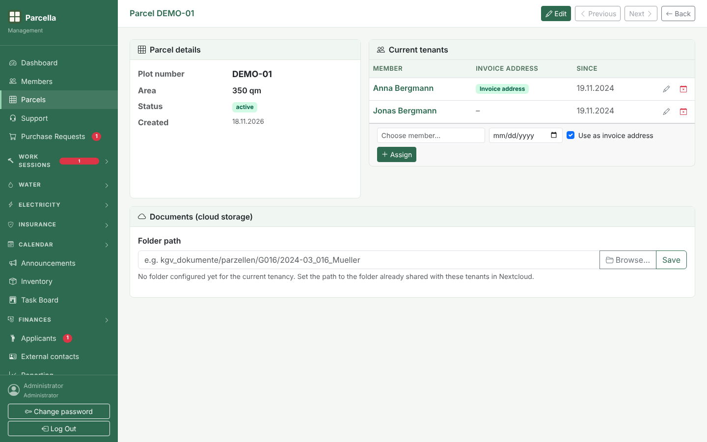

# Parcels

The parcel list holds every garden plot of your club: its number, its
area, its status and who holds it. Each parcel keeps a full tenancy
history, so years later you can still see who had which plot, and when.

!!! info "Who can use this"
    Parcels is part of the core and is always switched on. It can't be
    turned off.

    - **Everyone who can log in** can look at the parcel list, the
      parcel pages and the CSV export.
    - **Adding and editing** parcels, and assigning, editing and ending
      tenancies, needs *write* permission on **Members & Parcels**.
    - **Deleting** a former tenancy entry or deleting a parcel for good
      needs *delete* permission on **Members & Parcels**.
    - The **Documents (cloud storage)** card on a parcel page is only
      for board members and administrators, and only while the **Cloud
      storage** module is on (it's off by default).

    See [Roles, groups and permissions](../getting-started/roles-and-permissions.md).

## Parcel statuses

Every parcel has one of four statuses:

| Status | Meaning |
|---|---|
| **active** | A normal, leased parcel. |
| **terminated** | The lease has been terminated -- the parcel is up for a new tenant. Only terminated parcels can be [handed over to applicants](applicants.md#assign-a-parcel). |
| **communal** | A common area the club manages itself -- paths, the playground, the club house lawn. You record it like a parcel, with its area, but it isn't leased to members. You can switch it back to **active** if the club decides to lease it out after all. |
| **deleted** | The parcel no longer exists, e.g. after two plots were merged. Its history is kept. |

You change the status in the [parcel form](#new-parcel-and-edit-parcel).
Each change is recorded with date and user in the parcel's change
history, so you don't need a separate termination date.

## Parcel list

Open **Parcels** in the main menu. The list shows every parcel, sorted
by plot number -- including deleted ones, unless you filter by status.

### Buttons at the top

| Button | What it does |
|---|---|
| **CSV Import** | Opens the import dialog (see [Importing parcels from a CSV file](#importing-parcels-from-a-csv-file)). Needs write permission. |
| **CSV Export** | Downloads all parcels as a CSV file (see [CSV export](#csv-export)). |
| **New parcel** | Opens an empty [parcel form](#new-parcel-and-edit-parcel). Needs write permission. |

### Search and filter

| Field / button | What it does |
|---|---|
| **Search plot number…** | Finds parcels whose plot number contains the text. To find a parcel by its tenant's name, search the [member list](members.md#search-and-filters) instead. |
| **All statuses** | Shows only parcels with the chosen status. Applies as soon as you change it. |
| **Search** | Applies the search text. |
| **Reset** | Clears search and status filter. Only shown while one is active. |

Like on the member list, **Previous**, **Next** and **Back** on a parcel
page keep the filter you came from.

### Columns

| Column | What it shows |
|---|---|
| Checkbox | Selects the parcel for **Export selected** or **Write to their leaseholders** (see below). |
| **Plot number** | Click it to open the parcel. |
| **Area** | Area in square metres, or "–". |
| **Status** | **active**, **terminated**, **communal** or **deleted**. |
| **Tenant** | The current tenants. Click a name to open the member. Former and upcoming tenants aren't shown here. |
| Eye button | Opens the parcel page. |

The footer shows the number of parcels in the list and, if areas are
recorded, their total area -- handy to check a filtered selection, e.g.
the total area of all active parcels.

### Picking parcels and writing to their leaseholders {#picking-parcels}

Every row has a checkbox, so you can pick parcels by hand -- for example
all parcels along one water pipe -- and send a notice to the people who
lease them.

| Button | What it does |
|---|---|
| **Select all** | Ticks every parcel in the current list. |
| **Select none** | Clears all ticks. |
| ***N* selected** | Counts the ticked parcels. |
| **Export selected** | Downloads the CSV file (see below) with only the ticked parcels. Disabled until you tick one. |
| **Write to their leaseholders** | Starts a new [announcement](announcements.md) to the **current** leaseholders of the ticked parcels. Only shown while the **Announcements** module is on, and only to board members and administrators. |

A notice to parcels concerns the **lease**, not the club membership:
it's addressed to the leaseholders of each parcel together, like the
annual invoice. So:

- **One notice per parcel.** Someone who leases two of the ticked
  parcels gets two notices, one for each lease. Every e-mail and letter
  names its parcel ("Parcel 12").
- **E-mail** to every leaseholder who allows information by e-mail
  (**May receive information by email**) and has an address.
- **Letter** to the other leaseholders: one per postal address, naming
  everyone there without e-mail -- also when someone they live with got
  the e-mail. With **Also send a letter to members who get the email**,
  everyone with a postal address gets a letter.
- Former and upcoming leaseholders are left out.

For messages to members (club news, invitations to a general meeting)
use the [member list](members.md) instead.

### CSV export

**CSV Export** downloads a file called `parcels.csv`, separated by
semicolons, with *every* parcel -- search and status filter don't apply.
**Export selected** (above) writes the same file with only the ticked
parcels.
The column headings are in German, so the file can be imported again:

Gartennummer (plot number), Fläche (qm) (area), Breitengrad (latitude),
Längengrad (longitude), Status, Kündigungsnotiz (termination note),
Mitglieder (members), Notizen (notes).

- Numbers use a decimal comma (312,5).
- The status is written as ACTIVE, TERMINATED, COMMUNAL or DELETED.
- The members column lists the parcel's tenants separated by
  semicolons, those marked as invoice address first and with a `*`
  after their name.
  <!-- TODO(verify): the members column includes former tenants as well, not only current ones. -->

## Importing parcels from a CSV file

Use the import to create all your parcels in one go, for example from a
spreadsheet. It works like the member import: you upload the file, map
its columns, then confirm. For a walkthrough, see
[Importing members and parcels](../guides/csv-import.md).

!!! tip "Import parcels first, then members"
    The import creates parcels only -- it doesn't assign tenants. Assign
    tenants afterwards on each parcel page or member page.

### Step 1: upload the file

Click **CSV Import** on the parcel list. In the **CSV import** dialog,
choose a `.csv` file and click **Import**. Nothing is saved yet.

- Columns may be separated by semicolons or commas; Parcella detects
  which.
- The first row must be the heading row. The headings don't need to
  match exactly -- you map them in the next step.

If the file is empty, you're sent back with "That CSV file appears to
be empty."

### Step 2: map the columns

<!-- TODO(verify): no screenshot -- this page is only reached by uploading a file, which the screenshot tool can't do. -->

The **Map CSV columns** page shows each column of your file with its
heading and the first five data rows.

| Field / button | What it does |
|---|---|
| Dropdown per column | Choose **Plot number**, **Area (sqm)**, **Latitude**, **Longitude**, **Status**, **Notes** -- or **— Ignore —**. Parcella pre-selects a field when it recognises the heading (in English or German, e.g. "Gartennummer" or "Plot number"). |
| **Import** | Imports the rows and returns to the parcel list. **Plot number** must be mapped to a column, otherwise you get "Please map the plot number column before importing." |
| **Back** | Returns to the parcel list without importing. |

### What happens on import

- Plot numbers are capitalised, just like in the form.
- A row whose plot number **already exists is skipped** -- existing
  parcels are never changed by an import.
- A row without a plot number is ignored.
- Area, latitude and longitude may use a decimal point or comma. A
  value that isn't a number is left empty.
- **Status** must be ACTIVE, TERMINATED, COMMUNAL or DELETED (capitals
  don't matter). Anything else, or an empty cell, becomes **active**.

The parcel list then shows a summary such as "40 imported, 2 skipped",
plus how many rows were ignored for lack of a plot number.

## Parcel page

Click a plot number to open the parcel page. It shows the parcel's
details, who holds it now, who held it before and what has changed.

### Buttons at the top

| Button | What it does |
|---|---|
| **Edit** | Opens the [edit form](#new-parcel-and-edit-parcel). Needs write permission. |
| **Previous** / **Next** | Jumps to the previous or next parcel in the list you came from. You can also press ++ctrl+left++ and ++ctrl+right++ (not while typing in a field). |
| **Back** | Returns to the parcel list, with your filter. |

### Parcel details

| Line | What it shows |
|---|---|
| **Plot number** | |
| **Area** | In square metres. |
| **Coordinates** | Only if latitude and longitude are both recorded. **View on map** opens the spot on OpenStreetMap in a new tab. |
| **Status** | The current status. |
| **Terminated on** | When the status was last set to **terminated**, taken from the change history. |
| **Termination note** | The reason or remarks, if recorded. |
| **Created** | When the parcel was entered in Parcella. |
| **Notes** | The parcel's internal notes, if any. |

Below the details, a **Processes** card lists the
[processes](processes.md) about this parcel, if that module is on and
you may see processes. **Start a process** starts a new one.

### Current tenants

The members who hold the parcel now, plus anyone who will take it over
on a future date.

| Column | What it shows |
|---|---|
| **Member** | The tenant's name -- click it to open the member. A blue **from *date*** badge marks an upcoming tenant who takes over on that date. A **until *date*** badge marks a tenant who has given notice and leaves on that date. |
| **Invoice address** | Whether invoices for this parcel go to this member's address. |
| **Since** | The start of the tenancy, or "–" if none was entered. |
| Pencil button | Opens [Edit tenancy](#edit-tenancy) to change dates or the invoice address. Needs write permission. |
| Calendar button | **End tenancy** (see below). Needs write permission. |

If nobody holds the parcel, the card says "No current tenants".

#### Assigning a tenant

At the bottom of the card (needs write permission):

| Field / button | What it does |
|---|---|
| **Choose member…** | Start typing a name; pick the member from the list that appears. Only active members are offered. If you don't pick from the list, you get "Please select a member from the list". |
| Date field | The first day of the tenancy. Optional. |
| **Use as invoice address** | Ticked by default. Invoices for this parcel go to this member's address. |
| **Assign** | Adds the member as tenant. |

You can assign several members to one parcel -- a couple or a family,
for example. All of them count as tenants with equal rights; there's no
"main" tenant. You can also tick **Use as invoice address** for more
than one of them.

!!! note "Assigning a former tenant again"
    If the member held this parcel before, Parcella reopens their old
    tenancy instead of creating a second one. The new start date
    replaces the old one (today, if you leave the date empty), and the
    earlier period no longer appears under **Former tenants**.

!!! tip "Handing a parcel to a new tenant"
    If the new tenant comes from the waiting list, use **Assign a
    parcel** on the [applicant's page](applicants.md#assign-a-parcel)
    instead. It ends the old tenancies, creates the new member and
    re-activates the parcel in one step. See also
    [Handing over a parcel](../guides/parcel-handover.md).

#### Ending a tenancy

Click the calendar button next to a tenant and confirm "End this
tenancy? (history is preserved)".

- The tenancy ends **today**. The member moves to **Former tenants**
  straight away, with today as the end date.
- The member is no longer the invoice address for this parcel.
- Nothing is deleted: the tenancy stays visible in the parcel's history
  and can be corrected later.
- The **membership** is not ended. If the member leaves the club, set
  **Member until** on their [member page](members.md#membership).
- The parcel's **status** doesn't change. If the parcel is now up for
  a new tenant, set it to **terminated** in the parcel form.
- If the parcel now has no current or upcoming tenant, its documents
  folder in cloud storage (if one is set) is retired.

The button only works for a tenancy without an end date. For a tenant
who has already given notice for a future date, change the date in
[Edit tenancy](#edit-tenancy) instead.

!!! tip "Ending on a date other than today"
    To record a tenancy that ended (or will end) on another day, open
    the pencil button and enter **Tenant until**.

### Former tenants

Only shown if the parcel had tenants before. Lists every tenancy that
has ended, the most recent first.

| Column / button | What it shows |
|---|---|
| **Member** | Click the name to open the member. |
| **From** / **Until** | The tenancy period. |
| Pencil button | **Correct period** -- opens [Edit tenancy](#edit-tenancy), e.g. to fix a wrong date. Needs write permission. |
| Trash button | **Delete entry** after you confirm "Really delete this entry permanently? This cannot be undone." Needs delete permission. |

!!! warning "Deleting a former tenancy is for mistakes only"
    Deleting removes the entry for good -- it's meant for an assignment
    that was entered by mistake or twice. For a normal change of tenant,
    end the tenancy; never delete it. Only ended tenancies can be
    deleted; a current one must be ended first.

### Documents (cloud storage)

Only shown to board members and administrators while the **Cloud
storage** module is on. It connects the parcel to a folder in your
club's cloud storage (for example Nextcloud), where you keep lease
agreements and other paperwork for the current tenants. Set up the
storage first under [Integrations](../administration/integrations.md).

| Field / button | What it does |
|---|---|
| **Folder path** | The path of the folder that belongs to the current tenancy, e.g. "kgv_dokumente/parzellen/G016/2024-03_016_Mueller". The folder must already exist and be shared with the tenants in your cloud storage. |
| **Browse…** | Opens **Choose a folder**: click through the folders (or type into **Filter folders…**), then click **Use this folder**. Double-clicking a folder picks it straight away. You can't pick the storage root itself -- "Open a folder first before selecting it." |
| **Save** | Saves the folder path. |
| File list | Shows the folder's files and subfolders with **Name** and **Last modified**. Click a subfolder to open it; the path above the list leads back. The download button downloads a file. |
| File field + **Upload** | Uploads a file into the folder you're currently looking at. |

When a tenancy ends and nobody holds the parcel any more, the folder is
retired automatically, so the next tenants don't see the old
paperwork. After a handover with a future date, a notice tells you
when the current folder is retired and which folder takes over on that
day.

### Change history

Only shown once something has been changed. Every change to the plot
number, area, coordinates, status, termination note or notes is
recorded:

| Column | What it shows |
|---|---|
| **Timestamp** | Date and time of the change. |
| **Field** | The technical name of the changed field, e.g. *status* or *area_sqm*. |
| **Old value** / **New value** | The value before and after. |
| **Changed by** | The user who made the change, or **Unknown**. |

Changes to tenancies don't appear here -- they show in the tenant
tables above.

## New parcel and Edit parcel

Click **New parcel** on the parcel list, or **Edit** on a parcel page.
The edit form has a few more fields than the new-parcel form.

| Field | What it does |
|---|---|
| **Plot number** \* | Required, e.g. "G093" or "G26/27". Automatically capitalised. Must be unique: if another parcel already has it, you get "Plot number '…' already exists." |
| **Area (sqm)** | The area in square metres. A decimal point or comma both work. Used for area-based fees and statistics. |
| **Latitude** / **Longitude** | Optional GPS position of the parcel, e.g. 51.339695 and 12.373075. With both filled in, the parcel page links to a map. Latitude must lie between -90 and 90, longitude between -180 and 180. The position is never shown on public pages. |
| **Status** | Edit form only. **active**, **terminated**, **communal** or **deleted** -- see [Parcel statuses](#parcel-statuses). The time of the change is logged automatically. New parcels always start as **active**. |
| **Termination note** | Edit form only. Reason or remarks for a termination. |
| **Notes** | Internal notes on the parcel. |

| Button | What it does |
|---|---|
| **Create parcel** / **Save changes** | Saves and opens the parcel page. |
| **Cancel** | Leaves without saving. |

<!-- TODO(verify): an area or coordinate that isn't a number is silently left empty instead of showing an error. -->

### Danger zone

The edit form ends with a **Danger zone**. **Permanently delete parcel**
removes the parcel from the database after you confirm. All tenancies
of the parcel -- current and former -- are removed with it. Water
connections are kept, but no longer linked to a parcel. This can't be
undone, and needs delete permission.

!!! warning "Use the deleted status instead"
    Permanent deletion is meant for parcels created by mistake, such as
    test entries. For a parcel that no longer exists, set its status to
    **deleted** -- the parcel and its whole history stay available.

## Edit tenancy

Opened with the pencil button next to a current or former tenant. The
heading names the member and the parcel. Needs write permission.

| Field | What it does |
|---|---|
| **Use as invoice address** | Invoices for this parcel go to this member's address. "Only applies while this tenancy is current -- cleared automatically once it has ended (end date today or earlier). A tenant who has given notice keeps it until then." The checkbox is greyed out once **Tenant until** is today or earlier; a date in the future leaves it as it is. |
| **Tenant since** | The first day of the tenancy. |
| **Tenant until** | The day the tenancy ends. "Empty = still a current tenant." A date in the future means the tenant has given notice: they stay a current tenant until that day and get an **until *date*** badge. From that day on they're listed under **Former tenants**. |

| Button | What it does |
|---|---|
| **Save changes** | Saves and returns to the parcel page. If the parcel now has no current or upcoming tenant, its cloud documents folder is retired. |
| **Cancel** / **Back** | Returns to the parcel page without saving. |

Clearing **Tenant until** on a former tenancy makes it current again.

## Related

- [Members](members.md) -- member data and assigning parcels from the member side
- [Applicants](applicants.md) -- handing a terminated parcel to people on the waiting list
- [Handing over a parcel](../guides/parcel-handover.md)
- [Importing members and parcels](../guides/csv-import.md)
- [Water and electricity](metering.md) -- meters belong to parcels
- [Integrations](../administration/integrations.md) -- setting up cloud storage
