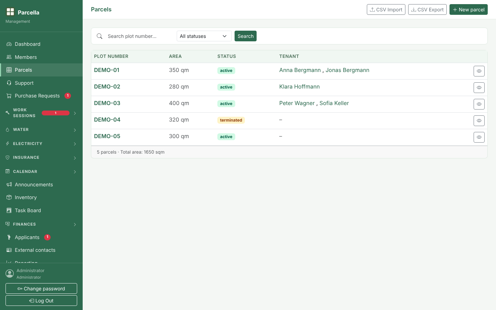

# Działki {#parcels}

!!! warning "Jeszcze niezaktualizowane"
    Ta strona opisuje starszą wersję. Aktualna jest wersja angielska (język zmienisz u góry).

!!! note "Tłumaczenie maszynowe"
    Ta strona została przetłumaczona maszynowo z języka angielskiego i nie została jeszcze sprawdzona. Jeśli coś jest niejasne, obowiązuje wersja angielska (język zmienisz u góry).

Lista działek zawiera każdą działkę ogrodową Twojego stowarzyszenia: jej
numer, powierzchnię, status i to, kto ją ma. Każda działka ma pełną
historię dzierżaw, więc nawet po latach widać, kto miał którą działkę i
kiedy.

!!! info "Kto może z tego korzystać"
    Działki należą do rdzenia i są zawsze włączone. Nie można ich
    wyłączyć.

    - **Każdy, kto może się zalogować**, może oglądać listę działek,
      strony działek i eksport CSV.
    - **Dodawanie i edycja** działek oraz przypisywanie, edycja i
      kończenie dzierżaw wymaga prawa *zapisu* w **Członkowie i
      działki**.
    - **Usunięcie** wpisu dawnej dzierżawy lub trwałe usunięcie działki
      wymaga prawa *usuwania* w **Członkowie i działki**.
    - Karta **Dokumenty (chmura)** na stronie działki jest tylko dla
      członków zarządu i administratorów i tylko wtedy, gdy moduł
      **Magazyn w chmurze** jest włączony (domyślnie jest wyłączony).

    Zob. [Role, grupy i uprawnienia](../getting-started/roles-and-permissions.md).

## Statusy działek {#parcel-statuses}

Każda działka ma jeden z czterech statusów:

| Status | Znaczenie |
|---|---|
| **aktywna** | Zwykła, wydzierżawiona działka. |
| **wypowiedziana** | Dzierżawa została wypowiedziana -- działka czeka na nowego dzierżawcę. Tylko wypowiedziane działki można [przekazać kandydatom](applicants.md#assign-a-parcel). |
| **wspólna** | Teren wspólny, którym stowarzyszenie zarządza samo -- ścieżki, plac zabaw, trawnik przy świetlicy. Zapisujesz go jak działkę, z powierzchnią, ale nie jest wydzierżawiany członkom. Możesz przełączyć go z powrotem na **aktywna**, jeśli stowarzyszenie jednak zdecyduje się go wydzierżawić. |
| **usunięta** | Działka już nie istnieje, np. po połączeniu dwóch działek. Jej historia jest zachowana. |

Status zmieniasz w [formularzu działki](#new-parcel-and-edit-parcel).
Każda zmiana jest zapisywana z datą i użytkownikiem w historii zmian
działki, więc nie potrzebujesz osobnej daty wypowiedzenia.

## Lista działek {#parcel-list}

Otwórz **Działki** w menu głównym. Lista pokazuje każdą działkę,
posortowaną według numeru działki -- łącznie z usuniętymi, chyba że
filtrujesz po statusie.

### Przyciski na górze {#buttons-at-the-top}

| Przycisk | Do czego służy |
|---|---|
| **Import CSV** | Otwiera okno importu (zob. [Import działek z pliku CSV](#importing-parcels-from-a-csv-file)). Wymaga prawa zapisu. |
| **Eksport CSV** | Pobiera wszystkie działki jako plik CSV (zob. [Eksport CSV](#csv-export)). |
| **Nowa działka** | Otwiera pusty [formularz działki](#new-parcel-and-edit-parcel). Wymaga prawa zapisu. |

### Wyszukiwanie i filtr {#search-and-filter}

| Pole / przycisk | Do czego służy |
|---|---|
| **Szukaj numeru działki…** | Znajduje działki, których numer zawiera tekst. Aby znaleźć działkę po nazwisku dzierżawcy, przeszukaj zamiast tego [listę członków](members.md#search-and-filters). |
| **Wszystkie statusy** | Pokazuje tylko działki z wybranym statusem. Działa od razu po zmianie. |
| **Szukaj** | Stosuje tekst wyszukiwania. |
| **Wyczyść** | Czyści wyszukiwanie i filtr statusu. Widoczny tylko, gdy któryś jest aktywny. |

Tak jak na liście członków, **Poprzedni**, **Następny** i **Wstecz** na
stronie działki zachowują filtr, z którego przyszedłeś.

### Kolumny {#columns}

| Kolumna | Co pokazuje |
|---|---|
| Pole wyboru | Wybiera działkę do **Eksportuj zaznaczone** lub **Napisz do dzierżawców** (zob. niżej). |
| **Numer działki** | Kliknij, aby otworzyć działkę. |
| **Powierzchnia** | Powierzchnia w metrach kwadratowych albo „–”. |
| **Status** | **aktywna**, **wypowiedziana**, **wspólna** lub **usunięta**. |
| **Dzierżawca** | Obecni dzierżawcy. Kliknij nazwisko, aby otworzyć członka. Byli i przyszli dzierżawcy nie są tu pokazywani. |
| Przycisk oka | Otwiera stronę działki. |

Stopka pokazuje liczbę działek na liście i, jeśli powierzchnie są
zapisane, ich łączną powierzchnię -- przydatne do sprawdzenia
przefiltrowanego wyboru, np. łącznej powierzchni wszystkich aktywnych
działek.

### Wybór działek i pisanie do ich dzierżawców {#picking-parcels}

Każdy wiersz ma pole wyboru, więc możesz wybrać działki ręcznie -- np.
wszystkie działki przy jednej rurze wodociągowej -- i wysłać
zawiadomienie do osób, które je dzierżawią.

| Przycisk | Do czego służy |
|---|---|
| **Zaznacz wszystkie** | Zaznacza każdą działkę na bieżącej liście. |
| **Odznacz wszystkie** | Czyści wszystkie zaznaczenia. |
| **Zaznaczono: *N*** | Liczy zaznaczone działki. |
| **Eksportuj zaznaczone** | Pobiera plik CSV (zob. niżej) tylko z zaznaczonymi działkami. Nieaktywny, dopóki żadnej nie zaznaczysz. |
| **Napisz do dzierżawców** | Rozpoczyna nowe [ogłoszenie](announcements.md) do **obecnych** dzierżawców zaznaczonych działek. Widoczny tylko, gdy moduł **Ogłoszenia** jest włączony, i tylko dla członków zarządu i administratorów. |

Zawiadomienie do działek dotyczy **dzierżawy**, a nie członkostwa w
stowarzyszeniu: jest skierowane do dzierżawców każdej działki razem,
tak jak roczna faktura. Dlatego:

- **Jedno zawiadomienie na działkę.** Ktoś, kto dzierżawi dwie z
  zaznaczonych działek, dostaje dwa zawiadomienia, po jednym na każdą
  dzierżawę. Każdy e-mail i list wymienia swoją działkę („Działka 12”).
- **E-mail** do każdego dzierżawcy, który zgadza się na informacje
  e-mailem (**Może otrzymywać informacje e-mailem**) i ma adres.
- **List** do pozostałych dzierżawców: jeden na adres pocztowy,
  wymieniający wszystkich tam mieszkających bez e-maila -- także wtedy,
  gdy ktoś, z kim mieszkają, dostał e-mail. Z **Wyślij list także
  członkom, którzy dostaną e-mail** list dostaje każdy, kto ma adres
  pocztowy.
- Byli i przyszli dzierżawcy są pomijani.

Wiadomości do członków (aktualności stowarzyszenia, zaproszenia na
walne zebranie) wysyłaj zamiast tego z [listy członków](members.md).

### Eksport CSV {#csv-export}

**Eksport CSV** pobiera plik `parcels.csv`, rozdzielany średnikami, z
*każdą* działką -- wyszukiwanie i filtr statusu nie są stosowane.
**Eksportuj zaznaczone** (wyżej) zapisuje ten sam plik tylko z
zaznaczonymi działkami. Nagłówki kolumn są po niemiecku, aby plik można
było zaimportować z powrotem:

Gartennummer (numer działki), Fläche (qm) (powierzchnia), Breitengrad
(szerokość geograficzna), Längengrad (długość geograficzna), Status,
Kündigungsnotiz (notatka o wypowiedzeniu), Mitglieder (członkowie),
Notizen (notatki).

- Liczby mają przecinek dziesiętny (312,5).
- Status jest zapisywany jako ACTIVE, TERMINATED, COMMUNAL lub DELETED.
- Kolumna członków wymienia dzierżawców działki rozdzielonych
  średnikami, najpierw tych oznaczonych jako adres do faktury, z `*` po
  nazwisku.
  <!-- TODO(verify): the members column includes former tenants as well, not only current ones. -->

## Import działek z pliku CSV {#importing-parcels-from-a-csv-file}

Użyj importu, aby utworzyć wszystkie działki za jednym razem, np. z
arkusza kalkulacyjnego. Działa jak import członków: przesyłasz plik,
przypisujesz kolumny, potem potwierdzasz. Przewodnik zawiera instrukcja
[Import członków i działek](../guides/csv-import.md).

!!! tip "Najpierw importuj działki, potem członków"
    Import tworzy tylko działki -- nie przypisuje dzierżawców. Przypisz
    dzierżawców potem na stronie każdej działki lub członka.

### Krok 1: przesłanie pliku {#step-1-upload-the-file}

Kliknij **Import CSV** na liście działek. W oknie **Import CSV** wybierz
plik `.csv` i kliknij **Importuj**. Jeszcze nic nie jest zapisywane.

- Kolumny mogą być rozdzielane średnikami lub przecinkami; Parcella to
  rozpoznaje.
- Pierwszy wiersz musi być wierszem nagłówka. Nagłówki nie muszą
  pasować dokładnie -- przypiszesz je w następnym kroku.

Jeśli plik jest pusty, wracasz z komunikatem „Ten plik CSV wydaje się
być pusty.”

### Krok 2: mapowanie kolumn {#step-2-map-the-columns}

<!-- TODO(verify): no screenshot -- this page is only reached by uploading a file, which the screenshot tool can't do. -->

Strona **Mapowanie kolumn CSV** pokazuje każdą kolumnę pliku z
nagłówkiem i pierwszymi pięcioma wierszami danych.

| Pole / przycisk | Do czego służy |
|---|---|
| Lista rozwijana dla kolumny | Wybierz **Numer działki**, **Powierzchnia (m²)**, **Szerokość geograficzna**, **Długość geograficzna**, **Status**, **Notatki** -- albo **— Ignoruj —**. Parcella wybiera pole wstępnie, gdy rozpozna nagłówek (po angielsku lub niemiecku, np. „Gartennummer” lub „Plot number”). |
| **Importuj** | Importuje wiersze i wraca na listę działek. **Numer działki** musi być przypisany do kolumny, inaczej dostajesz „Przed importem przypisz kolumnę z numerem działki.” |
| **Wstecz** | Wraca na listę działek bez importu. |

### Co dzieje się przy imporcie {#what-happens-on-import}

- Numery działek są zapisywane wielkimi literami, tak jak w formularzu.
- Wiersz, którego numer działki **już istnieje, jest pomijany** --
  import nigdy nie zmienia istniejących działek.
- Wiersz bez numeru działki jest ignorowany.
- Powierzchnia, szerokość i długość geograficzna mogą mieć kropkę lub
  przecinek dziesiętny. Wartość, która nie jest liczbą, zostaje pusta.
- **Status** musi być ACTIVE, TERMINATED, COMMUNAL lub DELETED (wielkość
  liter nie ma znaczenia). Cokolwiek innego albo pusta komórka daje
  **aktywna**.

Lista działek pokazuje potem podsumowanie, np. „40 zaimportowanych, 2
pominiętych”, oraz ile wierszy zignorowano z powodu braku numeru
działki.

## Strona działki {#parcel-page}

Kliknij numer działki, aby otworzyć stronę działki. Pokazuje dane
działki, kto ją ma teraz, kto miał ją wcześniej i co się zmieniło.

### Przyciski na górze {#buttons-at-the-top_1}

| Przycisk | Do czego służy |
|---|---|
| **Edytuj** | Otwiera [formularz edycji](#new-parcel-and-edit-parcel). Wymaga prawa zapisu. |
| **Poprzedni** / **Następny** | Przechodzi do poprzedniej lub następnej działki na liście, z której przyszedłeś. Możesz też nacisnąć ++ctrl+left++ i ++ctrl+right++ (nie podczas pisania w polu). |
| **Wstecz** | Wraca na listę działek, z Twoim filtrem. |

### Szczegóły działki {#parcel-details}

| Wiersz | Co pokazuje |
|---|---|
| **Numer działki** | |
| **Powierzchnia** | W metrach kwadratowych. |
| **Współrzędne** | Tylko gdy zapisano zarówno szerokość, jak i długość geograficzną. **Pokaż na mapie** otwiera to miejsce w OpenStreetMap w nowej karcie. |
| **Status** | Obecny status. |
| **Wypowiedziana dnia** | Kiedy status ostatnio ustawiono na **wypowiedziana**, na podstawie historii zmian. |
| **Notatka o wypowiedzeniu** | Przyczyna lub uwagi, jeśli zapisane. |
| **Utworzono** | Kiedy działka została wpisana do Parcelli. |
| **Notatki** | Wewnętrzne notatki działki, jeśli są. |

Pod szczegółami karta **Procesy** pokazuje [procesy](processes.md)
dotyczące tej działki, jeśli moduł jest włączony i możesz widzieć
procesy. **Rozpocznij proces** uruchamia nowy.

### Obecni dzierżawcy {#current-tenants}

Członkowie, którzy mają działkę teraz, oraz każdy, kto przejmie ją w
przyszłym terminie.

| Kolumna | Co pokazuje |
|---|---|
| **Członek** | Nazwisko dzierżawcy -- kliknij, aby otworzyć członka. Niebieskie oznaczenie **od *daty*** wskazuje przyszłego dzierżawcę, który przejmuje działkę tego dnia. Oznaczenie **do *daty*** wskazuje dzierżawcę, który złożył wypowiedzenie i odchodzi tego dnia. |
| **Adres do faktury** | Czy faktury za tę działkę trafiają na adres tego członka. |
| **Od** | Początek dzierżawy albo „–”, jeśli nie wpisano. |
| Przycisk ołówka | Otwiera [Edytuj dzierżawę](#edit-tenancy), aby zmienić daty lub adres do faktury. Wymaga prawa zapisu. |
| Przycisk kalendarza | **Zakończ dzierżawę** (zob. niżej). Wymaga prawa zapisu. |

Jeśli nikt nie ma działki, karta mówi „Brak obecnych dzierżawców”.

#### Przypisanie dzierżawcy {#assigning-a-tenant}

Na dole karty (wymaga prawa zapisu):

| Pole / przycisk | Do czego służy |
|---|---|
| **Wybierz członka…** | Zacznij wpisywać nazwisko; wybierz członka z listy, która się pojawi. Proponowani są tylko aktywni członkowie. Jeśli nie wybierzesz z listy, dostajesz „Proszę wybrać członka z listy”. |
| Pole daty | Pierwszy dzień dzierżawy. Opcjonalne. |
| **Użyj jako adresu do faktury** | Domyślnie zaznaczone. Faktury za tę działkę trafiają na adres tego członka. |
| **Przypisz** | Dodaje członka jako dzierżawcę. |

Do jednej działki możesz przypisać kilku członków -- np. parę lub
rodzinę. Wszyscy liczą się jako dzierżawcy o równych prawach; nie ma
„głównego” dzierżawcy. **Użyj jako adresu do faktury** możesz też
zaznaczyć dla więcej niż jednego z nich.

!!! note "Ponowne przypisanie byłego dzierżawcy"
    Jeśli członek miał już tę działkę, Parcella otwiera ponownie jego
    starą dzierżawę zamiast tworzyć drugą. Nowa data początkowa zastępuje
    starą (dzisiejszą, jeśli zostawisz datę pustą), a wcześniejszy okres
    przestaje się pojawiać w **Byli dzierżawcy**.

!!! tip "Przekazanie działki nowemu dzierżawcy"
    Jeśli nowy dzierżawca pochodzi z listy oczekujących, użyj zamiast
    tego **Przydziel działkę** na [stronie kandydata](applicants.md#assign-a-parcel).
    W jednym kroku kończy to stare dzierżawy, tworzy nowego członka i
    ponownie aktywuje działkę. Zob. też
    [Przekazanie działki](../guides/parcel-handover.md).

#### Zakończenie dzierżawy {#ending-a-tenancy}

Kliknij przycisk kalendarza obok dzierżawcy i potwierdź „Zakończyć
dzierżawę? (historia zostaje zachowana)”.

- Dzierżawa kończy się **dziś**. Członek od razu przechodzi do **Byli
  dzierżawcy**, z dzisiejszą datą jako datą końcową.
- Członek przestaje być adresem do faktury tej działki.
- Nic nie jest usuwane: dzierżawa pozostaje widoczna w historii działki
  i można ją później poprawić.
- **Członkostwo** nie zostaje zakończone. Jeśli członek opuszcza
  stowarzyszenie, ustaw **Członek do** na jego
  [stronie członka](members.md#membership).
- **Status** działki się nie zmienia. Jeśli działka czeka teraz na
  nowego dzierżawcę, ustaw ją w formularzu działki na **wypowiedziana**.
- Jeśli działka nie ma teraz obecnego ani przyszłego dzierżawcy, jej
  folder dokumentów w chmurze (jeśli ustawiony) zostaje wycofany.

Przycisk działa tylko dla dzierżawy bez daty końcowej. Dla dzierżawcy,
który złożył już wypowiedzenie na przyszłą datę, zmień datę w
[Edytuj dzierżawę](#edit-tenancy).

!!! tip "Zakończenie w innym dniu niż dziś"
    Aby zapisać dzierżawę, która zakończyła się (lub zakończy) innego
    dnia, otwórz przycisk ołówka i wpisz **Dzierżawca do**.

### Byli dzierżawcy {#former-tenants}

Widoczne tylko, jeśli działka miała wcześniej dzierżawców. Pokazuje
każdą zakończoną dzierżawę, od najnowszej.

| Kolumna / przycisk | Co pokazuje |
|---|---|
| **Członek** | Kliknij nazwisko, aby otworzyć członka. |
| **Od** / **Do** | Okres dzierżawy. |
| Przycisk ołówka | **Popraw okres** -- otwiera [Edytuj dzierżawę](#edit-tenancy), np. aby poprawić błędną datę. Wymaga prawa zapisu. |
| Przycisk kosza | **Usuń wpis** po potwierdzeniu „Czy na pewno trwale usunąć ten wpis? Tej czynności nie można cofnąć.” Wymaga prawa usuwania. |

!!! warning "Usuwanie dawnej dzierżawy jest tylko na pomyłki"
    Usunięcie kasuje wpis na zawsze -- jest przeznaczone dla
    przypisania wpisanego przez pomyłkę lub dwukrotnie. Przy zwykłej
    zmianie dzierżawcy zakończ dzierżawę; nigdy jej nie usuwaj. Usuwać
    można tylko zakończone dzierżawy; obecną trzeba najpierw zakończyć.

### Dokumenty (chmura) {#documents-cloud-storage}

Widoczne tylko dla członków zarządu i administratorów, gdy moduł
**Magazyn w chmurze** jest włączony. Łączy działkę z folderem w
magazynie w chmurze stowarzyszenia (np. Nextcloud), w którym trzymasz
umowy dzierżawy i inne dokumenty obecnych dzierżawców. Najpierw
skonfiguruj magazyn w [Integracjach](../administration/integrations.md).

| Pole / przycisk | Do czego służy |
|---|---|
| **Ścieżka folderu** | Ścieżka folderu należącego do obecnej dzierżawy, np. „kgv_dokumente/parzellen/G016/2024-03_016_Mueller”. Folder musi już istnieć i być udostępniony dzierżawcom w magazynie w chmurze. |
| **Przeglądaj…** | Otwiera **Wybierz folder**: przeklikaj się przez foldery (lub wpisz w **Filtruj foldery…**), potem kliknij **Użyj tego folderu**. Dwukrotne kliknięcie folderu wybiera go od razu. Nie można wybrać samego katalogu głównego magazynu -- „Najpierw otwórz folder, zanim go wybierzesz.” |
| **Zapisz** | Zapisuje ścieżkę folderu. |
| Lista plików | Pokazuje pliki i podfoldery z kolumnami **Nazwa** i **Ostatnia modyfikacja**. Kliknij podfolder, aby go otworzyć; ścieżka powyżej listy prowadzi z powrotem. Przycisk pobierania pobiera plik. |
| Pole pliku + **Prześlij** | Przesyła plik do folderu, który właśnie oglądasz. |

Gdy dzierżawa się kończy i nikt już nie ma działki, folder jest
automatycznie wycofywany, aby następni dzierżawcy nie widzieli starych
dokumentów. Po przekazaniu z datą w przyszłości notka mówi, kiedy obecny
folder zostanie wycofany i który folder przejmie tego dnia.

### Historia zmian {#change-history}

Widoczna dopiero, gdy coś zostało zmienione. Każda zmiana numeru
działki, powierzchni, współrzędnych, statusu, notatki o wypowiedzeniu
lub notatek jest zapisywana:

| Kolumna | Co pokazuje |
|---|---|
| **Data i godzina** | Data i godzina zmiany. |
| **Pole** | Techniczna nazwa zmienionego pola, np. *status* lub *area_sqm*. |
| **Stara wartość** / **Nowa wartość** | Wartość przed i po. |
| **Zmienione przez** | Użytkownik, który dokonał zmiany, albo **Nieznany**. |

Zmiany dzierżaw się tu nie pojawiają -- widać je w tabelach dzierżawców
powyżej.

## Nowa działka i edycja działki {#new-parcel-and-edit-parcel}

Kliknij **Nowa działka** na liście działek albo **Edytuj** na stronie
działki. Formularz edycji ma kilka pól więcej niż formularz nowej
działki.

| Pole | Do czego służy |
|---|---|
| **Numer działki** \* | Wymagany, np. „G093” lub „G26/27”. Automatycznie zapisywany wielkimi literami. Musi być unikalny: jeśli inna działka już go ma, dostajesz „Numer działki „…” już istnieje.” |
| **Powierzchnia (m²)** | Powierzchnia w metrach kwadratowych. Działa zarówno kropka, jak i przecinek dziesiętny. Używana do opłat zależnych od powierzchni i statystyk. |
| **Szerokość geograficzna** / **Długość geograficzna** | Opcjonalna pozycja GPS działki, np. 51.339695 i 12.373075. Gdy oba pola są wypełnione, strona działki linkuje do mapy. Szerokość musi leżeć między -90 a 90, długość między -180 a 180. Pozycja nigdy nie jest pokazywana na stronach publicznych. |
| **Status** | Tylko w formularzu edycji. **aktywna**, **wypowiedziana**, **wspólna** lub **usunięta** -- zob. [Statusy działek](#parcel-statuses). Czas zmiany jest zapisywany automatycznie. Nowe działki zawsze zaczynają jako **aktywna**. |
| **Notatka o wypowiedzeniu** | Tylko w formularzu edycji. Przyczyna lub uwagi do wypowiedzenia. |
| **Notatki** | Wewnętrzne notatki działki. |

| Przycisk | Do czego służy |
|---|---|
| **Utwórz działkę** / **Zapisz zmiany** | Zapisuje i otwiera stronę działki. |
| **Anuluj** | Wychodzi bez zapisywania. |

<!-- TODO(verify): an area or coordinate that isn't a number is silently left empty instead of showing an error. -->

### Strefa niebezpieczna {#danger-zone}

Formularz edycji kończy się sekcją **Strefa niebezpieczna**. **Usuń
działkę trwale** po potwierdzeniu usuwa działkę z bazy danych. Usuwane
są z nią wszystkie dzierżawy działki -- obecne i dawne. Przyłącza wody
zostają, ale nie są już powiązane z działką. Tego nie można cofnąć;
wymaga prawa usuwania.

!!! warning "Używaj zamiast tego statusu usunięta"
    Trwałe usunięcie jest przeznaczone dla działek utworzonych przez
    pomyłkę, np. wpisów testowych. Dla działki, która już nie istnieje,
    ustaw status **usunięta** -- działka i cała jej historia pozostają
    dostępne.

## Edytuj dzierżawę {#edit-tenancy}

Otwierane przyciskiem ołówka obok obecnego lub byłego dzierżawcy.
Nagłówek wymienia członka i działkę. Wymaga prawa zapisu.

| Pole | Do czego służy |
|---|---|
| **Użyj jako adresu do faktury** | Faktury za tę działkę trafiają na adres tego członka. „Dotyczy tylko aktualnej dzierżawy -- zostaje automatycznie wyłączone, gdy dzierżawa się zakończy (data zakończenia dziś lub wcześniej). Dzierżawca, który złożył wypowiedzenie, zachowuje je do tego czasu.” Pole wyboru jest wyszarzone, gdy **Dzierżawca do** to dziś lub wcześniej; data w przyszłości pozostawia je bez zmian. |
| **Dzierżawca od** | Pierwszy dzień dzierżawy. |
| **Dzierżawca do** | Dzień, w którym dzierżawa się kończy. „Puste = nadal dzierżawca.” Data w przyszłości oznacza, że dzierżawca złożył wypowiedzenie: pozostaje obecnym dzierżawcą do tego dnia i dostaje oznaczenie **do *daty***. Od tego dnia jest wymieniony w **Byli dzierżawcy**. |

| Przycisk | Do czego służy |
|---|---|
| **Zapisz zmiany** | Zapisuje i wraca na stronę działki. Jeśli działka nie ma teraz obecnego ani przyszłego dzierżawcy, jej folder dokumentów w chmurze zostaje wycofany. |
| **Anuluj** / **Wstecz** | Wraca na stronę działki bez zapisywania. |

Wyczyszczenie **Dzierżawca do** w dawnej dzierżawie czyni ją ponownie
obecną.

## Powiązane {#related}

- [Członkowie](members.md) -- dane członków i przypisywanie działek od strony członka
- [Kandydaci](applicants.md) -- przekazanie wypowiedzianej działki osobom z listy oczekujących
- [Przekazanie działki](../guides/parcel-handover.md)
- [Import członków i działek](../guides/csv-import.md)
- [Woda i prąd](metering.md) -- liczniki należą do działek
- [Integracje](../administration/integrations.md) -- konfiguracja magazynu w chmurze
