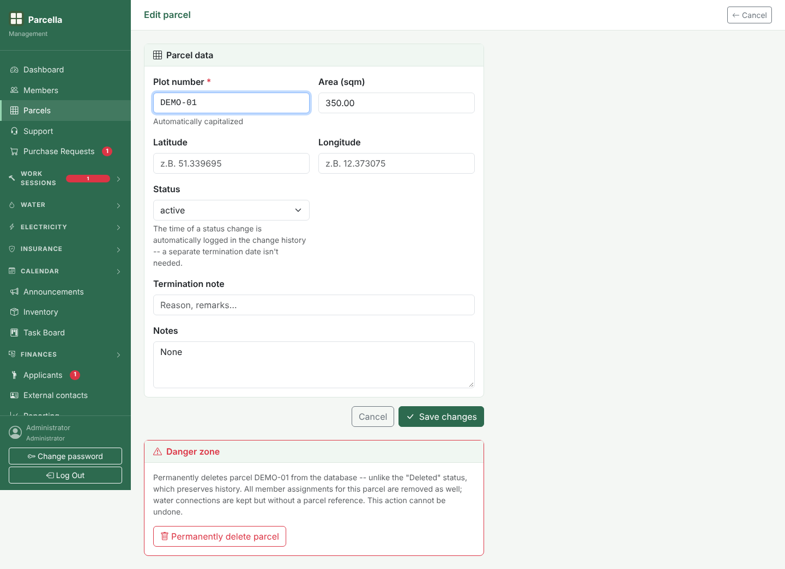

# Parcely {#parcels}

!!! warning "Zatiaľ neaktualizované"
    Táto stránka opisuje starší stav. Aktuálna je anglická verzia (jazyk prepnete hore).

!!! note "Strojový preklad"
    Táto stránka bola strojovo preložená z angličtiny a zatiaľ nebola skontrolovaná. Ak je niečo nejasné, platí anglická verzia (jazyk prepnete hore).

Zoznam parciel obsahuje každú záhradku vášho spolku: jej číslo,
rozlohu, stav a kto ju má. Každá parcela si uchováva úplnú históriu
nájmov, takže aj po rokoch vidíte, kto mal ktorú záhradku a kedy.

!!! info "Kto to môže používať"
    Parcely sú súčasťou jadra a sú vždy zapnuté. Nedajú sa vypnúť.

    - **Každý, kto sa môže prihlásiť**, si môže pozrieť zoznam parciel,
      stránky parciel a export CSV.
    - **Pridávanie a úprava** parciel a prideľovanie, úprava a
      ukončovanie nájmov potrebujú oprávnenie *zápis* pre **Členovia a
      parcely**.
    - **Mazanie** záznamu bývalého nájmu alebo natrvalo zmazanie
      parcely potrebuje oprávnenie *mazanie* pre **Členovia a parcely**.
    - Karta **Dokumenty (cloudové úložisko)** na stránke parcely je len
      pre členov výboru a administrátorov a len kým je zapnutý modul
      **Cloudové úložisko** (predvolene je vypnutý).

    Pozri [Roly, skupiny a oprávnenia](../getting-started/roles-and-permissions.md).

## Stavy parciel {#parcel-statuses}

Každá parcela má jeden zo štyroch stavov:

| Stav | Význam |
|---|---|
| **aktívna** | Bežná, prenajatá parcela. |
| **ukončená** | Nájom bol vypovedaný -- parcela čaká na nového nájomcu. Len ukončené parcely sa dajú [odovzdať uchádzačom](applicants.md#assign-a-parcel). |
| **spoločná** | Spoločná plocha, ktorú spolok spravuje sám -- chodníky, ihrisko, trávnik pri klubovni. Evidujete ju ako parcelu, s rozlohou, ale nie je prenajatá členom. Ak sa spolok rozhodne ju predsa len prenajať, môžete ju prepnúť späť na **aktívna**. |
| **vymazaná** | Parcela už neexistuje, napr. po zlúčení dvoch záhradiek. Jej história sa zachová. |

Stav zmeníte vo [formulári parcely](#new-parcel-and-edit-parcel). Každá
zmena sa zaznamená s dátumom a používateľom v histórii zmien parcely,
takže nepotrebujete samostatný dátum ukončenia.

## Zoznam parciel {#parcel-list}

Otvorte **Parcely** v hlavnom menu. Zoznam ukazuje každú parcelu,
zoradenú podľa čísla parcely -- vrátane vymazaných, pokiaľ nefiltrujete
podľa stavu.

### Tlačidlá hore {#buttons-at-the-top}

| Tlačidlo | Čo robí |
|---|---|
| **CSV import** | Otvorí dialóg importu (pozri [Import parciel zo súboru CSV](#importing-parcels-from-a-csv-file)). Potrebuje oprávnenie na zápis. |
| **CSV export** | Stiahne všetky parcely ako súbor CSV (pozri [Export CSV](#csv-export)). |
| **Nová parcela** | Otvorí prázdny [formulár parcely](#new-parcel-and-edit-parcel). Potrebuje oprávnenie na zápis. |

### Vyhľadávanie a filter {#search-and-filter}

| Pole / tlačidlo | Čo robí |
|---|---|
| **Hľadať číslo parcely…** | Nájde parcely, ktorých číslo obsahuje text. Ak chcete nájsť parcelu podľa mena nájomcu, hľadajte namiesto toho v [zozname členov](members.md#search-and-filters). |
| **Všetky stavy** | Ukáže len parcely s vybraným stavom. Použije sa hneď po zmene. |
| **Hľadať** | Použije hľadaný text. |
| **Resetovať** | Zruší vyhľadávanie a filter stavu. Zobrazí sa len, kým je niektorý aktívny. |

Rovnako ako v zozname členov si **Predchádzajúci**, **Ďalší** a
**Späť** na stránke parcely zachovajú filter, z ktorého ste prišli.

### Stĺpce {#columns}

| Stĺpec | Čo ukazuje |
|---|---|
| Zaškrtávacie políčko | Vyberie parcelu pre **Exportovať výber** alebo **Napísať nájomcom** (pozri nižšie). |
| **Číslo parcely** | Kliknutím otvoríte parcelu. |
| **Rozloha** | Rozloha v metroch štvorcových alebo „–“. |
| **Stav** | **aktívna**, **ukončená**, **spoločná** alebo **vymazaná**. |
| **Nájomca** | Súčasní nájomcovia. Kliknutím na meno otvoríte člena. Bývalí a budúci nájomcovia sa tu nezobrazujú. |
| Tlačidlo s okom | Otvorí stránku parcely. |

Päta ukazuje počet parciel v zozname a, ak sú rozlohy zadané, ich
celkovú rozlohu -- šikovné na kontrolu vyfiltrovaného výberu, napr.
celkovej rozlohy všetkých aktívnych parciel.

### Výber parciel a písanie ich nájomcom {#picking-parcels}

Každý riadok má zaškrtávacie políčko, takže môžete parcely vyberať
ručne -- napríklad všetky parcely pozdĺž jedného vodovodného potrubia --
a poslať oznámenie ľuďom, ktorí ich majú prenajaté.

| Tlačidlo | Čo robí |
|---|---|
| **Vybrať všetko** | Zaškrtne každú parcelu v aktuálnom zozname. |
| **Zrušiť výber** | Zruší všetky zaškrtnutia. |
| **Vybrané: *N*** | Počíta zaškrtnuté parcely. |
| **Exportovať výber** | Stiahne súbor CSV (pozri nižšie) len so zaškrtnutými parcelami. Kým nezaškrtnete žiadnu, je neaktívne. |
| **Napísať nájomcom** | Začne nový [oznam](announcements.md) **súčasným** nájomcom zaškrtnutých parciel. Zobrazí sa len, kým je zapnutý modul **Oznamy**, a len členom výboru a administrátorom. |

Oznámenie parcelám sa týka **nájmu**, nie členstva v spolku: je
adresované nájomcom každej parcely spoločne, ako ročná faktúra. Preto:

- **Jedno oznámenie na parcelu.** Kto má prenajaté dve zo zaškrtnutých
  parciel, dostane dve oznámenia, jedno za každý nájom. Každý e-mail a
  list uvádza svoju parcelu („Záhradka 12“).
- **E-mail** každému nájomcovi, ktorý povoľuje informácie e-mailom
  (**Môže dostávať informácie e-mailom**) a má adresu.
- **List** ostatným nájomcom: jeden na poštovú adresu, s menami
  všetkých tam bez e-mailu -- aj vtedy, keď niekto, s kým bývajú, dostal
  e-mail. S **Poslať list aj členom, ktorí dostanú e-mail** dostane list
  každý s poštovou adresou.
- Bývalí a budúci nájomcovia sú vynechaní.

Pre správy členom (novinky spolku, pozvánky na členskú schôdzu) použite
namiesto toho [zoznam členov](members.md).

### Export CSV {#csv-export}

**CSV export** stiahne súbor `parcels.csv`, oddelený bodkočiarkami, s
*každou* parcelou -- vyhľadávanie a filter stavu sa neuplatnia.
**Exportovať výber** (vyššie) zapíše ten istý súbor len so zaškrtnutými
parcelami. Nadpisy stĺpcov sú po nemecky, aby sa súbor dal znova
importovať:

Gartennummer (číslo parcely), Fläche (qm) (rozloha), Breitengrad
(zemepisná šírka), Längengrad (zemepisná dĺžka), Status, Kündigungsnotiz
(poznámka k ukončeniu), Mitglieder (členovia), Notizen (poznámky).

- Čísla používajú desatinnú čiarku (312,5).
- Stav sa zapisuje ako ACTIVE, TERMINATED, COMMUNAL alebo DELETED.
- Stĺpec členov uvádza nájomcov parcely oddelených bodkočiarkami, tých
  označených ako fakturačná adresa prvých a s `*` za menom.
  <!-- TODO(verify): the members column includes former tenants as well, not only current ones. -->

## Import parciel zo súboru CSV {#importing-parcels-from-a-csv-file}

Import použite na vytvorenie všetkých parciel naraz, napríklad z
tabuľky. Funguje ako import členov: nahráte súbor, priradíte jeho
stĺpce a potom potvrdíte. Postup nájdete v časti
[Import členov a parciel](../guides/csv-import.md).

!!! tip "Najprv importujte parcely, potom členov"
    Import vytvára len parcely -- nájomcov nepriraďuje. Nájomcov
    priraďte potom na stránke každej parcely alebo člena.

### Krok 1: nahratie súboru {#step-1-upload-the-file}

Kliknite na **CSV import** v zozname parciel. V dialógu **CSV import**
vyberte súbor `.csv` a kliknite na **Importovať**. Zatiaľ sa nič
neuloží.

- Stĺpce môžu byť oddelené bodkočiarkami alebo čiarkami; Parcella to
  rozpozná.
- Prvý riadok musí byť hlavičkový. Nadpisy sa nemusia presne zhodovať --
  priradíte ich v ďalšom kroku.

Ak je súbor prázdny, vrátite sa s hlásením „Tento súbor CSV sa zdá byť
prázdny.“

### Krok 2: priradenie stĺpcov {#step-2-map-the-columns}

<!-- TODO(verify): no screenshot -- this page is only reached by uploading a file, which the screenshot tool can't do. -->

Stránka **Mapovanie stĺpcov CSV** ukazuje každý stĺpec vášho súboru s
jeho nadpisom a prvými piatimi riadkami dát.

| Pole / tlačidlo | Čo robí |
|---|---|
| Rozbaľovací zoznam pri každom stĺpci | Vyberte **Číslo parcely**, **Rozloha (m²)**, **Zemepisná šírka**, **Zemepisná dĺžka**, **Stav**, **Poznámky** -- alebo **— Ignorovať —**. Parcella predvyberie pole, keď nadpis rozpozná (po anglicky alebo po nemecky, napr. „Gartennummer“ alebo „Plot number“). |
| **Importovať** | Importuje riadky a vráti sa do zoznamu parciel. **Číslo parcely** musí byť priradené k stĺpcu, inak dostanete „Pred importom prosím priraďte stĺpec s číslom parcely.“ |
| **Späť** | Vráti sa do zoznamu parciel bez importu. |

### Čo sa pri importe stane {#what-happens-on-import}

- Čísla parciel sa prevedú na veľké písmená, rovnako ako vo formulári.
- Riadok, ktorého číslo parcely **už existuje, sa preskočí** --
  existujúce parcely import nikdy nemení.
- Riadok bez čísla parcely sa ignoruje.
- Rozloha, zemepisná šírka a dĺžka môžu používať desatinnú bodku alebo
  čiarku. Hodnota, ktorá nie je číslo, zostane prázdna.
- **Stav** musí byť ACTIVE, TERMINATED, COMMUNAL alebo DELETED (na
  veľkých písmenách nezáleží). Čokoľvek iné alebo prázdna bunka sa stane
  **aktívna**.

Zoznam parciel potom ukáže zhrnutie ako „40 importovaných, 2
preskočených“ plus koľko riadkov bolo ignorovaných pre chýbajúce číslo
parcely.

## Stránka parcely {#parcel-page}

Kliknutím na číslo parcely otvoríte stránku parcely. Ukazuje údaje
parcely, kto ju má teraz, kto ju mal predtým a čo sa zmenilo.

### Tlačidlá hore {#buttons-at-the-top_1}

| Tlačidlo | Čo robí |
|---|---|
| **Upraviť** | Otvorí [formulár úprav](#new-parcel-and-edit-parcel). Potrebuje oprávnenie na zápis. |
| **Predchádzajúci** / **Ďalší** | Skočí na predchádzajúcu alebo ďalšiu parcelu v zozname, z ktorého ste prišli. Môžete stlačiť aj ++ctrl+left++ a ++ctrl+right++ (nie počas písania do poľa). |
| **Späť** | Vráti sa do zoznamu parciel s vaším filtrom. |

### Podrobnosti parcely {#parcel-details}

| Riadok | Čo ukazuje |
|---|---|
| **Číslo parcely** | |
| **Rozloha** | V metroch štvorcových. |
| **Súradnice** | Len ak sú zadané zemepisná šírka aj dĺžka. **Zobraziť na mape** otvorí miesto v OpenStreetMap v novej karte. |
| **Stav** | Aktuálny stav. |
| **Ukončená dňa** | Kedy bol stav naposledy nastavený na **ukončená**, podľa histórie zmien. |
| **Poznámka k ukončeniu** | Dôvod alebo pripomienky, ak boli zadané. |
| **Vytvorená** | Kedy bola parcela zadaná do Parcelly. |
| **Poznámky** | Interné poznámky parcely, ak nejaké sú. |

Pod podrobnosťami karta **Procesy** uvádza [procesy](processes.md)
týkajúce sa tejto parcely, ak je modul zapnutý a smiete vidieť procesy.
**Začať proces** spustí nový.

### Súčasní nájomcovia {#current-tenants}

Členovia, ktorí majú parcelu teraz, plus ktokoľvek, kto ju prevezme k
budúcemu dátumu.

| Stĺpec | Čo ukazuje |
|---|---|
| **Člen** | Meno nájomcu -- kliknutím otvoríte člena. Modrý odznak **od *dátum*** označuje budúceho nájomcu, ktorý preberá parcelu v tento deň. Odznak **do *dátum*** označuje nájomcu, ktorý dal výpoveď a odchádza v tento deň. |
| **Fakturačná adresa** | Či faktúry za túto parcelu idú na adresu tohto člena. |
| **Od** | Začiatok nájmu alebo „–“, ak nebol zadaný. |
| Tlačidlo ceruzky | Otvorí [Upraviť nájom](#edit-tenancy) na zmenu dátumov alebo fakturačnej adresy. Potrebuje oprávnenie na zápis. |
| Tlačidlo kalendára | **Ukončiť nájom** (pozri nižšie). Potrebuje oprávnenie na zápis. |

Ak parcelu nikto nemá, karta hovorí „Žiadni súčasní nájomcovia“.

#### Pridelenie nájomcu {#assigning-a-tenant}

Na konci karty (potrebuje oprávnenie na zápis):

| Pole / tlačidlo | Čo robí |
|---|---|
| **Vyberte člena…** | Začnite písať meno; vyberte člena zo zoznamu, ktorý sa objaví. Ponúkajú sa len aktívni členovia. Ak nevyberiete zo zoznamu, dostanete „Vyberte prosím člena zo zoznamu“. |
| Pole dátumu | Prvý deň nájmu. Voliteľné. |
| **Použiť ako fakturačnú adresu** | Predvolene zaškrtnuté. Faktúry za túto parcelu idú na adresu tohto člena. |
| **Priradiť** | Pridá člena ako nájomcu. |

K jednej parcele môžete priradiť viacerých členov -- napríklad pár alebo
rodinu. Všetci sa počítajú ako rovnoprávni nájomcovia; „hlavný“
nájomca neexistuje. **Použiť ako fakturačnú adresu** môžete zaškrtnúť aj
pri viacerých z nich.

!!! note "Opätovné priradenie bývalého nájomcu"
    Ak člen mal túto parcelu predtým, Parcella namiesto vytvorenia
    druhého nájmu znova otvorí jeho starý nájom. Nový dátum začiatku
    nahradí starý (dnešok, ak dátum necháte prázdny) a skoršie obdobie
    sa už v **Bývalí nájomcovia** nezobrazuje.

!!! tip "Odovzdanie parcely novému nájomcovi"
    Ak nový nájomca prichádza z poradovníka, použite namiesto toho
    **Prideliť parcelu** na [stránke uchádzača](applicants.md#assign-a-parcel).
    Jedným krokom ukončí staré nájmy, vytvorí nového člena a znova
    aktivuje parcelu. Pozri aj
    [Odovzdanie parcely](../guides/parcel-handover.md).

#### Ukončenie nájmu {#ending-a-tenancy}

Kliknite na tlačidlo kalendára pri nájomcovi a potvrďte „Ukončiť toto
nájomné? (história zostáva zachovaná)“.

- Nájom končí **dnes**. Člen sa hneď presunie do **Bývalí
  nájomcovia** s dnešným dátumom ako dátumom ukončenia.
- Člen už nie je fakturačnou adresou tejto parcely.
- Nič sa nezmaže: nájom zostáva viditeľný v histórii parcely a dá sa
  neskôr opraviť.
- **Členstvo** sa neukončí. Ak člen zo spolku odchádza, nastavte
  **Členom do** na jeho [stránke člena](members.md#membership).
- **Stav** parcely sa nezmení. Ak parcela teraz čaká na nového
  nájomcu, nastavte ju vo formulári parcely na **ukončená**.
- Ak parcela teraz nemá súčasného ani budúceho nájomcu, jej priečinok
  dokumentov v cloudovom úložisku (ak je nastavený) sa vyradí.

Tlačidlo funguje len pri nájme bez dátumu ukončenia. Pri nájomcovi,
ktorý už dal výpoveď k budúcemu dátumu, zmeňte namiesto toho dátum v
[Upraviť nájom](#edit-tenancy).

!!! tip "Ukončenie k inému dňu ako dnes"
    Ak chcete zaznamenať nájom, ktorý skončil (alebo skončí) v iný deň,
    otvorte tlačidlo ceruzky a zadajte **Nájomca do**.

### Bývalí nájomcovia {#former-tenants}

Zobrazí sa len vtedy, ak parcela mala predtým nájomcov. Uvádza každý
skončený nájom, najnovší prvý.

| Stĺpec / tlačidlo | Čo ukazuje |
|---|---|
| **Člen** | Kliknutím na meno otvoríte člena. |
| **Od** / **Do** | Obdobie nájmu. |
| Tlačidlo ceruzky | **Opraviť obdobie** -- otvorí [Upraviť nájom](#edit-tenancy), napr. na opravu nesprávneho dátumu. Potrebuje oprávnenie na zápis. |
| Tlačidlo koša | **Zmazať záznam** po potvrdení „Naozaj natrvalo zmazať tento záznam? Túto akciu nie je možné vrátiť späť.“ Potrebuje oprávnenie na mazanie. |

!!! warning "Mazanie bývalého nájmu je len na chyby"
    Zmazanie natrvalo odstráni záznam -- je určené pre priradenie,
    ktoré bolo zadané omylom alebo dvakrát. Pri bežnej zmene nájomcu
    nájom ukončite; nikdy ho nemažte. Zmazať sa dajú len skončené nájmy;
    aktuálny treba najprv ukončiť.

### Dokumenty (cloudové úložisko) {#documents-cloud-storage}

Zobrazí sa len členom výboru a administrátorom, kým je zapnutý modul
**Cloudové úložisko**. Prepája parcelu s priečinkom v cloudovom úložisku
vášho spolku (napríklad Nextcloud), kde uchovávate nájomné zmluvy a iné
dokumenty pre súčasných nájomcov. Úložisko najprv nastavte v časti
[Integrácie](../administration/integrations.md).

| Pole / tlačidlo | Čo robí |
|---|---|
| **Cesta k priečinku** | Cesta k priečinku, ktorý patrí k aktuálnemu nájmu, napr. „kgv_dokumente/parzellen/G016/2024-03_016_Mueller“. Priečinok už musí existovať a byť vo vašom cloudovom úložisku zdieľaný s nájomcami. |
| **Prehľadávať…** | Otvorí **Vyberte priečinok**: preklikajte sa priečinkami (alebo píšte do **Filtrovať priečinky…**) a potom kliknite na **Použiť tento priečinok**. Dvojklik na priečinok ho hneď vyberie. Samotný koreň úložiska vybrať nemôžete -- „Najskôr otvorte priečinok, než ho vyberiete.“ |
| **Uložiť** | Uloží cestu k priečinku. |
| Zoznam súborov | Ukazuje súbory a podpriečinky priečinka s **Názov** a **Naposledy zmenené**. Kliknutím na podpriečinok ho otvoríte; cesta nad zoznamom vedie späť. Tlačidlo sťahovania súbor stiahne. |
| Pole súboru + **Nahrať** | Nahrá súbor do priečinka, ktorý si práve prezeráte. |

Keď nájom skončí a parcelu už nikto nemá, priečinok sa automaticky
vyradí, aby ďalší nájomcovia nevideli staré dokumenty. Po odovzdaní k
budúcemu dátumu vám upozornenie povie, kedy sa aktuálny priečinok
vyradí a ktorý priečinok ho v ten deň nahradí.

### História zmien {#change-history}

Zobrazí sa, až keď sa niečo zmenilo. Zaznamenáva sa každá zmena čísla
parcely, rozlohy, súradníc, stavu, poznámky k ukončeniu alebo poznámok:

| Stĺpec | Čo ukazuje |
|---|---|
| **Časová značka** | Dátum a čas zmeny. |
| **Pole** | Technický názov zmeneného poľa, napr. *status* alebo *area_sqm*. |
| **Staršia hodnota** / **Nová hodnota** | Hodnota pred a po. |
| **Zmenil** | Používateľ, ktorý zmenu urobil, alebo **Neznámy**. |

Zmeny nájmov sa tu nezobrazujú -- ukazujú sa v tabuľkách nájomcov
vyššie.

## Nová parcela a úprava parcely {#new-parcel-and-edit-parcel}

Kliknite na **Nová parcela** v zozname parciel alebo na **Upraviť** na
stránke parcely. Formulár úprav má o niekoľko polí viac ako formulár
novej parcely.

| Pole | Čo robí |
|---|---|
| **Číslo parcely** \* | Povinné, napr. „G093“ alebo „G26/27“. Automaticky veľkými písmenami. Musí byť jedinečné: ak ho už má iná parcela, dostanete „Číslo parcely '…' už existuje.“ |
| **Rozloha (m²)** | Rozloha v metroch štvorcových. Funguje desatinná bodka aj čiarka. Používa sa na poplatky podľa rozlohy a štatistiky. |
| **Zemepisná šírka** / **Zemepisná dĺžka** | Voliteľná poloha GPS parcely, napr. 51.339695 a 12.373075. Keď sú vyplnené obe, stránka parcely odkazuje na mapu. Zemepisná šírka musí byť medzi -90 a 90, dĺžka medzi -180 a 180. Poloha sa nikdy nezobrazuje na verejných stránkach. |
| **Stav** | Len vo formulári úprav. **aktívna**, **ukončená**, **spoločná** alebo **vymazaná** -- pozri [Stavy parciel](#parcel-statuses). Čas zmeny sa zaznamená automaticky. Nové parcely vždy začínajú ako **aktívna**. |
| **Poznámka k ukončeniu** | Len vo formulári úprav. Dôvod alebo pripomienky k ukončeniu. |
| **Poznámky** | Interné poznámky o parcele. |

| Tlačidlo | Čo robí |
|---|---|
| **Vytvoriť parcelu** / **Uložiť zmeny** | Uloží a otvorí stránku parcely. |
| **Zrušiť** | Odíde bez uloženia. |

<!-- TODO(verify): an area or coordinate that isn't a number is silently left empty instead of showing an error. -->

### Nebezpečná zóna {#danger-zone}

Formulár úprav končí **Nebezpečnou zónou**. **Natrvalo vymazať
parcelu** po potvrdení odstráni parcelu z databázy. Spolu s ňou sa
odstránia všetky nájmy parcely -- súčasné aj bývalé. Vodovodné prípojky
sa zachovajú, ale už nie sú prepojené s parcelou. Nedá sa to vrátiť
späť a potrebuje to oprávnenie na mazanie.

!!! warning "Použite radšej stav vymazaná"
    Natrvalo zmazanie je určené pre parcely vytvorené omylom, napríklad
    testovacie záznamy. Pri parcele, ktorá už neexistuje, nastavte jej
    stav na **vymazaná** -- parcela a celá jej história zostanú
    dostupné.

## Upraviť nájom {#edit-tenancy}

Otvorí sa tlačidlom ceruzky pri súčasnom alebo bývalom nájomcovi.
Nadpis uvádza člena a parcelu. Potrebuje oprávnenie na zápis.

| Pole | Čo robí |
|---|---|
| **Použiť ako fakturačnú adresu** | Faktúry za túto parcelu idú na adresu tohto člena. „Platí iba, kým je tento nájom aktuálny -- automaticky sa zruší, keď sa skončí (dátum ukončenia dnes alebo skôr). Nájomca, ktorý dal výpoveď, si ju dovtedy ponechá.“ Zaškrtávacie políčko je sivé, keď je **Nájomca do** dnes alebo skôr; dátum v budúcnosti ho nechá tak, ako je. |
| **Nájomca od** | Prvý deň nájmu. |
| **Nájomca do** | Deň, keď nájom končí. „Prázdne = stále súčasný nájomca.“ Dátum v budúcnosti znamená, že nájomca dal výpoveď: zostáva súčasným nájomcom do tohto dňa a dostane odznak **do *dátum***. Od tohto dňa je uvedený v **Bývalí nájomcovia**. |

| Tlačidlo | Čo robí |
|---|---|
| **Uložiť zmeny** | Uloží a vráti sa na stránku parcely. Ak parcela teraz nemá súčasného ani budúceho nájomcu, jej cloudový priečinok dokumentov sa vyradí. |
| **Zrušiť** / **Späť** | Vráti sa na stránku parcely bez uloženia. |

Vymazanie **Nájomca do** pri bývalom nájme z neho znova urobí aktuálny
nájom.

## Súvisiace {#related}

- [Členovia](members.md) -- údaje členov a priraďovanie parciel zo
  strany člena
- [Uchádzači](applicants.md) -- odovzdanie ukončenej parcely ľuďom z
  poradovníka
- [Odovzdanie parcely](../guides/parcel-handover.md)
- [Import členov a parciel](../guides/csv-import.md)
- [Voda a elektrina](metering.md) -- meradlá patria k parcelám
- [Integrácie](../administration/integrations.md) -- nastavenie
  cloudového úložiska
