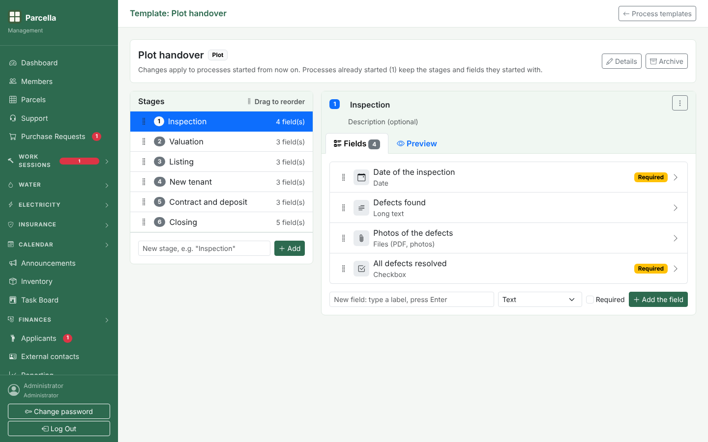

# Procédures {#processes}

!!! note "Traduction automatique"
    Cette page a été traduite automatiquement de l'anglais et n'a pas encore été relue. En cas de doute, la version anglaise fait foi (changez de langue en haut de la page).

Beaucoup de tâches de l'association suivent toujours les mêmes étapes :
transmettre une parcelle, accueillir un nouveau membre, traiter une
réclamation. Avec les procédures, vous décrivez une fois une telle tâche
sous forme de **modèle** -- une suite d'**étapes**, chacune avec les
**champs** à remplir -- puis vous la menez aussi souvent que nécessaire,
pour une parcelle, un membre ou un candidat. Parcella suit où en est
chaque procédure, ce qui a été saisi, et qui a fait quoi.

!!! info "Qui peut l'utiliser"
    - L'interrupteur du module est **Procédures** sous **Administration →
      Activer et désactiver les modules**. Il est **activé** par défaut.
    - Les rôles **Conseil d'administration** et **Administrateur**, et
      les membres d'un groupe avec **Accès complet à chaque module**,
      peuvent tout faire, y compris créer des modèles.
    - Tous les autres ont besoin du droit **Procédures** dans l'un de
      leurs [groupes](../administration/groups.md) :
        - *lecture* : voir les procédures, leurs valeurs, fichiers et
          historique ;
        - *écriture* : démarrer des procédures, remplir des champs,
          téléverser des fichiers, passer à l'étape suivante ou revenir en
          arrière ;
        - *suppression* : interrompre ou supprimer une procédure.
    - Les **modèles** ne peuvent être créés et modifiés qu'avec l'accès
      complet.
    - Les procédures concernant des candidats, et les champs candidat,
      nécessitent aussi la lecture du module [candidats](applicants.md).
      Sans elle, vous voyez « Visible uniquement avec l'accès au module des
      candidats. »

## Comment tout s'articule {#how-it-fits-together}

- Un **modèle** indique sur quoi porte la procédure (une parcelle, un
  membre, un candidat, ou rien de particulier) et liste ses étapes dans
  l'ordre.
- Chaque **étape** a un nombre quelconque de **champs**. Un champ peut
  être **Obligatoire**.
- Démarrer une procédure fait une copie du modèle. Les modifications
  ultérieures du modèle n'affectent pas les procédures déjà en cours.
- Une procédure se trouve toujours dans une **étape actuelle**. Vous
  avancez avec **Fait -- étape suivante** une fois que chaque champ
  obligatoire de cette étape est rempli. Après la dernière étape, la
  procédure est **Terminée**.
- Vous pouvez revenir à une étape précédente (avec un motif), ou
  interrompre la procédure (avec un motif). Une procédure terminée ou
  interrompue ne peut plus être modifiée.

## Liste des procédures {#process-list}

Ouvrez **Procédures** dans le menu.

| Champ / bouton | Ce qu'il fait |
|---|---|
| **Modèles** | Ouvre [Modèles de procédure](#process-templates). Seulement avec l'accès complet. |
| **Démarrer une procédure** | Ouvre [Démarrer une procédure](#start-a-process). Nécessite l'*écriture*. |
| **Statut** | **En cours** (par défaut), **Clôturées** (terminées ou interrompues) ou **Toutes**. |
| **Modèle** | **Tous les modèles** ou un modèle ; les modèles archivés sont marqués « (archivé) ». |
| **Filtrer** | Applique les deux filtres. |

| Colonne | Ce qu'elle affiche |
|---|---|
| **Procédure** | Le titre (avec lien) et, en dessous, le nom du modèle. |
| **Pour** | La parcelle, le membre ou le candidat, avec un lien vers sa page. « (supprimé) » si cet enregistrement a été supprimé. |
| **Étape actuelle** | L'étape où se trouve la procédure, par ex. « Estimation (2/6) ». Un tiret pour les procédures clôturées. |
| **Démarrée** | La date de démarrage. |
| **Statut** | **En cours**, **Terminée** ou **Interrompue**. |

Si la liste est vide, elle indique **Aucune procédure.**, et sans modèle
propose **Créez d'abord un modèle.**

!!! tip "Les procédures sur les pages des parcelles, membres et candidats"
    La page d'une [parcelle](parcels.md), d'un [membre](members.md) et
    d'un [candidat](applicants.md) a une carte **Procédures** listant
    leurs procédures avec l'étape actuelle et le statut. Son bouton
    **Démarrer une procédure** ouvre la page de démarrage avec cette
    parcelle, ce membre ou ce candidat déjà choisi, et seulement les
    modèles correspondants proposés.

## Démarrer une procédure {#start-a-process}

1. Choisissez le **Modèle**. La page se recharge et affiche la
   description du modèle et ses **Étapes**. Les modèles archivés ne sont
   pas proposés.
2. Si le modèle porte sur une parcelle, un membre ou un candidat,
   choisissez-le dans le champ **Parcelle**, **Membre** ou **Candidat**.
   C'est obligatoire.
3. Donnez éventuellement un **Titre** -- le nom du modèle est utilisé
   s'il est laissé vide. Astuce : incluez le numéro de parcelle ou le
   nom, par ex. « Transmission parcelle 17 », pour distinguer les
   procédures dans la liste.
4. Cliquez sur **Démarrer**. La procédure s'ouvre à sa première étape.

**Annuler** revient à la liste. S'il n'existe encore aucun modèle, la
page indique **Il n'y a pas encore de modèle actif.**

## Une procédure en cours {#a-running-process}

En haut, vous voyez le statut, le modèle, ce sur quoi porte la procédure
(avec lien) et « Démarrée le {date} par {name} ». En dessous, une rangée
de badges montre l'avancement : vert avec une coche pour les étapes
terminées, bleu pour l'étape actuelle, gris pour les étapes à venir.
Cliquez sur un badge pour aller à cette étape.

Une procédure terminée affiche **Terminée le {date}.** ; une procédure
interrompue affiche **Interrompue**, la date et le motif.

### Les étapes {#the-stages}

Chaque étape est une carte avec son numéro et son nom.

- **Les étapes terminées** affichent la date et qui les a terminées.
  Leurs champs peuvent encore être corrigés tant que la procédure est
  ouverte.
- **L'étape actuelle** est marquée **Étape actuelle** et encadrée en
  bleu.
- **Les étapes pas encore atteintes** sont marquées **Pas encore
  atteinte** et ne listent que les noms de leurs champs.

Dans une étape modifiable, remplissez les champs et cliquez sur
**Enregistrer**. Cela enregistre les champs de cette seule étape. Les
fichiers se téléversent séparément (voir ci-dessous). Si une valeur
n'est pas valide, vous voyez un message comme **Veuillez saisir un
nombre valide.** ou **Veuillez saisir une date valide.**

### Avancer {#moving-on}

En bas de l'étape actuelle :

- **Encore nécessaire avant de continuer :** liste les champs
  obligatoires encore vides, chacun avec un lien vers son champ. Tant
  que quelque chose est listé, le bouton est désactivé.
- **Fait -- étape suivante** termine l'étape et fait avancer la
  procédure. À la dernière étape, le bouton est **Terminer la
  procédure**.

Une case à cocher obligatoire compte comme remplie une fois cochée ; un
champ de fichiers obligatoire dès qu'il a au moins un fichier.

### Revenir en arrière {#go-back}

La carte **Revenir en arrière** (avec l'*écriture*, une fois la
procédure au-delà de sa première étape) ramène la procédure à une étape
précédente, par exemple quand une visite doit être refaite.

| Champ / bouton | Ce qu'il fait |
|---|---|
| **Revenir à l'étape** | L'étape précédente vers laquelle revenir. L'étape juste avant est présélectionnée. |
| **Motif** | Obligatoire. Va dans l'historique. |
| **Revenir en arrière** | Fait reculer la procédure. Toutes les valeurs saisies jusqu'ici sont conservées. |

### Historique {#history}

La carte **Historique** liste tout ce qui s'est passé, le plus récent en
haut, avec heure, étape, note et utilisateur : **Démarrée**,
**Passage à**, **Retour à**, **Terminée**, **Interrompue**, **Champ
modifié** (avec ancienne et nouvelle valeur), **Fichier ajouté** et
**Fichier retiré**.

### Interrompre ou supprimer {#abort-or-delete}

Seulement avec le droit de *suppression* :

| Champ / bouton | Ce qu'il fait |
|---|---|
| **Interrompre la procédure** + **Motif** + **Interrompre** | Arrête définitivement une procédure ouverte, après **Vraiment interrompre cette procédure ? Elle ne pourra pas être rouverte.** Le motif est obligatoire et affiché sur la procédure. La procédure reste dans la liste comme **Interrompue**. |
| **Supprimer la procédure** | Supprime complètement la procédure, avec toutes ses valeurs et fichiers, après **Vraiment supprimer cette procédure avec toutes ses valeurs et fichiers ?** Seulement pour une procédure démarrée par erreur. Les fichiers dans le cloud ne sont pas supprimés. |

## Types de champs {#field-types}

| Type | Ce que vous saisissez dans une procédure |
|---|---|
| **Texte** | Une ligne, jusqu'à 1 000 caractères. |
| **Texte long** | Plusieurs lignes. |
| **Nombre** | Un nombre. La virgule et le point fonctionnent tous deux comme séparateur décimal (« 1.234,50 » et « 1,234.50 »). |
| **Montant** | Comme un nombre, affiché avec la devise de votre association. |
| **Date** | Une date. |
| **Case à cocher** | Cochée ou non, par ex. « Clés remises ». |
| **Choix dans une liste** | L'une des options définies dans le modèle. |
| **Fichiers (PDF, photos)** | Un ou plusieurs fichiers téléversés. |
| **Membre** | Un membre de l'association. |
| **Candidat** | Un candidat (nécessite l'accès au module des candidats). |
| **Parcelle** | Une parcelle. |

Un champ peut avoir un texte d'aide, affiché en dessous.

### Fichiers {#files}

Un champ de fichiers liste ses fichiers avec nom, taille, date et qui les
a téléversés ; une icône de nuage signifie **Enregistré dans le cloud**.
Cliquez sur un nom pour ouvrir ou télécharger le fichier. Pour en
ajouter un, utilisez **Choisir un fichier** et **Téléverser** ; le petit
x retire un fichier après **Retirer ce fichier ?** (tant que l'étape est
modifiable).

Seulement PDF, JPEG, PNG ou WebP, jusqu'à 20 Mo. Sous le bouton de
téléversement, Parcella indique où ira le fichier, dans cet ordre :

1. **Le dossier cloud de la parcelle**, dans un sous-dossier pour cette
   procédure -- si le module de stockage cloud est activé et que la
   procédure porte sur une parcelle ayant un dossier cloud, ou sur un
   membre ayant exactement une parcelle actuelle qui en a un.
2. **Le dossier des fichiers de procédure**, si un administrateur a
   défini **Dossier des fichiers de procédure** sous **Administration →
   Intégrations**.
3. Sinon **le stockage privé de Parcella** : « Conservé dans le stockage
   privé de Parcella (aucun dossier cloud défini pour cette parcelle ni
   pour les processus). »

!!! warning "Les dossiers des parcelles sont souvent partagés avec les locataires"
    Si les dossiers de vos parcelles dans le cloud sont partagés avec
    les locataires de la parcelle, ceux-ci voient aussi les fichiers des
    procédures concernant leur parcelle. C'est voulu -- les documents
    officiels concernant une parcelle sont ouverts à ses locataires. Si
    vous voulez des fichiers réservés au bureau, ne définissez pas de
    dossier cloud sur la parcelle et utilisez plutôt le dossier des
    fichiers de procédure.

Retirer un fichier d'une procédure supprime un fichier du stockage
propre de Parcella, mais ne fait que délier un fichier du cloud ; le
fichier lui-même y reste.

## Modèles de procédure {#process-templates}

**Modèles** dans la liste des procédures (accès complet seulement)
ouvre **Modèles de procédure**. **Procédures** en haut à droite vous
ramène.

La carte **Modèles** liste chaque modèle avec ce sur quoi il porte, son
nombre d'étapes, le nombre de fois où il a été utilisé, et **archivé**
s'il est archivé. **Modifier** ouvre l'[éditeur de modèle](#the-template-editor).

### Nouveau modèle {#new-template}

| Champ / bouton | Ce qu'il fait |
|---|---|
| **Nom** | Obligatoire, jusqu'à 200 caractères. |
| **Une procédure concerne** | **Parcelle**, **Membre**, **Candidat** ou **Non rattachée**. Au démarrage d'une procédure, on choisit la parcelle, le membre ou le candidat concerné, et la procédure est listée sur sa page. |
| **Description** | Facultative. Affichée quand quelqu'un choisit le modèle pour démarrer une procédure. |
| **Créer** | Crée le modèle et ouvre l'éditeur. |

### Partir d'un exemple {#start-from-an-example}

Crée un modèle ordinaire que vous pouvez ensuite modifier librement,
dans votre langue. Cliquez sur **Utiliser** à côté de :

- **Passation de parcelle** -- une parcelle résiliée en route vers le
  prochain locataire : visite, estimation, annonce, nouveau locataire,
  contrat et remise.
- **Accueil d'un nouveau membre** -- accueillir un nouveau membre :
  premier entretien, papiers, et derniers détails.

## L'éditeur de modèle {#the-template-editor}

L'éditeur est intitulé « Modèle : {name} ». Les modifications sont
enregistrées au fur et à mesure ; une courte confirmation apparaît en
haut à droite.

L'en-tête affiche le nom, ce sur quoi porte le modèle, et une note :
« Les modifications s'appliquent aux procédures démarrées à partir de
maintenant. Les procédures déjà démarrées ({count}) gardent leurs étapes
et champs. »

| Bouton | Ce qu'il fait |
|---|---|
| **Détails** | Ouvre le nom, **Une procédure concerne** et la description pour les modifier ; **Enregistrer** les enregistre. |
| **Archiver** / **Restaurer** | Un modèle archivé ne peut plus servir à démarrer de nouvelles procédures ; celles en cours continuent. |
| **Supprimer** | Seulement tant qu'aucune procédure n'a été démarrée à partir du modèle, après **Vraiment supprimer ce modèle ?** Sinon, archivez-le. |

### Étapes {#stages}

La carte de gauche liste les **Étapes** dans l'ordre, avec leur nombre
de champs. Cliquez sur l'une pour la modifier. Faites glisser une étape
par sa poignée pour changer l'ordre. Ajoutez une étape en tapant un nom
dans **Nouvelle étape, p. ex. « Visite »** et en cliquant sur
**Ajouter**.

L'étape sélectionnée s'affiche à droite :

- Son **nom** et sa **Description (facultative)** se modifient sur
  place. La description s'affiche en haut de l'étape dans une procédure
  en cours.
- Le menu **⋮** (**Actions de l'étape**) propose **Monter**,
  **Descendre** et **Supprimer l'étape** (après **Supprimer cette étape
  avec tous ses champs ?**).

### Champs {#fields}

L'onglet **Champs** liste les champs de l'étape avec leur type, leurs
options, leur texte d'aide et un badge **Obligatoire**. Une étape sans
champ est une simple étape à cocher.

Pour ajouter un champ, tapez son libellé dans **Nouveau champ :
saisissez un libellé, puis Entrée**, choisissez le **Type**, cochez
**Obligatoire** si nécessaire et appuyez sur Entrée ou cliquez sur
**Ajouter le champ**. Pour **Choix dans une liste**, un panneau latéral
s'ouvre d'abord, car un choix a besoin de ses options.

Faites glisser les champs par leur poignée pour changer l'ordre. Cliquez
sur un champ pour ouvrir le panneau **Modifier le champ** :

| Champ / bouton | Ce qu'il fait |
|---|---|
| **Libellé** | Obligatoire, jusqu'à 200 caractères. |
| **Type** | L'un des [types de champs](#field-types). |
| **Options (choix uniquement, une par ligne)** | Obligatoire pour **Choix dans une liste** : au moins une option. |
| **Obligatoire** | La procédure ne peut avancer qu'une fois ce champ rempli. |
| **Texte d'aide (facultatif)** | Affiché sous le champ dans une procédure en cours. |
| **Enregistrer** / **Fermer** | Enregistre le champ / ferme le panneau. |
| **Déplacer vers l'étape** + bouton flèche | Déplace le champ à la fin d'une autre étape. |
| **Monter** / **Descendre** | Change l'ordre, sans glisser-déposer. |
| **Dupliquer** | Ajoute une copie juste en dessous. |
| **Supprimer le champ** | Retire le champ du modèle. |

L'onglet **Aperçu** montre l'aspect de l'étape dans une procédure en
cours, avec les champs de saisie désactivés.

## Exemple complet : la transmission d'une parcelle {#worked-example-a-plot-handover}

Un locataire a donné son congé pour la parcelle 17. Voici comment le
bureau mène la transmission avec l'exemple **Passation de parcelle**.

**Une fois : configurer le modèle.** Ouvrez **Procédures → Modèles**,
cliquez sur **Utiliser** à côté de **Passation de parcelle**. Vous
obtenez un modèle portant sur une **Parcelle** avec six étapes :

| # | Étape | Champs (* = obligatoire) |
|---|---|---|
| 1 | Visite | Date de la visite*, Défauts constatés, Photos des défauts, Tous les défauts corrigés* |
| 2 | Estimation | Expert*, Date de l'estimation*, Rapport d'estimation* (fichier) |
| 3 | Annonce | Texte de l'annonce*, Photos pour l'annonce, Publiée le* |
| 4 | Nouveau locataire | Nouveau locataire* (candidat), Contact établi*, Documents envoyés* |
| 5 | Contrat et caution | Contrat de vente confirmé*, Caution (montant), Caution reçue le |
| 6 | Remise | Signé par le nouveau locataire*, Contresigné par le bureau*, Clés remises*, Compteurs relevés*, Procès-verbal de remise (fichier) |

Adaptez-le à votre association : par exemple, rendez **Caution**
obligatoire, ou ajoutez un champ **Choix dans une liste** « Résultat de
l'estimation » avec les options « Reprise à l'estimation » et « Parcelle
à débarrasser ».

**À chaque fois : la mener.**

1. Ouvrez la parcelle 17 et cliquez sur **Démarrer une procédure** dans
   sa carte **Procédures**. **Passation de parcelle** et la parcelle sont
   déjà choisies. Saisissez le titre « Transmission parcelle 17 » et
   cliquez sur **Démarrer**.
2. **Visite** : après le tour de la parcelle, saisissez la date, listez
   les défauts, téléversez des photos et cliquez sur **Enregistrer**.
   L'étape ne peut pas encore être terminée : **Tous les défauts
   corrigés** est encore nécessaire. Une fois que le locataire a tout
   réparé, cochez-le, **Enregistrer**, puis **Fait -- étape suivante**.
3. **Estimation** : saisissez l'expert et la date, téléversez le rapport
   en PDF. Si la parcelle a un dossier cloud, le rapport arrive là dans
   un sous-dossier pour cette transmission. **Fait -- étape suivante**.
4. **Annonce** et **Nouveau locataire** : enregistrez l'annonce, puis
   choisissez la personne retenue dans la liste des candidats et cochez
   les deux cases.
5. **Contrat et caution** : confirmez l'accord, saisissez la caution et
   le jour où elle est arrivée.
6. **Remise** : cochez les signatures, les clés et les relevés de
   compteurs, téléversez le procès-verbal de remise, et cliquez sur
   **Terminer la procédure**.

Si le nouveau locataire se retire à l'étape 5, utilisez **Revenir en
arrière** pour retourner à **Annonce** avec le motif « Le candidat s'est
désisté ». Les valeurs saisies jusqu'ici restent, et l'historique montre
ce qui s'est passé.

La procédure elle-même ne fait qu'enregistrer la transmission. Terminer
l'ancien bail, démarrer le nouveau et relever les compteurs dans
Parcella se font dans les modules [parcelles](parcels.md) et
[compteurs](metering.md) -- voir le
[guide de transmission d'une parcelle](../guides/parcel-handover.md).

## Voir aussi {#related}

- [Transmettre une parcelle](../guides/parcel-handover.md)
- [Parcelles](parcels.md), [Membres](members.md),
  [Candidats](applicants.md) -- la carte **Procédures** sur leurs pages.
- [Intégrations](../administration/integrations.md) -- le dossier des
  fichiers de procédure.
- [Groupes](../administration/groups.md) -- donner à quelqu'un des
  droits sur les procédures.
