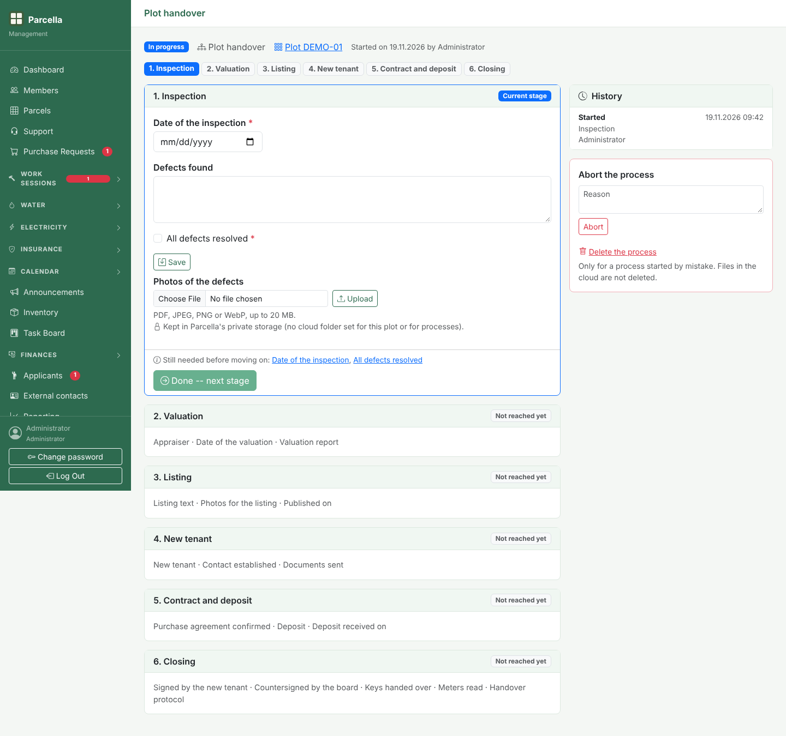

# Processes

Many club jobs follow the same steps every time: handing over a plot,
welcoming a new member, dealing with a complaint. With processes you
describe such a job once as a **template** -- a series of **stages**,
each with the **fields** to fill in -- and then run it as often as you
need, for a plot, a member or an applicant. Parcella keeps track of
where each run stands, what was entered, and who did what.

!!! info "Who can use this"
    - The module switch is **Processes** under **Administration →
      Turning modules on and off**. It is **on** by default.
    - The **Board** and **Administrator** roles, and members of a group
      with **Full access to every module**, can do everything,
      including building templates.
    - Everyone else needs the **Processes** permission in one of their
      [groups](../administration/groups.md):
        - *read*: see processes, their values, files and history;
        - *write*: start processes, fill in fields, upload files, move
          on to the next stage or go back;
        - *delete*: abort or delete a process.
    - **Templates** can only be created and changed with full access.
    - Processes about applicants, and applicant fields, also need read
      access to the [applicants](applicants.md) module. Without it you
      see "Only visible with access to the applicants module."

## How it fits together

- A **template** says what the process is about (a plot, a member, an
  applicant, or nothing in particular) and lists its stages in order.
- Each **stage** has any number of **fields**. A field can be
  **Required**.
- Starting a process makes a copy of the template. Later changes to the
  template don't affect processes that are already running.
- A process always sits in one **current stage**. You move on with
  **Done -- next stage** once every required field of that stage is
  filled in. After the last stage the process is **Completed**.
- You can go back to an earlier stage (with a reason), or abort the
  process (with a reason). A completed or aborted process can't be
  changed any more.

## Process list

Open **Processes** in the menu.

| Field / button | What it does |
|---|---|
| **Templates** | Opens [Process templates](#process-templates). Only with full access. |
| **Start a process** | Opens [Start a process](#start-a-process). Needs *write*. |
| **Status** | **In progress** (default), **Closed** (completed or aborted) or **All**. |
| **Template** | **All templates** or one template; archived templates are marked "(archived)". |
| **Filter** | Applies the two filters. |

| Column | What it shows |
|---|---|
| **Process** | The title (linked) and, underneath, the template's name. |
| **For** | The plot, member or applicant, linked to their page. "(removed)" if that record was deleted. |
| **Current stage** | The stage the process is in, e.g. "Valuation (2/6)". A dash for closed processes. |
| **Started** | The start date. |
| **Status** | **In progress**, **Completed** or **Aborted**. |

If the list is empty it says **No processes here.**, and with no
templates yet offers **Create a template first.**

!!! tip "Processes on plot, member and applicant pages"
    The page of a [plot](parcels.md), a [member](members.md) and an
    [applicant](applicants.md) has a **Processes** card listing their
    processes with current stage and status. Its **Start a process**
    button opens the start page with that plot, member or applicant
    already chosen, and only the matching templates offered.

## Start a process

1. Pick the **Template**. The page reloads and shows the template's
   description and its **Stages**. Archived templates are not offered.
2. If the template is about a plot, member or applicant, choose it in
   the field labelled **Plot**, **Member** or **Applicant**. This is
   required.
3. Optionally give a **Title** -- the template's name is used if left
   blank. Tip: include the plot number or name, e.g. "Handover plot 17",
   so you can tell processes apart in the list.
4. Click **Start**. The process opens at its first stage.

**Cancel** goes back to the list. If no template exists yet, the page
says **There's no active template yet.**

## A running process

At the top you see the status, the template, what the process is about
(linked) and "Started on {date} by {name}". Below that, a row of
badges shows the progress: green with a tick for finished stages, blue
for the current stage, grey for stages still to come. Click a badge to
jump to that stage.

A completed process shows **Completed on {date}.**; an aborted one shows
**Aborted**, the date and the reason.

### The stages

Each stage is a card with its number and name.

- **Finished stages** show the date and who finished them. Their
  fields can still be corrected while the process is open.
- The **current stage** is marked **Current stage** and framed in blue.
- **Stages not reached yet** are marked **Not reached yet** and only
  list the names of their fields.

In a stage you can edit, fill in the fields and click **Save**. This
saves the fields of that one stage. Files are uploaded separately (see
below). If a value isn't valid, you see a message such as **Please enter
a valid number.** or **Please enter a valid date.**

### Moving on

At the bottom of the current stage:

- **Still needed before moving on:** lists the required fields that
  are still empty, each linked to its field. While anything is listed,
  the button is disabled.
- **Done -- next stage** finishes the stage and moves the process on.
  On the last stage the button is **Complete the process**.

A required checkbox counts as filled once it's ticked; a required file
field once it has at least one file.

### Go back

The **Go back** card (with *write*, once the process is past its first
stage) returns the process to an earlier stage, for example when an
inspection has to be repeated.

| Field / button | What it does |
|---|---|
| **Back to stage** | Which earlier stage to return to. The previous stage is preselected. |
| **Reason** | Required. Goes into the history. |
| **Go back** | Moves the process back. All values entered so far are kept. |

### History

The **History** card lists everything that happened, newest at the
top, with time, stage, note and user: **Started**, **Moved on to**,
**Went back to**, **Completed**, **Aborted**, **Field changed** (with
old and new value), **File added** and **File removed**.

### Abort or delete

Only with *delete* permission:

| Field / button | What it does |
|---|---|
| **Abort the process** + **Reason** + **Abort** | Stops an open process for good, after **Really abort this process? It can't be reopened.** The reason is required and shown on the process. The process stays in the list as **Aborted**. |
| **Delete the process** | Removes the process completely, with all its values and files, after **Really delete this process with all its values and files?** Only for a process started by mistake. Files in the cloud are not deleted. |

## Field types

| Type | What you enter in a process |
|---|---|
| **Text** | One line, up to 1,000 characters. |
| **Long text** | Several lines. |
| **Number** | A number. Comma or point both work as decimal separator ("1.234,50" and "1,234.50"). |
| **Amount of money** | Like a number, shown with your club's currency. |
| **Date** | A date. |
| **Checkbox** | Ticked or not, e.g. "Keys handed over". |
| **Choice from a list** | One of the options defined in the template. |
| **Files (PDF, photos)** | One or more uploaded files. |
| **Member** | A member of the club. |
| **Applicant** | An applicant (needs access to the applicants module). |
| **Plot** | A plot. |

A field can have a help text, shown underneath it.

### Files

A file field lists its files with name, size, date and who uploaded
them; a cloud icon means **Stored in the cloud**. Click a name to open
or download the file. To add one, use **Choose a file** and **Upload**;
the small x removes a file after **Remove this file?** (while the stage
is editable).

Only PDF, JPEG, PNG or WebP, up to 20 MB. Under the upload button
Parcella says where the file will go, in this order:

1. **The plot's cloud folder**, in a subfolder for this process -- if
   the cloud storage module is on and the process is about a plot with
   a cloud folder, or about a member with exactly one current plot that
   has one.
2. **The folder for process files**, if an administrator set
   **Folder for process files** under **Administration → Integrations**.
3. Otherwise **Parcella's private storage**: "Kept in Parcella's private
   storage (no cloud folder set for this plot or for processes)."

!!! warning "Plot folders are often shared with the tenants"
    If your plot folders in the cloud are shared with the plot's
    tenants, they see the files of processes about their plot too. That
    is intended -- official documents about a plot are open to its
    tenants. If you want board-only files, don't set a cloud folder on
    the plot and use the folder for process files instead.

Removing a file from a process deletes a file in Parcella's own storage,
but only unlinks a file in the cloud; the file itself stays there.

## Process templates

**Templates** on the process list (full access only) opens **Process
templates**. **Processes** at the top right takes you back.

The **Templates** card lists every template with what it is about, its
number of stages, how often it was used, and **archived** if it is
archived. **Edit** opens the [template editor](#the-template-editor).

### New template

| Field / button | What it does |
|---|---|
| **Name** | Required, up to 200 characters. |
| **A process is about** | **Plot**, **Member**, **Applicant** or **Not attached to anything**. When starting a process, the plot, member or applicant it's about is chosen, and the process is listed on their page. |
| **Description** | Optional. Shown when someone picks the template to start a process. |
| **Create** | Creates the template and opens the editor. |

### Start from an example

Creates an ordinary template you can then change freely, in your
language. Click **Use** next to:

- **Plot handover** -- a terminated plot on its way to the next tenant:
  inspection, valuation, listing, new tenant, contract and closing.
- **Member onboarding** -- welcoming a new member: first meeting,
  paperwork, and the last details.

## The template editor

The editor is headed "Template: {name}". Changes are saved as you make
them; a short confirmation appears at the top right.

The header shows the name, what the template is about, and a note:
"Changes apply to processes started from now on. Processes already
started ({count}) keep the stages and fields they started with."

| Button | What it does |
|---|---|
| **Details** | Opens name, **A process is about** and description for editing; **Save** stores them. |
| **Archive** / **Restore** | An archived template can't be used to start new processes; running ones carry on. |
| **Delete** | Only while no process has been started from the template, after **Really delete this template?** Otherwise archive it. |

### Stages

The left card lists the **Stages** in order, with their number of
fields. Click one to edit it. Drag a stage by its handle to change the
order. Add a stage by typing a name into **New stage, e.g. "Inspection"**
and clicking **Add**.

The selected stage is shown on the right:

- Its **name** and **Description (optional)** can be edited in place.
  The description is shown at the top of the stage in a running process.
- The **⋮** menu (**Stage actions**) has **Move up**, **Move down** and
  **Delete the stage** (after **Delete this stage with all its
  fields?**).

### Fields

The **Fields** tab lists the stage's fields with their type, options,
help text and a **Required** badge. A stage without fields is a simple
step to tick off.

To add a field, type its label into **New field: type a label, press
Enter**, pick the **Type**, tick **Required** if needed and press Enter
or click **Add the field**. For **Choice from a list** a side panel opens
first, because a choice needs its options.

Drag fields by their handle to change the order. Click a field to open
the **Edit field** panel:

| Field / button | What it does |
|---|---|
| **Label** | Required, up to 200 characters. |
| **Type** | One of the [field types](#field-types). |
| **Options (choice only, one per line)** | Required for **Choice from a list**: at least one option. |
| **Required** | The process can only move on once this field is filled in. |
| **Help text (optional)** | Shown under the field in a running process. |
| **Save** / **Close** | Saves the field / closes the panel. |
| **Move to stage** + arrow button | Moves the field to the end of another stage. |
| **Move up** / **Move down** | Changes the order, without dragging. |
| **Duplicate** | Adds a copy right below. |
| **Delete the field** | Removes the field from the template. |

The **Preview** tab shows how the stage looks in a running process, with
the inputs disabled.

## Worked example: a plot handover

A tenant has given notice on plot 17. Here is how the board runs the
handover with the **Plot handover** example.

**Once: set up the template.** Open **Processes → Templates**, click
**Use** next to **Plot handover**. You get a template about a **Plot**
with six stages:

| # | Stage | Fields (* = required) |
|---|---|---|
| 1 | Inspection | Date of the inspection*, Defects found, Photos of the defects, All defects resolved* |
| 2 | Valuation | Appraiser*, Date of the valuation*, Valuation report* (file) |
| 3 | Listing | Listing text*, Photos for the listing, Published on* |
| 4 | New tenant | New tenant* (applicant), Contact established*, Documents sent* |
| 5 | Contract and deposit | Purchase agreement confirmed*, Deposit (amount), Deposit received on |
| 6 | Closing | Signed by the new tenant*, Countersigned by the board*, Keys handed over*, Meters read*, Handover protocol (file) |

Adjust it to your club: for example, make **Deposit** required, or add a
**Choice from a list** field "Valuation result" with the options
"Takeover at valuation" and "Plot to be cleared".

**Every time: run it.**

1. Open plot 17 and click **Start a process** in its **Processes** card.
   **Plot handover** and the plot are already chosen. Enter the title
   "Handover plot 17" and click **Start**.
2. **Inspection**: after the walk-round, enter the date, list the
   defects, upload photos and click **Save**. The stage can't be finished
   yet: **All defects resolved** is still needed. Once the tenant has
   fixed everything, tick it, **Save**, then **Done -- next stage**.
3. **Valuation**: enter the appraiser and date, upload the report as a
   PDF. If the plot has a cloud folder, the report lands in a subfolder
   for this handover there. **Done -- next stage**.
4. **Listing** and **New tenant**: record the listing, then pick the
   chosen person from the applicant list and tick the two checkboxes.
5. **Contract and deposit**: confirm the agreement, enter the deposit
   and the day it arrived.
6. **Closing**: tick the signatures, keys and meter readings, upload the
   handover protocol, and click **Complete the process**.

If the new tenant pulls out in stage 5, use **Go back** to return to
**Listing** with the reason "Applicant withdrew". The values entered so
far stay, and the history shows what happened.

The process itself only records the handover. Ending the old lease,
starting the new one and reading the meters in Parcella are done in the
[parcels](parcels.md) and [metering](metering.md) modules -- see the
[parcel handover guide](../guides/parcel-handover.md).

## Related

- [Handing over a parcel](../guides/parcel-handover.md)
- [Parcels](parcels.md), [Members](members.md),
  [Applicants](applicants.md) -- the **Processes** card on their pages.
- [Integrations](../administration/integrations.md) -- the folder for
  process files.
- [Groups](../administration/groups.md) -- giving someone process
  permissions.
