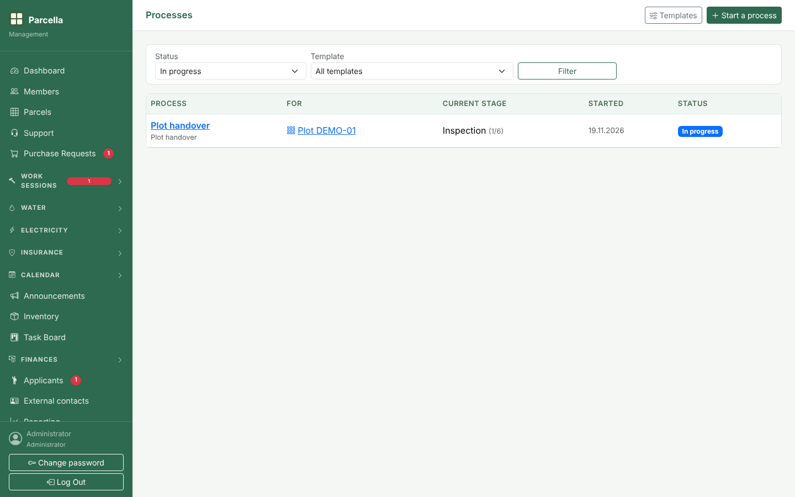
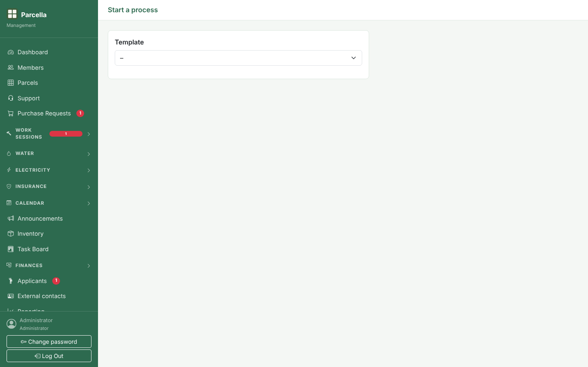
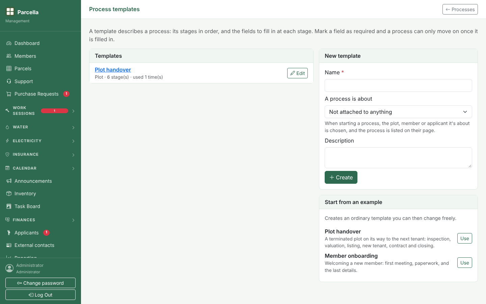

# Procesy {#processes}

!!! note "Strojový preklad"
    Táto stránka bola strojovo preložená z angličtiny a zatiaľ nebola skontrolovaná. Ak je niečo nejasné, platí anglická verzia (jazyk prepnete hore).

Mnohé práce spolku majú zakaždým rovnaké kroky: odovzdanie záhradky,
privítanie nového člena, vybavenie sťažnosti. S procesmi takúto prácu
raz opíšete ako **šablónu** -- sériu **fáz**, každú s **poľami** na
vyplnenie -- a potom ju spúšťate, koľkokrát potrebujete, pre záhradku,
člena alebo uchádzača. Parcella sleduje, kde každý beh stojí, čo bolo
zadané a kto čo urobil.

!!! info "Kto to môže používať"
    - Prepínač modulu je **Procesy** v časti **Administrácia →
      Zapínanie a vypínanie modulov**. Predvolene je **zapnutý**.
    - Roly **Výbor** a **Administrátor** a členovia skupiny s **Plný
      prístup ku každému modulu** môžu všetko, vrátane tvorby šablón.
    - Všetci ostatní potrebujú oprávnenie **Procesy** v niektorej zo
      svojich [skupín](../administration/groups.md):
        - *čítanie*: vidieť procesy, ich hodnoty, súbory a históriu;
        - *zápis*: začínať procesy, vypĺňať polia, nahrávať súbory,
          posúvať sa na ďalšiu fázu alebo sa vracať;
        - *mazanie*: prerušiť alebo zmazať proces.
    - **Šablóny** sa dajú vytvárať a meniť len s plným prístupom.
    - Procesy týkajúce sa uchádzačov a polia uchádzačov potrebujú aj
      čítanie modulu [uchádzačov](applicants.md). Bez neho uvidíte
      „Viditeľné len s prístupom k modulu uchádzačov.“

## Ako to do seba zapadá {#how-it-fits-together}

- **Šablóna** hovorí, čoho sa proces týka (záhradky, člena, uchádzača
  alebo ničoho konkrétneho), a uvádza jeho fázy v poradí.
- Každá **fáza** má ľubovoľný počet **polí**. Pole môže byť **Povinné**.
- Začatie procesu vytvorí kópiu šablóny. Neskoršie zmeny šablóny už
  bežiace procesy neovplyvnia.
- Proces je vždy v jednej **aktuálnej fáze**. Posuniete sa ďalej
  tlačidlom **Hotovo -- ďalšia fáza**, keď sú vyplnené všetky povinné
  polia tejto fázy. Po poslednej fáze je proces **Dokončené**.
- Môžete sa vrátiť na skoršiu fázu (s dôvodom) alebo proces prerušiť
  (s dôvodom). Dokončený alebo prerušený proces sa už nedá meniť.

## Zoznam procesov {#process-list}

Otvorte **Procesy** v menu.

| Pole / tlačidlo | Čo robí |
|---|---|
| **Šablóny** | Otvorí [Šablóny procesov](#process-templates). Len s plným prístupom. |
| **Začať proces** | Otvorí [Začať proces](#start-a-process). Potrebuje *zápis*. |
| **Stav** | **Prebiehajúce** (predvolené), **Uzavreté** (dokončené alebo prerušené) alebo **Všetky**. |
| **Šablóna** | **Všetky šablóny** alebo jedna šablóna; archivované šablóny sú označené „(archivované)“. |
| **Filtrovať** | Použije oba filtre. |

| Stĺpec | Čo ukazuje |
|---|---|
| **Proces** | Názov (s odkazom) a pod ním názov šablóny. |
| **Pre** | Záhradka, člen alebo uchádzač s odkazom na jeho stránku. „(odstránené)“, ak bol tento záznam zmazaný. |
| **Aktuálna fáza** | Fáza, v ktorej proces je, napr. „Ocenenie (2/6)“. Pri uzavretých procesoch pomlčka. |
| **Začaté** | Dátum začatia. |
| **Stav** | **Prebieha**, **Dokončené** alebo **Prerušené**. |

Ak je zoznam prázdny, hovorí **Žiadne procesy.** a keď ešte nie sú
šablóny, ponúka **Najprv vytvorte šablónu.**

!!! tip "Procesy na stránkach záhradiek, členov a uchádzačov"
    Stránka [záhradky](parcels.md), [člena](members.md) a
    [uchádzača](applicants.md) má kartu **Procesy** s ich procesmi,
    aktuálnou fázou a stavom. Jej tlačidlo **Začať proces** otvorí
    stránku začatia s už vybranou záhradkou, členom alebo uchádzačom a
    ponúkne len zodpovedajúce šablóny.

## Začať proces {#start-a-process}

1. Vyberte **Šablóna**. Stránka sa znova načíta a ukáže popis šablóny
   a jej **Fázy**. Archivované šablóny sa neponúkajú.
2. Ak sa šablóna týka záhradky, člena alebo uchádzača, vyberte ho v poli
   označenom **Záhradka**, **Člen** alebo **Uchádzač**. Je to povinné.
3. Voliteľne zadajte **Názov** -- ak zostane prázdny, použije sa názov
   šablóny. Tip: uveďte číslo záhradky alebo meno, napr. „Odovzdanie
   záhradky 17“, aby ste procesy v zozname rozlíšili.
4. Kliknite na **Začať**. Proces sa otvorí na svojej prvej fáze.

**Zrušiť** vás vráti do zoznamu. Ak ešte neexistuje žiadna šablóna,
stránka hovorí **Zatiaľ neexistuje žiadna aktívna šablóna.**

## Bežiaci proces {#a-running-process}

Hore vidíte stav, šablónu, čoho sa proces týka (s odkazom) a „Začaté
{date}, {name}“. Pod tým rad odznakov ukazuje priebeh: zelené s fajkou
pre dokončené fázy, modré pre aktuálnu fázu, sivé pre fázy, ktoré ešte
prídu. Kliknutím na odznak skočíte na túto fázu.

Dokončený proces ukazuje **Dokončené {date}.**; prerušený ukazuje
**Prerušené**, dátum a dôvod.

### Fázy {#the-stages}

Každá fáza je karta so svojím číslom a názvom.

- **Dokončené fázy** ukazujú dátum a kto ich dokončil. Ich polia sa
  dajú opravovať, kým je proces otvorený.
- **Aktuálna fáza** je označená **Aktuálna fáza** a zarámovaná modrou.
- **Ešte nedosiahnuté fázy** sú označené **Zatiaľ nedosiahnuté** a
  uvádzajú len názvy svojich polí.

Vo fáze, ktorú môžete upravovať, vyplňte polia a kliknite na **Uložiť**.
Uloží to polia tejto jednej fázy. Súbory sa nahrávajú samostatne (pozri
nižšie). Ak hodnota nie je platná, uvidíte hlásenie ako **Zadajte platné
číslo.** alebo **Zadajte platný dátum.**

### Posun ďalej {#moving-on}

Na konci aktuálnej fázy:

- **Pred posunom ešte chýba:** uvádza povinné polia, ktoré sú ešte
  prázdne, každé s odkazom na svoje pole. Kým je niečo uvedené,
  tlačidlo je neaktívne.
- **Hotovo -- ďalšia fáza** dokončí fázu a posunie proces ďalej. Pri
  poslednej fáze je tlačidlo **Dokončiť proces**.

Povinné zaškrtávacie pole sa počíta ako vyplnené, keď je zaškrtnuté;
povinné pole so súbormi, keď má aspoň jeden súbor.

### Vrátiť sa {#go-back}

Karta **Vrátiť sa** (so *zápisom*, keď je proces za svojou prvou fázou)
vráti proces na skoršiu fázu, napríklad keď treba zopakovať obhliadku.

| Pole / tlačidlo | Čo robí |
|---|---|
| **Späť na fázu** | Na ktorú skoršiu fázu sa vrátiť. Predvybraná je predchádzajúca fáza. |
| **Dôvod** | Povinné. Zapíše sa do histórie. |
| **Vrátiť sa** | Vráti proces späť. Všetky doteraz zadané hodnoty sa zachovajú. |

### História {#history}

Karta **História** uvádza všetko, čo sa stalo, najnovšie navrchu, s
časom, fázou, poznámkou a používateľom: **Začaté**, **Posun na**,
**Návrat na**, **Dokončené**, **Prerušené**, **Pole zmenené** (so
starou a novou hodnotou), **Súbor pridaný** a **Súbor odstránený**.

### Prerušenie alebo zmazanie {#abort-or-delete}

Len s oprávnením *mazanie*:

| Pole / tlačidlo | Čo robí |
|---|---|
| **Prerušiť proces** + **Dôvod** + **Prerušiť** | Natrvalo zastaví otvorený proces po otázke **Naozaj prerušiť tento proces? Nedá sa znova otvoriť.** Dôvod je povinný a zobrazí sa pri procese. Proces zostane v zozname ako **Prerušené**. |
| **Zmazať proces** | Úplne odstráni proces so všetkými jeho hodnotami a súbormi po otázke **Naozaj zmazať tento proces so všetkými hodnotami a súbormi?** Len pre proces začatý omylom. Súbory v cloude sa nemažú. |

## Typy polí {#field-types}

| Typ | Čo v procese zadáte |
|---|---|
| **Text** | Jeden riadok, najviac 1 000 znakov. |
| **Dlhý text** | Viac riadkov. |
| **Číslo** | Číslo. Ako desatinný oddeľovač funguje čiarka aj bodka („1.234,50“ aj „1,234.50“). |
| **Suma** | Ako číslo, zobrazené s menou vášho spolku. |
| **Dátum** | Dátum. |
| **Zaškrtávacie pole** | Zaškrtnuté alebo nie, napr. „Kľúče odovzdané“. |
| **Výber zo zoznamu** | Jedna z možností definovaných v šablóne. |
| **Súbory (PDF, fotky)** | Jeden alebo viac nahraných súborov. |
| **Člen** | Člen spolku. |
| **Uchádzač** | Uchádzač (potrebuje prístup k modulu uchádzačov). |
| **Záhradka** | Záhradka. |

Pole môže mať pomocný text, zobrazený pod ním.

### Súbory {#files}

Pole so súbormi uvádza svoje súbory s názvom, veľkosťou, dátumom a kto
ich nahral; ikona oblaku znamená **Uložené v cloude**. Kliknutím na
názov súbor otvoríte alebo stiahnete. Pridáte ho pomocou **Vyberte
súbor** a **Nahrať**; malé x súbor odstráni po otázke **Odstrániť tento
súbor?** (kým je fáza upraviteľná).

Len PDF, JPEG, PNG alebo WebP, do 20 MB. Pod tlačidlom nahrávania
Parcella hovorí, kam súbor pôjde, v tomto poradí:

1. **Cloudový priečinok záhradky**, v podpriečinku pre tento proces --
   ak je zapnutý modul cloudového úložiska a proces sa týka záhradky s
   cloudovým priečinkom alebo člena s práve jednou aktuálnou záhradkou,
   ktorá ho má.
2. **Priečinok pre súbory procesov**, ak administrátor nastavil
   **Priečinok pre súbory procesov** v časti **Administrácia →
   Integrácie**.
3. Inak **súkromné úložisko Parcelly**: „Ukladá sa do súkromného
   úložiska Parcelly (pre túto parcelu ani pre procesy nie je nastavený
   priečinok v cloude).“

!!! warning "Priečinky záhradiek sú často zdieľané s nájomcami"
    Ak sú vaše priečinky záhradiek v cloude zdieľané s nájomcami
    záhradky, vidia aj súbory procesov týkajúcich sa ich záhradky. Je to
    zámer -- úradné dokumenty o záhradke sú prístupné jej nájomcom. Ak
    chcete súbory len pre výbor, nenastavujte pri záhradke cloudový
    priečinok a použite namiesto toho priečinok pre súbory procesov.

Odstránenie súboru z procesu zmaže súbor vo vlastnom úložisku Parcelly,
ale pri súbore v cloude len zruší prepojenie; samotný súbor tam zostane.

## Šablóny procesov {#process-templates}

**Šablóny** v zozname procesov (len s plným prístupom) otvorí
**Šablóny procesov**. **Procesy** vpravo hore vás vráti späť.

Karta **Šablóny** uvádza každú šablónu s tým, čoho sa týka, počtom fáz,
ako často bola použitá, a **archivované**, ak je archivovaná.
**Upraviť** otvorí [editor šablón](#the-template-editor).

### Nová šablóna {#new-template}

| Pole / tlačidlo | Čo robí |
|---|---|
| **Názov** | Povinné, najviac 200 znakov. |
| **Proces sa týka** | **Záhradka**, **Člen**, **Uchádzač** alebo **Nepriradené**. Pri začatí procesu sa vyberie záhradka, člen alebo uchádzač, ktorého sa týka, a proces sa zobrazí na jeho stránke. |
| **Popis** | Voliteľné. Zobrazí sa, keď niekto vyberá šablónu na začatie procesu. |
| **Vytvoriť** | Vytvorí šablónu a otvorí editor. |

### Začať príkladom {#start-from-an-example}

Vytvorí bežnú šablónu, ktorú potom môžete ľubovoľne meniť, vo vašom
jazyku. Kliknite na **Použiť** vedľa:

- **Odovzdanie záhradky** -- vypovedaná záhradka na ceste k ďalšiemu
  nájomcovi: obhliadka, ocenenie, inzerát, nový nájomca, zmluva a
  odovzdanie.
- **Prijatie nového člena** -- privítanie nového člena: prvé
  stretnutie, dokumenty a posledné podrobnosti.

## Editor šablón {#the-template-editor}

Editor má nadpis „Šablóna: {name}“. Zmeny sa ukladajú priebežne; vpravo
hore sa objaví krátke potvrdenie.

Hlavička ukazuje názov, čoho sa šablóna týka, a poznámku: „Zmeny platia
pre procesy začaté odteraz. Už začaté procesy ({count}) si ponechajú
svoje fázy a polia.“

| Tlačidlo | Čo robí |
|---|---|
| **Podrobnosti** | Otvorí na úpravu názov, **Proces sa týka** a popis; **Uložiť** ich uloží. |
| **Archivovať** / **Obnoviť** | Z archivovanej šablóny sa nedajú začínať nové procesy; bežiace pokračujú. |
| **Zmazať** | Len kým z šablóny nebol začatý žiadny proces, po otázke **Naozaj zmazať túto šablónu?** Inak ju archivujte. |

### Fázy {#stages}

Ľavá karta uvádza **Fázy** v poradí, s počtom ich polí. Kliknutím na
niektorú ju upravíte. Fázu potiahnete za úchyt, aby ste zmenili poradie.
Fázu pridáte napísaním názvu do **Nová fáza, napr. „Obhliadka“** a
kliknutím na **Pridať**.

Vybraná fáza sa zobrazí vpravo:

- Jej **názov** a **Popis (voliteľné)** sa dajú upraviť priamo na
  mieste. Popis sa zobrazí hore vo fáze bežiaceho procesu.
- Menu **⋮** (**Akcie fázy**) má **Nahor**, **Nadol** a **Zmazať fázu**
  (po otázke **Zmazať túto fázu so všetkými poľami?**).

### Polia {#fields}

Karta **Polia** uvádza polia fázy s ich typom, možnosťami, pomocným
textom a odznakom **Povinné**. Fáza bez polí je jednoduchý krok na
odškrtnutie.

Pole pridáte tak, že napíšete jeho názov do **Nové pole: napíšte názov
a stlačte Enter**, vyberiete **Typ**, v prípade potreby zaškrtnete
**Povinné** a stlačíte Enter alebo kliknete na **Pridať pole**. Pri
**Výber zo zoznamu** sa najprv otvorí bočný panel, pretože výber
potrebuje svoje možnosti.

Polia potiahnete za úchyt, aby ste zmenili poradie. Kliknutím na pole
otvoríte panel **Upraviť pole**:

| Pole / tlačidlo | Čo robí |
|---|---|
| **Popis** | Povinné, najviac 200 znakov. |
| **Typ** | Jeden z [typov polí](#field-types). |
| **Možnosti (len pri výbere, jedna na riadok)** | Povinné pre **Výber zo zoznamu**: aspoň jedna možnosť. |
| **Povinné** | Proces sa môže posunúť ďalej, len keď je toto pole vyplnené. |
| **Pomocný text (voliteľné)** | Zobrazí sa pod poľom v bežiacom procese. |
| **Uložiť** / **Zavrieť** | Uloží pole / zatvorí panel. |
| **Presunúť do fázy** + tlačidlo so šípkou | Presunie pole na koniec inej fázy. |
| **Nahor** / **Nadol** | Zmení poradie bez ťahania. |
| **Duplikovať** | Pridá kópiu hneď pod ním. |
| **Zmazať pole** | Odstráni pole zo šablóny. |

Karta **Náhľad** ukazuje, ako fáza vyzerá v bežiacom procese, s
vypnutými vstupmi.

## Príklad z praxe: odovzdanie záhradky {#worked-example-a-plot-handover}

Nájomca dal výpoveď zo záhradky 17. Takto výbor vedie odovzdanie s
príkladom **Odovzdanie záhradky**.

**Raz: nastavte šablónu.** Otvorte **Procesy → Šablóny** a kliknite na
**Použiť** vedľa **Odovzdanie záhradky**. Dostanete šablónu týkajúcu sa
**Záhradka** so šiestimi fázami:

| # | Fáza | Polia (* = povinné) |
|---|---|---|
| 1 | Obhliadka | Dátum obhliadky*, Zistené nedostatky, Fotky nedostatkov, Všetky nedostatky odstránené* |
| 2 | Ocenenie | Odhadca*, Dátum ocenenia*, Posudok* (súbor) |
| 3 | Inzerát | Text inzerátu*, Fotky k inzerátu, Zverejnené dňa* |
| 4 | Nový nájomca | Nový nájomca* (uchádzač), Kontakt nadviazaný*, Dokumenty odoslané* |
| 5 | Zmluva a kaucia | Kúpna zmluva potvrdená*, Kaucia (suma), Kaucia prijatá dňa |
| 6 | Odovzdanie | Podpísané novým nájomcom*, Spolupodpísané výborom*, Kľúče odovzdané*, Merače odčítané*, Odovzdávací protokol (súbor) |

Prispôsobte ju svojmu spolku: napríklad urobte **Kaucia** povinnou
alebo pridajte pole **Výber zo zoznamu** „Výsledok ocenenia“ s
možnosťami „Prevzatie za odhadnú cenu“ a „Záhradku treba vypratať“.

**Zakaždým: spustite ju.**

1. Otvorte záhradku 17 a kliknite na **Začať proces** v jej karte
   **Procesy**. **Odovzdanie záhradky** a záhradka sú už vybrané.
   Zadajte názov „Odovzdanie záhradky 17“ a kliknite na **Začať**.
2. **Obhliadka**: po obchôdzke zadajte dátum, vypíšte nedostatky,
   nahrajte fotky a kliknite na **Uložiť**. Fázu ešte nemožno dokončiť:
   ešte chýba **Všetky nedostatky odstránené**. Keď nájomca všetko
   opraví, zaškrtnite to, **Uložiť** a potom **Hotovo -- ďalšia fáza**.
3. **Ocenenie**: zadajte odhadcu a dátum, nahrajte posudok ako PDF. Ak
   má záhradka cloudový priečinok, posudok sa uloží do podpriečinka
   pre toto odovzdanie. **Hotovo -- ďalšia fáza**.
4. **Inzerát** a **Nový nájomca**: zaznamenajte inzerát, potom zo
   zoznamu uchádzačov vyberte zvolenú osobu a zaškrtnite obe políčka.
5. **Zmluva a kaucia**: potvrďte dohodu, zadajte kauciu a deň, keď
   prišla.
6. **Odovzdanie**: zaškrtnite podpisy, kľúče a odpočty meračov,
   nahrajte odovzdávací protokol a kliknite na **Dokončiť proces**.

Ak nový nájomca vo fáze 5 odstúpi, použite **Vrátiť sa** a vráťte sa na
**Inzerát** s dôvodom „Uchádzač odstúpil“. Doteraz zadané hodnoty
zostanú a história ukazuje, čo sa stalo.

Samotný proces odovzdanie len zaznamenáva. Ukončenie starého nájmu,
začatie nového a odpočet meradiel v Parcelle sa robí v moduloch
[parciel](parcels.md) a [merania](metering.md) -- pozri
[návod na odovzdanie parcely](../guides/parcel-handover.md).

## Súvisiace {#related}

- [Odovzdanie parcely](../guides/parcel-handover.md)
- [Parcely](parcels.md), [Členovia](members.md),
  [Uchádzači](applicants.md) -- karta **Procesy** na ich stránkach.
- [Integrácie](../administration/integrations.md) -- priečinok pre
  súbory procesov.
- [Skupiny](../administration/groups.md) -- udelenie oprávnení pre
  procesy.
