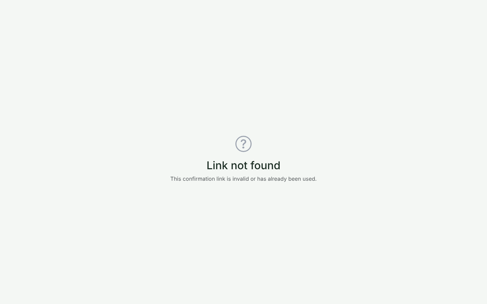

# Demandes d'achat {#purchase-requests}

!!! note "Traduction automatique"
    Cette page a été traduite automatiquement de l'anglais et n'a pas encore été relue. En cas de doute, la version anglaise fait foi (changez de langue en haut de la page).

Les demandes d'achat garantissent qu'aucun argent de l'association n'est
dépensé sans accord : avant que quelqu'un achète quelque chose pour
l'association, il dépose une demande, et **deux membres du bureau
différents** doivent l'approuver. Un seul membre du bureau peut
l'arrêter. Toutes les personnes concernées peuvent discuter de la
demande directement sur sa page.

!!! info "Qui peut l'utiliser"
    - **Voir les demandes et commenter :** toute personne dont le groupe
      accorde la **Lecture** sur **Demandes d'achat** (voir
      [Groupes](../administration/groups.md)).
    - **Créer des demandes et changer le fournisseur :** l'**Écriture**
      sur **Demandes d'achat**.
    - **Approuver ou rejeter :** seulement les membres du bureau et les
      administrateurs, ou les utilisateurs d'un groupe à accès complet.
      Un simple droit d'**Écriture** ne suffit pas.

    Le module s'active avec **Demandes d'achat** sous
    [Activer et désactiver les modules](../administration/modules.md).
    Il est activé par défaut.

L'entrée de navigation **Demandes d'achat** affiche un badge rouge avec
le nombre de demandes ouvertes -- le même nombre que la tuile du tableau
de bord. Il compte chaque demande ouverte, y compris celles que vous
avez déjà approuvées et qui attendent une seconde approbation.

## Le principe de la double approbation {#the-two-person-approval-principle}

Ces règles s'appliquent toujours, quel que soit l'utilisateur :

1. Une demande est **Ouverte** à sa création.
2. Elle devient **Approuvée** dès que **deux** membres du bureau
   **différents** ont cliqué sur **Approuver**. Chaque membre du bureau
   ne peut approuver une demande qu'une fois.
3. **Ni le demandeur ni la personne qui a saisi la demande** ne peuvent
   l'approuver. C'est important quand un membre du bureau saisit une
   demande pour le compte de quelqu'un d'autre : il compte du côté du
   demandeur et ne peut pas donner lui-même l'une des deux
   approbations.
4. **Un seul refus suffit.** Tout membre du bureau peut rejeter une
   demande ouverte, avec un motif. Le demandeur peut aussi rejeter sa
   propre demande -- par exemple pour la retirer.
5. Une fois qu'une demande est **Approuvée** ou **Rejetée**, c'est
   définitif. Plus aucune approbation ni aucun rejet n'est possible, et
   il n'y a aucun moyen de la rouvrir.

!!! note
    Les approbations et rejets n'envoient pas d'e-mails. Seuls les
    nouveaux commentaires le font (voir [Discussion](#discussion)).

## Vue d'ensemble {#overview}

**Demandes d'achat** liste les demandes, la plus récente en premier.

| Champ / bouton | Ce qu'il fait |
|---|---|
| **Nouvelle demande d'achat** | Ouvre le [formulaire](#new-purchase-request). Affiché seulement avec le droit d'écriture. |
| **Ouverte** / **Approuvée** / **Rejetée** / **Toutes** | N'affiche que les demandes dans ce statut, ou toutes. **Ouverte** est sélectionné quand vous arrivez sur la page. |
| **Titre** | Ce qui doit être acheté ; renvoie vers la demande. |
| **Demandeur** | Le nom du demandeur. Pour une demande saisie pour le compte de quelqu'un, le nom saisi (ou son adresse e-mail si aucun nom n'a été donné). |
| **Coût estimé** | Le coût estimé, ou « – » s'il n'a pas été saisi. |
| **Approbations** | Pour les demandes ouvertes, combien des deux approbations requises existent, par ex. **1 / 2**. « – » pour les demandes clôturées. |
| **Statut** | **Ouverte**, **Approuvée** ou **Rejetée**. |
| Bouton œil | Ouvre la demande. |

## Nouvelle demande d'achat {#new-purchase-request}

Cliquez sur **Nouvelle demande d'achat** dans la vue d'ensemble.

### Demande d'achat {#purchase-request}

| Champ | Ce qu'il fait |
|---|---|
| **Que faut-il acheter ?** | Le titre de la demande. Obligatoire. |
| **Justification** | Pourquoi l'association en a besoin. Obligatoire. |
| **Lien vers l'endroit où il peut être acheté** | Adresse web facultative d'une boutique ou d'une offre. Doit être une adresse complète commençant par `http://` ou `https://`. |
| **Fournisseur (contact)** | Fournisseur facultatif parmi les [Contacts externes](external-contacts.md). Les entreprises sont listées avec leurs personnes en dessous. Affiché seulement si le module des contacts externes est activé et que vous pouvez lire les contacts. |
| **Coût estimé** | Facultatif. Accepte une virgule ou un point comme séparateur décimal. Laissez-le vide si le prix n'est pas encore connu. Si Parcella ne peut pas lire la valeur comme un nombre, la demande est enregistrée sans coût. |

### Demandeur {#requester}

| Champ | Ce qu'il fait |
|---|---|
| **Créer au nom d'une autre personne (qui n'a pas de compte propre)** | Cochez cette case quand vous saisissez une demande pour quelqu'un d'autre, par ex. un membre qui vous l'a demandé par téléphone. Affiche les deux champs ci-dessous. Si vous ne la cochez pas, c'est vous le demandeur. |
| **Nom de la personne** | Le nom du demandeur. |
| **Adresse e-mail** | L'adresse e-mail du demandeur. Il reçoit un lien pour confirmer les informations (voir [Confirmation par le demandeur](#confirmation-by-the-requester)). |

Cliquez sur **Créer une demande d'achat** pour enregistrer, ou sur
**Annuler** pour revenir. Après l'enregistrement, la page de la demande
s'ouvre.

!!! note "Sans adresse e-mail"
    Vous pouvez laisser l'**Adresse e-mail** vide : la demande est
    enregistrée avec le nom saisi comme demandeur, simplement sans
    e-mail de confirmation. Si vous cochez la case mais laissez le nom
    et l'adresse vides, la demande compte comme *la vôtre*. Dans tous
    les cas, vous ne pouvez pas approuver une demande que vous avez
    saisie vous-même.

## Page de la demande {#request-page}

Ouvrir une demande affiche ses détails, la discussion et les
approbations. **Retour** revient à la vue d'ensemble.

### Détails {#details}

| Champ | Ce qu'il affiche |
|---|---|
| **Demandeur** | Qui a demandé l'achat. Pour une demande saisie pour le compte de quelqu'un, aussi son adresse e-mail et un badge : **Confirmation en attente** ou **Confirmé par le demandeur**. |
| **Créée par** | Qui a saisi la demande, et quand. |
| **Justification** | Le motif indiqué. |
| **Lien** | Le lien vers la boutique, s'il a été saisi. S'ouvre dans un nouvel onglet. |
| **Fournisseur (contact)** | Le contact externe relié, ou « – ». Avec le droit d'écriture, vous pouvez choisir un autre contact (ou **— aucun —**) et cliquer sur **Enregistrer** -- quel que soit le statut, car le fournisseur ne fait pas partie de l'approbation. Un contact supprimé depuis s'affiche avec « (supprimé) ». |
| **Coût estimé** | Affiché seulement si un coût a été saisi. |

Sous les détails, une demande clôturée affiche un bandeau :

- **Approuvée** -- avec la date et l'heure de la seconde approbation.
- **Rejetée** -- avec qui l'a rejetée, quand, et le motif.

### Discussion {#discussion}

La carte **Discussion ({count})** liste tous les commentaires, du plus
ancien au plus récent, avec auteur et heure. Toute personne qui peut
voir la demande peut commenter, quel que soit le statut -- une demande
rejetée est souvent justement le moment où quelqu'un veut expliquer
quelque chose.

| Champ / bouton | Ce qu'il fait |
|---|---|
| Zone de commentaire | Votre question ou remarque, jusqu'à 5 000 caractères. Un commentaire vide est refusé. |
| **Commenter** | Ajoute le commentaire et l'envoie par e-mail. |

Les commentaires ne peuvent être ni modifiés ni supprimés ensuite.

Chaque nouveau commentaire est envoyé par e-mail :

- au demandeur -- à l'adresse de son compte, ou, pour une demande saisie
  pour le compte de quelqu'un, à l'adresse e-mail indiquée ;
- à chaque utilisateur actif qui a déjà commenté ou approuvé la demande.

L'auteur du commentaire ne reçoit pas d'e-mail, et personne ne reçoit
deux fois le même commentaire. Les utilisateurs reçoivent un bouton qui
ouvre la demande pour qu'ils puissent répondre dans Parcella. Un
demandeur sans compte ne peut pas répondre dans Parcella ; son e-mail
l'invite à contacter le bureau.

### Approbations ({count}/2) {#approvals-count2}

Liste chaque approbation avec le nom du membre du bureau, la date et
l'heure. **Pas encore d'approbations.** s'il n'y en a aucune.

Tant que la demande est **Ouverte**, les membres du bureau voient
aussi :

| Bouton / message | Ce qu'il fait |
|---|---|
| **Approuver** | Enregistre votre approbation. La seconde approbation d'un autre membre du bureau fait passer la demande à **Approuvée**. |
| « En tant que demandeur, vous ne pouvez pas approuver votre propre demande d'achat … » | Affiché à la place d'**Approuver** si vous êtes le demandeur ou avez saisi la demande. |
| « Vous avez déjà approuvé cette demande. » | Affiché à la place d'**Approuver** après votre approbation. |
| **Rejeter** | Ouvre une zone pour le motif du rejet. |
| **Rejeter définitivement** | Rejette la demande avec le motif saisi (obligatoire). La demande est immédiatement clôturée. |

## Confirmation par le demandeur {#confirmation-by-the-requester}

Quand vous créez une demande pour le compte de quelqu'un avec une
adresse e-mail, Parcella lui envoie un e-mail « Merci de confirmer :
demande d'achat « {title} » ». Il vous nomme comme la personne qui l'a
saisie, reprend le titre et la justification et contient un bouton
**Confirmer les détails**.

La confirmation est **purement informative**. Elle montre au bureau que
la personne voulait vraiment la demande telle que saisie. Elle n'est
*pas* nécessaire à l'approbation : les membres du bureau peuvent
approuver ou rejeter que le demandeur ait confirmé ou non. Si le
demandeur a son propre compte et crée lui-même la demande, il n'y a
aucune étape de confirmation.

### Confirmer la demande d'achat {#confirm-purchase-request}

Le lien de l'e-mail ouvre une page qui fonctionne **sans connexion**.
Elle affiche le **Titre**, la **Justification**, le **Lien** (s'il y en
a un) et le **Coût estimé** (s'il y en a un) de la demande, avec
l'explication que la demande a été saisie pour le compte de la personne.

| Bouton / message | Ce qu'il fait |
|---|---|
| **Confirmer les détails** | Enregistre la confirmation. Sur la page de la demande, le badge passe de **Confirmation en attente** à **Confirmé par le demandeur**. |
| « Vous avez déjà confirmé ces détails. » | Affiché à la place du bouton si le lien a déjà été utilisé. Rouvrir le lien ne fait pas de mal. |

Après confirmation, la personne voit une page **Merci !** indiquant que
sa confirmation de la demande a été enregistrée.
<!-- Screenshots of the confirm and thank-you pages are not generated: the sample data contains no request with a confirmation link. -->

### Lien non trouvé {#link-not-found}

La page **Lien non trouvé** apparaît quand le lien est faux ou incomplet,
ou quand la demande a été créée **il y a plus de 30 jours** -- les liens
de confirmation cessent de fonctionner après 30 jours. Le demandeur doit
alors contacter directement le bureau ; le bureau peut quand même
statuer sur la demande.

!!! note
    Le texte de la page dit que le lien « est invalide ou a déjà été
    utilisé ». Un lien déjà utilisé fonctionne encore pendant les
    30 jours -- il affiche « Vous avez déjà confirmé ces détails. »

## Voir aussi {#related}

- [Contacts externes](external-contacts.md) -- les fournisseurs que
  vous pouvez relier à une demande ; la page d'un contact liste ses
  demandes d'achat
- [Factures reçues](finances/incoming-invoices.md) -- enregistrer la
  facture une fois l'achat approuvé effectué
- [Tableau de bord](../getting-started/dashboard.md) -- la tuile des
  demandes d'achat ouvertes
- [Rôles, groupes et droits](../getting-started/roles-and-permissions.md)
