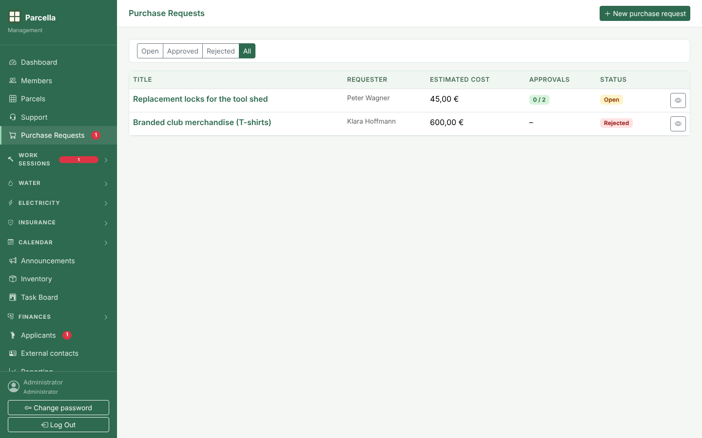
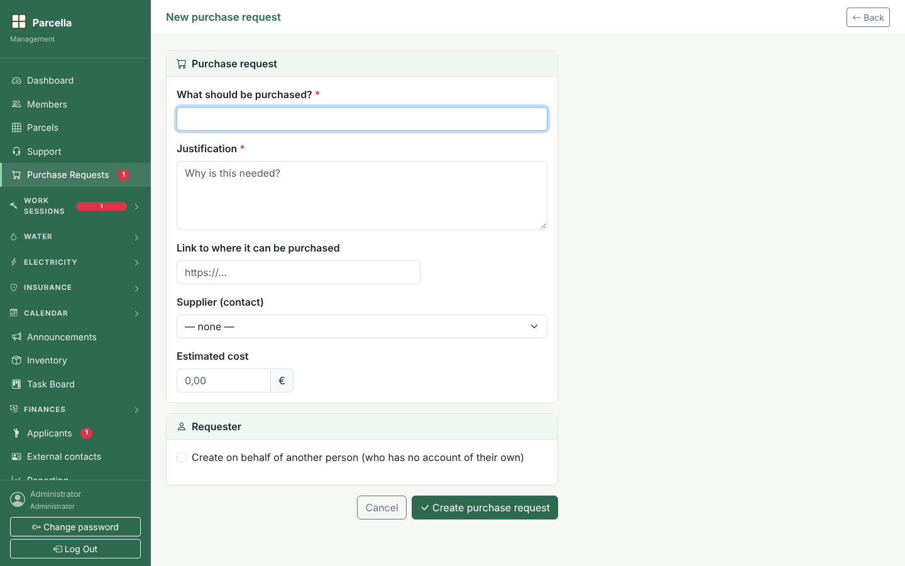

# Purchase requests

Purchase requests make sure no club money is spent without agreement:
before anyone buys something for the club, they file a request, and
**two different board members** have to approve it. A single board
member can stop it on their own. Everyone involved can discuss the
request right on its page.

!!! info "Who can use this"
    - **See requests and comment:** anyone whose group grants **Read**
      for **Purchase Requests** (see [Groups](../administration/groups.md)).
    - **Create requests and change the supplier:** **Write** for
      **Purchase Requests**.
    - **Approve or reject:** only board members and administrators, or
      users in a group with full access. A normal **Write** permission
      is not enough.

    The module is switched on with **Purchase requests** under
    [Turning modules on and off](../administration/modules.md). It is
    on by default.

The navigation entry **Purchase Requests** shows a red badge with the
number of open requests -- the same number as the dashboard tile. It
counts every open request, including ones you have already approved
and that are waiting for a second approval.

## The two-person approval principle

These rules always apply, whoever is using the app:

1. A request is **Open** when it's created.
2. It becomes **Approved** as soon as **two different** board members
   have clicked **Approve**. Each board member can approve a request
   only once.
3. **Neither the requester nor the person who entered the request**
   may approve it. This matters when a board member enters a request
   on someone else's behalf: they count as the requester's side and
   can't give one of the two approvals themselves.
4. **One rejection is enough.** Any board member can reject an open
   request, with a reason. The requester can reject their own request
   too -- for example to withdraw it.
5. Once a request is **Approved** or **Rejected**, it's final. No more
   approvals or rejections are possible, and there's no way to reopen
   it.

!!! note
    Approvals and rejections don't send e-mails. Only new comments do
    (see [Discussion](#discussion)).

## Overview

**Purchase Requests** lists requests, newest first.

| Field / button | What it does |
|---|---|
| **New purchase request** | Opens the [form](#new-purchase-request). Only shown with write permission. |
| **Open** / **Approved** / **Rejected** / **All** | Shows only requests in that status, or all of them. **Open** is selected when you come to the page. |
| **Title** | What should be purchased; links to the request. |
| **Requester** | The requester's name. For a request entered on someone's behalf, the name typed in (or their e-mail address if no name was given). |
| **Estimated cost** | The estimated cost, or "–" if none was entered. |
| **Approvals** | For open requests, how many of the two required approvals exist, e.g. **1 / 2**. "–" for closed requests. |
| **Status** | **Open**, **Approved** or **Rejected**. |
| Eye button | Opens the request. |

## New purchase request

Click **New purchase request** on the overview.

### Purchase request

| Field | What it does |
|---|---|
| **What should be purchased?** | The title of the request. Required. |
| **Justification** | Why the club needs it. Required. |
| **Link to where it can be purchased** | Optional web address of a shop or offer. Must be a full address starting with `http://` or `https://`. |
| **Supplier (contact)** | Optional supplier from [External contacts](external-contacts.md). Companies are listed with their people beneath them. Only shown if the external contacts module is on and you may read contacts. |
| **Estimated cost** | Optional. Accepts a comma or a point as decimal separator. Leave it empty if the price isn't known yet. If Parcella can't read the value as a number, the request is saved without a cost. |

### Requester

| Field | What it does |
|---|---|
| **Create on behalf of another person (who has no account of their own)** | Tick this when you enter a request for someone else, e.g. a member who asked you by phone. Shows the two fields below. If you leave it unticked, you are the requester. |
| **Person's name** | The requester's name. |
| **Email address** | The requester's e-mail address. They receive a link to confirm the details (see [Confirmation by the requester](#confirmation-by-the-requester)). |

Click **Create purchase request** to save, or **Cancel** to go back.
After saving, the request's page opens.

!!! note "Without an e-mail address"
    You can leave the **Email address** empty: the request is saved with
    the name you typed as requester, just without a confirmation e-mail.
    If you tick the box but leave both name and address empty, the
    request counts as *your own*. Either way you can't approve a request
    you entered yourself.

## Request page

Opening a request shows its details, the discussion and the approvals.
**Back** returns to the overview.

### Details

| Field | What it shows |
|---|---|
| **Requester** | Who asked for the purchase. For a request entered on someone's behalf, also their e-mail address and a badge: **Confirmation pending** or **Confirmed by requester**. |
| **Created by** | Who entered the request, and when. |
| **Justification** | The reason given. |
| **Link** | The shop link, if one was entered. Opens in a new tab. |
| **Supplier (contact)** | The linked external contact, or "–". With write permission you can pick a different contact (or **— none —**) and click **Save** -- in any status, because the supplier is not part of the approval. A contact that has since been deleted is shown with "(deleted)". |
| **Estimated cost** | Only shown if a cost was entered. |

Below the details, a closed request shows a banner:

- **Approved** -- with the date and time of the second approval.
- **Rejected** -- with who rejected it, when, and the reason.

### Discussion

The **Discussion ({count})** card lists all comments, oldest first,
with author and time. Anyone who can see the request can comment, in
every status -- a rejected request is often exactly when someone wants
to explain something.

| Field / button | What it does |
|---|---|
| Comment box | Your question or note, up to 5,000 characters. An empty comment is refused. |
| **Comment** | Adds the comment and e-mails it. |

Comments can't be edited or deleted afterwards.

Each new comment is e-mailed to:

- the requester -- their account's address, or, for a request entered
  on someone's behalf, the e-mail address given there;
- every active user who has commented on or approved the request
  before.

The author of the comment gets no e-mail, and nobody gets the same
comment twice. Users receive a button that opens the request so they
can reply in Parcella. A requester without an account can't reply in
Parcella; their e-mail asks them to get in touch with the board.

### Approvals ({count}/2)

Lists each approval with the board member's name and the date and
time. **No approvals yet.** if there are none.

While the request is **Open**, board members also see:

| Button / message | What it does |
|---|---|
| **Approve** | Records your approval. The second approval from a different board member sets the request to **Approved**. |
| "As the requester, you cannot approve your own purchase request …" | Shown instead of **Approve** if you are the requester or entered the request. |
| "You have already approved this." | Shown instead of **Approve** after you have approved. |
| **Reject** | Opens a box for the reason for rejection. |
| **Reject permanently** | Rejects the request with the reason you entered (required). The request is closed at once. |

## Confirmation by the requester

When you create a request on someone's behalf with an e-mail address,
Parcella sends them an e-mail "Please confirm: purchase request
"{title}"". It names you as the person who entered it, repeats the title
and justification and contains a **Confirm details** button.

The confirmation is **for information only**. It shows the board that
the person really meant the request as entered. It is *not* needed
for approval: board members can approve or reject whether or not the
requester has confirmed. If the requester has their own account and
creates the request themselves, there's no confirmation step at all.

### Confirm purchase request

The link in the e-mail opens a page that works **without logging in**.
It shows the request's **Title**, **Justification**, **Link** (if any)
and **Estimated cost** (if any), with the explanation that the request
was entered on the person's behalf.

| Button / message | What it does |
|---|---|
| **Confirm details** | Records the confirmation. On the request page the badge changes from **Confirmation pending** to **Confirmed by requester**. |
| "You have already confirmed these details." | Shown instead of the button if the link was used before. Opening the link again does no harm. |

After confirming, the person sees a **Thank you!** page saying their
confirmation for the request has been saved.
<!-- Screenshots of the confirm and thank-you pages are not generated: the sample data contains no request with a confirmation link. -->

### Link not found

The page **Link not found** appears when the link is wrong or
incomplete, or when the request was created **more than 30 days ago**
-- confirmation links stop working after 30 days. The requester should
then contact the board directly; the board can still decide on the
request.

!!! note
    The page text says the link "is invalid or has already been used".
    A link that was already used still works within the 30 days -- it
    shows "You have already confirmed these details."

## Related

- [External contacts](external-contacts.md) -- suppliers you can link
  to a request; a contact's page lists its purchase requests
- [Incoming invoices](finances/incoming-invoices.md) -- recording the
  invoice once the approved purchase has been made
- [Dashboard](../getting-started/dashboard.md) -- the open purchase
  requests tile
- [Roles, groups and permissions](../getting-started/roles-and-permissions.md)
