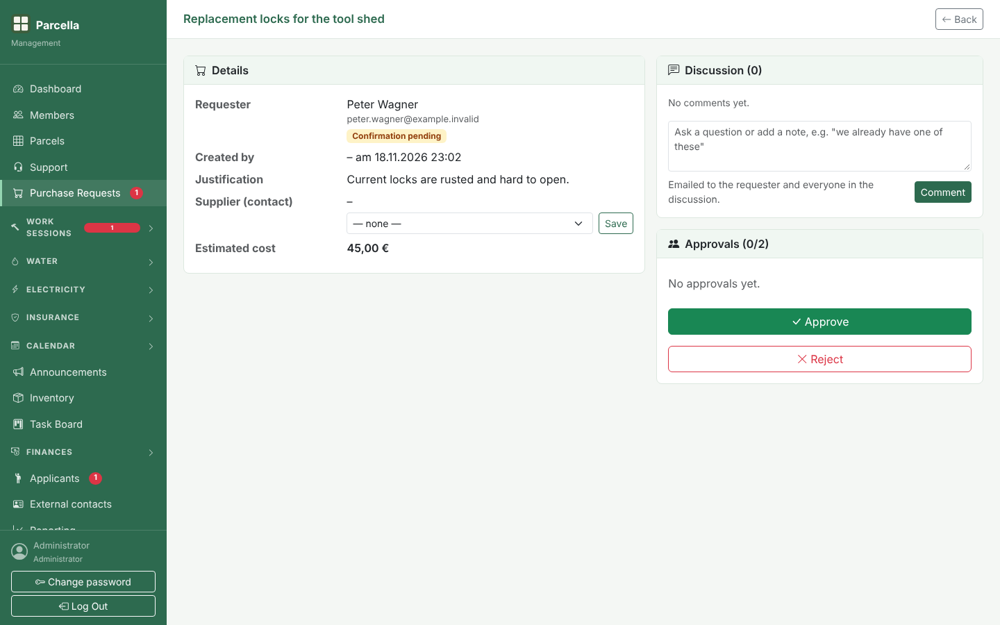

# Wnioski zakupowe {#purchase-requests}

!!! note "Tłumaczenie maszynowe"
    Ta strona została przetłumaczona maszynowo z języka angielskiego i nie została jeszcze sprawdzona. Jeśli coś jest niejasne, obowiązuje wersja angielska (język zmienisz u góry).

Wnioski zakupowe pilnują, aby żadne pieniądze stowarzyszenia nie były
wydawane bez zgody: zanim ktoś kupi coś dla stowarzyszenia, składa
wniosek, a **dwóch różnych członków zarządu** musi go zatwierdzić.
Jeden członek zarządu może go sam zatrzymać. Wszyscy zaangażowani mogą
omawiać wniosek bezpośrednio na jego stronie.

!!! info "Kto może z tego korzystać"
    - **Oglądanie wniosków i komentowanie:** każdy, czyja grupa nadaje
      **Odczyt** dla **Wnioski zakupowe** (zob. [Grupy](../administration/groups.md)).
    - **Tworzenie wniosków i zmiana dostawcy:** **Zapis** dla
      **Wnioski zakupowe**.
    - **Zatwierdzanie lub odrzucanie:** tylko członkowie zarządu i
      administratorzy albo użytkownicy w grupie z pełnym dostępem.
      Zwykłe prawo **Zapis** nie wystarcza.

    Moduł włącza się przełącznikiem **Wnioski zakupowe** w
    [Włączaniu i wyłączaniu modułów](../administration/modules.md).
    Domyślnie jest włączony.

Pozycja nawigacji **Wnioski zakupowe** pokazuje czerwone oznaczenie z
liczbą otwartych wniosków -- tę samą liczbę co kafelek na panelu. Liczy
każdy otwarty wniosek, łącznie z tymi, które już zatwierdziłeś i które
czekają na drugie zatwierdzenie.

## Zasada dwóch osób {#the-two-person-approval-principle}

Te zasady obowiązują zawsze, niezależnie od tego, kto korzysta z
aplikacji:

1. Wniosek jest **Otwarty**, gdy zostaje utworzony.
2. Staje się **Zatwierdzony**, gdy tylko **dwóch różnych** członków
   zarządu kliknie **Zatwierdź**. Każdy członek zarządu może zatwierdzić
   wniosek tylko raz.
3. **Ani wnioskodawca, ani osoba, która wpisała wniosek**, nie może go
   zatwierdzić. Ma to znaczenie, gdy członek zarządu wpisuje wniosek w
   czyimś imieniu: liczy się jako strona wnioskodawcy i sam nie może
   dać jednego z dwóch zatwierdzeń.
4. **Wystarczy jedno odrzucenie.** Każdy członek zarządu może odrzucić
   otwarty wniosek, z uzasadnieniem. Wnioskodawca też może odrzucić
   własny wniosek -- np. aby go wycofać.
5. Gdy wniosek jest **Zatwierdzony** lub **Odrzucony**, jest to
   ostateczne. Nie są już możliwe żadne zatwierdzenia ani odrzucenia i
   nie da się go ponownie otworzyć.

!!! note
    Zatwierdzenia i odrzucenia nie wysyłają e-maili. Wysyłają je tylko
    nowe komentarze (zob. [Dyskusja](#discussion)).

## Przegląd {#overview}

**Wnioski zakupowe** pokazuje wnioski, od najnowszych.

| Pole / przycisk | Do czego służy |
|---|---|
| **Nowy wniosek zakupowy** | Otwiera [formularz](#new-purchase-request). Widoczny tylko z prawem zapisu. |
| **Otwarte** / **Zatwierdzone** / **Odrzucone** / **Wszystkie** | Pokazuje tylko wnioski w tym statusie albo wszystkie. Po wejściu na stronę wybrane jest **Otwarte**. |
| **Tytuł** | Co ma zostać kupione; link do wniosku. |
| **Wnioskodawca** | Imię i nazwisko wnioskodawcy. Dla wniosku wpisanego w czyimś imieniu wpisane imię i nazwisko (lub adres e-mail, jeśli nie podano nazwiska). |
| **Szacowany koszt** | Szacowany koszt albo „–”, jeśli nie wpisano. |
| **Zatwierdzenia** | Dla otwartych wniosków: ile z dwóch wymaganych zatwierdzeń istnieje, np. **1 / 2**. „–” dla zamkniętych wniosków. |
| **Status** | **Otwarty**, **Zatwierdzony** lub **Odrzucony**. |
| Przycisk oka | Otwiera wniosek. |

## Nowy wniosek zakupowy {#new-purchase-request}

Kliknij **Nowy wniosek zakupowy** w przeglądzie.

### Wniosek zakupowy {#purchase-request}

| Pole | Do czego służy |
|---|---|
| **Co ma zostać kupione?** | Tytuł wniosku. Wymagany. |
| **Uzasadnienie** | Dlaczego stowarzyszenie tego potrzebuje. Wymagane. |
| **Link do zakupu** | Opcjonalny adres internetowy sklepu lub oferty. Musi być pełnym adresem zaczynającym się od `http://` lub `https://`. |
| **Dostawca (kontakt)** | Opcjonalny dostawca z [Kontaktów zewnętrznych](external-contacts.md). Firmy są wymienione z osobami pod nimi. Widoczne tylko, jeśli moduł kontaktów zewnętrznych jest włączony i możesz czytać kontakty. |
| **Szacowany koszt** | Opcjonalny. Akceptuje przecinek lub kropkę jako separator dziesiętny. Zostaw puste, jeśli cena nie jest jeszcze znana. Jeśli Parcella nie potrafi odczytać wartości jako liczby, wniosek zostaje zapisany bez kosztu. |

### Wnioskodawca {#requester}

| Pole | Do czego służy |
|---|---|
| **Utwórz w imieniu innej osoby (bez własnego dostępu)** | Zaznacz, gdy wpisujesz wniosek za kogoś innego, np. członka, który poprosił Cię telefonicznie. Pokazuje dwa pola poniżej. Jeśli zostawisz niezaznaczone, to Ty jesteś wnioskodawcą. |
| **Imię i nazwisko osoby** | Imię i nazwisko wnioskodawcy. |
| **Adres e-mail** | Adres e-mail wnioskodawcy. Dostaje link do potwierdzenia danych (zob. [Potwierdzenie przez wnioskodawcę](#confirmation-by-the-requester)). |

Kliknij **Utwórz wniosek zakupowy**, aby zapisać, albo **Anuluj**, aby
wrócić. Po zapisaniu otwiera się strona wniosku.

!!! note "Bez adresu e-mail"
    Pole **Adres e-mail** możesz zostawić puste: wniosek zostaje
    zapisany z wpisanym imieniem i nazwiskiem jako wnioskodawcą, tylko
    bez e-maila z potwierdzeniem. Jeśli zaznaczysz pole, ale zostawisz
    puste zarówno nazwisko, jak i adres, wniosek liczy się jako *Twój
    własny*. Tak czy inaczej nie możesz zatwierdzić wniosku, który sam
    wpisałeś.

## Strona wniosku {#request-page}

Otwarcie wniosku pokazuje jego szczegóły, dyskusję i zatwierdzenia.
**Wstecz** wraca do przeglądu.

### Szczegóły {#details}

| Pole | Co pokazuje |
|---|---|
| **Wnioskodawca** | Kto prosił o zakup. Dla wniosku wpisanego w czyimś imieniu także jego adres e-mail i oznaczenie: **Oczekuje na potwierdzenie** lub **Potwierdzone przez wnioskodawcę**. |
| **Utworzone przez** | Kto wpisał wniosek i kiedy. |
| **Uzasadnienie** | Podany powód. |
| **Link** | Link do sklepu, jeśli go wpisano. Otwiera się w nowej karcie. |
| **Dostawca (kontakt)** | Powiązany kontakt zewnętrzny albo „–”. Z prawem zapisu możesz wybrać inny kontakt (lub **— brak —**) i kliknąć **Zapisz** -- w każdym statusie, bo dostawca nie jest częścią zatwierdzania. Kontakt, który został później usunięty, jest pokazywany z dopiskiem o usunięciu. |
| **Szacowany koszt** | Widoczny tylko, jeśli wpisano koszt. |

Pod szczegółami zamknięty wniosek pokazuje baner:

- **Zatwierdzony** -- z datą i godziną drugiego zatwierdzenia.
- **Odrzucony** -- z tym, kto go odrzucił, kiedy i z jakim uzasadnieniem.

### Dyskusja {#discussion}

Karta **Dyskusja ({count})** pokazuje wszystkie komentarze, od
najstarszych, z autorem i godziną. Każdy, kto może zobaczyć wniosek, może
go komentować, w każdym statusie -- odrzucony wniosek to często właśnie
moment, gdy ktoś chce coś wyjaśnić.

| Pole / przycisk | Do czego służy |
|---|---|
| Pole komentarza | Twoje pytanie lub uwaga, do 5000 znaków. Pusty komentarz jest odrzucany. |
| **Skomentuj** | Dodaje komentarz i wysyła go e-mailem. |

Komentarzy nie można potem edytować ani usuwać.

Każdy nowy komentarz jest wysyłany e-mailem do:

- wnioskodawcy -- na adres jego konta albo, dla wniosku wpisanego w
  czyimś imieniu, na podany tam adres e-mail;
- każdego aktywnego użytkownika, który wcześniej skomentował lub
  zatwierdził wniosek.

Autor komentarza nie dostaje e-maila i nikt nie dostaje tego samego
komentarza dwa razy. Użytkownicy dostają przycisk otwierający wniosek,
aby mogli odpowiedzieć w Parcelli. Wnioskodawca bez konta nie może
odpowiedzieć w Parcelli; jego e-mail prosi o kontakt z zarządem.

### Zatwierdzenia ({count}/2) {#approvals-count2}

Pokazuje każde zatwierdzenie z imieniem i nazwiskiem członka zarządu
oraz datą i godziną. **Brak jeszcze zatwierdzeń.**, jeśli nie ma
żadnych.

Dopóki wniosek jest **Otwarty**, członkowie zarządu widzą też:

| Przycisk / komunikat | Do czego służy |
|---|---|
| **Zatwierdź** | Zapisuje Twoje zatwierdzenie. Drugie zatwierdzenie od innego członka zarządu ustawia wniosek na **Zatwierdzony**. |
| „Jako wnioskodawca nie możesz sam zatwierdzić tego wniosku zakupowego …” | Pokazywane zamiast **Zatwierdź**, jeśli jesteś wnioskodawcą lub wpisałeś wniosek. |
| „Już zatwierdzono.” | Pokazywane zamiast **Zatwierdź** po Twoim zatwierdzeniu. |
| **Odrzuć** | Otwiera pole na uzasadnienie odrzucenia. |
| **Odrzuć ostatecznie** | Odrzuca wniosek z wpisanym uzasadnieniem (wymaganym). Wniosek zostaje od razu zamknięty. |

## Potwierdzenie przez wnioskodawcę {#confirmation-by-the-requester}

Gdy tworzysz wniosek w czyimś imieniu z adresem e-mail, Parcella wysyła
tej osobie e-mail „Proszę potwierdzić: wniosek zakupowy „{title}””.
Wymienia Ciebie jako osobę, która go wpisała, powtarza tytuł i
uzasadnienie i zawiera przycisk **Potwierdź dane**.

Potwierdzenie ma **wyłącznie charakter informacyjny**. Pokazuje
zarządowi, że osoba naprawdę chciała wniosku w tej postaci. *Nie* jest
potrzebne do zatwierdzenia: członkowie zarządu mogą zatwierdzić lub
odrzucić wniosek niezależnie od tego, czy wnioskodawca go potwierdził.
Jeśli wnioskodawca ma własne konto i sam tworzy wniosek, nie ma kroku
potwierdzenia.

### Potwierdzenie wniosku zakupowego {#confirm-purchase-request}

Link w e-mailu otwiera stronę, która działa **bez logowania**. Pokazuje
**Tytuł**, **Uzasadnienie**, **Link** (jeśli jest) i **Szacowany koszt**
(jeśli jest) wniosku, z wyjaśnieniem, że wniosek wpisano w imieniu tej
osoby.

| Przycisk / komunikat | Do czego służy |
|---|---|
| **Potwierdź dane** | Zapisuje potwierdzenie. Na stronie wniosku oznaczenie zmienia się z **Oczekuje na potwierdzenie** na **Potwierdzone przez wnioskodawcę**. |
| „Te dane zostały już potwierdzone.” | Pokazywane zamiast przycisku, jeśli link był już użyty. Ponowne otwarcie linku nie szkodzi. |

Po potwierdzeniu osoba widzi stronę **Dziękujemy!** z informacją, że jej
potwierdzenie wniosku zostało zapisane.
<!-- Screenshots of the confirm and thank-you pages are not generated: the sample data contains no request with a confirmation link. -->

### Nie znaleziono linku {#link-not-found}

Strona **Nie znaleziono linku** pojawia się, gdy link jest błędny lub
niekompletny albo gdy wniosek został utworzony **ponad 30 dni temu** --
linki potwierdzające przestają działać po 30 dniach. Wnioskodawca
powinien wtedy skontaktować się bezpośrednio z zarządem; zarząd nadal
może zdecydować o wniosku.

!!! note
    Tekst strony mówi, że link „jest nieprawidłowy lub został już
    wykorzystany”. Link, który był już użyty, nadal działa w ciągu 30 dni
    -- pokazuje „Te dane zostały już potwierdzone.”

## Powiązane {#related}

- [Kontakty zewnętrzne](external-contacts.md) -- dostawcy, których
  możesz powiązać z wnioskiem; strona kontaktu pokazuje jego wnioski
  zakupowe
- [Faktury przychodzące](finances/incoming-invoices.md) -- zapisanie
  faktury po dokonaniu zatwierdzonego zakupu
- [Panel główny](../getting-started/dashboard.md) -- kafelek otwartych
  wniosków zakupowych
- [Role, grupy i uprawnienia](../getting-started/roles-and-permissions.md)
