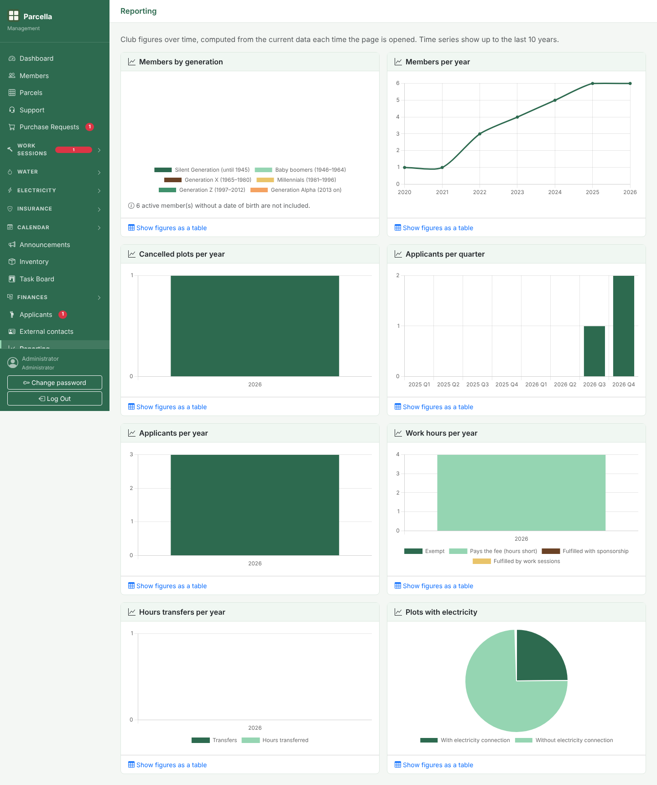

# Rapportages {#reporting}

!!! note "Machinevertaling"
    Deze pagina is machinaal vertaald uit het Engels en nog niet nagekeken. Als iets onduidelijk is, geldt de Engelse versie (taal wisselt u bovenaan).

De kerncijfers van uw vereniging door de tijd, als grafieken: hoe oud
uw leden zijn, hoe het ledental zich ontwikkelde, hoeveel tuinen werden
opgezegd, hoeveel mensen zich aanmelden, en hoe het met de werkuren ging.
Handig voor het jaarverslag of de algemene ledenvergadering.

!!! info "Wie kan dit gebruiken"
    - De moduleschakelaar is **Rapportages** onder **Administratie →
      Modules in- en uitschakelen**. Ze staat standaard **aan**.
    - De rollen **Bestuur** en **Beheerder**, en leden van een groep met
      **Volledige toegang tot elke module**, kunnen haar altijd zien.
    - Alle anderen hebben *lezen* op **Rapportages** in een van hun
      [groepen](../administration/groups.md) nodig. De pagina toont
      alleen totalen en aantallen, nooit namen, dus er is geen extra
      toegang tot leden, werkuren of aanmelders nodig.

## Rapportagepagina {#reporting-page}

Open **Rapportages** in het menu. De pagina is alleen-lezen. Elk cijfer
wordt telkens bij het openen van de pagina uit uw actuele gegevens
berekend; er wordt niets opgeslagen of hoeft niets te worden bijgewerkt.
Tijdreeksen tonen hooguit de laatste 10 jaar, vanaf het eerste jaar met
gegevens tot het huidige jaar. Een voorbij jaar wordt geteld zoals het
er op 31 december voor stond, het huidige jaar zoals het er vandaag voor
staat.

Elke grafiek is een kaart met:

- de grafiek zelf (beweeg de muis erover om de exacte getallen te zien);
- een grijze notitie met een infopictogram waar iets uitleg nodig heeft,
  bijvoorbeeld hoeveel leden zijn weggelaten;
- **Cijfers als tabel tonen**, dat dezelfde getallen als tabel uitklapt,
  klaar om te kopiëren. Taartdiagrammen krijgen een kolom **Aandeel /
  totaal** met de percentages, gestapelde grafieken een kolom met het
  totaal per jaar.

Een grafiek zonder gegevens zegt **Nog geen gegevens.**

Sommige grafieken verschijnen alleen als hun module aan staat: de
grafieken over aanmelders vragen **Aanmelders**, de grafieken over
werkuren vragen **Werktijdenbeheer**, en de grafiek over elektriciteit
vraagt **Elektriciteitsbeheer**.

## De grafieken {#the-charts}

| Grafiek | Wat ze telt |
|---|---|
| **Leden per generatie** | Taartdiagram van de actieve leden van vandaag per geboortejaar: **Stille generatie (tot 1945)**, **Babyboomers (1946–1964)**, **Generatie X (1965–1980)**, **Millennials (1981–1996)**, **Generatie Z (1997–2012)**, **Generatie Alfa (vanaf 2013)**. Leden zonder geboortedatum vallen weg; de notitie zegt hoeveel. |
| **Leden per jaar** | Lijngrafiek van het aantal **Leden** in elk jaar: iedereen van wie de datum „lid sinds“ op of vóór het einde van dat jaar ligt en die toen nog niet was vertrokken. Leden zonder datum van toetreding worden in elk jaar meegeteld; de notitie zegt hoeveel. |
| **Opgezegde tuinen per jaar** | Staafdiagram van **Beëindigde pachten** per jaar: elke huur waarvan de einddatum in dat jaar valt, ook einddatums die al voor later dit jaar zijn ingesteld. Een tuin die van de ene huurder naar de volgende gaat, telt als één beëindigde huur. |
| **Aanmeldingen per kwartaal** | Staafdiagram van nieuwe **Aanmeldingen** naar aanmeldingsdatum, voor elk kwartaal van vorig jaar en dit jaar. |
| **Aanmeldingen per jaar** | Hetzelfde per jaar. |
| **Werkuren per jaar** | Gestapelde staven voor elk jaar met een werkurenconfiguratie. Elke tuin (of elk lid, zie hieronder) wordt in precies één groep geteld, gecontroleerd in deze volgorde: **Vrijgesteld**, **Betaalt de bijdrage (uren tekort)**, **Voldaan met peterschap**, **Voldaan met werkdagen**. In jaren waarin de werkuren per lid in plaats van per tuin verschuldigd waren, zegt de notitie „In ... per lid in plaats van per tuin geteld.“ |
| **Urenoverdrachten per jaar** | Twee staven per jaar: het aantal **Overdrachten** van uren, en het totaal aan **Overgedragen uren**. |
| **Tuinen met stroom** | Taartdiagram van de actieve tuinen van vandaag **Met stroomaansluiting** (minstens één elektriciteitsmeter op de tuin) en **Zonder stroomaansluiting**. |

!!! note "Om rekening mee te houden"
    - **Leden per generatie** en **Tuinen met stroom** tonen alleen
      vandaag. Parcella bewaart geen momentopnamen, dus het kan niet
      zeggen hoe dit er in een eerder jaar uitzag.
    - Een lid dat is verwijderd (in plaats van een einddatum te krijgen),
      verdwijnt ook uit elk voorbij jaar. Beëindig lidmaatschappen in
      plaats van leden te verwijderen, dan blijft de geschiedenis
      kloppen.
    - Cijfers komen uit de gegevens zoals ze zijn ingevoerd. Een
      ontbrekende datum van toetreding of geboortedatum verschijnt in de
      notities; herstel die bij het [lid](members.md) en laad de pagina
      opnieuw.

Er is geen exportknop voor de grafieken. Gebruik **Cijfers als tabel
tonen** om de getallen te kopiëren, bijvoorbeeld naar een spreadsheet of
het jaarverslag.

## Gerelateerd {#related}

- [Leden](members.md) -- datums van toetreding en geboortedatums.
- [Percelen](parcels.md) -- huren en hun einddatums.
- [Aanmelders](applicants.md)
- [Werkuren](work-hours.md) -- vrijstellingen, sponsorschappen en
  urenoverdrachten.
- [Water en elektriciteit](metering.md) -- elektriciteitsmeters per
  tuin.
