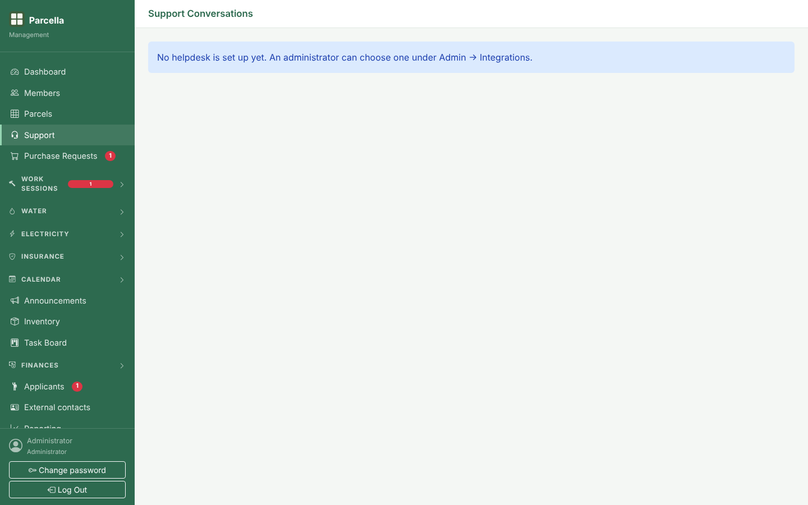

# Podpora {#support}

!!! note "Strojový preklad"
    Táto stránka bola strojovo preložená z angličtiny a zatiaľ nebola skontrolovaná. Ak je niečo nejasné, platí anglická verzia (jazyk prepnete hore).

Parcella nemá vlastný systém tiketov. Váš spolok odpovedá na e-maily a
žiadosti z kontaktného formulára v helpdesku -- FreeScout, Zammad,
Znuny / OTRS, osTicket, Zendesk alebo Freshdesk -- a modul podpory
tento helpdesk prepája s Parcellou: vidíte, ktorá konverzácia patrí ku
ktorému členovi a parcele, prečítate si konverzáciu a urobíte z nej
kartu na nástenke úloh. Odpovede sa vždy píšu priamo v helpdesku.

!!! info "Kto to môže používať"
    - Modul sa zapína prepínačom **Podpora (helpdesk)** v časti
      [Zapínanie a vypínanie modulov](../administration/modules.md). Je
      **predvolene vypnutý**, pretože ukladá prístupové údaje k
      helpdesku. Samotný helpdesk vyberá a pripája administrátor v
      časti [Integrácie](../administration/integrations.md).
    - **Konverzácie podpory v Parcelle:** členovia výboru a
      administrátori a používatelia, ktorých skupina udeľuje **Čítanie**
      pre **Podpora (helpdesk)** (pozri [Skupiny](../administration/groups.md)).
      Na prepojenie konverzácie s členom alebo parcelou je potrebný
      **Zápis**.
    - **Vytvoriť úlohu:** len členovia výboru a administrátori (alebo
      používatelia v skupine s plným prístupom), rovnako ako samotná
      nástenka úloh.
    - **Všetci ostatní** dostanú v navigácii odkaz **Podpora**, keď je
      modul zapnutý a helpdesk má webovú adresu: otvorí helpdesk priamo
      v novej karte.

## Odkiaľ konverzácie pochádzajú {#where-conversations-come-from}

Parcella kontroluje helpdesk na nové a zmenené konverzácie približne
každých päť minút. Ukladá len odkaz -- predmet, zákazníka, stav, počet
správ a prepojenia na člena, parcelu a úlohu. Samotné správy zostávajú
v helpdesku a pri každom otvorení konverzácie sa načítajú nanovo.

**Priraďovanie členov:** keď príde konverzácia, Parcella hľadá člena,
ku ktorému patrí:

1. Ak bol tento zákazník helpdesku už predtým prepojený s členom,
   použije sa tento člen.
2. Inak, ak má e-mailovú adresu zákazníka **práve jeden** člen, tento
   člen sa prepojí automaticky.
3. Ak adresu zdieľa viac členov (napr. pár s jednou schránkou) alebo ju
   nemá nikto (sused, dodávateľ), konverzácia zostane bez člena. Môžete
   ho prepojiť ručne.

Ak má prepojený člen práve jednu aktuálnu parcelu, prepojí sa aj táto
parcela. Konverzácia, ktorá má člena -- či už automaticky, alebo
nastaveného vami --, sa neskôr už nikdy znova nepriraďuje.

Keď sa v Parcelle zmení meno člena, premenuje sa aj jeho záznam
zákazníka v helpdesku, ak to helpdesk podporuje.

**Stavy:** každý helpdesk pomenúva svoje stavy inak; Parcella ich
ukazuje ako `active`, `pending`, `closed`, `spam` alebo `deleted`.
Uzavreté, spamové a zmazané konverzácie sú skryté zo zoznamu, odznaku
aj dashboardu. Ak sa konverzácia v helpdesku znova otvorí, objaví sa
znova s neporušeným prepojením na člena.

### Čo ktorý helpdesk podporuje {#what-each-helpdesk-supports}

| Helpdesk | Zoznam konverzácií a odznak | Čítanie konverzácií | Kontaktný formulár vytvorí konverzáciu | Synchronizácia mien zákazníkov |
|---|---|---|---|---|
| FreeScout | áno | áno | áno | áno |
| Zammad | áno | áno | áno | áno |
| Znuny / OTRS | áno | áno | áno | nie |
| osTicket | nie | nie | áno | nie |
| Zendesk | áno | áno | áno | áno |
| Freshdesk | áno | áno | áno | áno |

S osTicketom môže Parcella len odovzdávať žiadosti z kontaktného
formulára na webe; pracujete s nimi len v osTickete.

Zobrazujú sa len správy, ktoré vidí zákazník -- interné poznámky
zostávajú v helpdesku. Prílohy sa nezobrazujú; na ne otvorte
konverzáciu v helpdesku.

## Konverzácie podpory {#support-conversations}

**Podpora** v navigácii otvorí zoznam otvorených konverzácií aktívneho
helpdesku, naposledy aktualizované navrchu. Červený odznak vedľa
**Podpora** -- a dlaždica **Otvorené konverzácie podpory** na
[dashboarde](../getting-started/dashboard.md) -- počíta tie isté
konverzácie, či už majú člena, alebo nie.

| Pole / tlačidlo | Čo robí |
|---|---|
| **Otvoriť v {helpdesk}** | Otvorí helpdesk v novej karte. Zobrazí sa len vtedy, keď je nastavená webová adresa helpdesku. |
| **Predmet** | Predmet konverzácie. Kliknutím kdekoľvek v riadku konverzáciu otvoríte. |
| **Zákazník** | Meno odosielateľa alebo jeho e-mailová adresa. |
| **Člen** | Prepojený člen alebo „—“. |
| **Stav** | `active` alebo `pending` (uzavreté sa neuvádzajú). |
| **Správy** | Počet správ, ako ho naposledy oznámil helpdesk. |
| **Aktualizované** | Kedy sa konverzácia v helpdesku naposledy zmenila. |
| **Úloha** | Ikona nástenky, ak je konverzácia prepojená s úlohou. |

Namiesto zoznamu môžete vidieť:

- „Zatiaľ nie je nastavený žiadny helpdesk. …“ -- administrátor ho
  ešte musí vybrať v časti [Integrácie](../administration/integrations.md).
- „{helpdesk} nevie cez svoje rozhranie vypísať konverzácie. …“ --
  helpdesk je osTicket.
- „Zatiaľ žiadne konverzácie podpory.“ -- práve nie je nič otvorené.

## Stránka konverzácie {#conversation-page}

<!-- TODO(verify): no screenshot -- the list's rows open conversations by click, not by a link, so the screenshot tool can't follow one; without a connected helpdesk the transcript would only show an error anyway. -->

Ukazuje jednu konverzáciu s jej predmetom ako názvom.

| Tlačidlo | Čo robí |
|---|---|
| **Späť** | Vráti sa do zoznamu. |
| **Otvoriť v {helpdesk}** | Otvorí túto konverzáciu v helpdesku -- tam na ňu odpovedáte. |

### Konverzácia {#conversation}

Správy, najstaršie prvé, každá s autorom a časom. Ak sa nedajú
načítať, upozornenie vysvetlí prečo -- helpdesk nie je dostupný, nevie
zobraziť konverzácie (osTicket), alebo „Helpdesk tejto konverzácie nie
je (už) nastavený.“, keď spolok odvtedy prešiel na iný helpdesk.
„Správy sa nepodarilo načítať.“ znamená, že helpdesk žiadne nevrátil.

### Člen {#member}

Ukazuje prepojeného člena (s odkazom na jeho stránku) alebo „Nebol
priradený žiadny člen.“.

S oprávnením na zápis vyberte člena a kliknite na **Uložiť**:

- Členovia s e-mailovou adresou zákazníka sú uvedení ako prví,
  označení **navrhované**. Ak adresu zdieľa viac členov, poznámka vás
  požiada, aby ste vybrali toho správneho.
- Pod nimi všetci súčasní členovia.
- **-- žiadny --** prepojenie odstráni.

Uloženie člena zároveň nastaví parcelu nanovo: ak má člen práve jednu
aktuálnu parcelu, prepojí sa; inak žiadna.

### Parcela {#parcel}

Zobrazí sa, keď je prepojený člen. S oprávnením na zápis vyberte jednu
z aktuálnych parciel člena alebo **-- žiadna --** a kliknite na
**Uložiť**.
<!-- TODO(verify): without write permission the Parcel card is empty -- the linked parcel isn't displayed at all for read-only users. -->

### Nástenka úloh {#task-board}

| Pole / tlačidlo | Čo robí |
|---|---|
| **Otvoriť úlohu** | Zobrazí sa, keď je konverzácia prepojená s úlohou; otvorí úlohu. |
| Zoznam + **Vytvoriť úlohu** | Vytvorí novú kartu vo vybranom zozname [nástenky úloh](tasks.md) a prepojí ju s konverzáciou. Názov karty je predmet; jej popis uvádza helpdesk, číslo konverzácie a, ak je prepojený, člena. Len členovia výboru a administrátori. |

Ak na nástenke úloh ešte nie sú žiadne zoznamy, vytvorenie úlohy zlyhá
s hlásením „Na nástenke úloh zatiaľ nie sú žiadne zoznamy“.
<!-- TODO(verify): there is a route to link an existing task to a conversation, but no form on the page uses it. -->

!!! note "Odpovedá sa v helpdesku"
    Parcella zámerne nemá pole na odpoveď. Kliknite na **Otvoriť v
    {helpdesk}** a odpovedzte tam; nová správa sa v Parcelle objaví,
    keď konverzáciu otvoríte nabudúce.

## Kontaktný formulár na webe {#the-website-contact-form}

Ak má web vášho spolku kontaktný formulár, môže cez Parcellu vytvoriť
konverzáciu priamo v helpdesku. Je to samostatný prepínač, **Verejné
API kontaktného formulára**, tiež predvolene vypnutý. Nastavenie je
opísané v časti [Integrácie](../administration/integrations.md).

## Súvisiace {#related}

- [Integrácie](../administration/integrations.md) -- výber a pripojenie
  helpdesku
- [Nástenka úloh](tasks.md) -- ďalší postup pri konverzácii
- [Členovia](members.md) -- e-mailové adresy použité na priraďovanie
- [Dashboard](../getting-started/dashboard.md)
