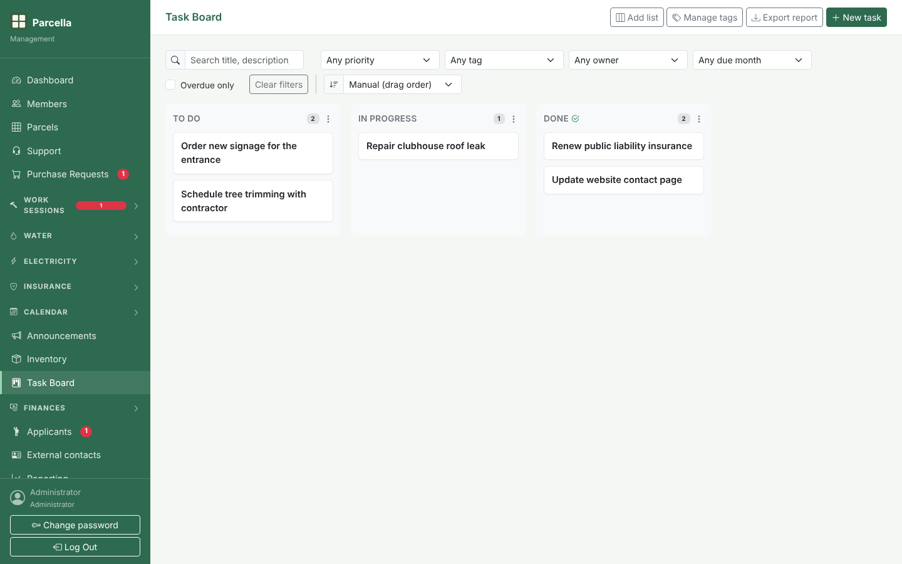
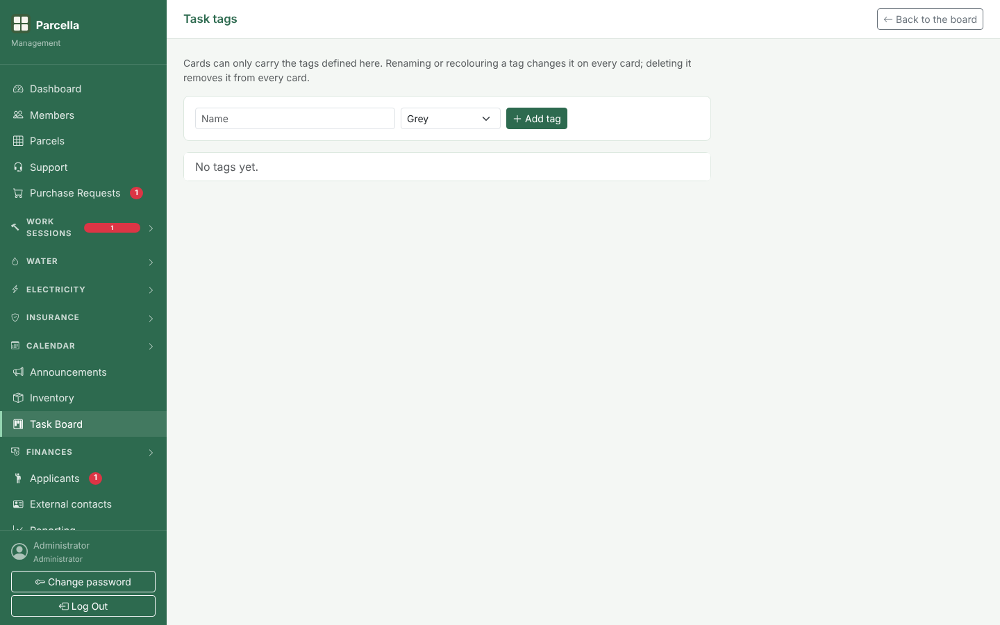

# Aufgabenboard {#task-board}

Eine gemeinsame To-do-Tafel für die Angelegenheiten des Vorstands, die
nicht an einen Arbeitseinsatz gebunden sind: „Versicherungspolice
erneuern“, „Elektriker anrufen“, „beim Dachdecker nachhaken“. Aufgaben sind
Karten in Spalten, die du von links nach rechts ziehst, während die Arbeit
vorangeht.

!!! info "Wer das nutzen kann"
    - Der Modulschalter ist **Aufgabenboard** unter **Administration →
      Module ein- und ausschalten**. Er ist standardmäßig **an**.
    - Nur die Rollen **Vorstand** und **Administrator** sowie Mitglieder
      einer Gruppe mit **Voller Zugriff auf jedes Modul** sehen
      **Aufgabenboard** im Menü. Ein Gruppenrecht, um es anderen Benutzern
      zu öffnen, gibt es nicht, weder lesend noch schreibend.
    - Auf Wunsch lassen sich Karten von einem Nextcloud-Deck-Board
      übernehmen (Modulschalter **Nextcloud-Deck-Synchronisierung**,
      standardmäßig aus). Siehe
      [Karten aus Nextcloud Deck](#cards-from-nextcloud-deck).

!!! note "Nicht dasselbe wie Aufgaben bei Arbeitseinsätzen"
    Die Arbeiten, die Mitglieder bei einem Arbeitseinsatz erledigen („Hecke
    schneiden“), stehen im Modul [Arbeitsstunden](work-hours.md) unter
    **Aufgaben**. Das Aufgabenboard ist die To-do-Liste des Vorstands.

## Das Board {#the-board}

Das Board zeigt alle Listen (Spalten) nebeneinander; scroll seitlich, wenn
mehr da sind, als auf den Bildschirm passen. Neue Installationen beginnen
mit drei Listen, „To Do“, „In Progress“ und „Done“. Du kannst Listen nach
Belieben umbenennen, hinzufügen, umsortieren und löschen.

Der Menüeintrag **Aufgabenboard** zeigt eine rote Zahl, wenn Aufgaben
überfällig sind. Das Dashboard hat eine Karte **Überfällige Aufgaben** mit
derselben Zahl; ihre Schaltfläche **Alle anzeigen** öffnet das Board mit
schon angehaktem **Nur überfällige**.

### Schaltflächen oben {#buttons-at-the-top}

| Schaltfläche | Was sie bewirkt |
|---|---|
| **Liste hinzufügen** | Öffnet ein kleines Fenster zum Hinzufügen einer Liste. Gib einen **Name** ein (bis zu 100 Zeichen) und klick auf **Hinzufügen**. Die neue Liste kommt ans rechte Ende des Boards. |
| **Tags verwalten** | Öffnet [Aufgaben-Tags](#task-tags). |
| **Bericht exportieren** | Öffnet [Aktivitätsbericht exportieren](#export-activity-report). |
| **Neue Aufgabe** | Öffnet das [Aufgabenfenster](#the-task-window) für eine neue Karte. |

### Eine Liste (Spalte) {#a-list-column}

Jeder Spaltenkopf zeigt den Namen der Liste, ein grünes Häkchen-Symbol, wenn
sie eine [Erledigt-Liste](#done-lists) ist, und die Zahl der Karten darin.

| Aktion | Was sie bewirkt |
|---|---|
| Den Kopf ziehen | Verschiebt die ganze Liste an eine neue Stelle des Boards. |
| **⋮** → **Umbenennen** | Öffnet **Liste umbenennen**; ändere den **Name** und klick auf **Änderungen speichern**. |
| **⋮** → **Als Erledigt-Liste markieren** / **Nicht mehr Erledigt-Liste** | Schaltet die Erledigt-Funktion für diese Liste ein oder aus. Siehe [Erledigt-Listen](#done-lists). |
| **⋮** → **Löschen** | Öffnet **Liste löschen**. Bei der letzten verbleibenden Liste nicht möglich. |

Löschst du eine Liste, die noch Karten hat, sagt das Fenster **Diese Liste
enthält noch Karten. Wählen Sie eine andere Liste aus, in die sie vor dem
Löschen verschoben werden sollen.** Wähl das Ziel in **Karten verschieben
nach** und klick auf **Liste löschen**. Die Karten kommen ans Ende dieser
Liste, in ihrer bisherigen Reihenfolge -- mit einer Liste wird nie eine
Karte gelöscht. Eine leere Liste fragt **Liste "…" löschen? Das kann nicht
rückgängig gemacht werden.**

### Eine Karte {#a-card}

Jede Karte zeigt:

- das Badge der **Priorität** (**Hoch**, **Mittel** oder **Niedrig**), wenn
  eine gesetzt ist;
- ein Wolken-Symbol, wenn die Karte aus Nextcloud Deck stammt;
- den **Titel** -- ein Klick öffnet das [Aufgabenfenster](#the-task-window);
- wem sie zugewiesen ist und das **Fälligkeitsdatum**. Ein überschrittenes
  Fälligkeitsdatum steht in Rot;
- **Erledigt …** in Grün bei erledigten Karten, die außerdem blass und
  durchgestrichen erscheinen;
- ihre **Tags** als farbige Etiketten.

Eine leere Liste zeigt **Keine Aufgaben**.

**Zieh eine Karte** in eine andere Liste oder innerhalb einer Liste nach
oben und unten, um ihren Platz zu ändern. Die Reihenfolge wird sofort
gespeichert. Schlägt das Speichern fehl, lädt die Seite neu und zeigt den
tatsächlichen Stand.

!!! note "Wenn das Ziehen abgeschaltet ist"
    Solange eine Suche, ein Filter oder eine andere Sortierung als
    **Manuell (Ziehreihenfolge)** aktiv ist, lassen sich Karten nicht
    ziehen, weil das Board dann nicht jede Karte in ihrer echten
    Reihenfolge zeigt. Klick auf **Filter zurücksetzen** und stell die
    Sortierung wieder auf **Manuell (Ziehreihenfolge)**. Ganze Listen
    verschieben geht weiterhin.

### Suche, Filter und Sortierung {#search-filters-and-sort}

Die Leiste über dem Board grenzt ein, was du siehst. Das passiert sofort in
deinem Browser und ändert nichts am Board selbst.

| Feld / Schaltfläche | Was es bewirkt |
|---|---|
| Suchfeld | Durchsucht Titel, Beschreibung, Tags und Kommentare. |
| **Alle Prioritäten** | Zeigt nur Karten mit Priorität **Hoch**, **Mittel** oder **Niedrig**. |
| **Alle Tags** | Zeigt nur Karten mit diesem Tag. Nur Tags, die auf dem Board vorkommen, stehen zur Wahl. |
| **Alle Zuständigen** | Zeigt nur Karten, die dieser Person zugewiesen sind. Nur Personen mit Karten stehen zur Wahl. |
| **Alle Fälligkeitsmonate** | Zeigt nur Karten, die in diesem Monat fällig sind (z. B. „Juli 2026“). Nur vorkommende Monate stehen zur Wahl. |
| **Nur überfällige** | Zeigt nur überfällige Karten: Fälligkeitsdatum in der Vergangenheit und nicht erledigt. |
| **Filter zurücksetzen** | Setzt Suche und Filter zurück. |
| Sortierung (**Manuell (Ziehreihenfolge)**, **Fälligkeitsdatum**, **Priorität**) | Ordnet die Karten in jeder Liste zum Ansehen neu: nach Fälligkeitsmonat oder Hoch → Mittel → Niedrig mit Karten ohne Priorität am Schluss. **Manuell (Ziehreihenfolge)** zeigt wieder deine eigene Reihenfolge. Die Sortierung wird nie gespeichert. |

Passt nichts: **Keine Aufgaben entsprechen Ihrer Suche/Filtern.**

## Das Aufgabenfenster {#the-task-window}

Ein Klick auf **Neue Aufgabe** oder auf den Titel einer Karte öffnet ein
Fenster über dem Board, mit der Überschrift **Neue Aufgabe** oder **Aufgabe
bearbeiten**. Jede Karte hat ihre eigene Webadresse; du kannst sie also als
Lesezeichen speichern oder den Link einem anderen Vorstandsmitglied
schicken. Das Fenster zu schließen (X, **Abbrechen**, Esc oder ein Klick
daneben) führt ohne Speichern zum Board zurück.

| Feld / Schaltfläche | Was es bewirkt |
|---|---|
| **Titel** | Pflicht. |
| **Beschreibung** | Freiwilliger Freitext. |
| **Fällig am** | Freiwillig. Eine Karte mit überschrittenem Fälligkeitsdatum gilt als überfällig, bis sie erledigt ist. |
| **Priorität** | **Keine Priorität** (Vorgabe), **Niedrig**, **Mittel** oder **Hoch**. Die Priorität ändert nicht die Reihenfolge der Karten; sie zeigt nur ein Badge und lässt sich filtern und sortieren. |
| **Tags** | Hak beliebige [Aufgaben-Tags](#task-tags) des Vereins an. Gibt es noch keine: **Noch keine Tags angelegt.** mit einem Link zu **Tags verwalten**. Neue Tags kannst du hier nicht eintippen. |
| **Liste** | In welcher Liste die Karte steht. Eine neue Karte kommt in die erste Liste, sofern du keine andere wählst; sie wird ans Ende gestellt. |
| **Erledigt** | Markiert die Karte als erledigt (mit Datum und Uhrzeit der Erledigung). Erledigte Aufgaben erscheinen nie als überfällig. Wird eine Karte in eine Erledigt-Liste verschoben, gilt sie automatisch als erledigt. Häkchen entfernen öffnet sie wieder. |
| **Zugewiesen an** | Hak beliebig viele Personen an. Nur aktive Benutzerkonten stehen zur Wahl. |
| **Erstellen** / **Änderungen speichern** | Speichert die Karte und führt zum Board zurück. |
| **Aufgabe löschen** | Nur bei bestehenden Karten. Löscht die Karte mit ihren Kommentaren nach **Diese Aufgabe löschen? Das kann nicht rückgängig gemacht werden.** |

### Kommentare {#comments}

Bestehende Karten haben einen Bereich **Kommentare**: ein fortlaufendes
Protokoll für die Person, die die Aufgabe als Nächstes übernimmt. Jeder
Kommentar zeigt Verfasser und Zeit.

- Tipp in **Neuer Kommentar** und klick auf **Kommentar hinzufügen**.
- Unter jedem Kommentar steht ein kleiner roter Link **Kommentar löschen**,
  der diesen Kommentar nach **Diesen Kommentar löschen? Das kann nicht
  rückgängig gemacht werden.** entfernt. Jedes Vorstandsmitglied kann jeden
  Kommentar löschen. Bearbeiten lassen sich Kommentare nicht.

### Änderungshistorie {#change-history}

Unter den Kommentaren listet **Änderungshistorie** jede festgehaltene
Änderung, die neueste zuerst: **Zeitpunkt**, **Feld**, **Alter Wert**,
**Neuer Wert** und **Geändert von**. Festgehalten werden Änderungen an
Titel, Beschreibung, Fälligkeitsdatum, Priorität, Tags, Liste (mit dem Namen
der Liste) und der Erledigt-Markierung. Änderungen daran, wem die Karte
zugewiesen ist, werden nicht festgehalten. Gibt es noch keine: **Noch keine
Änderungen erfasst.**

## Erledigt-Listen {#done-lists}

Eine Karte ist nur „erledigt“, wenn sie als erledigt markiert ist -- nie
einfach, weil sie in einer Spalte namens „Done“ steht. Damit das Verschieben
in eine Spalte eine Karte als erledigt markiert, kennzeichne diese Spalte
als Erledigt-Liste:

1. Öffne das **⋮**-Menü der Liste, die du für abgeschlossene Aufgaben
   nutzt.
2. Wähl **Als Erledigt-Liste markieren**. Neben ihrem Namen erscheint ein
   grünes Häkchen.

Ab dann:

- das Verschieben einer Karte **in** eine Erledigt-Liste markiert sie als
  erledigt (durch Ziehen, durch Ändern der **Liste** im Aufgabenfenster
  oder durch Anlegen dort);
- das Verschieben **heraus** in eine normale Liste öffnet sie wieder;
- das Verschieben zwischen zwei normalen Listen ändert nichts;
- das Kästchen **Erledigt** markiert eine Karte in jeder Liste als erledigt
  oder öffnet sie wieder.

Das Kennzeichnen einer Liste markiert die Karten, die schon darin stehen,
als erledigt. Hebst du die Kennzeichnung auf, bleiben ihre Karten, wie sie
sind.

Solange keine Liste gekennzeichnet ist, zeigt das Board einen blauen Hinweis
dazu.

## Aufgaben-Tags {#task-tags}

**Tags verwalten** auf dem Board öffnet **Aufgaben-Tags**: die feste Liste
der Tags, die Karten tragen können. Karten können nur die hier angelegten
Tags tragen. **Zurück zum Board** führt zum Board zurück.

| Feld / Schaltfläche | Was es bewirkt |
|---|---|
| **Name** + Farbe + **Tag anlegen** | Legt einen Tag an. Der Name ist Pflicht, bis zu 100 Zeichen, und muss eindeutig sein (Groß-/Kleinschreibung zählt nicht). Farben: **Grau** (Vorgabe), **Rot**, **Orange**, **Gelb**, **Grün**, **Türkis**, **Blau**, **Lila**. |
| Name und Farbe eines bestehenden Tags + Häkchen-Schaltfläche | Benennt den Tag um oder färbt ihn um. Die Änderung erscheint sofort auf jeder Karte. |
| „… Aufgabe(n)“ | Wie viele Karten den Tag tragen. |
| Papierkorb-Schaltfläche | Löscht den Tag nach **Tag „…“ löschen? Er wird bei allen Aufgaben entfernt.** Die Karten bleiben. |

Mögliche Fehler: **Ein Tag braucht einen Namen.**, **Ein Tag mit diesem
Namen gibt es schon.**, **Unbekannte Farbe.** Gibt es noch keine Tags:
**Noch keine Tags.**

## Aktivitätsbericht exportieren {#export-activity-report}

**Bericht exportieren** lädt eine Markdown-Textdatei über die Aktivität auf
dem Board herunter, zum Beispiel als Entwurf fürs Vorstandsprotokoll oder
eine Monatsübersicht (auch mit Hilfe eines KI-Assistenten).

| Feld / Schaltfläche | Was es bewirkt |
|---|---|
| **Von** | Beginn des Zeitraums. Vorgabe: vor 30 Tagen. |
| **Bis** | Ende des Zeitraums. Vorgabe: heute. |
| **Herunterladen** | Lädt den Bericht herunter. |

Der Bericht hat drei Teile: die im Zeitraum angelegten oder geänderten
Karten, die im Zeitraum geschriebenen Kommentare und eine Momentaufnahme
jeder Karte auf dem Board, wie sie jetzt ist (erledigte Karten mit ihrem
Erledigt-Datum).

!!! warning "Was „im Zeitraum geändert“ heißt"
    Eine Karte zählt als berührt, wenn sie im Zeitraum angelegt oder
    bearbeitet wurde. Der Bericht kann nicht genau sagen, wann eine Karte
    in ihre aktuelle Liste verschoben wurde. Die Datei sagt das selbst,
    damit niemand beim Lesen einen Zeitablauf erfindet.

## Karten aus Nextcloud Deck {#cards-from-nextcloud-deck}

Hat dein Verein früher in Nextcloud Deck geplant, kann Parcella ein
Deck-Board aufs Aufgabenboard kopieren und aktuell halten. Das ist ein
Spiegel in eine Richtung, gedacht als Hilfe beim Umzug.

Eingerichtet von einem Administrator: **Nextcloud-Deck-Synchronisierung**
unter **Module ein- und ausschalten** einschalten, dann Server, Benutzer,
App-Passwort und **Deck-Board-ID** unter **Administration → Integrationen →
Nextcloud Deck** eintragen (siehe
[Integrationen](../administration/integrations.md)). Parcella prüft Deck
dann alle 15 Minuten; **Jetzt synchronisieren** dort tut es sofort.

Was du auf dem Board siehst:

- Jede Deck-Spalte wird eine Liste mit demselben Namen (bei Bedarf
  angelegt).
- Synchronisierte Karten haben ein Wolken-Symbol (**Synchronisiert von
  Nextcloud Deck**).
- Im Aufgabenfenster sagt ein grauer Hinweis: **Diese Karte wird von
  Nextcloud Deck synchronisiert -- Titel, Beschreibung, Fälligkeitsdatum und
  Liste werden dort verwaltet und automatisch aktualisiert. Priorität, Tags,
  Zuständige und Kommentare gibt es nur in Parcella und sind immer
  bearbeitbar.** Titel, Beschreibung, Fälligkeitsdatum und Liste lassen sich
  in Parcella nicht ändern.
- **In Parcella übernehmen** löst die Verbindung: Ab dann ist die Karte eine
  gewöhnliche Parcella-Karte, voll bearbeitbar, und Deck ändert sie nicht
  mehr.
- Eine in Deck gelöschte oder archivierte Karte wird in Parcella nie
  gelöscht. Sie wird einfach nicht mehr synchronisiert, als hättest du sie
  übernommen.
- Archivierte Deck-Karten werden gar nicht kopiert.

## Siehe auch {#related}

- [Dashboard](../getting-started/dashboard.md) -- die Karte **Überfällige
  Aufgaben**.
- [Arbeitsstunden](work-hours.md) -- Aufgaben für Arbeitseinsätze.
- [Integrationen](../administration/integrations.md) -- die Verbindung zu
  Nextcloud Deck.
- [Module ein- und ausschalten](../administration/modules.md)
