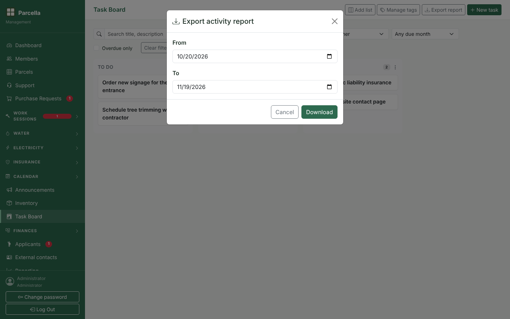

# Tablica zadań {#task-board}

!!! note "Tłumaczenie maszynowe"
    Ta strona została przetłumaczona maszynowo z języka angielskiego i nie została jeszcze sprawdzona. Jeśli coś jest niejasne, obowiązuje wersja angielska (język zmienisz u góry).

Wspólna tablica zadań dla własnych spraw zarządu, które nie są związane
z terminem prac społecznych: „odnowić polisę ubezpieczeniową”,
„zadzwonić do elektryka”, „przypomnieć się dekarzowi”. Zadania to karty
w kolumnach, które przeciągasz od lewej do prawej w miarę postępu pracy.

!!! info "Kto może z tego korzystać"
    - Przełącznik modułu to **Tablica zadań** w **Administracja →
      Włączanie i wyłączanie modułów**. Domyślnie jest **włączony**.
    - Tylko role **Zarząd** i **Administrator** oraz członkowie grupy z
      **Pełny dostęp do każdego modułu** widzą **Tablica zadań** w menu.
      Nie ma uprawnienia grupy, które otwierałoby ją innym użytkownikom,
      do odczytu ani do zapisu.
    - Opcjonalnie karty można pobierać z tablicy Nextcloud Deck
      (przełącznik modułu **Synchronizacja Nextcloud Deck**, domyślnie
      wyłączony). Zob. [Karty z Nextcloud Deck](#cards-from-nextcloud-deck).

!!! note "To nie to samo co zadania na terminach prac"
    Prace, które członkowie wykonują podczas terminu prac („przyciąć
    żywopłot”), znajdują się w module [Prace społeczne](work-hours.md) w
    **Zadania**. Tablica zadań to własna lista zadań zarządu.

## Tablica {#the-board}

Tablica pokazuje wszystkie listy (kolumny) obok siebie; przewiń w bok,
jeśli jest ich więcej, niż mieści się na ekranie. Nowe instalacje
zaczynają z trzema listami: „To Do”, „In Progress” i „Done”. Możesz
dowolnie zmieniać ich nazwy, dodawać je, zmieniać kolejność i usuwać.

Pozycja menu **Tablica zadań** pokazuje czerwoną liczbę, gdy zadania są
zaległe. Panel główny ma kartę **Zaległe zadania** z tą samą liczbą;
jej przycisk **Pokaż wszystkie** otwiera tablicę z już zaznaczonym
**Tylko zaległe**.

### Przyciski na górze {#buttons-at-the-top}

| Przycisk | Do czego służy |
|---|---|
| **Dodaj listę** | Otwiera małe okno do dodania listy. Wpisz **Nazwa** (do 100 znaków) i kliknij **Dodaj**. Nowa lista trafia na prawy koniec tablicy. |
| **Zarządzaj tagami** | Otwiera [Tagi zadań](#task-tags). |
| **Eksportuj raport** | Otwiera [Eksportuj raport aktywności](#export-activity-report). |
| **Nowe zadanie** | Otwiera [okno zadania](#the-task-window) dla nowej karty. |

### Lista (kolumna) {#a-list-column}

Nagłówek każdej kolumny pokazuje nazwę listy, zieloną ikonę haczyka,
jeśli to [lista ukończonych](#done-lists), oraz liczbę kart w niej.

| Działanie | Do czego służy |
|---|---|
| Przeciągnij nagłówek | Przenosi całą listę w nowe miejsce na tablicy. |
| **⋮** → **Zmień nazwę** | Otwiera **Zmień nazwę listy**; zmień **Nazwa** i kliknij **Zapisz zmiany**. |
| **⋮** → **Oznacz jako listę ukończonych** / **Usuń oznaczenie listy ukończonych** | Włącza lub wyłącza funkcję listy ukończonych dla tej listy. Zob. [Listy ukończonych](#done-lists). |
| **⋮** → **Usuń** | Otwiera **Usuń listę**. Niemożliwe dla ostatniej pozostałej listy. |

Gdy usuwasz listę, która ma jeszcze karty, okno mówi **Ta lista nadal
zawiera karty. Przed usunięciem wybierz inną listę, do której mają
zostać przeniesione.** Wybierz cel w **Przenieś karty do** i kliknij
**Usuń listę**. Karty są dodawane na koniec tej listy, w obecnej
kolejności -- żadna karta nigdy nie jest usuwana razem z listą. Pusta
lista pyta **Usunąć listę "{name}"? Tej operacji nie można cofnąć.**

### Karta {#a-card}

Każda karta pokazuje:

- oznaczenie **priorytetu** (**Wysoki**, **Średni** lub **Niski**), jeśli
  jest ustawione;
- ikonę chmury, jeśli karta pochodzi z Nextcloud Deck;
- **tytuł** -- kliknij go, aby otworzyć [okno zadania](#the-task-window);
- komu jest przypisana oraz **termin**. Termin po czasie jest pokazywany
  na czerwono;
- **Ukończono {date}** na zielono dla ukończonych kart, które są też
  pokazywane wyblakłe i przekreślone;
- jej **tagi** jako kolorowe etykiety.

Pusta lista pokazuje **Brak zadań**.

**Przeciągnij kartę** na inną listę albo w górę i w dół w obrębie listy,
aby zmienić jej miejsce. Kolejność jest zapisywana od razu. Jeśli zapis
się nie uda, strona przeładowuje się, aby pokazać rzeczywisty stan.

!!! note "Gdy przeciąganie jest wyłączone"
    Gdy aktywne jest wyszukiwanie, filtr albo sortowanie inne niż
    **Ręcznie (kolejność przeciągania)**, kart nie można przeciągać, bo
    tablica nie pokazuje wtedy każdej karty w jej rzeczywistej
    kolejności. Kliknij **Wyczyść filtry** i ustaw sortowanie z powrotem
    na **Ręcznie (kolejność przeciągania)**. Przenoszenie całych list
    nadal działa.

### Wyszukiwanie, filtry i sortowanie {#search-filters-and-sort}

Pasek nad tablicą zawęża to, co widzisz. Wszystko dzieje się od razu w
Twojej przeglądarce i niczego nie zmienia na samej tablicy.

| Pole / przycisk | Do czego służy |
|---|---|
| Pole wyszukiwania | Przeszukuje tytuł, opis, tagi i komentarze. |
| **Dowolny priorytet** | Pokazuje tylko karty z priorytetem **Wysoki**, **Średni** lub **Niski**. |
| **Dowolny tag** | Pokazuje tylko karty z tym tagiem. Proponowane są tylko tagi używane na tablicy. |
| **Dowolna osoba** | Pokazuje tylko karty przypisane tej osobie. Proponowane są tylko osoby z kartami. |
| **Dowolny miesiąc terminu** | Pokazuje tylko karty z terminem w tym miesiącu (np. „lipiec 2026”). Proponowane są tylko występujące miesiące. |
| **Tylko zaległe** | Pokazuje tylko zaległe karty: termin w przeszłości i nieukończone. |
| **Wyczyść filtry** | Resetuje wyszukiwanie i filtry. |
| Sortowanie (**Ręcznie (kolejność przeciągania)**, **Termin**, **Priorytet**) | Zmienia kolejność kart w każdej liście do oglądania: według miesiąca terminu albo Wysoki → Średni → Niski, z kartami bez priorytetu na końcu. **Ręcznie (kolejność przeciągania)** znowu pokazuje Twoją własną kolejność. Sortowanie nigdy nie jest zapisywane. |

Jeśli nic nie pasuje: **Żadne zadania nie pasują do
wyszukiwania/filtrów.**

## Okno zadania {#the-task-window}

Kliknięcie **Nowe zadanie** lub tytułu karty otwiera okno nad tablicą,
z nagłówkiem **Nowe zadanie** lub **Edytuj zadanie**. Każda karta ma
własny adres internetowy, więc możesz dodać ją do zakładek albo wysłać
link innemu członkowi zarządu. Zamknięcie okna (X, **Anuluj**, Esc lub
kliknięcie obok) wraca do tablicy bez zapisywania.

| Pole / przycisk | Do czego służy |
|---|---|
| **Tytuł** | Wymagany. |
| **Opis** | Opcjonalny dowolny tekst. |
| **Termin** | Opcjonalny. Karta, której termin minął, liczy się jako zaległa, dopóki nie zostanie ukończona. |
| **Priorytet** | **Brak priorytetu** (domyślnie), **Niski**, **Średni** lub **Wysoki**. Priorytet nie zmienia kolejności kart; tylko pokazuje oznaczenie i można po nim filtrować i sortować. |
| **Tagi** | Zaznacz dowolne z [tagów zadań](#task-tags) stowarzyszenia. Jeśli jeszcze żadnych nie ma: **Nie zdefiniowano jeszcze tagów.** z linkiem do **Zarządzaj tagami**. Nowych tagów nie można tu wpisywać. |
| **Lista** | Na której liście jest karta. Nowa karta trafia na pierwszą listę, chyba że wybierzesz inną; jest dodawana na koniec. |
| **Ukończone** | Oznacza kartę jako ukończoną (z datą i godziną ukończenia). Ukończone zadania nigdy nie są pokazywane jako zaległe. Przeniesienie karty do listy ukończonych automatycznie oznacza ją jako ukończoną. Odznacz, aby ją ponownie otworzyć. |
| **Przydzielone do** | Zaznacz dowolną liczbę osób. Wymieniane są tylko aktywne konta użytkowników. |
| **Utwórz** / **Zapisz zmiany** | Zapisuje kartę i wraca do tablicy. |
| **Usuń zadanie** | Tylko przy istniejących kartach. Usuwa kartę wraz z komentarzami po **Usunąć to zadanie? Tej operacji nie można cofnąć.** |

### Komentarze {#comments}

Istniejące karty mają sekcję **Komentarze**: bieżący dziennik notatek
dla tego, kto przejmie zadanie. Każdy komentarz pokazuje autora i
godzinę.

- Wpisz tekst w **Nowy komentarz** i kliknij **Dodaj komentarz**.
- Pod każdym komentarzem jest mały czerwony link **Usuń komentarz**,
  który usuwa komentarz po **Usunąć ten komentarz? Tej operacji nie można
  cofnąć.** Każdy członek zarządu może usunąć każdy komentarz.
  Komentarzy nie można edytować.

### Historia zmian {#change-history}

Pod komentarzami **Historia zmian** pokazuje każdą zapisaną zmianę, od
najnowszej: **Data i godzina**, **Pole**, **Stara wartość**, **Nowa
wartość** i **Zmienione przez**. Zapisywane są zmiany tytułu, opisu,
terminu, priorytetu, tagów, listy (pokazywanej po nazwie) i oznaczenia
ukończenia. Zmiany przypisania karty nie są zapisywane. Jeśli jeszcze
nie ma żadnych: **Brak zarejestrowanych zmian.**

## Listy ukończonych {#done-lists}

Karta jest „ukończona” tylko wtedy, gdy jest oznaczona jako ukończona --
nigdy tylko dlatego, że leży w kolumnie o nazwie „Done”. Aby
przeniesienie karty do kolumny oznaczało ją jako ukończoną, oznacz tę
kolumnę jako listę ukończonych:

1. Otwórz menu **⋮** listy, której używasz dla ukończonych zadań.
2. Wybierz **Oznacz jako listę ukończonych**. Obok jej nazwy pojawia
   się zielony haczyk.

Od tej chwili:

- przeniesienie karty **do** listy ukończonych oznacza ją jako ukończoną
  (przeciągnięcie, zmiana **Lista** w oknie zadania albo utworzenie jej
  tam);
- przeniesienie jej **z niej** do zwykłej listy ponownie ją otwiera;
- przenoszenie między dwiema zwykłymi listami niczego nie zmienia;
- pole **Ukończone** oznacza lub ponownie otwiera kartę na dowolnej
  liście.

Oznaczenie listy oznacza jako ukończone karty, które już na niej są.
Usunięcie oznaczenia listy pozostawia jej karty bez zmian.

Dopóki żadna lista nie jest oznaczona, tablica pokazuje niebieską notkę
wyjaśniającą to.

## Tagi zadań {#task-tags}

**Zarządzaj tagami** na tablicy otwiera **Tagi zadań**: stałą listę
tagów, które mogą mieć karty. Karty mogą mieć tylko tagi zdefiniowane
tutaj. **Powrót do tablicy** wraca do tablicy.

| Pole / przycisk | Do czego służy |
|---|---|
| **Nazwa** + kolor + **Dodaj tag** | Tworzy tag. Nazwa jest wymagana, do 100 znaków, i musi być unikalna (wielkość liter się nie liczy). Kolory: **Szary** (domyślnie), **Czerwony**, **Pomarańczowy**, **Żółty**, **Zielony**, **Turkusowy**, **Niebieski**, **Fioletowy**. |
| Nazwa i kolor istniejącego tagu + przycisk haczyka | Zmienia nazwę lub kolor tagu. Zmiana od razu pokazuje się na każdej karcie. |
| „Zadania: {count}” | Ile kart ma ten tag. |
| Przycisk kosza | Usuwa tag po **Usunąć tag „{name}”? Zostanie usunięty ze wszystkich zadań.** Karty zostają. |

Możliwe błędy: **Tag musi mieć nazwę.**, **Tag o tej nazwie już
istnieje.**, **Nieznany kolor.** Bez tagów: **Brak tagów.**

## Eksportuj raport aktywności {#export-activity-report}

**Eksportuj raport** pobiera plik tekstowy Markdown o aktywności na
tablicy, np. do przygotowania protokołu zarządu lub miesięcznego
podsumowania (także z pomocą asystenta AI).

| Pole / przycisk | Do czego służy |
|---|---|
| **Od** | Początek okresu. Domyślnie 30 dni temu. |
| **Do** | Koniec okresu. Domyślnie dziś. |
| **Pobierz** | Pobiera raport. |

Raport ma trzy części: karty utworzone lub zmienione w okresie,
komentarze napisane w okresie oraz migawkę każdej karty na tablicy w tej
chwili (ukończone karty z datą ukończenia).

!!! warning "Co znaczy „zmienione w okresie”"
    Karta liczy się jako ruszona, jeśli została utworzona lub
    edytowana w okresie. Raport nie potrafi powiedzieć, kiedy dokładnie
    karta została przeniesiona na obecną listę. Plik sam to mówi, aby
    czytający nie wymyślał osi czasu.

## Karty z Nextcloud Deck {#cards-from-nextcloud-deck}

Jeśli Twoje stowarzyszenie planowało wcześniej w Nextcloud Deck,
Parcella może skopiować jedną tablicę Deck na tablicę zadań i ją
aktualizować. To lustro w jedną stronę, mające pomóc w przeprowadzce.

Konfiguruje to administrator: włącza **Synchronizacja Nextcloud Deck** w
**Włączaniu i wyłączaniu modułów**, a potem wpisuje serwer, użytkownika,
hasło aplikacji i **ID tablicy Deck** w **Administracja → Integracje →
Nextcloud Deck** (zob. [Integracje](../administration/integrations.md)).
Parcella sprawdza wtedy Deck co 15 minut; **Synchronizuj teraz** robi to
od razu.

Co widzisz na tablicy:

- Każda kolumna Deck staje się listą o tej samej nazwie (tworzoną w
  razie potrzeby).
- Zsynchronizowane karty mają ikonę chmury (**Zsynchronizowano z
  Nextcloud Deck**).
- W oknie zadania szara notka mówi: **Ta karta jest zsynchronizowana z
  Nextcloud Deck -- tytuł, opis, termin i lista są zarządzane tam i
  aktualizowane automatycznie. Priorytet, tagi, przypisani i komentarze
  istnieją tylko w Parcelli i zawsze można je edytować.** Tytułu, opisu,
  terminu i listy nie można zmienić w Parcelli.
- **Przejmij do Parcelli** zrywa powiązanie: od tej chwili karta jest
  zwykłą kartą Parcelli, w pełni edytowalną, a Deck już jej nie zmienia.
- Karta usunięta lub zarchiwizowana w Deck nigdy nie jest usuwana w
  Parcelli. Po prostu przestaje być synchronizowana, jakbyś ją przejął.
- Zarchiwizowane karty Deck w ogóle nie są kopiowane.

## Powiązane {#related}

- [Panel główny](../getting-started/dashboard.md) -- karta **Zaległe
  zadania**.
- [Prace społeczne](work-hours.md) -- zadania na terminach prac.
- [Integracje](../administration/integrations.md) -- połączenie z
  Nextcloud Deck.
- [Włączanie i wyłączanie modułów](../administration/modules.md)
