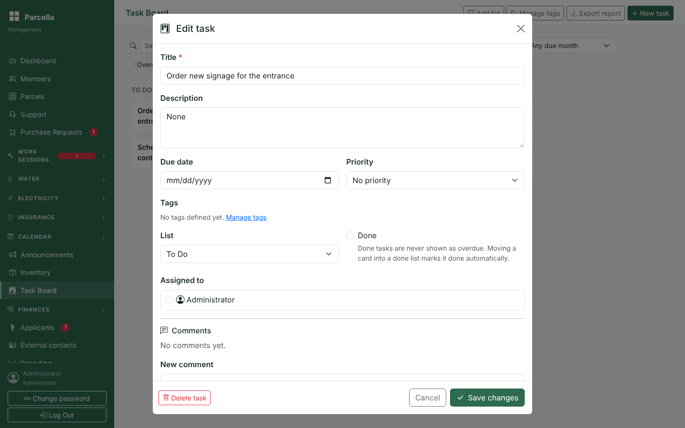

# Nástenka úloh {#task-board}

!!! note "Strojový preklad"
    Táto stránka bola strojovo preložená z angličtiny a zatiaľ nebola skontrolovaná. Ak je niečo nejasné, platí anglická verzia (jazyk prepnete hore).

Spoločná nástenka úloh pre vlastné záležitosti výboru, ktoré nie sú
viazané na pracovnú zmenu: „obnoviť poistnú zmluvu“, „zavolať
elektrikára“, „ozvať sa pokrývačovi“. Úlohy sú karty v stĺpcoch, ktoré
ťaháte zľava doprava, ako práca postupuje.

!!! info "Kto to môže používať"
    - Prepínač modulu je **Nástenka úloh** v časti **Administrácia →
      Zapínanie a vypínanie modulov**. Predvolene je **zapnutý**.
    - **Nástenku úloh** v menu vidia len roly **Výbor** a
      **Administrátor** a členovia skupiny s **Plný prístup ku každému
      modulu**. Neexistuje oprávnenie skupiny, ktoré by ju sprístupnilo
      iným používateľom, ani na čítanie, ani na zápis.
    - Voliteľne sa karty dajú preberať z nástenky Nextcloud Deck
      (prepínač modulu **Synchronizácia Nextcloud Deck**, predvolene
      vypnutý). Pozri [Karty z Nextcloud Deck](#cards-from-nextcloud-deck).

!!! note "Nie je to to isté ako úlohy pracovných zmien"
    Práce, ktoré členovia robia počas pracovnej zmeny („ostrihať
    živý plot“), sú v module [pracovných hodín](work-hours.md) v časti
    **Úlohy**. Nástenka úloh je pre vlastný zoznam úloh výboru.

## Nástenka {#the-board}

Nástenka ukazuje všetky zoznamy (stĺpce) vedľa seba; ak sa ich na
obrazovku nezmestí viac, posúvajte do strany. Nové inštalácie začínajú
s tromi zoznamami, „To Do“, „In Progress“ a „Done“. Zoznamy môžete
ľubovoľne premenovávať, pridávať, preusporiadať a mazať.

Položka menu **Nástenka úloh** ukazuje červené číslo, keď sú úlohy po
termíne. Dashboard má kartu **Úlohy po termíne** s rovnakým číslom; jej
tlačidlo **Zobraziť všetko** otvorí nástenku s už zaškrtnutým **Iba po
termíne**.

### Tlačidlá hore {#buttons-at-the-top}

| Tlačidlo | Čo robí |
|---|---|
| **Pridať zoznam** | Otvorí malé okno na pridanie zoznamu. Zadajte **Názov** (najviac 100 znakov) a kliknite na **Pridať**. Nový zoznam sa pridá na pravý koniec nástenky. |
| **Spravovať štítky** | Otvorí [Štítky úloh](#task-tags). |
| **Exportovať report** | Otvorí [Export reportu aktivít](#export-activity-report). |
| **Nová úloha** | Otvorí [okno úlohy](#the-task-window) pre novú kartu. |

### Zoznam (stĺpec) {#a-list-column}

Hlavička každého stĺpca ukazuje názov zoznamu, zelenú ikonu fajky, ak
ide o [zoznam hotových](#done-lists), a počet kariet v ňom.

| Akcia | Čo robí |
|---|---|
| Potiahnutie hlavičky | Presunie celý zoznam na novú pozíciu na nástenke. |
| **⋮** → **Premenovať** | Otvorí **Premenovať zoznam**; zmeňte **Názov** a kliknite na **Uložiť zmeny**. |
| **⋮** → **Označiť ako zoznam hotových** / **Zrušiť označenie zoznamu hotových** | Zapne alebo vypne pre tento zoznam funkciu zoznamu hotových. Pozri [Zoznamy hotových](#done-lists). |
| **⋮** → **Odstrániť** | Otvorí **Odstrániť zoznam**. Pri poslednom zostávajúcom zozname to nie je možné. |

Keď mažete zoznam, ktorý ešte obsahuje karty, okno hovorí **Tento
zoznam stále obsahuje karty. Pred odstránením vyberte iný zoznam, do
ktorého sa majú presunúť.** Vyberte cieľ v **Presunúť karty do** a
kliknite na **Odstrániť zoznam**. Karty sa pridajú na koniec tohto
zoznamu v ich aktuálnom poradí -- spolu so zoznamom sa nikdy nezmaže
žiadna karta. Prázdny zoznam sa pýta **Odstrániť zoznam „{name}“? Túto
akciu nemožno vrátiť späť.**

### Karta {#a-card}

Každá karta ukazuje:

- odznak **priority** (**Vysoká**, **Stredná** alebo **Nízka**), ak je
  nastavená;
- ikonu oblaku, ak karta pochádza z Nextcloud Deck;
- **názov** -- kliknutím otvoríte [okno úlohy](#the-task-window);
- komu je pridelená a **termín**. Termín po splatnosti sa zobrazuje
  červeno;
- **Hotovo {date}** zeleno pri dokončených kartách, ktoré sú navyše
  vyblednuté a prečiarknuté;
- jej **štítky** ako farebné značky.

Prázdny zoznam ukazuje **Žiadne úlohy**.

**Potiahnite kartu** do iného zoznamu alebo hore a dole v rámci zoznamu,
aby ste zmenili jej miesto. Poradie sa uloží hneď. Ak sa uloženie
nepodarí, stránka sa znova načíta a ukáže skutočný stav.

!!! note "Keď je ťahanie vypnuté"
    Kým je aktívne vyhľadávanie, filter alebo iné zoradenie ako
    **Ručne (poradie ťahania)**, karty sa nedajú ťahať, pretože
    nástenka potom neukazuje každú kartu v jej skutočnom poradí.
    Kliknite na **Zrušiť filtre** a nastavte zoradenie späť na **Ručne
    (poradie ťahania)**. Presúvanie celých zoznamov funguje aj tak.

### Vyhľadávanie, filtre a zoradenie {#search-filters-and-sort}

Lišta nad nástenkou zužuje to, čo vidíte. Všetko sa deje okamžite vo
vašom prehliadači a na samotnej nástenke nič nemení.

| Pole / tlačidlo | Čo robí |
|---|---|
| Pole vyhľadávania | Hľadá v názve, popise, štítkoch a komentároch. |
| **Ľubovoľná priorita** | Ukáže len karty s prioritou **Vysoká**, **Stredná** alebo **Nízka**. |
| **Ľubovoľný štítok** | Ukáže len karty s týmto štítkom. Ponúkajú sa len štítky použité na nástenke. |
| **Ľubovoľný riešiteľ** | Ukáže len karty pridelené tejto osobe. Ponúkajú sa len ľudia s kartami. |
| **Ľubovoľný mesiac splatnosti** | Ukáže len karty so splatnosťou v tomto mesiaci (napr. „júl 2026“). Ponúkajú sa len mesiace, ktoré sa vyskytujú. |
| **Iba po termíne** | Ukáže len karty po termíne: termín v minulosti a nie hotové. |
| **Zrušiť filtre** | Zruší vyhľadávanie a filtre. |
| Zoradenie (**Ručne (poradie ťahania)**, **Dátum splatnosti**, **Priorita**) | Preusporiada karty v každom zozname na zobrazenie: podľa mesiaca splatnosti alebo Vysoká → Stredná → Nízka s kartami bez priority na konci. **Ručne (poradie ťahania)** znova ukáže vaše vlastné poradie. Zoradenie sa nikdy neukladá. |

Ak nič nevyhovuje: **Žiadne úlohy nezodpovedajú vyhľadávaniu/filtrom.**

## Okno úlohy {#the-task-window}

Kliknutie na **Nová úloha** alebo na názov karty otvorí okno nad
nástenkou s nadpisom **Nová úloha** alebo **Upraviť úlohu**. Každá
karta má vlastnú webovú adresu, takže si ju môžete uložiť do záložiek
alebo poslať odkaz inému členovi výboru. Zatvorenie okna (X,
**Zrušiť**, Esc alebo kliknutie vedľa neho) vás vráti na nástenku bez
uloženia.

| Pole / tlačidlo | Čo robí |
|---|---|
| **Názov** | Povinné. |
| **Popis** | Voliteľný voľný text. |
| **Dátum splatnosti** | Voliteľné. Karta, ktorej termín uplynul, sa počíta ako po termíne, kým nie je hotová. |
| **Priorita** | **Bez priority** (predvolené), **Nízka**, **Stredná** alebo **Vysoká**. Priorita nemení poradie kariet; len ukáže odznak a dá sa podľa nej filtrovať a zoraďovať. |
| **Štítky** | Zaškrtnite ľubovoľné zo [štítkov úloh](#task-tags) spolku. Ak ešte žiadne neexistujú: **Zatiaľ nie sú definované žiadne štítky.** s odkazom na **Spravovať štítky**. Nové štítky tu napísať nemôžete. |
| **Zoznam** | V ktorom zozname karta je. Nová karta ide do prvého zoznamu, pokiaľ nevyberiete iný; pridá sa na koniec. |
| **Hotovo** | Označí kartu ako hotovú (s dátumom a časom dokončenia). Hotové úlohy sa nikdy nezobrazujú ako po termíne. Presunutie karty do zoznamu hotových ju automaticky označí ako hotovú. Odškrtnutím ju znova otvoríte. |
| **Priradené komu** | Zaškrtnite ľubovoľný počet ľudí. Uvedené sú len aktívne používateľské účty. |
| **Vytvoriť** / **Uložiť zmeny** | Uloží kartu a vráti sa na nástenku. |
| **Odstrániť úlohu** | Len pri existujúcich kartách. Zmaže kartu s jej komentármi po otázke **Odstrániť túto úlohu? Túto akciu nemožno vrátiť späť.** |

### Komentáre {#comments}

Existujúce karty majú sekciu **Komentáre**: priebežný záznam poznámok
pre toho, kto úlohu prevezme ďalej. Každý komentár ukazuje autora a
čas.

- Napíšte do **Nový komentár** a kliknite na **Pridať komentár**.
- Každý komentár má pod sebou malý červený odkaz **Zmazať komentár**,
  ktorý tento komentár odstráni po otázke **Odstrániť tento komentár?
  Túto akciu nemožno vrátiť späť.** Ktorýkoľvek člen výboru môže zmazať
  ktorýkoľvek komentár. Komentáre sa nedajú upraviť.

### História zmien {#change-history}

Pod komentármi **História zmien** uvádza každú zaznamenanú zmenu,
najnovšie prvé: **Časová značka**, **Pole**, **Staršia hodnota**,
**Nová hodnota** a **Zmenil**. Zaznamenávajú sa zmeny názvu, popisu,
termínu, priority, štítkov, zoznamu (zobrazeného názvom zoznamu) a
označenia hotovo. Zmeny toho, komu je karta pridelená, sa
nezaznamenávajú. Ak zatiaľ žiadne nie sú: **Zatiaľ neboli zaznamenané
žiadne zmeny.**

## Zoznamy hotových {#done-lists}

Karta je „hotová“, len keď je označená ako hotová -- nikdy len preto,
že je v stĺpci s názvom „Done“. Aby presunutie karty do stĺpca kartu
označilo ako hotovú, označte tento stĺpec ako zoznam hotových:

1. Otvorte menu **⋮** zoznamu, ktorý používate na dokončené úlohy.
2. Vyberte **Označiť ako zoznam hotových**. Pri jeho názve sa objaví
   zelená fajka.

Odvtedy:

- presunutie karty **do** zoznamu hotových ju označí ako hotovú
  (ťahaním, zmenou **Zoznam** v okne úlohy alebo jej vytvorením tam);
- presunutie **von** do bežného zoznamu ju znova otvorí;
- presun medzi dvoma bežnými zoznamami nič nemení;
- zaškrtávacie políčko **Hotovo** označí alebo znova otvorí kartu v
  ktoromkoľvek zozname.

Označenie zoznamu označí karty, ktoré v ňom už sú, ako hotové. Zrušenie
označenia zoznamu nechá jeho karty tak, ako sú.

Kým nie je označený žiadny zoznam, nástenka ukazuje modré upozornenie,
ktoré to vysvetľuje.

## Štítky úloh {#task-tags}

**Spravovať štítky** na nástenke otvorí **Štítky úloh**: pevný zoznam
štítkov, ktoré môžu karty niesť. Karty môžu niesť len štítky
definované tu. **Späť na tabuľu** vás vráti na nástenku.

| Pole / tlačidlo | Čo robí |
|---|---|
| **Názov** + farba + **Pridať štítok** | Vytvorí štítok. Názov je povinný, najviac 100 znakov a musí byť jedinečný (na veľkosti písmen nezáleží). Farby: **Sivá** (predvolené), **Červená**, **Oranžová**, **Žltá**, **Zelená**, **Tyrkysová**, **Modrá**, **Fialová**. |
| Názov a farba existujúceho štítku + tlačidlo s fajkou | Premenuje alebo prefarbí štítok. Zmena sa hneď prejaví na každej karte. |
| „Úlohy: {count}“ | Koľko kariet štítok nesie. |
| Tlačidlo koša | Zmaže štítok po otázke **Zmazať štítok „{name}“? Odstráni sa zo všetkých úloh.** Karty zostanú. |

Možné chyby: **Štítok musí mať názov.**, **Štítok s týmto názvom už
existuje.**, **Neznáma farba.** Ak ešte nie sú žiadne štítky: **Zatiaľ
žiadne štítky.**

## Export reportu aktivít {#export-activity-report}

**Exportovať report** stiahne textový súbor Markdown o aktivite na
nástenke, napríklad ako podklad pre zápisnicu výboru alebo mesačné
zhrnutie (aj s pomocou AI asistenta).

| Pole / tlačidlo | Čo robí |
|---|---|
| **Od** | Začiatok obdobia. Predvolene pred 30 dňami. |
| **Do** | Koniec obdobia. Predvolene dnes. |
| **Stiahnuť** | Stiahne report. |

Report má tri časti: karty vytvorené alebo zmenené v danom období,
komentáre napísané v danom období a snímku každej karty na nástenke
práve teraz (hotové karty s dátumom dokončenia).

!!! warning "Čo znamená ‚zmenené v danom období‘"
    Karta sa počíta ako dotknutá, ak bola v danom období vytvorená alebo
    upravená. Report nevie presne povedať, kedy bola karta presunutá do
    svojho aktuálneho zoznamu. Súbor to sám uvádza, aby si ten, kto ho
    číta, nevymyslel časovú os.

## Karty z Nextcloud Deck {#cards-from-nextcloud-deck}

Ak váš spolok predtým plánoval v Nextcloud Deck, Parcella môže
skopírovať jednu nástenku Deck na nástenku úloh a udržiavať ju
aktuálnu. Je to jednosmerné zrkadlo, ktoré vám má pomôcť s prechodom.

Nastavuje administrátor: zapne **Synchronizácia Nextcloud Deck** v časti
**Zapínanie a vypínanie modulov** a potom zadá server, používateľa,
heslo aplikácie a **ID nástenky Deck** v časti **Administrácia →
Integrácie → Nextcloud Deck** (pozri [Integrácie](../administration/integrations.md)).
Parcella potom kontroluje Deck každých 15 minút; **Synchronizovať
teraz** tam to urobí okamžite.

Čo vidíte na nástenke:

- Každý stĺpec Deck sa stane zoznamom s rovnakým názvom (vytvorí sa,
  ak treba).
- Synchronizované karty majú ikonu oblaku (**Synchronizované z
  Nextcloud Deck**).
- V okne úlohy sivé upozornenie hovorí: **Táto karta je
  synchronizovaná z Nextcloud Deck -- názov, popis, termín a zoznam sa
  spravujú tam a aktualizujú sa automaticky. Priorita, štítky, priradení
  a komentáre existujú iba v Parcelle a vždy sa dajú upravovať.** Názov,
  popis, termín a zoznam sa v Parcelle nedajú zmeniť.
- **Prevziať do Parcelly** preruší prepojenie: odvtedy je karta bežná
  karta Parcelly, plne upraviteľná, a Deck ju už nemení.
- Karta zmazaná alebo archivovaná v Deck sa v Parcelle nikdy nezmaže.
  Jednoducho sa prestane synchronizovať, ako keby ste ju prevzali.
- Archivované karty Deck sa vôbec nekopírujú.

## Súvisiace {#related}

- [Dashboard](../getting-started/dashboard.md) -- karta **Úlohy po
  termíne**.
- [Pracovné hodiny](work-hours.md) -- úlohy pre pracovné zmeny.
- [Integrácie](../administration/integrations.md) -- pripojenie
  Nextcloud Deck.
- [Zapínanie a vypínanie modulov](../administration/modules.md)
