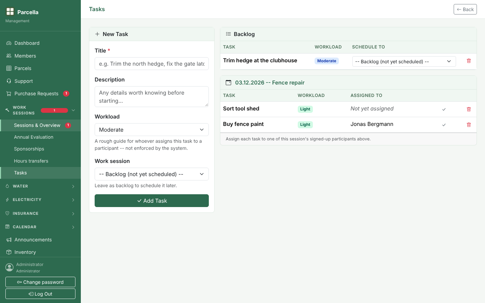

# Pracovní hodiny {#work-hours}

!!! note "Strojový překlad"
    Tato stránka byla strojově přeložena z angličtiny a dosud nebyla zkontrolována. Pokud je něco nejasné, platí anglická verze (jazyk přepnete nahoře).

Většina zahrádkářských spolků očekává, že každý člen nebo každá parcela
odpracuje ročně určitý počet [povinných pracovních hodin](../glossary.md),
nebo za neodpracované hodiny zaplatí. Tento modul plánuje pracovní směny
spolku, zaznamenává, kdo se zúčastnil, připisuje sponzoringy a
osvobození a na konci roku spočítá, kdo ještě dluží hodiny a kolik peněz
to dělá.

!!! info "Kdo to může používat"
    Modul je ve výchozím stavu zapnutý. Pokud váš spolek povinné hodiny
    nevybírá, můžete ho vypnout v **Administrace → Nastavení** (**Správa
    pracovních hodin**) -- viz
    [Zapínání a vypínání modulů](../administration/modules.md). Vypnutím
    se nic nesmaže.

    Správci a členové výboru mohou vše. Ostatní uživatelé potřebují
    [skupinu](../administration/groups.md), která dává oprávnění
    **Pracovní sezení**: *čtení* pro zobrazení stránek, *zápis* pro
    vytváření a změny, *mazání* pro odstraňování směn, účastníků,
    sponzoringů, převodů, úkolů, rolí ve spolku a ročních konfigurací.
    Bez alespoň oprávnění ke čtení se menu **Pracovní sezení**
    nezobrazí.

Modul najdete v bočním menu pod **Pracovní sezení** s těmito položkami:
**Sezení a přehled**, **Roční hodnocení**, **Sponzoringy**, **Převod
hodin** a **Úkoly**. Konfigurace hodin a role ve spolku se otevírají
tlačítky na stránce přehledu.

## Jak se hodiny počítají {#how-the-hours-are-counted}

Než se podíváte na jednotlivé obrazovky, pomůže vědět, jak Parcella
sčítá rok. U každého člena počítá:

- **Pracovní směny** -- každou směnu v daném kalendářním roce, kde má
  člen stav **Zúčastnil se**. Každá účast se počítá s hodinami zadanými
  pro tuto osobu, nebo, pokud žádné zadány nebyly, s **Hodiny na
  účastníka** dané směny. **Zaregistrován** a **Nedostavil se** se
  nepočítají.
- **Sponzoringy** -- **Připsané hodiny/rok** každého sponzoringu
  přiděleného členovi, jehož období se s rokem překrývá. Sponzoring se
  počítá, až když má člena i datum **Platné od**.
- **Převody hodin** -- hodiny, které mu darovali jiní členové (plus),
  minus hodiny, které daroval (minus).

Co následuje, závisí na **Fakturační režim**, který pro rok nastavíte v
[konfiguraci](#mandatory-hours-configuration):

| Fakturační režim | Co to pro spolek znamená |
|---|---|
| **Na nájem / parcelu** | Každá parcela dluží roční hodiny jednou. Hodiny všech jejích nájemců se sčítají: když jeden nájemce odpracuje 2 hodiny a druhý 3, je požadavek 5 hodin splněn. |
| **Na člena** | Každý člen, který měl v průběhu roku nájem, dluží hodiny sám za sebe. |

Otevřené hodiny se násobí **Hodinová sazba**, čímž vznikne dlužná
částka.

### Osvobození {#exemptions}

Člen je pro daný rok osvobozen, když v tomto roce zastává
[roli ve spolku](#club-roles) označenou **Osvobozen od povinných hodin**
-- typicky práci ve výboru.

!!! warning "Jeden osvobozený nájemce osvobodí celou parcelu"
    V režimu **Na nájem / parcelu** je parcela osvobozena, jakmile je
    osvobozen **alespoň jeden** z jejích nájemců. Spolunájemci člena
    výboru tedy v tomto roce také nic nedluží: funkce ve výboru „pokryje“
    celou parcelu. Nezáleží na tom, zda jsou ostatní nájemci sami
    osvobozeni.

    V režimu **Na člena** je osvobozen jen osvobozený člen.

Osvobození platí vždy pro **celý kalendářní rok**, pro který je zadáno
přidělení role. Člen výboru, který odstoupí v říjnu, zůstává osvobozen
po zbytek roku; data v **Od** a **Do** slouží pro vaši evidenci a
osvobození nezkracují. Příští rok roli přidělíte znovu (nebo ne).

### Kdo se v roce počítá jako nájemce {#who-counts-as-a-tenant-in-a-year}

Vyhodnocení se dívá na to, kdo parcelu držel *v průběhu hodnoceného
roku*, ne kdo ji drží dnes:

- Ukončení nájmu nezruší hodiny daného roku. Nájemce, který odejde v
  červnu, stále dluží celý rok. V režimu **Na nájem / parcelu** zůstává
  v řádku parcely, sečtený s tím, kdo parcelu převzal; v každém případě
  dostane odznak **pacht ukončen**.
- Nájem, který skončil před začátkem roku nebo začíná po něm, se
  nepočítá.
- Člen, který se v průběhu roku přestěhoval v rámci spolku z jedné
  parcely na jinou, se počítá jen u parcely, na kterou se přestěhoval.
- Člen, který drží současně dvě parcely, dluží hodiny za každou
  parcelu. Jeho vlastní hodiny plní parcely v pořadí čísel parcel: každá
  parcela dostane, co ještě potřebuje, poslední dostane zbytek.
  Například 7,5 hodiny proti požadavku 5 hodin: první parcela je splněna
  5 hodinami, druhá má 2,5 hodiny a 2,5 hodiny otevřené. Vyhodnocení
  takového nájemce ukáže jako „5,0 z 7,5 h“.
- Smazaní členové vypadnou ze všech vyhodnocení, včetně minulých let.
  Pokud se mají hodiny odcházejícího ještě vyúčtovat, ukončete jeho
  členství datem konce místo smazání -- viz [Členové](members.md).

## Sezení a přehled {#sessions-overview}

Úvodní stránka modulu s titulkem **Povinné hodiny** a rokem. Sem
přijdete plánovat směny a na první pohled zjistit, zda přišla nová
přihlášení.

Pokud pro vybraný rok zatím neexistuje konfigurace, žlutý pruh uvádí
**Pro ... zatím neexistuje konfigurace povinných hodin.** s odkazem
**Vytvořit nyní →**. Jinak tři dlaždice ukazují nastavení roku.

| Pole / tlačítko | Co dělá |
|---|---|
| Výběr roku (vpravo nahoře) | Přepne na jiný rok. Uvedeny jsou jen roky, které mají [konfiguraci](#mandatory-hours-configuration). |
| **Nové sezení** | Otevře [formulář směny](#new-work-session-and-edit-session). Vyžaduje oprávnění k zápisu. |
| Dlaždice **Povinné hodiny** | Hodiny požadované v tomto roce a hodinová sazba (**při**). |
| Dlaždice **Režim** | **Na nájem** nebo **Na člena** -- jednotka vyúčtování pro tento rok. |
| Dlaždice **Max. dlužná částka** | Hodiny × sazba: kolik dluží jedna parcela nebo člen **při nula hodinách**. |
| **Roční hodnocení** | Otevře [Roční hodnocení](#annual-evaluation) za tento rok. |
| **CSV export** | Stáhne vyhodnocení jako tabulku (viz [Export CSV](#csv-export)). |

### Tabulka pracovních směn {#work-sessions-table}

Vypisuje každou směnu vybraného roku, nejnovější první.

| Sloupec | Co ukazuje |
|---|---|
| **Datum** | Datum směny. |
| **Název** | Odkazuje na [stránku směny](#session-page). Červené číslo vedle počítá nová přihlášení (viz níže). |
| **Typ** | **Standard** (plánovaná) nebo **Speciál** (spontánní). |
| **Čas** | Od -- do, nebo „–“, pokud čas nebyl zadán. |
| **Účastníci** | Počet účastníků, „/ maximum“, pokud je nastaven limit, a v závorce kolik se **zúčastnili** a kolik je **nových**. |
| Tlačítko s okem | Otevře stránku směny. |

Pokud rok zatím nemá žádné směny, tabulka uvádí **Zatím žádná pracovní
sezení pro ....** a nabízí **Vytvořit první sezení** (s oprávněním k
zápisu).

### Rychlý přístup {#quick-access}

Tlačítka pod tabulkou vedou na **Konfigurace hodin**, **Role ve
spolku**, **Sponzoringy** a **Úkoly**.

### Nová přihlášení: odznaky, dlaždice dashboardu a e-maily {#new-sign-ups-badges-dashboard-tile-and-e-mails}

Parcella označuje účast jako *novou* po dobu 14 dní od jejího vytvoření
-- ať se zahrádkář přihlásil přes web spolku, nebo někoho ručně přidal
člen výboru. Počítají se jen **Standard** směny, které ještě neproběhly;
zaznamenání docházky na minulé směně nebo směně **Speciál** se nikdy
neukáže jako „nové“.

Nová přihlášení uvidíte na čtyřech místech:

- červené číslo vedle **Pracovní sezení** a **Sezení a přehled** v
  bočním menu,
- dlaždice **Nová přihlášení** na [dashboardu](../getting-started/dashboard.md)
  s tlačítkem **Zobrazit vše**, které vede sem,
- červené číslo vedle názvu směny v tabulce výše,
- červený odznak **Nový** vedle účastníka na stránce směny.

Jakmile jste je prohlédli, klikněte na **Označit jako zkontrolováno** na
[stránce směny](#session-page). Tím se zruší značky „nový“ u všech, kdo
jsou v tu chvíli na směně. Kdo se přihlásí potom, je opět označen jako
nový.

Parcella také posílá e-maily každému aktivnímu uživateli s rolí Správce
nebo Výbor:

- **Když člen výboru přidá účastníka ručně**, ostatní uživatelé s rolí
  Správce a Výbor dostanou jeden e-mail na účastníka („Nové přihlášení k
  pracovní směně v ...“). Ten, kdo účastníka přidal, ho nedostane.
- **Když se zahrádkáři přihlásí přes web spolku**, dostanou všichni
  jeden souhrnný e-mail na odeslání („... nová(ých) přihlášení k
  pracovním směnám v ...“), bez ohledu na to, kolik směn a členů
  domácnosti bylo přihlášeno.

<!-- TODO(verify): users who only have full access through a group (not the Admin/Board role itself) don't receive these notification e-mails -- confirm this is intended. -->

## Přihlášky přes web spolku {#sign-ups-through-the-club-website}

Pokud má web vašeho spolku (například WordPress) přihlašovací formulář na
pracovní směny, mohou se zahrádkáři přihlásit bez účtu v Parcelle.
Vyžaduje to modul **Veřejné API pro přihlášky**, který je **ve výchozím
stavu vypnutý**, protože otevírá Parcellu podáním z internetu. Zapněte
ho v **Administrace → Nastavení** a pak nastavte propojení s webem v
[Integrace](../administration/integrations.md). Co zahrádkáři vidí,
popisuje stránka [Pro zahrádkáře](../gardeners/index.md).

Ze strany výboru se děje toto:

- **Které směny se nabízejí.** Jen **Standard** směny, jejichž datum
  neuplynulo. Směna s **Uzávěrka přihlášek (dní předem)** zmizí z webu
  o tolik dní dříve. Směny **Speciál** se na webu nikdy nezobrazí.
- **Kdo se přihlásí.** Zahrádkář zadá číslo parcely a volitelně jméno.
  Parcella porovná jméno se *současnými* nájemci parcely. Pokud odpovídá
  právě jedné osobě, přihlásí se jen ta. Pokud jméno nebylo zadáno nebo
  jednoznačně neodpovídá jedné osobě, přihlásí se **každý současný
  nájemce parcely**, aby se žádné přihlášení neztratilo. Parcela bez
  současných nájemců se přihlásit nemůže.
- **Plné směny.** Pokud směna nemá dost volných míst pro všechny, kdo by
  byli přihlášeni, přihlášení na tuto směnu se odmítne jako celek.
  Účastníci označení **Nedostavil se** místo nezabírají.
- **Žádné duplicity.** Dvojí přihlášení na stejnou směnu nevytvoří
  druhý záznam.
- **Co uvidíte.** Přihlášení se objeví jako běžní účastníci se stavem
  **Zaregistrován**, odznakem **Nový** a **Poznámka** jako „Public
  signup, matched by name (parcel G012) | Phone: ...“. Když byli
  přihlášeni všichni nájemci, poznámka to uvádí a žádá vás, abyste
  odebrali ty, kdo se ve skutečnosti nepřihlásili.
- **Potvrzení zahrádkáři.** Každý nově přihlášený člen dostane
  potvrzovací e-mail na adresu uloženou v jeho záznamu člena -- nikdy na
  adresu zadanou do formuláře na webu. Text můžete změnit nebo potvrzení
  vypnout v [konfiguraci](#sign-up-confirmation-email).

!!! tip "Po příchodu přihlášek z webu"
    Otevřete směnu, zkontrolujte poznámky nových účastníků, odeberte
    každého, kdo byl přihlášen jen preventivně (vyžaduje oprávnění k
    mazání), a klikněte na **Označit jako zkontrolováno**.

## Stránka směny {#session-page}

Kliknutím na název směny ji otevřete. Zde spravujete seznam účastníků
před směnou a potom zaznamenáváte docházku.

| Tlačítko (nahoře) | Co dělá |
|---|---|
| **Upravit** | Otevře [formulář směny](#new-work-session-and-edit-session). Vyžaduje oprávnění k zápisu. |
| **Seznam účastníků** | Stáhne PDF k vytištění a vzetí na směnu (viz níže). |
| **Smazat** | Po potvrzení smaže směnu. **Všechny účasti se ztratí**, takže hodiny se už nikomu nepočítají. Úkoly naplánované na směnu se vrátí mezi nezařazené. Vyžaduje oprávnění k mazání. |
| **Zpět** | Vrátí se na přehled. |

### Podrobnosti {#details}

Ukazuje **Typ** (**Standard** nebo **Speciál**), **Datum**, **Čas**,
**Místa** (účastníci / maximum), **Hodiny/osoba** a popis.

### Účastníci {#participants}

Záhlaví karty počítá, kolik účastníků se **zúčastnili** a kolik je
**zaregistrováni**. Pokud jsou nová přihlášení a máte oprávnění k
zápisu, ukazuje také **Označit jako zkontrolováno** (viz
[Nová přihlášení](#new-sign-ups-badges-dashboard-tile-and-e-mails)).

Psaním do **Hledat podle člena nebo čísla zahrádky…** tabulku
vyfiltrujete.

| Sloupec | Co ukazuje / dělá |
|---|---|
| **Člen** | Jméno s odkazem na záznam člena. Červený odznak **Nový** označuje nové přihlášení. |
| **Parcela** | Současná parcela (parcely) člena. |
| **Stav** | **Zaregistrován**, **Zúčastnil se** nebo **Nedostavil se**. S oprávněním k zápisu se výběr jiné hodnoty uloží okamžitě. Do hodin člena se počítá jen **Zúčastnil se**. |
| **Hodiny** | Hodiny připsané této osobě. Pole je předvyplněno jejími vlastními hodinami, nebo, pokud žádné zadány nebyly, **Hodiny na účastníka** směny. Změňte je a uložte kliknutím na **✓**. Bez oprávnění k zápisu vidíte jen číslo. |
| **Poznámka** | Například údaje, které zahrádkář zadal ve formuláři na webu. |
| **×** | Po potvrzení odebere účastníka. Vyžaduje oprávnění k mazání. |

!!! tip "Docházku zaznamenejte po směně"
    Každému, kdo přišel, nastavte **Zúčastnil se** a opravte hodiny u
    každého, kdo zůstal kratší nebo delší dobu. Lidi, kteří nepřišli,
    nechte na **Nedostavil se** místo odebrání, abyste později viděli,
    kdo byl očekáván.

**Přidání účastníka** (oprávnění k zápisu): dole na kartě začněte psát
jméno nebo číslo parcely do **Vyberte člena…** a vyberte člena ze
seznamu -- musíte někoho vybrat ze seznamu, samotné napsání jména
nestačí. Členové, kteří už na směně jsou, se nenabízejí. Vyberte stav
(**Zúčastnil se** je předvybrán, protože se to většinou používá k
dodatečnému zaznamenání docházky), volitelně zadejte hodiny (prázdné
znamená výchozí hodnotu směny) a klikněte na **Přidat**.

Ruční přidání je možné vždy, i když je směna plná, její uzávěrka
přihlášek uplynula nebo je směna v minulosti -- limity platí jen pro
přihlášky přes web.

### Úkoly {#tasks}

Vypisuje [úkoly](#tasks_1) naplánované na tuto směnu s údaji **Úkol**,
**Náročnost** a **Přiděleno komu**. S oprávněním k zápisu můžete v
**Přiděleno komu** vybrat jednoho z účastníků směny (nebo **Zatím
nepřiděleno**) a tlačítkem zaškrtnutí označit úkol jako hotový nebo
nehotový. Hotové úkoly jsou přeškrtnuté. **Spravovat úkoly** otevře
seznam nezařazených úkolů.

### Seznam účastníků {#attendee-sheet}

PDF vypisuje každého účastníka směny, seřazené podle parcely a jména, se
sloupci **Parcela**, **Člen**, **Hodiny**, **Přiřazené úkoly** a
**Podpis**. **Hodiny** ukazuje individuální hodiny nebo výchozí hodnotu
směny a zůstane prázdný, pokud neexistuje ani jedno. **Přiřazené úkoly**
zůstane prázdné, když zatím nebyl přidělen žádný úkol, takže ho můžete
dopsat ručně. Seznam v případě potřeby pokračuje na více stranách.

Výtisk v Parcelle nic nemění: po směně zadejte opravený stav a hodiny na
stránce směny.

## Nové pracovní sezení a úprava sezení {#new-work-session-and-edit-session}

Otevírá se tlačítkem **Nové sezení** v přehledu nebo **Upravit** na
stránce směny. Vyžaduje oprávnění k zápisu.

| Pole | Co dělá |
|---|---|
| **Název** | Povinné. Například „Jarní úklid“. |
| **Typ** | **Standard (plánované)** pro směny plánované dopředu, **Speciál (spontánní)** pro neplánované. Jen standardní směny se zobrazují na webu spolku a počítají se jako nová přihlášení. |
| **Datum** | Povinné. Hodiny směny se počítají pro kalendářní rok tohoto data. |
| **Od** / **Do** | Volitelný čas začátku a konce. |
| **Max. účastníků** | Prázdné = bez omezení. Omezuje přihlášky přes web; členové výboru mohou ručně přidat další lidi. |
| **Uzávěrka přihlášek (dní předem)** | Uzavře přihlašování na webu tolik dní před směnou -- 1 ho uzavře den předem. Ponechte prázdné, chcete-li ho nechat otevřené, dokud neuplyne datum směny. Nemá vliv na přidávání lidí v Parcelle. |
| **Hodiny na účastníka** | Výchozí hodiny, které každý účastník dostane, například 4,0. Při zaznamenávání docházky můžete hodiny u každé osoby ještě změnit. |
| **Popis** | Úkoly, nářadí, zvláštní poznámky. |
| **Zrušit** / **Vytvořit sezení** nebo **Uložit změny** | Uložením se dostanete na stránku směny. |

## Roční hodnocení {#annual-evaluation}

Ukazuje u každé parcely nebo člena, kolik hodin bylo požadováno, kolik
odpracováno a co se ještě dluží. Otevřete ho z menu (**Roční
hodnocení**) nebo z přehledu. S tímto seznamem pracujete na konci roku a
z něj vychází fakturace u položky **Nedoplatek pracovních hodin (z
modulu)** (viz [Vyúčtování](finances/invoice-runs.md)).

| Tlačítko | Co dělá |
|---|---|
| Výběr roku | Přepne rok. Uvedeny jsou jen nakonfigurované roky. |
| **CSV export** | Stáhne vyhodnocení (viz níže). |
| **Zpět** | Vrátí se na přehled. |

Bez konfigurace pro daný rok stránka ukazuje jen žlutý pruh **Pro ...
zatím neexistuje konfigurace povinných hodin.**

Čtyři dlaždice nahoře ukazují, kolik řádků je **Splněno** (např.
„18 / 25“), celkové **Otevřené hodiny**, **Celková dlužná částka** a
**Režim** s hodinami a sazbou.

### Tabulka {#the-table}

Řádky jsou zelené, když jsou splněné, a žluté, když jsou hodiny
otevřené.

| Sloupec | Co ukazuje |
|---|---|
| **Parcela** a **Nájemce** (režim Na nájem) | Jeden řádek na parcelu, která měla v průběhu roku alespoň jednoho nájemce, včetně parcel s vypovězeným nájmem. Každý nájemce je uveden se svými hodinami v závorce, odznakem **osvobozen**, pokud je osvobozen, odznakem **pacht ukončen** s datem, pokud jeho nájem v průběhu roku skončil, a „x z y h“, pokud drží více parcel. |
| **Člen** (režim Na člena) | Jeden řádek na člena, který měl v průběhu roku nájem, případně s odznakem **pacht ukončen**. |
| **Požadováno** | Roční požadavek. |
| **Sezení** | Hodiny z navštívených pracovních směn. |
| **Sponzoring** | Hodiny připsané ze sponzoringů. |
| **Převody** | Přijaté (+) nebo darované (−) hodiny. „–“, pokud žádné. |
| **Celkem** | Sezení + sponzoring + převody. |
| **Otevřené** | Ještě chybějící hodiny. „–“ u osvobozených řádků. |
| **Dluh** | Otevřené hodiny × hodinová sazba. „–“ u osvobozených řádků. |
| **Stav** | **Osvobozeno**, **Splněno** nebo **Otevřené**. |

Kliknutím na šipku před řádkem (**Zobrazit pracovní sezení**) uvidíte
**Navštívená pracovní sezení** daného roku: datum, směnu (s odkazem) a
hodiny -- v režimu Na nájem jeden seznam na nájemce. Seznam vždy dává
dohromady sloupec **Sezení**. Sponzoringy a převody do něj nepatří.

### Export CSV {#csv-export}

Soubor CSV používá středníky a záhlaví sloupců stránky vyhodnocení v
jazyce spolku: parcela, nájemce, požadováno (h), sezení (h), sponzoring
(h), převody (h), celkem (h), otevřené (h), dluh (EUR), osvobozeno a
splněno, s „Ano“/„Ne“ v tomto jazyce pro ano/ne.

!!! warning "Export CSV funguje jen v režimu Na nájem"
    V roce nakonfigurovaném jako **Na člena** obsahuje soubor CSV jen
    řádek záhlaví. Použijte místo toho stránku vyhodnocení.

!!! warning "Parcely, které už nikdo nedrží"
    Pokud všichni nájemci parcely v průběhu roku odešli a parcela nebyla
    znovu pronajata, parcela stále ukazuje své otevřené hodiny, ale
    automatická faktura je nemůže vyúčtovat, protože parcela nemá
    současného nájemce, kterému by se adresovala. Takového odcházejícího
    vyúčtujte ručně. Pokud byla parcela znovu pronajata, dostane fakturu
    parcely za rok nový nájemce.

## Sponzoringy {#sponsorships}

Sponzoring je část areálu, o kterou se člen stará celý rok -- živý plot,
hřiště, vchod -- místo účasti na pracovních směnách. Každému
sponzorovi se připisuje pevný počet hodin za rok. Otevřete ho položkou
**Sponzoringy** v menu nebo v přehledu.

Stránka má tři části: formulář pro vytvoření sponzoringu (oprávnění k
zápisu), **Aktivní sponzoringy** a **Dřívější sponzoringy**.

### Vytvořit sponzoring / přidat člena {#create-sponsorship-add-member}

| Pole | Co dělá |
|---|---|
| **Oblast** | Povinné. Navrhuje již použité názvy oblastí. Vyberte existující oblast, chcete-li k ní přidat dalšího člena -- oblast může sdílet více lidí a **každý z nich** dostane plné připsané hodiny. |
| **Člen** | Uvedeni nejprve podle čísla parcely („G001 - Petr Novák“); členové bez parcely jsou poslední. Ponechte **– zatím nepřiděleno –**, chcete-li nabídnout oblast, kterou si zatím nikdo nevzal. |
| **Popis** | Co přesně se udržuje. |
| **Připsané hodiny/rok** | Povinné. Předvyplněno povinnými hodinami z konfigurace roku, ale můžete je změnit, pokud oblast vyžaduje víc nebo méně práce. |
| **Platné od** | Prázdné = zatím si ji nikdo nevzal. |
| **Platné do** | Prázdné = stále probíhá. Nesmí být před **Platné od**. |
| **Uložit** | Vytvoří záznam. |

!!! info "Kdy se sponzoring počítá"
    Sponzoring připisuje své hodiny za každý rok, se kterým se jeho
    období překrývá -- v plné výši, i když skončil v polovině roku.
    Počítá se, až když má **Člen** a datum **Platné od**. Záznam bez
    data začátku je trvalou nabídkou a zatím se nepočítá nikomu.

Pokud zadáte datum konce před datem začátku, Parcella odmítne uložit a
ukáže **Datum ukončení je před datem zahájení.** Váš vstup se zachová,
abyste ho mohli opravit. Starší záznamy uložené s takovými daty ukazují
červený odznak **Konec před začátkem** a nepočítají se v žádném roce,
dokud je neopravíte.

### Aktivní sponzoringy {#active-sponsorships}

Vypisuje sponzoringy pro rok uvedený v záhlaví karty (**v ...**), které
ještě neskončily, plus všechny nepřevzaté nabídky. Záznamy se stejnou
oblastí jsou seskupené, s odznakem „... osob“.

| Sloupec | Co ukazuje / dělá |
|---|---|
| **Oblast** | Název a popis. |
| **Člen(ové)** | Člen s odkazem, nebo *zatím nepřiděleno*. |
| **Hodiny/rok** | Připsané hodiny. |
| **Období** | Od – do (nebo *probíhá*), nebo *zatím nepřevzato*. |
| Tužka | Otevře [Upravit sponzoring](#edit-sponsorship). Vyžaduje oprávnění k zápisu. |
| Koš | Po potvrzení smaže záznam. Vyžaduje oprávnění k mazání. |

Při otevření z menu stránka ukazuje aktuální rok. Tlačítko
**Sponzoringy** v přehledu ji otevře pro rok tam vybraný.

### Dřívější sponzoringy {#former-sponsorships}

Každý sponzoring, jehož datum **Platné do** uplynulo, nejnovější datum
konce první, bez ohledu na zobrazený rok -- trvalý záznam. Stejné
sloupce a akce jako výše.

## Upravit sponzoring {#edit-sponsorship}

<!-- TODO(verify): no screenshot -- the sample data contains no sponsorships, so the edit page can't be reached by the screenshot tool. -->

Otevírá se tužkou na stránce sponzoringů. Vyžaduje oprávnění k zápisu.
Má stejná pole jako formulář vytvoření: **Oblast**, **Člen**, **Popis**,
**Připsané hodiny/rok**, **Platné od** a **Platné do**, s tlačítky
**Zrušit** a **Uložit změny**. Platí stejná kontrola dat. Po uložení se
vrátíte na stránku sponzoringů pro rok, ve kterém sponzoring začíná.

## Převod hodin {#hours-transfers}

Člen, který odpracoval víc, než dluží, může hodiny darovat jinému
členovi, například aby pomohl sousedovi. Otevřete **Převod hodin** v
menu.

| Pole / tlačítko | Co dělá |
|---|---|
| Výběr roku | Přepne rok. Uvádí nakonfigurované roky. |
| **Vyhodnocení** | Otevře Roční hodnocení za tento rok. |

### Převést hodiny {#give-hours}

Vyžaduje oprávnění k zápisu a konfiguraci pro daný rok; jinak karta
uvádí **Pro ... neexistuje žádná konfigurace**.

| Pole | Co dělá |
|---|---|
| **Od (předává)** | Povinné. Každý, kdo byl v průběhu roku v některé době členem, podle čísla parcely. |
| **Komu (přijímá)** | Povinné. Nesmí to být týž člen. |
| **Hodiny** | Povinné, kladné číslo (zaokrouhlené na jedno desetinné místo). Nejvýše přebytek dárce za tento rok. |
| **Poznámka** | Volitelné, např. důvod. |
| **Převést hodiny** | Uloží převod. |

**Kolik lze darovat.** Parcella při uložení zkontroluje přebytek
dárce:

- **Na člena**: vlastní celkový součet dárce minus požadavek.
- **Na nájem / parcelu**: přebytek parcely dárce -- parcela musí zůstat
  splněná -- a nikdy víc než vlastní hodiny dárce. Hodiny spolunájemce
  nemůže darovat někdo jiný.
- Osvobození členové a pomocníci bez parcely v daném roce mohou darovat
  všechny své vlastní hodiny.

Pokud je to příliš, červený pruh uvede, kolik hodin lze darovat,
například **Převést lze jen 2.0 h -- to je přebytek předávajícího v
tomto roce.**

!!! note "Poznámka"
    Kontrola proběhne jen jednou, při uložení převodu. Pokud se docházka
    později opraví (nebo se smaže převod, na kterém závisel), dárci může
    nakonec chybět; vyhodnocení pak jednoduše ukáže otevřené hodiny.

### Převody v roce ... {#transfers-in}

Vypisuje převody roku s údaji **Od**, **Komu**, **Hodiny** a
**Poznámka**, plus datum a kdo převod zadal. Koš po potvrzení **Smazat
tento převod? Hodiny se vrátí předávajícímu.** převod smaže (oprávnění k
mazání). Chybné záznamy se mažou, nezůstávají jako historie -- jsou to
opravy, ne historie spolku.

## Úkoly {#tasks_1}

Seznam prací, které je třeba udělat, které můžete naplánovat na
pracovní směnu a rozdělit lidem, kteří se přihlásili. Otevřete **Úkoly**
v menu, v přehledu, nebo **Spravovat úkoly** na stránce směny.

Každý úkol nese popisek **Náročnost** -- **Lehká**, **Střední** nebo
**Náročná** --, aby ten, kdo směnu koordinuje, mohl každému dát vhodnou
práci. Ten popisek je vše, co Parcella ukládá: neexistuje pole pro věk
nebo zdraví člena a nic se nepřiřazuje automaticky. Kdo co dělá, zůstává
na rozhodnutí koordinátora.

### Nový úkol {#new-task}

Vyžaduje oprávnění k zápisu.

| Pole | Co dělá |
|---|---|
| **Název** | Povinné. Například „Zastřihnout severní živý plot“. |
| **Popis** | Jakékoli podrobnosti, které je dobré znát před začátkem. |
| **Náročnost** | **Lehká**, **Střední** (předvybráno) nebo **Náročná**. Jen orientační, nevynucuje se. |
| **Pracovní směna** | Jedna z nadcházejících směn, nebo **-- Nezařazeno (zatím neplánováno) --** pro pozdější naplánování. |
| **Přidat úkol** | Uloží úkol. |

### Nezařazené úkoly {#backlog}

Úkoly bez směny, nejnovější první, s údaji **Úkol**, **Náročnost** a
**Naplánovat do**. Výběrem směny v **Naplánovat do** se úkol na ni
okamžitě přesune (oprávnění k zápisu). Nabízejí se jen směny od dneška
dál. Koš úkol smaže (oprávnění k mazání).

### Naplánované úkoly {#scheduled-tasks}

Pod nezařazenými úkoly je jedna karta na každou směnu, která má úkoly
(nejnovější směna první), s datem a názvem směny jako odkazem. Sloupce:
**Úkol**, **Náročnost**, **Přiděleno komu**, tlačítko zaškrtnutí pro
označení hotovo/nehotovo (oprávnění k zápisu) a koš pro smazání
(oprávnění k mazání). Hotové úkoly jsou přeškrtnuté.

Úkol přidělíte osobě na [stránce směny](#tasks), kde seznam **Přiděleno
komu** nabízí účastníky této směny -- přidělení dává smysl jen u
někoho, kdo se na tuto směnu přihlásil.

<!-- TODO(verify): the web pages offer no way to move a task that is already scheduled to a different session or back to the backlog (only the backlog has a "Schedule to" list). Moving it via the API clears the assignment. Confirm this is intended or a gap. -->

## Role ve spolku {#club-roles}

Funkce ve spolku -- předseda, pokladník, správce vody -- a kdo je v
kterém roce zastává. Role označená jako osvobozená osvobodí svého
nositele (a v režimu Na nájem celou jeho parcelu) od povinných hodin pro
tento rok. Otevřete ji tlačítkem **Role ve spolku** v přehledu.

| Pole / tlačítko | Co dělá |
|---|---|
| Výběr roku | Rok, jehož přidělení rolí se zobrazují a vytvářejí. Nabízí aktuální rok a čtyři předchozí. |
| **Zpět** | Vrátí se na přehled. |

### Nová role ve spolku {#new-club-role}

Vyžaduje oprávnění k zápisu.

| Pole | Co dělá |
|---|---|
| **Název** | Povinné, např. „Předseda“. |
| **Popis** | Povinnosti této role. |
| **Osvobozen od povinných hodin** | Zaškrtněte, pokud nositelé nemusí odpracovat pracovní hodiny. |
| **Důvod osvobození** | Objeví se po zaškrtnutí políčka: **Výborová práce**, **Rozšířený výbor**, **Nemoc / Zdravotní důvody**, **Osvobození z důvodu věku** nebo **Jiný důvod**. Pro vaši evidenci; nemění, jak osvobození funguje. |
| **Vytvořit roli** | Uloží roli. |

### Existující role {#existing-roles}

Vypisuje všechny role s **Název** (a popisem) a **Osvobozen**
(**Ano**/**Ne**). Tužka otevře [Upravit roli ve spolku](#edit-club-role)
(oprávnění k zápisu). Koš po varování **Opravdu chcete smazat tuto roli?
Všechna přiřazení budou ztracena.** roli smaže (oprávnění k mazání).

!!! warning "Smazání role mění minulé roky"
    S rolí se smažou přidělení *všech* let, takže členové, kteří byli v
    dřívějších letech osvobozeni, už nejsou osvobozeni ani ve
    vyhodnoceních těchto let. Mažte jen roli zadanou omylem.

### Členové v rolích spolku {#members-in-club-roles}

Přiděluje členy k rolím pro rok vybraný nahoře. Vyžaduje oprávnění k
zápisu.

| Pole | Co dělá |
|---|---|
| **Člen** | Povinné. Současní členové, abecedně. |
| **Role ve spolku** | Povinné. |
| **Od** / **Do** | Volitelná data funkčního období. Prázdné **Do** = stále probíhá. Jen pro vaši evidenci -- osvobození vždy pokrývá celý rok. |
| **Přidělit** | Uloží přidělení. Dvojí přidělení stejného člena ke stejné roli v jednom roce nic nedělá. |

Tabulka ukazuje přidělení roku s údaji **Člen**, **Role**,
**Osvobozen**, **Od**, **Do** (nebo *probíhá*) a **Poznámka**. Tužka
otevře [Upravit přidělení](#edit-assignment) (oprávnění k zápisu); **×**
po potvrzení přidělení odebere (oprávnění k mazání).

!!! tip "Každý rok znovu"
    Přidělení rolí patří k jednomu roku. Na začátku nového roku ho
    vyberte nahoře a výbor přidělte znovu, jinak v tom roce nikdo není
    osvobozen. Chcete-li zadat budoucí rok, který výběr ještě nenabízí,
    vytvořte přidělení a změňte jeho **Rok** v
    [Upravit přidělení](#edit-assignment).

## Upravit roli ve spolku {#edit-club-role}

<!-- TODO(verify): no screenshot -- the sample data contains no club roles. -->

Otevírá se tužkou vedle role. Stejná pole jako při vytváření: **Název**,
**Popis**, **Osvobozen od povinných hodin** a **Důvod osvobození**, s
tlačítky **Zrušit** a **Uložit změny**. Změna toho, zda je role
osvobozená, platí pro každý rok, ve kterém byla přidělena, včetně
minulých let.

## Upravit přidělení {#edit-assignment}

<!-- TODO(verify): no screenshot -- the sample data contains no club-role assignments. -->

Otevírá se tužkou vedle přidělení (**Upravit člena v roli spolku**).

| Pole | Co dělá |
|---|---|
| **Člen** | Povinné. |
| **Role ve spolku** | Povinné. |
| **Rok** | Povinné. Osvobození od povinných hodin platí pro celý tento kalendářní rok. |
| **Od** / **Do** | Volitelná data funkčního období; prázdné **Do** = stále probíhá. |
| **Poznámka** | Např. důvod odstoupení, předání komu… |
| **Zrušit** / **Uložit změny** | Uložením se vrátíte na role ve spolku roku přidělení. |

## Konfigurace povinných hodin {#mandatory-hours-configuration}

Roční pravidla: kolik hodin, kolik stojí neodpracovaná hodina a zda se
počítá po parcelách, nebo po členech. Každý rok má vlastní konfiguraci,
takže změna sazby příštího roku se minulých let nedotkne. Otevřete ji
tlačítkem **Konfigurace hodin** v přehledu nebo **Vytvořit nyní →** ve
varovném pruhu.

Bez konfigurace pro rok nelze tento rok vyhodnotit, nelze převádět
hodiny a fakturace neúčtuje žádný nedoplatek pracovních hodin.

### Vytvořit / aktualizovat rok {#create-update-year}

Vyžaduje oprávnění k zápisu.

| Pole | Co dělá |
|---|---|
| **Rok** | Povinné, předvyplněno aktuálním rokem. |
| **Celkové povinné hodiny** | Povinné, např. 5,0. |
| **Hodinová sazba** | Povinné. Hodnota za neodpracovanou hodinu, v měně spolku. |
| **Fakturační režim** | **Na nájem / parcelu**: všichni nájemci parcely odpracovávají povinné hodiny společně. **Na člena**: každý člen odpracovává své hodiny sám. |
| **Poznámka** | Např. usnesení členské schůze, ze kterého čísla pocházejí. |
| **Uložit** | Uloží rok. Pokud rok už konfiguraci má, **přepíše** se těmito hodnotami. |

### Potvrzovací e-mail k přihlášce {#sign-up-confirmation-email}

Vyžaduje oprávnění k zápisu. Řídí e-mail, který člen dostane po
přihlášení přes web spolku (viz
[Přihlášky přes web spolku](#sign-ups-through-the-club-website)).

| Pole | Co dělá |
|---|---|
| **Odesílat potvrzovací e-mail** | Ve výchozím stavu zapnuto. Odškrtnutím se žádná potvrzení neposílají. |
| **Váš text** | Prostý text; prázdný řádek začíná nový odstavec. Ponechte prázdné, chcete-li použít standardní text zobrazený šedě. Nejvýše 5 000 znaků. |
| **Uložit** | Uloží obě nastavení a ukáže **Potvrzení přihlášky uloženo.** |

E-mail jde na e-mailovou adresu uloženou u každého přihlášeného člena,
nikdy na adresu zadanou do formuláře na webu. Jeho předmět je „Re: Vaše
přihláška na brigádu dne“ plus datum. Pod váš text Parcella přidá název,
datum a čas směny a -- jen pokud jméno odpovídalo právě jednomu členovi
-- poznámky, které návštěvník napsal (nejvýše 500 znaků). Pokud odeslání
selže, přihlášení se přesto zachová.

### Historické konfigurace {#historical-configurations}

Všechny nakonfigurované roky, nejnovější první.

| Sloupec | Co ukazuje / dělá |
|---|---|
| **Rok**, **Hodiny**, **Sazba** | Nastavení roku. |
| **Max. dluh** | Hodiny × sazba. |
| **Režim** | **Nájem** nebo **Člen**. |
| **Poznámka** | Vaše poznámka. |
| Tužka | Otevře [Upravit konfiguraci](#edit-configuration). Vyžaduje oprávnění k zápisu. |
| Koš | Po potvrzení smaže konfiguraci roku. Vyžaduje oprávnění k mazání. Směny, sponzoringy a převody zůstanou, ale rok už nelze vyhodnotit ani vyúčtovat. |

## Upravit konfiguraci {#edit-configuration}

Otevírá se tužkou vedle roku. Pole jsou stejná jako výše -- **Rok**,
**Celkové povinné hodiny**, **Hodinová sazba**, **Fakturační režim** a
**Poznámka** --, s tlačítky **Zrušit** a **Uložit změny**. Můžete změnit
i samotný rok; pokud pro nový rok už existuje jiná konfigurace,
Parcella odmítne se zprávou **Pro ... již existuje jiná konfigurace.**

!!! warning "Varování"
    Změna hodin, sazby nebo režimu okamžitě změní vyhodnocení daného
    roku. Pokud už byly pro tento rok vytvořeny faktury, neaktualizují
    se.

<!-- TODO(verify): confirm that already-created invoices keep their amounts when the work-hours configuration changes afterwards. -->

## Související {#related}

- [Organizace pracovní směny](../guides/work-session.md) -- krok za
  krokem od plánování po vyúčtování
- [Roční vyúčtování](../guides/annual-invoicing.md) a
  [Vyúčtování](finances/invoice-runs.md) -- vyúčtování otevřených hodin
- [Členové](members.md) a [Parcely](parcels.md) -- nájmy určují, kdo
  dluží hodiny
- [Kalendář](calendar.md) -- standardní směny se zobrazují i v
  kalendáři spolku
- [Integrace](../administration/integrations.md) -- propojení
  přihlašovacího formuláře na webu spolku
- [Protokol e-mailů](../administration/email-log.md) -- kontrola, zda
  upozornění a potvrzovací e-maily odešly
