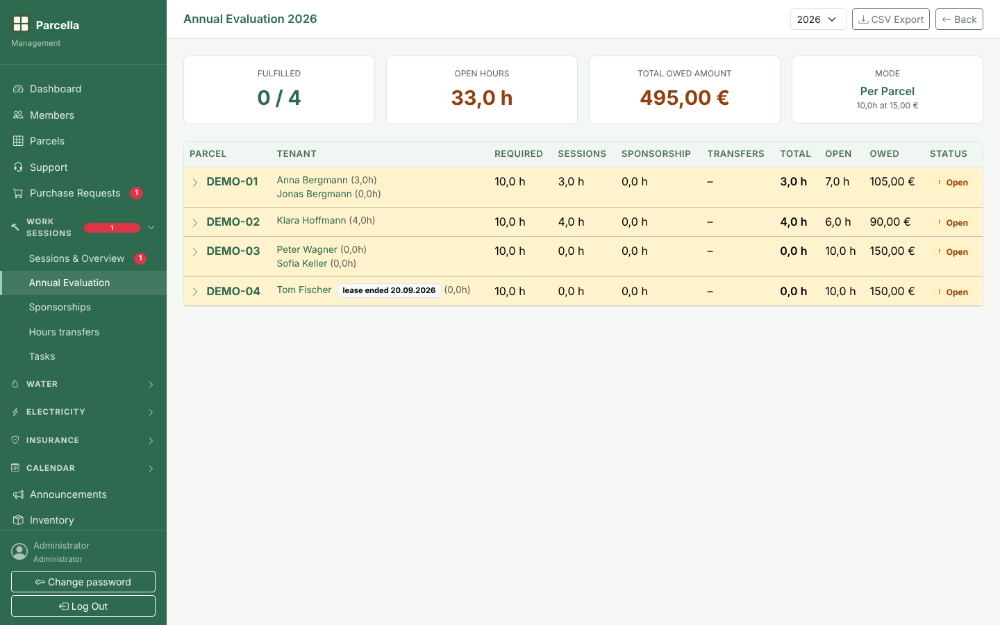
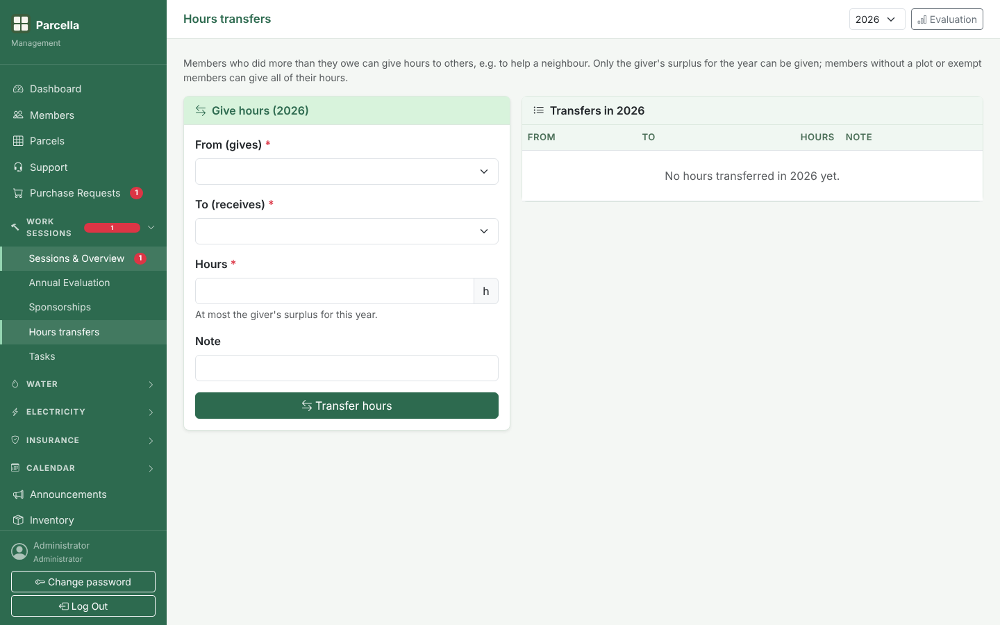

# Arbeitsstunden {#work-hours}

Die meisten Kleingartenvereine erwarten von jedem Mitglied oder jeder
Parzelle eine bestimmte Zahl an [Pflichtstunden](../glossary.md) im Jahr --
oder Geld für die Stunden, die nicht geleistet wurden. Dieses Modul plant die
Arbeitseinsätze des Vereins, hält fest, wer da war, rechnet Patenschaften und
Befreiungen an und ermittelt am Jahresende, wer noch Stunden schuldet und
wie viel Geld das ausmacht.

!!! info "Wer das nutzen kann"
    Das Modul ist standardmäßig eingeschaltet. Ausschalten kannst du es unter
    **Administration → Einstellungen** (**Pflichtstunden-Verwaltung**), wenn
    dein Verein keine Pflichtstunden erhebt -- siehe
    [Module ein- und ausschalten](../administration/modules.md). Beim
    Ausschalten wird nichts gelöscht.

    Admin- und Vorstandsbenutzer können alles. Andere Benutzer brauchen eine
    [Gruppe](../administration/groups.md), die Rechte für **Arbeitseinsätze**
    gewährt: *Lesen*, um die Seiten zu sehen, *Schreiben*, um etwas anzulegen
    und zu ändern, *Löschen*, um Einsätze, Teilnehmer, Patenschaften,
    Übertragungen, Aufgaben, Vereinsrollen und Jahreskonfigurationen zu
    entfernen. Ohne mindestens Leserecht erscheint das Menü
    **Arbeitseinsätze** nicht.

Du findest das Modul im Seitenmenü unter **Arbeitseinsätze**, mit diesen
Einträgen: **Einsätze & Übersicht**, **Jahresauswertung**,
**Patenschaften**, **Stundenübertragung** und **Aufgaben**. Die
Stunden-Konfiguration und die Vereinsrollen erreichst du über Schaltflächen
auf der Übersichtsseite.

## Wie die Stunden gezählt werden {#how-the-hours-are-counted}

Bevor du dir die einzelnen Seiten ansiehst, hilft es zu wissen, wie Parcella
ein Jahr zusammenrechnet. Für jedes Mitglied zählt es:

- **Arbeitseinsätze** -- jeden Einsatz in diesem Kalenderjahr, bei dem das
  Mitglied den Status **Erschienen** hat. Jede Teilnahme zählt mit den
  Stunden, die für diese Person eingetragen sind, oder, wenn keine
  eingetragen sind, mit den **Stunden pro Teilnehmer** des Einsatzes.
  **Angemeldet** und **Nicht erschienen** zählen nichts.
- **Patenschaften** -- die **Anrechenbaren Stunden/Jahr** jeder Patenschaft
  des Mitglieds, deren Zeitraum das Jahr berührt. Eine Patenschaft zählt
  erst, wenn sie ein Mitglied und ein Datum **Gültig ab** hat.
- **Stundenübertragungen** -- Stunden, die andere Mitglieder ihm gegeben
  haben (plus), abzüglich der Stunden, die es abgegeben hat (minus).

Was dann passiert, hängt vom **Abrechnungsmodus** ab, den du für das Jahr in
der [Konfiguration](#mandatory-hours-configuration) festlegst:

| Abrechnungsmodus | Was das für den Verein heißt |
|---|---|
| **Pro Pachtvertrag / Parzelle** | Jede Parzelle schuldet die Jahresstunden einmal. Die Stunden aller ihrer Pächter werden zusammengezählt: Leistet ein Pächter 2 Stunden und der andere 3, ist eine Pflicht von 5 Stunden erfüllt. |
| **Pro Mitglied** | Jedes Mitglied, das im Jahr eine Pacht hatte, schuldet die Stunden für sich. |

Offene Stunden werden mit dem **Stundensatz** multipliziert, daraus ergibt
sich der geschuldete Betrag.

### Befreiungen {#exemptions}

Ein Mitglied ist für ein Jahr befreit, wenn es für dieses Jahr eine
[Vereinsrolle](#club-roles) innehat, die als **Von Pflichtstunden befreit**
markiert ist -- typischerweise Vorstandsarbeit.

!!! warning "Ein befreiter Pächter befreit die ganze Parzelle"
    Im Modus **Pro Pachtvertrag / Parzelle** ist eine Parzelle befreit,
    sobald **mindestens einer** ihrer Pächter befreit ist. Die Mitpächter
    eines Vorstandsmitglieds schulden in diesem Jahr also auch nichts: Das
    Vorstandsamt „deckt“ die ganze Parzelle ab. Ob die anderen Pächter selbst
    befreit sind, spielt keine Rolle.

    Im Modus **Pro Mitglied** ist nur das befreite Mitglied befreit.

Eine Befreiung gilt immer für das **ganze Kalenderjahr**, für das die
Rollenzuordnung eingetragen ist. Ein Vorstandsmitglied, das im Oktober
zurücktritt, bleibt für den Rest des Jahres befreit; die Daten in **Von**
und **Bis** sind für deine Unterlagen und verkürzen die Befreiung nicht. Im
nächsten Jahr ordnest du die Rolle neu zu (oder nicht).

### Wer in einem Jahr als Pächter zählt {#who-counts-as-a-tenant-in-a-year}

Die Auswertung schaut, wer *im ausgewerteten Jahr* eine Parzelle hatte,
nicht, wer sie heute hat:

- Das Ende einer Pacht hebt die Stunden dieses Jahres nicht auf. Ein
  Pächter, der im Juni geht, schuldet trotzdem das ganze Jahr. Im Modus
  **Pro Pachtvertrag / Parzelle** bleibt er in der Zeile der Parzelle,
  zusammen mit dem, der die Parzelle übernommen hat; in beiden Modi bekommt
  er ein Badge **Pacht beendet**.
- Eine Pacht, die vor Beginn des Jahres geendet hat oder erst danach
  beginnt, zählt nicht.
- Ein Mitglied, das im Lauf des Jahres innerhalb des Vereins von einer
  Parzelle auf eine andere gewechselt ist, zählt nur bei der Parzelle, auf
  die es gewechselt ist.
- Ein Mitglied mit zwei Parzellen gleichzeitig schuldet die Stunden für
  jede Parzelle. Seine eigenen Stunden füllen die Parzellen in der
  Reihenfolge der Parzellennummern: Jede Parzelle bekommt, was ihr noch
  fehlt, die letzte den Rest. Beispiel: 7,5 Stunden bei einer Pflicht von 5
  Stunden: Die erste Parzelle ist mit 5 Stunden erfüllt, die zweite hat 2,5
  Stunden und 2,5 Stunden offen. Die Auswertung zeigt so einen Pächter als
  „5.0 von 7.5 h“.
- Gelöschte Mitglieder fallen aus jeder Auswertung heraus, auch aus
  vergangenen Jahren. Sollen die Stunden von jemandem, der gegangen ist,
  noch abgerechnet werden, beende seine Mitgliedschaft mit einem Enddatum,
  statt ihn zu löschen -- siehe [Mitglieder](members.md).

## Einsätze & Übersicht {#sessions-overview}

Die Startseite des Moduls, mit dem Titel **Pflichtstunden** und dem Jahr.
Hier planst du Einsätze und siehst auf einen Blick, ob neue Anmeldungen
eingegangen sind.

Gibt es für das gewählte Jahr noch keine Konfiguration, sagt ein gelbes
Banner **Keine Pflichtstunden-Konfiguration für … vorhanden.** mit einem
Link **Jetzt anlegen →**. Sonst zeigen drei Kacheln die Einstellungen des
Jahres.

| Feld / Schaltfläche | Was es bewirkt |
|---|---|
| Jahresauswahl (oben rechts) | Wechselt in ein anderes Jahr. Gelistet sind nur Jahre mit einer [Konfiguration](#mandatory-hours-configuration). |
| **Neuer Einsatz** | Öffnet das [Einsatzformular](#new-work-session-and-edit-session). Braucht Schreibrecht. |
| Kachel **Pflichtstunden** | Die in diesem Jahr geforderten Stunden, **à** Stundensatz. |
| Kachel **Modus** | **Pro Pachtvertrag** oder **Pro Mitglied** -- die Abrechnungseinheit für dieses Jahr. |
| Kachel **Max. Schuldbetrag** | Stunden × Satz: was eine Parzelle oder ein Mitglied **bei Null-Stunden** schuldet. |
| **Jahresauswertung** | Öffnet die [Jahresauswertung](#annual-evaluation) für dieses Jahr. |
| **CSV-Export** | Lädt die Auswertung als Tabelle herunter (siehe [CSV-Export](#csv-export)). |

### Tabelle der Arbeitseinsätze {#work-sessions-table}

Listet jeden Einsatz des gewählten Jahres, die neuesten zuerst.

| Spalte | Was sie zeigt |
|---|---|
| **Datum** | Das Datum des Einsatzes. |
| **Titel** | Verlinkt auf die [Seite des Einsatzes](#session-page). Eine rote Zahl daneben zählt neue Anmeldungen (siehe unten). |
| **Typ** | **Standard** (geplant) oder **Besonders** (spontan). |
| **Zeit** | Von -- bis oder „–“, wenn keine Uhrzeit eingetragen ist. |
| **Teilnehmer** | Zahl der Teilnehmer, „/ Maximum“, wenn eine Grenze gesetzt ist, und in Klammern, wie viele **erschienen** und wie viele **neu** sind. |
| Augen-Schaltfläche | Öffnet die Seite des Einsatzes. |

Hat das Jahr noch keine Einsätze, sagt die Tabelle **Noch keine
Arbeitseinsätze für ….** und bietet (mit Schreibrecht) **Ersten Einsatz
anlegen** an.

### Schnellzugriff {#quick-access}

Die Schaltflächen unter der Tabelle führen zu **Stunden-Konfiguration**,
**Vereinsrollen**, **Patenschaften** und **Aufgaben**.

### Neue Anmeldungen: Badges, Dashboard-Kachel und E-Mails {#new-sign-ups-badges-dashboard-tile-and-e-mails}

Parcella markiert eine Teilnahme 14 Tage lang nach ihrem Anlegen als *neu*
-- egal ob sich jemand über die Vereinswebsite angemeldet hat oder ein
Vorstandsmitglied jemanden von Hand eingetragen hat. Gezählt werden nur
**Standard**-Einsätze, die noch nicht stattgefunden haben; das Erfassen der
Anwesenheit bei einem vergangenen oder einem **Besonderen** Einsatz
erscheint nie als „neu“.

Neue Anmeldungen siehst du an vier Stellen:

- eine rote Zahl neben **Arbeitseinsätze** und **Einsätze & Übersicht** im
  Seitenmenü,
- die Kachel **Neue Anmeldungen** auf dem
  [Dashboard](../getting-started/dashboard.md), mit einer Schaltfläche
  **Alle anzeigen**, die hierher führt,
- die rote Zahl neben dem Titel des Einsatzes in der Tabelle oben,
- ein rotes Badge **Neu** neben dem Teilnehmer auf der Seite des Einsatzes.

Hast du sie dir angesehen, klick auf der
[Seite des Einsatzes](#session-page) auf **Als gesehen markieren**. Das
entfernt die „neu“-Markierung bei allen, die in diesem Moment beim Einsatz
eingetragen sind. Wer sich danach anmeldet, ist wieder als neu markiert.

Außerdem schickt Parcella E-Mails an jeden aktiven Benutzer mit der Rolle
Admin oder Vorstand:

- **Trägt ein Vorstandsmitglied einen Teilnehmer von Hand ein**, bekommen
  die anderen Admin- und Vorstandsbenutzer eine E-Mail je Teilnehmer. Wer
  ihn eingetragen hat, bekommt keine.
- **Melden sich Leute über die Vereinswebsite an**, bekommen alle eine
  Sammel-E-Mail je Anmeldung, egal für wie viele Einsätze und
  Haushaltsmitglieder sie gilt.

## Anmeldungen über die Vereinswebsite {#sign-ups-through-the-club-website}

Hat die Website deines Vereins (zum Beispiel WordPress) ein
Anmeldeformular für Arbeitseinsätze, können sich Gärtner ohne
Parcella-Zugang anmelden. Das braucht das Modul **Öffentliche
Anmelde-API**, das **standardmäßig aus** ist, weil es Parcella für
Einsendungen aus dem Internet öffnet. Schalte es unter **Administration →
Einstellungen** ein und richte dann die Website-Verbindung unter
[Integrationen](../administration/integrations.md) ein. Was die Gärtner
sehen, steht unter [Für Gärtner](../gardeners/index.md).

Aus Sicht des Vorstands passiert Folgendes:

- **Welche Einsätze angeboten werden.** Nur **Standard**-Einsätze, deren
  Datum noch nicht vorbei ist. Ein Einsatz mit **Anmeldeschluss (Tage
  vorher)** verschwindet so viele Tage früher von der Website.
  **Besondere** Einsätze erscheinen nie auf der Website.
- **Wer angemeldet wird.** Der Gärtner gibt seine Parzellennummer und,
  freiwillig, seinen Namen ein. Parcella vergleicht den Namen mit den
  *aktuellen* Pächtern der Parzelle. Passt er auf genau eine Person, wird
  nur diese angemeldet. Fehlt der Name oder passt er nicht eindeutig auf
  eine Person, wird **jeder aktuelle Pächter der Parzelle** angemeldet,
  damit keine Anmeldung verloren geht. Eine Parzelle ohne aktuelle Pächter
  kann sich nicht anmelden.
- **Volle Einsätze.** Hat der Einsatz nicht genug freie Plätze für alle,
  die angemeldet würden, wird die Anmeldung für diesen Einsatz als Ganzes
  abgelehnt. Teilnehmer mit **Nicht erschienen** belegen keinen Platz.
- **Keine Doppelten.** Wer sich zweimal für denselben Einsatz anmeldet,
  erzeugt keinen zweiten Eintrag.
- **Was du siehst.** Die Anmeldungen erscheinen als normale Teilnehmer mit
  Status **Angemeldet**, einem Badge **Neu** und einer **Notiz** wie
  „Öffentliche Anmeldung, per Name zugeordnet (Parzelle G012) | Telefon:
  …“. Wurden alle Pächter angemeldet, sagt die Notiz das und bittet dich,
  wer sich nicht wirklich angemeldet hat, wieder zu entfernen.
- **Bestätigung an den Gärtner.** Jedes neu angemeldete Mitglied bekommt
  eine Bestätigungs-E-Mail an die Adresse aus seinem Mitgliedseintrag --
  nie an eine Adresse, die ins Website-Formular getippt wurde. Den Text
  änderst oder die Mail abschaltest du in der
  [Konfiguration](#sign-up-confirmation-email).

!!! tip "Wenn Anmeldungen von der Website eingehen"
    Öffne den Einsatz, prüf die Notizen der neuen Teilnehmer, entferne alle,
    die nur vorsorglich angemeldet wurden (braucht Löschrecht), und klick
    auf **Als gesehen markieren**.

## Seite des Einsatzes {#session-page}

Ein Klick auf den Titel eines Einsatzes öffnet ihn. Hier pflegst du vor dem
Einsatz die Teilnehmerliste und erfasst danach die Anwesenheit.

| Schaltfläche (oben) | Was sie bewirkt |
|---|---|
| **Bearbeiten** | Öffnet das [Einsatzformular](#new-work-session-and-edit-session). Braucht Schreibrecht. |
| **Teilnehmerliste** | Lädt ein PDF zum Ausdrucken und Mitnehmen zum Einsatz herunter (siehe unten). |
| **Löschen** | Löscht den Einsatz nach einer Bestätigung. **Alle Teilnahmen gehen verloren**, die Stunden zählen also für niemanden mehr. Für den Einsatz geplante Aufgaben gehen zurück in den Rückstand. Braucht Löschrecht. |
| **Zurück** | Führt zur Übersicht zurück. |

### Details {#details}

Zeigt **Typ** (**Standard** oder **Besonders**), **Datum**, **Uhrzeit**,
**Plätze** (Teilnehmer / Maximum), **Std./Person** und die Beschreibung.

### Teilnehmer {#participants}

Der Kartenkopf zählt, wie viele Teilnehmer **erschienen** und wie viele
**angemeldet** sind. Gibt es neue Anmeldungen und hast du Schreibrecht,
zeigt er auch **Als gesehen markieren** (siehe
[Neue Anmeldungen](#new-sign-ups-badges-dashboard-tile-and-e-mails)).

Tipp in **Nach Mitglied oder Parzellennummer suchen…**, um die Tabelle zu
filtern.

| Spalte | Was sie zeigt / bewirkt |
|---|---|
| **Mitglied** | Name, verlinkt auf den Mitgliedseintrag. Ein rotes Badge **Neu** kennzeichnet eine neue Anmeldung. |
| **Parzelle** | Die aktuelle(n) Parzelle(n) des Mitglieds. |
| **Status** | **Angemeldet**, **Erschienen** oder **Nicht erschienen**. Mit Schreibrecht speichert die Wahl eines anderen Werts sofort. Nur **Erschienen** zählt für die Stunden des Mitglieds. |
| **Stunden** | Die dieser Person angerechneten Stunden. Das Feld ist mit ihren eigenen Stunden vorbelegt oder, wenn keine eingetragen sind, mit den **Stunden pro Teilnehmer** des Einsatzes. Ändern und mit **✓** speichern. Ohne Schreibrecht siehst du nur die Zahl. |
| **Notiz** | Zum Beispiel die Angaben, die jemand ins Website-Formular eingetragen hat. |
| **×** | Entfernt den Teilnehmer nach einer Bestätigung. Braucht Löschrecht. |

!!! tip "Anwesenheit nach dem Einsatz erfassen"
    Setz alle, die gekommen sind, auf **Erschienen** und korrigier die
    Stunden von allen, die kürzer oder länger geblieben sind. Lass Leute,
    die nicht gekommen sind, auf **Nicht erschienen**, statt sie zu
    entfernen -- so siehst du später, wer erwartet wurde.

**Einen Teilnehmer hinzufügen** (Schreibrecht): Unten in der Karte tippst du
einen Namen oder eine Parzellennummer in **Mitglied wählen…** und wählst das
Mitglied aus der Liste -- du musst jemanden aus der Liste wählen, nur einen
Namen tippen reicht nicht. Mitglieder, die schon beim Einsatz sind, werden
nicht angeboten. Wähl den Status (**Erschienen** ist vorausgewählt, weil das
meist zum nachträglichen Erfassen genutzt wird), trag bei Bedarf Stunden ein
(leer heißt: Vorgabe des Einsatzes) und klick auf **Hinzufügen**.

Von Hand jemanden hinzufügen geht immer, auch wenn der Einsatz voll ist,
sein Anmeldeschluss vorbei ist oder er in der Vergangenheit liegt -- die
Grenzen gelten nur für Anmeldungen über die Website.

### Aufgaben {#tasks}

Listet die für diesen Einsatz geplanten [Aufgaben](#tasks_1) mit
**Aufgabe**, **Aufwand** und **Zugewiesen an**. Mit Schreibrecht wählst du
in **Zugewiesen an** einen der Teilnehmer des Einsatzes (oder **Noch nicht
zugewiesen**) und markierst eine Aufgabe mit der Häkchen-Schaltfläche als
erledigt oder nicht erledigt. Erledigte Aufgaben sind durchgestrichen.
**Aufgaben verwalten** öffnet den Aufgaben-Rückstand.

### Teilnehmerliste {#attendee-sheet}

Das PDF listet jeden Teilnehmer des Einsatzes, sortiert nach Parzelle und
Name, mit den Spalten **Parzelle**, **Mitglied**, **Stunden**,
**Zugewiesene Aufgaben** und **Unterschrift**. **Stunden** zeigt die
persönlichen Stunden oder die Vorgabe des Einsatzes und bleibt leer, wenn es
keins von beiden gibt. **Zugewiesene Aufgaben** bleibt leer, solange noch
keine Aufgabe zugewiesen ist, damit du von Hand eine eintragen kannst. Die
Liste läuft bei Bedarf über mehrere Seiten.

Der Ausdruck ändert nichts in Parcella: Trag nach dem Einsatz den
korrigierten Status und die Stunden auf der Seite des Einsatzes ein.

## Neuer Arbeitseinsatz und Einsatz bearbeiten {#new-work-session-and-edit-session}

Geöffnet mit **Neuer Einsatz** auf der Übersicht oder **Bearbeiten** auf der
Seite eines Einsatzes. Braucht Schreibrecht.

| Feld | Was es bewirkt |
|---|---|
| **Titel** | Pflicht. Zum Beispiel „Frühjahrsputz“. |
| **Typ** | **Standard (geplant)** für vorausgeplante Einsätze, **Besonders (spontan)** für ungeplante. Nur Standard-Einsätze erscheinen auf der Vereinswebsite und zählen als neue Anmeldungen. |
| **Datum** | Pflicht. Die Stunden des Einsatzes zählen für das Kalenderjahr dieses Datums. |
| **Von** / **Bis** | Freiwillige Anfangs- und Endzeit. |
| **Max. Teilnehmer** | Leer = unbegrenzt. Begrenzt die Anmeldungen über die Website; Vorstandsmitglieder können trotzdem weitere Leute von Hand eintragen. |
| **Anmeldeschluss (Tage vorher)** | Schließt die Website-Anmeldung so viele Tage vor dem Einsatz -- 1 schließt sie am Vortag. Leer lassen, damit sie offen bleibt, bis das Datum vorbei ist. Wirkt nicht auf das Eintragen in Parcella. |
| **Stunden pro Teilnehmer** | Die Vorgabe-Stunden je Teilnehmer, zum Beispiel 4,0. Beim Erfassen der Anwesenheit kannst du sie je Person noch ändern. |
| **Beschreibung** | Aufgaben, Werkzeug, besondere Hinweise. |
| **Abbrechen** / **Einsatz anlegen** oder **Änderungen speichern** | Speichern führt zur Seite des Einsatzes. |

## Jahresauswertung {#annual-evaluation}

Zeigt für jede Parzelle oder jedes Mitglied, wie viele Stunden gefordert
waren, wie viele geleistet wurden und was noch offen ist. Du öffnest sie aus
dem Menü (**Jahresauswertung**) oder über die Übersicht. Mit dieser Liste
arbeitest du am Jahresende, und die Rechnungsstellung nutzt sie für die
Position **Pflichtstunden-Fehlbetrag (aus Modul)** (siehe
[Rechnungsläufe](finances/invoice-runs.md)).

| Schaltfläche | Was sie bewirkt |
|---|---|
| Jahresauswahl | Wechselt das Jahr. Gelistet sind nur konfigurierte Jahre. |
| **CSV-Export** | Lädt die Auswertung herunter (siehe unten). |
| **Zurück** | Führt zur Übersicht zurück. |

Ohne Konfiguration für das Jahr zeigt die Seite nur das gelbe Banner
**Keine Pflichtstunden-Konfiguration für … vorhanden.**

Die vier Kacheln oben zeigen, wie viele Zeilen **Erfüllt** sind (z. B.
„18 / 25“), die gesamten **Offenen Stunden**, den **Schuldbetrag gesamt**
und den **Modus** mit Stunden und Satz.

### Die Tabelle {#the-table}

Zeilen sind grün, wenn sie erfüllt sind, und gelb, wenn Stunden offen sind.

| Spalte | Was sie zeigt |
|---|---|
| **Parzelle** und **Pächter** (Modus Pro Pachtvertrag) | Eine Zeile je Parzelle, die im Jahr mindestens einen Pächter hatte, auch Parzellen, deren Pacht gekündigt wurde. Jeder Pächter steht mit seinen Stunden in Klammern da, mit einem Badge **befreit**, wenn er befreit ist, einem Badge **Pacht beendet** mit Datum, wenn seine Pacht im Jahr geendet hat, und „x von y h“, wenn er mehrere Parzellen hat. |
| **Mitglied** (Modus Pro Mitglied) | Eine Zeile je Mitglied, das im Jahr eine Pacht hatte, gegebenenfalls mit Badge **Pacht beendet**. |
| **Pflicht** | Die Jahrespflicht. |
| **Einsätze** | Stunden aus Arbeitseinsätzen mit Status Erschienen. |
| **Patenschaft** | Aus Patenschaften angerechnete Stunden. |
| **Übertragen** | Erhaltene (+) oder abgegebene (−) Stunden. „–“, wenn keine. |
| **Gesamt** | Einsätze + Patenschaft + Übertragungen. |
| **Offen** | Noch fehlende Stunden. „–“ bei befreiten Zeilen. |
| **Schuldbetrag** | Offene Stunden × Stundensatz. „–“ bei befreiten Zeilen. |
| **Status** | **Befreit**, **Erfüllt** oder **Offen**. |

Ein Klick auf den Pfeil vor einer Zeile (**Arbeitseinsätze anzeigen**)
zeigt die **Besuchten Arbeitseinsätze** dieses Jahres: Datum, Einsatz
(verlinkt) und Stunden -- im Modus Pro Pachtvertrag eine Liste je Pächter.
Die Liste ergibt immer die Spalte **Einsätze**. Patenschaften und
Übertragungen gehören nicht dazu.

### CSV-Export {#csv-export}

Die CSV-Datei nutzt Semikolons und die Spaltenüberschriften der
Auswertungsseite, in der Sprache des Vereins: Parzelle, Pächter, Pflicht
(h), Einsätze (h), Patenschaft (h), Übertragen (h), Gesamt (h), Offen (h),
Schuldbetrag (EUR), Befreit und Erfüllt, mit „Ja“/„Nein“ in dieser Sprache
für ja/nein.

!!! warning "Der CSV-Export funktioniert nur im Modus Pro Pachtvertrag"
    In einem Jahr mit **Pro Mitglied** enthält die CSV-Datei nur die
    Überschriftenzeile. Nimm stattdessen die Auswertungsseite.

!!! warning "Parzellen, die niemand mehr hat"
    Sind alle Pächter einer Parzelle im Lauf des Jahres gegangen und wurde
    die Parzelle nicht wieder verpachtet, zeigt sie trotzdem ihre offenen
    Stunden, aber die automatische Rechnung kann sie nicht abrechnen, weil
    die Parzelle keinen aktuellen Pächter als Empfänger hat. Rechne so
    jemanden von Hand ab. Wurde die Parzelle wieder verpachtet, bekommt der
    neue Pächter die Rechnung der Parzelle für das Jahr.

## Patenschaften {#sponsorships}

Eine Patenschaft ist ein Bereich der Anlage, um den sich ein Mitglied das
ganze Jahr kümmert -- eine Hecke, der Spielplatz, der Eingang --, statt zu
Arbeitseinsätzen zu kommen. Jedem Paten wird eine feste Stundenzahl pro
Jahr angerechnet. Du öffnest die Seite über **Patenschaften** im Menü oder
auf der Übersicht.

Die Seite hat drei Teile: das Formular zum Anlegen einer Patenschaft
(Schreibrecht), **Aktive Patenschaften** und **Frühere Patenschaften**.

### Patenschaft anlegen / Mitglied hinzufügen {#create-sponsorship-add-member}

| Feld | Was es bewirkt |
|---|---|
| **Bereich** | Pflicht. Schlägt die schon verwendeten Bereichsnamen vor. Wähl einen bestehenden Bereich, um ihm ein weiteres Mitglied hinzuzufügen -- mehrere Leute können sich einen Bereich teilen, und **jeder von ihnen** bekommt die vollen anrechenbaren Stunden. |
| **Mitglied** | Zuerst nach Parzellennummer gelistet („G001 - Peter Ahnert“); Mitglieder ohne Parzelle kommen zuletzt. Lass es auf **– noch nicht vergeben –**, um einen Bereich auszuschreiben, den noch niemand übernommen hat. |
| **Beschreibung** | Was genau gepflegt wird. |
| **Anrechenbare Stunden/Jahr** | Pflicht. Vorbelegt mit den Pflichtstunden aus der Konfiguration des Jahres; du kannst sie ändern, wenn der Bereich mehr oder weniger Aufwand macht. |
| **Gültig ab** | Leer = noch von niemandem übernommen. |
| **Gültig bis** | Leer = läuft noch. Darf nicht vor **Gültig ab** liegen. |
| **Speichern** | Legt den Eintrag an. |

!!! info "Wann eine Patenschaft zählt"
    Eine Patenschaft rechnet ihre Stunden für jedes Jahr an, das ihr
    Zeitraum berührt -- voll, auch wenn sie mitten im Jahr geendet hat. Sie
    zählt erst, wenn sie ein **Mitglied** und ein Datum **Gültig ab** hat.
    Ein Eintrag ohne Startdatum ist ein offenes Angebot und zählt noch für
    niemanden.

Gibst du ein Enddatum vor dem Startdatum ein, speichert Parcella nicht und
zeigt eine Meldung, dass das Enddatum vor dem Startdatum liegt. Deine
Eingaben bleiben erhalten, damit du sie korrigieren kannst. Ältere Einträge,
die mit solchen Daten gespeichert wurden, zeigen ein rotes Badge **Ende vor
Beginn** und zählen in keinem Jahr, bis du sie korrigierst.

### Aktive Patenschaften {#active-sponsorships}

Listet die Patenschaften für das Jahr im Kartenkopf (**im Jahr …**), die
noch nicht geendet haben, und alle offenen Angebote. Einträge mit demselben
Bereich sind gruppiert, mit einem Badge „… Personen“.

| Spalte | Was sie zeigt / bewirkt |
|---|---|
| **Bereich** | Name und Beschreibung. |
| **Mitglied(er)** | Verlinktes Mitglied oder *noch nicht vergeben*. |
| **Stunden/Jahr** | Anrechenbare Stunden. |
| **Zeitraum** | Von – bis (oder *läuft noch*) oder *noch nicht übernommen*. |
| Stift | Öffnet [Patenschaft bearbeiten](#edit-sponsorship). Braucht Schreibrecht. |
| Papierkorb | Löscht den Eintrag nach einer Bestätigung. Braucht Löschrecht. |

Aus dem Menü geöffnet, zeigt die Seite das aktuelle Jahr. Die Schaltfläche
**Patenschaften** auf der Übersicht öffnet sie für das dort gewählte Jahr.

### Frühere Patenschaften {#former-sponsorships}

Jede Patenschaft, deren Datum **Gültig bis** vorbei ist, das späteste
Enddatum zuerst, unabhängig vom angezeigten Jahr -- eine dauerhafte
Übersicht. Gleiche Spalten und Aktionen wie oben.

## Patenschaft bearbeiten {#edit-sponsorship}

Geöffnet mit dem Stift auf der Patenschaftsseite. Braucht Schreibrecht. Die
Seite hat dieselben Felder wie das Anlegeformular: **Bereich**,
**Mitglied**, **Beschreibung**, **Anrechenbare Stunden/Jahr**, **Gültig ab**
und **Gültig bis**, mit **Abbrechen** und **Änderungen speichern**. Es gilt
dieselbe Datumsprüfung. Nach dem Speichern kommst du zurück zur
Patenschaftsseite für das Jahr, in dem die Patenschaft beginnt.

## Stundenübertragungen {#hours-transfers}

Ein Mitglied, das mehr geleistet hat, als es schuldet, kann Stunden an ein
anderes Mitglied abgeben, zum Beispiel um einem Nachbarn zu helfen. Öffne
**Stundenübertragung** im Menü.

| Feld / Schaltfläche | Was es bewirkt |
|---|---|
| Jahresauswahl | Wechselt das Jahr. Listet konfigurierte Jahre. |
| **Auswertung** | Öffnet die Jahresauswertung für dieses Jahr. |

### Stunden übertragen {#give-hours}

Braucht Schreibrecht und eine Konfiguration für das Jahr; sonst sagt die
Karte **Keine Konfiguration für …**.

| Feld | Was es bewirkt |
|---|---|
| **Von (gibt ab)** | Pflicht. Alle, die irgendwann im Jahr Mitglied waren, nach Parzellennummer. |
| **An (erhält)** | Pflicht. Darf nicht dasselbe Mitglied sein. |
| **Stunden** | Pflicht, eine positive Zahl (auf eine Nachkommastelle gerundet). Höchstens der Überschuss des Gebenden in diesem Jahr. |
| **Notiz** | Freiwillig, z. B. der Grund. |
| **Stunden übertragen** | Speichert die Übertragung. |

**Wie viel abgegeben werden kann.** Parcella prüft beim Speichern den
Überschuss des Gebenden:

- **Pro Mitglied**: die eigene Summe des Gebenden minus die Pflicht.
- **Pro Pachtvertrag / Parzelle**: der Überschuss der Parzelle des Gebenden
  -- die Parzelle muss erfüllt bleiben -- und nie mehr als die eigenen
  Stunden des Gebenden. Die Stunden eines Mitpächters kann niemand anderes
  abgeben.
- Befreite Mitglieder und Helfer ohne Parzelle in diesem Jahr können alle
  ihre eigenen Stunden abgeben.

Ist es zu viel, sagt ein rotes Banner, wie viele Stunden abgegeben werden
können, zum Beispiel **Es können nur 2.0 h übertragen werden -- das ist der
Überschuss des Gebenden in diesem Jahr.**

!!! note
    Die Prüfung passiert nur einmal, beim Speichern der Übertragung. Wird
    die Anwesenheit später korrigiert (oder eine Übertragung gelöscht, auf
    der sie beruhte), kann dem Gebenden am Ende etwas fehlen; die Auswertung
    zeigt dann einfach die offenen Stunden.

### Übertragungen … {#transfers-in}

Listet die Übertragungen des Jahres mit **Von**, **An**, **Stunden** und
**Notiz**, dazu das Datum und wer sie eingetragen hat. Der Papierkorb löscht
eine Übertragung nach der Bestätigung **Diese Übertragung löschen? Die
Stunden gehen an den Gebenden zurück.** (Löschrecht). Falsche Einträge
werden gelöscht, nicht als Verlauf aufbewahrt -- sie sind Korrekturen, keine
Vereinsgeschichte.

## Aufgaben {#tasks_1}

Ein Rückstand an Arbeiten, die erledigt werden müssen, die du für einen
Arbeitseinsatz einplanen und an die Angemeldeten verteilen kannst. Öffne
**Aufgaben** im Menü, auf der Übersicht oder **Aufgaben verwalten** auf der
Seite eines Einsatzes.

Jede Aufgabe trägt ein Etikett **Arbeitsaufwand** -- **Leicht**, **Mittel**
oder **Anspruchsvoll** --, damit wer einen Einsatz koordiniert, jeder Person
passende Arbeit geben kann. Mehr speichert Parcella nicht: Es gibt kein Feld
für Alter oder Gesundheit eines Mitglieds, und nichts wird automatisch
zugeordnet. Wer was macht, bleibt die Entscheidung der Koordination.

### Neue Aufgabe {#new-task}

Braucht Schreibrecht.

| Feld | Was es bewirkt |
|---|---|
| **Titel** | Pflicht. Zum Beispiel „Hecke Nordseite schneiden“. |
| **Beschreibung** | Alles, was man vor dem Start wissen sollte. |
| **Arbeitsaufwand** | **Leicht**, **Mittel** (vorausgewählt) oder **Anspruchsvoll**. Nur eine Orientierung, nicht erzwungen. |
| **Arbeitseinsatz** | Einer der anstehenden Einsätze oder **-- Rückstand (noch nicht geplant) --**, um sie später einzuplanen. |
| **Aufgabe hinzufügen** | Speichert die Aufgabe. |

### Rückstand {#backlog}

Aufgaben ohne Einsatz, die neuesten zuerst, mit **Aufgabe**, **Aufwand** und
**Einplanen zu**. Wählst du in **Einplanen zu** einen Einsatz, wandert die
Aufgabe sofort dorthin (Schreibrecht). Angeboten werden nur Einsätze ab
heute. Der Papierkorb löscht die Aufgabe (Löschrecht).

### Geplante Aufgaben {#scheduled-tasks}

Unter dem Rückstand eine Karte je Einsatz mit Aufgaben (der neueste Einsatz
zuerst), mit Datum und Titel des Einsatzes verlinkt. Spalten: **Aufgabe**,
**Aufwand**, **Zugewiesen an**, eine Häkchen-Schaltfläche zum Markieren als
erledigt oder nicht erledigt (Schreibrecht) und ein Papierkorb zum Löschen
(Löschrecht). Erledigte Aufgaben sind durchgestrichen.

Einer Person weist du eine Aufgabe auf der [Seite des Einsatzes](#tasks) zu,
wo die Liste **Zugewiesen an** die Teilnehmer dieses Einsatzes anbietet --
eine Zuweisung ergibt nur für jemanden Sinn, der sich für diesen Einsatz
angemeldet hat.

## Vereinsrollen {#club-roles}

Vereinsämter -- Vorsitz, Kasse, Wasserwart -- und wer sie in welchem Jahr
innehat. Eine als befreit markierte Rolle befreit ihren Inhaber (und im
Modus Pro Pachtvertrag seine ganze Parzelle) für dieses Jahr von den
Pflichtstunden. Du öffnest die Seite mit **Vereinsrollen** auf der
Übersicht.

| Feld / Schaltfläche | Was es bewirkt |
|---|---|
| Jahresauswahl | Das Jahr, dessen Rollenzuordnungen angezeigt und angelegt werden. Bietet das aktuelle Jahr und die vier davor an. |
| **Zurück** | Führt zur Übersicht zurück. |

### Neue Vereinsrolle {#new-club-role}

Braucht Schreibrecht.

| Feld | Was es bewirkt |
|---|---|
| **Bezeichnung** | Pflicht, z. B. „Vorsitz“. |
| **Beschreibung** | Aufgaben dieser Rolle. |
| **Von Pflichtstunden befreit** | Anhaken, wenn die Inhaber keine Arbeitsstunden leisten müssen. |
| **Befreiungsgrund** | Erscheint, wenn das Kästchen angehakt ist: **Vorstandsarbeit**, **Erweiterter Vorstand**, **Krankheit / gesundheitliche Gründe**, **Altersbefreiung** oder **Sonstiger Grund**. Für deine Unterlagen; an der Wirkung der Befreiung ändert er nichts. |
| **Rolle anlegen** | Speichert die Rolle. |

### Bestehende Rollen {#existing-roles}

Listet alle Rollen mit **Name** (und Beschreibung) und **Befreit**
(**Ja**/**Nein**). Der Stift öffnet [Vereinsrolle bearbeiten](#edit-club-role)
(Schreibrecht). Der Papierkorb löscht die Rolle nach der Warnung **Rolle
wirklich löschen? Alle Zuordnungen gehen verloren.** (Löschrecht).

!!! warning "Eine Rolle löschen ändert vergangene Jahre"
    Mit der Rolle werden die Zuordnungen *aller* Jahre gelöscht; Mitglieder,
    die in früheren Jahren befreit waren, sind es dann auch in den
    Auswertungen dieser Jahre nicht mehr. Lösch nur eine Rolle, die du
    versehentlich angelegt hast.

### Mitglieder in Vereinsrollen {#members-in-club-roles}

Ordnet Mitglieder für das oben gewählte Jahr Rollen zu. Braucht
Schreibrecht.

| Feld | Was es bewirkt |
|---|---|
| **Mitglied** | Pflicht. Aktuelle Mitglieder, alphabetisch. |
| **Vereinsrolle** | Pflicht. |
| **Von** / **Bis** | Freiwillige Daten der Amtszeit. Leeres **Bis** = läuft noch. Nur für deine Unterlagen -- die Befreiung gilt immer für das ganze Jahr. |
| **Zuordnen** | Speichert die Zuordnung. Dasselbe Mitglied zweimal derselben Rolle im selben Jahr zuzuordnen bewirkt nichts. |

Die Tabelle zeigt die Zuordnungen des Jahres mit **Mitglied**, **Rolle**,
**Befreit**, **Von**, **Bis** (oder *läuft noch*) und **Notiz**. Der Stift
öffnet [Zuordnung bearbeiten](#edit-assignment) (Schreibrecht); **×**
entfernt die Zuordnung nach einer Bestätigung (Löschrecht).

!!! tip "Jedes Jahr neu"
    Rollenzuordnungen gehören zu einem Jahr. Wähl zu Beginn eines neuen
    Jahres dieses oben aus und ordne den Vorstand neu zu, sonst ist in
    diesem Jahr niemand befreit. Für ein künftiges Jahr, das die Auswahl
    noch nicht anbietet, legst du die Zuordnung an und änderst ihr **Jahr**
    unter [Zuordnung bearbeiten](#edit-assignment).

## Vereinsrolle bearbeiten {#edit-club-role}

Geöffnet mit dem Stift neben einer Rolle. Dieselben Felder wie beim Anlegen:
**Bezeichnung**, **Beschreibung**, **Von Pflichtstunden befreit** und
**Befreiungsgrund**, mit **Abbrechen** und **Änderungen speichern**. Änderst
du, ob eine Rolle befreit, gilt das für jedes Jahr, in dem sie zugeordnet
war, vergangene Jahre eingeschlossen.

## Zuordnung bearbeiten {#edit-assignment}

Geöffnet mit dem Stift neben einer Zuordnung (**Mitglied in Vereinsrolle
bearbeiten**).

| Feld | Was es bewirkt |
|---|---|
| **Mitglied** | Pflicht. |
| **Vereinsrolle** | Pflicht. |
| **Jahr** | Pflicht. Die Befreiung von den Pflichtstunden gilt für dieses ganze Kalenderjahr. |
| **Von** / **Bis** | Freiwillige Daten der Amtszeit; leeres **Bis** = läuft noch. |
| **Notiz** | Z. B. Grund des Rücktritts, Übergabe an … |
| **Abbrechen** / **Änderungen speichern** | Speichern führt zu den Vereinsrollen des Jahres der Zuordnung zurück. |

## Pflichtstunden-Konfiguration {#mandatory-hours-configuration}

Die Regeln des Jahres: wie viele Stunden, was eine nicht geleistete Stunde
kostet und ob je Parzelle oder je Mitglied gezählt wird. Jedes Jahr hat
seine eigene Konfiguration; ändert sich der Satz im nächsten Jahr, bleiben
vergangene Jahre unberührt. Du öffnest sie mit **Stunden-Konfiguration** auf
der Übersicht oder **Jetzt anlegen →** in einem Warnbanner.

Ohne Konfiguration für ein Jahr lässt sich das Jahr nicht auswerten, es
lassen sich keine Stunden übertragen, und die Rechnungsstellung berechnet
keinen Pflichtstunden-Fehlbetrag.

### Jahr anlegen / aktualisieren {#create-update-year}

Braucht Schreibrecht.

| Feld | Was es bewirkt |
|---|---|
| **Jahr** | Pflicht, vorbelegt mit dem aktuellen Jahr. |
| **Pflichtstunden gesamt** | Pflicht, z. B. 5,0. |
| **Stundensatz** | Pflicht. Wert je nicht geleisteter Stunde, in der Währung des Vereins. |
| **Abrechnungsmodus** | **Pro Pachtvertrag / Parzelle**: Alle Pächter einer Parzelle erbringen die Pflichtstunden gemeinsam. **Pro Mitglied**: Jedes Mitglied erbringt seine Stunden für sich. |
| **Notiz** | Z. B. der Beschluss der Mitgliederversammlung, aus dem die Zahlen stammen. |
| **Speichern** | Speichert das Jahr. Hat das Jahr schon eine Konfiguration, wird sie mit diesen Werten **überschrieben**. |

### Bestätigungs-E-Mail zur Anmeldung {#sign-up-confirmation-email}

Braucht Schreibrecht. Steuert die E-Mail, die ein Mitglied nach einer
Anmeldung über die Vereinswebsite bekommt (siehe
[Anmeldungen über die Vereinswebsite](#sign-ups-through-the-club-website)).

| Feld | Was es bewirkt |
|---|---|
| **Bestätigungs-E-Mail verschicken** | Standardmäßig an. Haken entfernen, um keine Bestätigungen zu verschicken. |
| **Dein Text** | Reiner Text; eine Leerzeile beginnt einen neuen Absatz. Leer lassen, um den grau angezeigten Standardtext zu nutzen. Bis zu 5.000 Zeichen. |
| **Speichern** | Speichert beide Einstellungen und zeigt **Bestätigung zur Anmeldung gespeichert.** |

Die E-Mail geht an die E-Mail-Adresse, die bei jedem angemeldeten Mitglied
hinterlegt ist, nie an eine Adresse, die ins Website-Formular getippt wurde.
Ihr Betreff nennt die Anmeldung zum Arbeitseinsatz und das Datum. Unter
deinem Text fügt Parcella Titel, Datum und Uhrzeit des Einsatzes an und --
nur wenn der Name auf genau ein Mitglied gepasst hat -- die Bemerkungen, die
eingetippt wurden (bis zu 500 Zeichen). Scheitert der Versand, bleibt die
Anmeldung trotzdem bestehen.

### Historische Konfigurationen {#historical-configurations}

Alle konfigurierten Jahre, die neuesten zuerst.

| Spalte | Was sie zeigt / bewirkt |
|---|---|
| **Jahr**, **Stunden**, **Satz** | Die Einstellungen des Jahres. |
| **Max. Schuld** | Stunden × Satz. |
| **Modus** | **Pachtvertrag** oder **Mitglied**. |
| **Notiz** | Deine Notiz. |
| Stift | Öffnet [Konfiguration bearbeiten](#edit-configuration). Braucht Schreibrecht. |
| Papierkorb | Löscht die Konfiguration des Jahres nach einer Bestätigung. Braucht Löschrecht. Einsätze, Patenschaften und Übertragungen bleiben, aber das Jahr lässt sich nicht mehr auswerten oder abrechnen. |

## Konfiguration bearbeiten {#edit-configuration}

Geöffnet mit dem Stift neben einem Jahr. Die Felder sind dieselben wie oben
-- **Jahr**, **Pflichtstunden gesamt**, **Stundensatz**,
**Abrechnungsmodus** und **Notiz** --, mit **Abbrechen** und **Änderungen
speichern**. Du kannst das Jahr selbst ändern; gibt es für das neue Jahr
schon eine andere Konfiguration, lehnt Parcella mit **Für … existiert
bereits eine andere Konfiguration.** ab.

!!! warning
    Stunden, Satz oder Modus zu ändern, ändert sofort die Auswertung dieses
    Jahres. Schon erstellte Rechnungen für das Jahr werden nicht
    aktualisiert.

## Siehe auch {#related}

- [Einen Arbeitseinsatz organisieren](../guides/work-session.md) -- Schritt
  für Schritt von der Planung bis zur Abrechnung
- [Die Jahresrechnungen erstellen](../guides/annual-invoicing.md) und
  [Rechnungsläufe](finances/invoice-runs.md) -- die offenen Stunden
  abrechnen
- [Mitglieder](members.md) und [Parzellen](parcels.md) -- die Pachtverträge
  entscheiden, wer Stunden schuldet
- [Kalender](calendar.md) -- Standard-Einsätze erscheinen auch im
  Vereinskalender
- [Integrationen](../administration/integrations.md) -- das
  Anmeldeformular der Vereinswebsite verbinden
- [E-Mail-Protokoll](../administration/email-log.md) -- prüfen, ob
  Benachrichtigungs- und Bestätigungs-E-Mails rausgegangen sind
