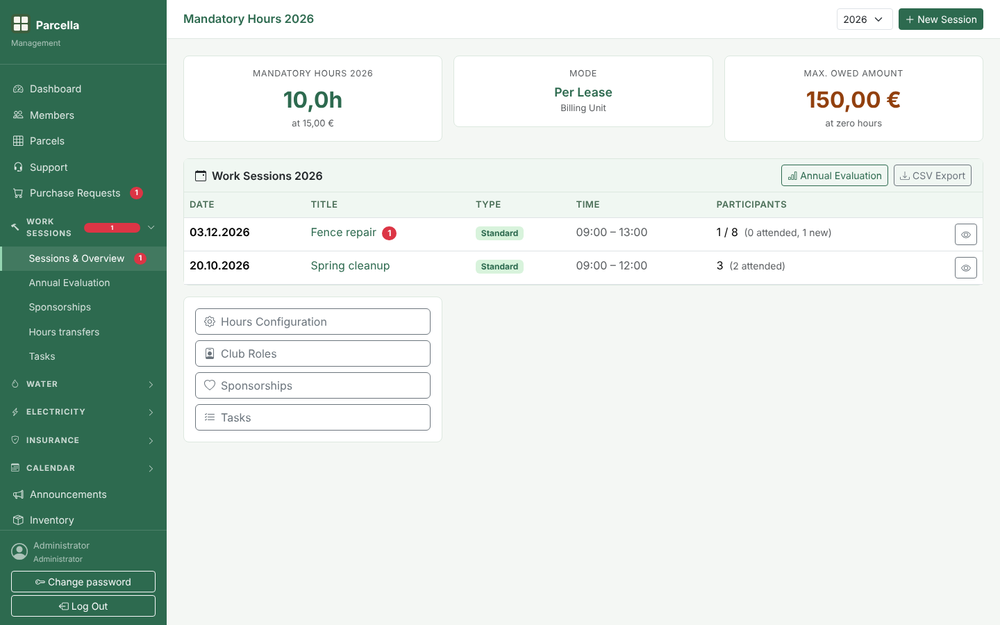

# Work hours

Most allotment garden associations expect each member or each parcel to
put in a number of [mandatory work hours](../glossary.md) per year, or
pay for the hours they didn't do. This module plans the club's work
sessions, records who attended, credits sponsorships and exemptions, and
works out at the end of the year who still owes hours and how much
money that comes to.

!!! info "Who can use this"
    The module is switched on by default. You can turn it off under
    **Administration → Settings** (**Work-hours management**) if your
    club doesn't collect mandatory hours -- see
    [Turning modules on and off](../administration/modules.md). Nothing
    is deleted when you switch it off.

    Admin and Board users can do everything. Other users need a
    [group](../administration/groups.md) that grants **Work Sessions**
    permissions: *read* to see the pages, *write* to create and change
    things, *delete* to remove sessions, participants, sponsorships,
    transfers, tasks, club roles and yearly configurations. Without at
    least read permission the **Work Sessions** menu doesn't appear.

You find the module in the side menu under **Work Sessions**, with
these entries: **Sessions & Overview**, **Annual Evaluation**,
**Sponsorships**, **Hours transfers** and **Tasks**. The hours
configuration and club roles are reached from buttons on the overview
page.

## How the hours are counted

Before you look at the individual screens, it helps to know how
Parcella adds up a year. For every member it counts:

- **Work sessions** -- every session in that calendar year where the
  member's status is **Attended**. Each attendance counts with the hours
  entered for that person, or, if none were entered, with the session's
  **Hours per Participant**. **Registered** and **No Show** count
  nothing.
- **Sponsorships** -- the **Credited Hours/Year** of every sponsorship
  assigned to the member whose period overlaps the year. A sponsorship
  only counts once it has both a member and a **Valid From** date.
- **Hours transfers** -- hours other members gave them (plus), minus
  hours they gave away (minus).

What happens next depends on the **Billing Mode** you set for the year
in the [configuration](#mandatory-hours-configuration):

| Billing mode | What it means for the club |
|---|---|
| **Per Lease / Parcel** | Each parcel owes the yearly hours once. The hours of all its tenants are added together: if one tenant does 2 hours and the other 3, a 5-hour requirement is fulfilled. |
| **Per Member** | Each member who held a lease during the year owes the hours individually. |

Open hours are multiplied by the **Hourly Rate** to get the amount
owed.

### Exemptions

A member is exempt for a year when they hold a
[club role](#club-roles) marked **Exempt from mandatory hours** for that
year -- typically board work.

!!! warning "One exempt tenant exempts the whole parcel"
    In **Per Lease / Parcel** mode, a parcel is exempt as soon as **at
    least one** of its tenants is exempt. The co-tenants of a board
    member therefore owe nothing that year either: the board position
    "covers" the whole parcel. It does not matter whether the other
    tenants are exempt themselves.

    In **Per Member** mode, only the exempt member is exempt.

An exemption always applies to the **whole calendar year** for which
the role assignment is entered. A board member who steps down in
October stays exempt for the rest of that year; the dates in **From**
and **Until** are for your records and don't shorten the exemption.
Next year, you assign the role again (or not).

### Who counts as a tenant in a year

The evaluation looks at who held a parcel *during the evaluated year*,
not who holds it today:

- Ending a lease doesn't cancel that year's hours. A tenant who leaves
  in June still owes the full year. In **Per Lease / Parcel** mode they
  stay on the parcel's row, pooled with whoever took the parcel over;
  either way they get a **lease ended** badge.
- A lease that ended before the year began, or starts after it, doesn't
  count.
- A member who moved from one parcel to another within the club during
  the year counts only on the parcel they moved to.
- A member who holds two parcels at the same time owes the hours for
  each parcel. Their own hours fill the parcels in plot-number order:
  each parcel gets what it still needs, the last one gets the rest.
  For example, 7.5 hours against a 5-hour requirement: the first parcel
  is fulfilled with 5 hours, the second has 2.5 hours and 2.5 hours
  open. The evaluation shows such a tenant as "5.0 of 7.5 h".
- Members who were deleted drop out of every evaluation, including past
  years. If a leaver's hours should still be billed, end their
  membership with an end date instead of deleting them -- see
  [Members](members.md).

## Sessions & Overview

The start page of the module, titled **Mandatory Hours** plus the year.
Come here to plan sessions and to see at a glance whether new sign-ups
have arrived.

If there is no configuration for the selected year yet, a yellow banner
says **No mandatory-hours configuration for ... yet.** with a
**Create now →** link. Otherwise three tiles show the year's settings.

| Field / button | What it does |
|---|---|
| Year selector (top right) | Switches to another year. Only years that have a [configuration](#mandatory-hours-configuration) are listed. |
| **New Session** | Opens the [session form](#new-work-session-and-edit-session). Needs write permission. |
| **Mandatory Hours** tile | The hours required in this year, and **at** the hourly rate. |
| **Mode** tile | **Per Lease** or **Per Member** -- the billing unit for this year. |
| **Max. Owed Amount** tile | Hours × rate: what one parcel or member owes **at zero hours**. |
| **Annual Evaluation** | Opens the [Annual Evaluation](#annual-evaluation) for this year. |
| **CSV Export** | Downloads the evaluation as a spreadsheet (see [CSV export](#csv-export)). |

### Work Sessions table

Lists every session of the selected year, newest first.

| Column | What it shows |
|---|---|
| **Date** | The session date. |
| **Title** | Links to the [session's page](#session-page). A red number next to it counts new sign-ups (see below). |
| **Type** | **Standard** (planned) or **Special** (spontaneous). |
| **Time** | From -- until, or "–" if no time was entered. |
| **Participants** | Number of participants, "/ maximum" if a limit is set, and in brackets how many **attended** and how many are **new**. |
| Eye button | Opens the session's page. |

If the year has no sessions yet, the table says **No work sessions for
... yet.** and offers **Create First Session** (with write permission).

### Quick access

The buttons below the table lead to **Hours Configuration**,
**Club Roles**, **Sponsorships** and **Tasks**.

### New sign-ups: badges, dashboard tile and e-mails

Parcella marks a participation as *new* for 14 days after it was
created -- whether a gardener signed up through the club website or a
board member added someone by hand. Only **Standard** sessions that
haven't happened yet are counted; recording attendance for a past
session or a **Special** session never shows up as "new".

You see new sign-ups in four places:

- a red number next to **Work Sessions** and **Sessions & Overview** in
  the side menu,
- the **New Sign-ups** tile on the [dashboard](../getting-started/dashboard.md),
  with a **Show all** button that leads here,
- the red number next to the session title in the table above,
- a red **New** badge next to the participant on the session's page.

Once you have looked at them, click **Mark reviewed** on the
[session's page](#session-page). That clears the "new" marks for
everyone who is on the session at that moment. Anyone who signs up
afterwards is marked new again.

Parcella also sends e-mails to every active user with the Admin or
Board role:

- **When a board member adds a participant by hand**, the other Admin
  and Board users get one e-mail per participant ("New work-session
  sign-up in ..."). The person who added them doesn't get one.
- **When gardeners sign up through the club website**, everyone gets
  one summary e-mail per submission ("... new work-session sign-up(s)
  in ..."), however many sessions and household members it registered.

<!-- TODO(verify): users who only have full access through a group (not the Admin/Board role itself) don't receive these notification e-mails -- confirm this is intended. -->

## Sign-ups through the club website

If your club's website (for example WordPress) has a sign-up form for
work sessions, gardeners can register without a Parcella login. This
needs the **Public signup API** module, which is **off by default**
because it opens Parcella to submissions from the internet. Switch it
on under **Administration → Settings**, then set up the website
connection on [Integrations](../administration/integrations.md). What
gardeners see is described in [For gardeners](../gardeners/index.md).

From the board's side, this is what happens:

- **Which sessions are offered.** Only **Standard** sessions whose date
  hasn't passed. A session with a **Registration deadline (days
  before)** disappears from the website that many days earlier.
  **Special** sessions never appear on the website.
- **Who gets registered.** The gardener enters their parcel number and,
  optionally, their name. Parcella compares the name with the parcel's
  *current* tenants. If it matches exactly one person, only that person
  is registered. If no name was given, or it doesn't clearly match one
  person, **every current tenant of the parcel** is registered, so no
  sign-up gets lost. A parcel without current tenants can't sign up.
- **Full sessions.** If the session doesn't have enough free places for
  everyone who would be registered, the sign-up for that session is
  refused as a whole. Participants marked **No Show** don't take up a
  place.
- **No duplicates.** Signing up twice for the same session doesn't
  create a second entry.
- **What you see.** The sign-ups appear as normal participants with
  status **Registered**, a **New** badge, and a **Note** such as
  "Public signup, matched by name (parcel G012) | Phone: ...". When all
  tenants were registered, the note says so and asks you to remove
  whoever didn't actually sign up.
- **Confirmation to the gardener.** Each newly registered member gets a
  confirmation e-mail at the address stored in their member record --
  never at an address typed into the website form. You can change the
  text or switch it off in the [configuration](#sign-up-confirmation-email).

!!! tip "After website sign-ups arrive"
    Open the session, check the notes of the new participants, remove
    anyone who was only registered as a precaution (needs delete
    permission), and click **Mark reviewed**.

## Session page

Click a session title to open it. This is where you manage the
participant list before the session and record attendance afterwards.

| Button (top) | What it does |
|---|---|
| **Edit** | Opens the [session form](#new-work-session-and-edit-session). Needs write permission. |
| **Attendee sheet** | Downloads a PDF to print and take to the session (see below). |
| **Delete** | Deletes the session after a confirmation. **All participations are lost**, so the hours no longer count for anyone. Tasks scheduled for the session go back to the backlog. Needs delete permission. |
| **Back** | Returns to the overview. |

### Details

Shows the **Type** (**Standard** or **Special**), **Date**, **Time**,
**Slots** (participants / maximum), **Hours/Person** and the
description.

### Participants

The card header counts how many participants **attended** and how many
are **registered**. If there are new sign-ups and you have write
permission, it also shows **Mark reviewed** (see
[New sign-ups](#new-sign-ups-badges-dashboard-tile-and-e-mails)).

Type into **Search by member or plot number…** to filter the table.

| Column | What it shows / does |
|---|---|
| **Member** | Name, linked to the member record. A red **New** badge marks a new sign-up. |
| **Parcel** | The member's current parcel(s). |
| **Status** | **Registered**, **Attended** or **No Show**. With write permission, choosing another value saves immediately. Only **Attended** counts towards the member's hours. |
| **Hours** | The hours credited for this person. The field is pre-filled with their own hours or, if none were entered, the session's **Hours per Participant**. Change it and click **✓** to save. Without write permission you only see the number. |
| **Note** | For example the details a gardener entered on the website form. |
| **×** | Removes the participant after a confirmation. Needs delete permission. |

!!! tip "Record attendance after the session"
    Set everyone who came to **Attended** and correct the hours of
    anyone who stayed shorter or longer. Leave people who didn't come on
    **No Show** rather than removing them, so you can see later who was
    expected.

**Adding a participant** (write permission): at the bottom of the card,
start typing a name or plot number in **Select member…** and pick the
member from the list -- you must choose someone from the list, typing a
name alone isn't enough. Members already on the session aren't offered.
Choose the status (**Attended** is preselected, because this is mostly
used to record attendance afterwards), optionally enter hours (empty
means the session's default) and click **Add**.

Adding someone by hand is always possible, even when the session is
full, its registration deadline has passed or the session is in the
past -- the limits only apply to sign-ups through the website.

### Tasks

Lists the [tasks](#tasks) scheduled for this session, with **Task**,
**Workload** and **Assigned to**. With write permission you can choose
one of the session's participants in **Assigned to** (or **Not yet
assigned**), and mark a task done or not done with the check button.
Done tasks are crossed out. **Manage Tasks** opens the task backlog.

### Attendee sheet

The PDF lists every participant on the session, sorted by parcel and
name, with the columns **Parcel**, **Member**, **Hours**, **Tasks
assigned** and **Signature**. **Hours** shows the individual hours or
the session default, and is left blank if neither exists. **Tasks
assigned** stays empty when no task has been assigned yet, so you can
write one in by hand. The list runs over several pages if needed.

The printout doesn't change anything in Parcella: after the session,
enter the corrected status and hours on the session page.

## New Work Session and Edit Session

Opened with **New Session** on the overview, or **Edit** on a session's
page. Needs write permission.

| Field | What it does |
|---|---|
| **Title** | Required. For example "Spring Cleanup". |
| **Type** | **Standard (planned)** for sessions planned ahead, **Special (spontaneous)** for unplanned ones. Only Standard sessions appear on the club website and count as new sign-ups. |
| **Date** | Required. The session's hours count for this date's calendar year. |
| **From** / **Until** | Optional start and end time. |
| **Max. Participants** | Empty = unlimited. Limits sign-ups through the website; board members can still add more people by hand. |
| **Registration deadline (days before)** | Closes website sign-up this many days before the session -- 1 closes it the day before. Leave empty to keep it open until the session date has passed. Doesn't affect adding people in Parcella. |
| **Hours per Participant** | The default hours each attendee gets, for example 4.0. You can still change the hours per person when recording attendance. |
| **Description** | Tasks, tools, special notes. |
| **Cancel** / **Create Session** or **Save Changes** | Saving takes you to the session's page. |

## Annual Evaluation

Shows, for every parcel or member, how many hours were required, how
many were done, and what is still owed. Open it from the menu
(**Annual Evaluation**) or the overview. This is the list you work from
at the end of the year, and it is what invoicing uses for the
**Work-hours shortfall (from module)** item (see
[Invoice runs](finances/invoice-runs.md)).

| Button | What it does |
|---|---|
| Year selector | Switches the year. Only configured years are listed. |
| **CSV Export** | Downloads the evaluation (see below). |
| **Back** | Returns to the overview. |

Without a configuration for the year, the page only shows the yellow
**No mandatory-hours configuration for ... yet.** banner.

The four tiles at the top show how many rows are **Fulfilled**
(e.g. "18 / 25"), the total **Open Hours**, the **Total Owed Amount**,
and the **Mode** with hours and rate.

### The table

Rows are green when fulfilled and yellow when hours are open.

| Column | What it shows |
|---|---|
| **Parcel** and **Tenant** (Per Lease mode) | One row per parcel that had at least one tenant during the year, including parcels whose lease was terminated. Each tenant is listed with their hours in brackets, an **exempt** badge if they are exempt, a **lease ended** badge with the date if their lease ended during the year, and "x of y h" if they hold several parcels. |
| **Member** (Per Member mode) | One row per member who held a lease during the year, with a **lease ended** badge where applicable. |
| **Required** | The yearly requirement. |
| **Sessions** | Hours from attended work sessions. |
| **Sponsorship** | Hours credited from sponsorships. |
| **Transfers** | Hours received (+) or given away (−). "–" if none. |
| **Total** | Sessions + sponsorship + transfers. |
| **Open** | Hours still missing. "–" for exempt rows. |
| **Owed** | Open hours × hourly rate. "–" for exempt rows. |
| **Status** | **Exempt**, **Fulfilled** or **Open**. |

Click the arrow in front of a row (**Show work sessions**) to see the
**Attended work sessions** of that year: date, session (linked) and
hours -- in Per Lease mode one list per tenant. The list always adds up
to the **Sessions** column. Sponsorships and transfers aren't part of
it.

### CSV export

The CSV file uses semicolons and the evaluation page's column headings,
in the club's language: Parcel, Tenant, Required (h), Sessions (h),
Sponsorship (h), Transfers (h), Total (h), Open (h), Owed (EUR), Exempt
and Fulfilled, with "Yes"/"No" in that language for yes/no.

!!! warning "CSV export only works in Per Lease mode"
    In a year configured as **Per Member**, the CSV file contains only
    the heading row. Use the evaluation page instead.

!!! warning "Parcels nobody holds any more"
    If all tenants of a parcel left during the year and the parcel was
    not let again, the parcel still shows its open hours, but the
    automatic invoice can't bill them because the parcel has no current
    tenant to address. Bill such a leaver by hand. If the parcel was let
    again, the new tenant receives the parcel's invoice for the year.

## Sponsorships

A sponsorship is an area of the grounds that a member looks after all
year -- a hedge, the playground, the entrance -- instead of attending
work sessions. Each sponsor is credited a fixed number of hours per
year. Open it from **Sponsorships** in the menu or on the overview.

The page has three parts: the form to create a sponsorship (write
permission), **Active Sponsorships**, and **Former Sponsorships**.

### Create Sponsorship / Add Member

| Field | What it does |
|---|---|
| **Area** | Required. Suggests the area names already used. Choose an existing area to add another member to it -- several people can share an area, and **each of them** gets the full credited hours. |
| **Member** | Listed by plot number first ("G001 - Peter Ahnert"); members without a parcel come last. Leave it on **– not yet assigned –** to advertise an area nobody has taken yet. |
| **Description** | What exactly is being maintained. |
| **Credited Hours/Year** | Required. Pre-filled with the mandatory hours of the year's configuration, but you can change it if the area takes more or less effort. |
| **Valid From** | Empty = not yet claimed by anyone. |
| **Valid Until** | Empty = still ongoing. Can't be before **Valid From**. |
| **Save** | Creates the entry. |

!!! info "When a sponsorship counts"
    A sponsorship credits its hours for every year its period overlaps
    -- in full, even if it ended in the middle of the year. It only
    counts once it has a **Member** and a **Valid From** date. An entry
    without a start date is a standing offer and counts for nobody yet.

If you enter an end date before the start date, Parcella refuses to
save and shows **The end date is before the start date.** Your input is
kept so you can correct it. Older entries saved with such dates show a
red **End before start** badge and count in no year until you fix them.

### Active Sponsorships

Lists sponsorships for the year shown in the card header (**in ...**)
that haven't ended yet, plus all unclaimed offers. Entries with the same
area are grouped, with a "... people" badge.

| Column | What it shows / does |
|---|---|
| **Area** | Name and description. |
| **Member(s)** | Linked member, or *not yet assigned*. |
| **Hours/Year** | Credited hours. |
| **Period** | From – until (or *ongoing*), or *not yet claimed*. |
| Pencil | Opens [Edit Sponsorship](#edit-sponsorship). Needs write permission. |
| Bin | Deletes the entry after a confirmation. Needs delete permission. |

The page shows the current year when opened from the menu. The
**Sponsorships** button on the overview opens it for the year selected
there.

### Former Sponsorships

Every sponsorship whose **Valid Until** date has passed, newest end date
first, regardless of the year shown -- a permanent record. Same columns
and actions as above.

## Edit Sponsorship

<!-- TODO(verify): no screenshot -- the sample data contains no sponsorships, so the edit page can't be reached by the screenshot tool. -->

Opened with the pencil on the sponsorships page. Needs write
permission. It has the same fields as the create form: **Area**,
**Member**, **Description**, **Credited Hours/Year**, **Valid From**
and **Valid Until**, with **Cancel** and **Save Changes**. The same
date check applies. After saving you return to the sponsorships page
for the year the sponsorship starts in.

## Hours transfers

A member who did more than they owe can give hours to another member,
for example to help a neighbour. Open **Hours transfers** in the menu.

| Field / button | What it does |
|---|---|
| Year selector | Switches the year. Lists configured years. |
| **Evaluation** | Opens the Annual Evaluation for this year. |

### Give hours

Needs write permission and a configuration for the year; otherwise the
card says **No configuration for ...**.

| Field | What it does |
|---|---|
| **From (gives)** | Required. Everyone who was a member at some point during the year, by plot number. |
| **To (receives)** | Required. Can't be the same member. |
| **Hours** | Required, a positive number (rounded to one decimal). At most the giver's surplus for this year. |
| **Note** | Optional, e.g. the reason. |
| **Transfer hours** | Saves the transfer. |

**How much can be given.** Parcella checks the giver's surplus when you
save:

- **Per Member**: the giver's own total minus the requirement.
- **Per Lease / Parcel**: the surplus of the giver's parcel -- the
  parcel must stay fulfilled -- and never more than the giver's own
  hours. A co-tenant's hours can't be given away by someone else.
- Exempt members, and helpers without a parcel that year, can give all
  of their own hours.

If it's too much, a red banner says how many hours can be given, for
example **Only 2.0 h can be given -- that's the giver's surplus for this
year.**

!!! note
    The check only happens once, when the transfer is saved. If
    attendance is corrected later (or a transfer it relied on is
    deleted), the giver may end up short; the evaluation then simply
    shows the open hours.

### Transfers in ...

Lists the year's transfers with **From**, **To**, **Hours** and
**Note**, plus the date and who entered it. The bin deletes a transfer
after the confirmation **Delete this transfer? The hours go back to the
giver.** (delete permission). Wrong entries are deleted rather than
kept as history -- they are corrections, not club history.

## Tasks

A backlog of jobs that need doing, which you can schedule for a work
session and hand out to the people who signed up. Open **Tasks** in the
menu, on the overview, or **Manage Tasks** on a session's page.

Each task carries a **Workload** label -- **Light**, **Moderate** or
**Demanding** -- so whoever coordinates a session can give suitable work
to each person. That label is all Parcella stores: there is no field for
a member's age or health, and nothing is matched automatically. Who
does what stays the coordinator's decision.

### New Task

Needs write permission.

| Field | What it does |
|---|---|
| **Title** | Required. For example "Trim the north hedge". |
| **Description** | Any details worth knowing before starting. |
| **Workload** | **Light**, **Moderate** (preselected) or **Demanding**. A guide only, not enforced. |
| **Work session** | One of the upcoming sessions, or **-- Backlog (not yet scheduled) --** to schedule it later. |
| **Add Task** | Saves the task. |

### Backlog

Tasks without a session, newest first, with **Task**, **Workload** and
**Schedule to**. Choosing a session in **Schedule to** moves the task
there immediately (write permission). Only sessions from today onward
are offered. The bin deletes the task (delete permission).

### Scheduled tasks

Below the backlog, one card per session that has tasks (newest session
first), with the session's date and title linked. Columns: **Task**,
**Workload**, **Assigned to**, a check button to mark it done or not
done (write permission), and a bin to delete it (delete permission).
Done tasks are crossed out.

You assign a task to a person on the [session's page](#tasks), where the
**Assigned to** list offers that session's participants -- an
assignment only makes sense for someone who signed up for that session.

<!-- TODO(verify): the web pages offer no way to move a task that is already scheduled to a different session or back to the backlog (only the backlog has a "Schedule to" list). Moving it via the API clears the assignment. Confirm this is intended or a gap. -->

## Club Roles

Club offices -- chair, treasurer, water officer -- and who holds them in
which year. A role marked as exempt frees its holder (and, in Per Lease
mode, their whole parcel) from mandatory hours for that year. Open it
with **Club Roles** on the overview.

| Field / button | What it does |
|---|---|
| Year selector | The year whose role assignments are shown and created. Offers the current year and the four before it. |
| **Back** | Returns to the overview. |

### New Club Role

Needs write permission.

| Field | What it does |
|---|---|
| **Name** | Required, e.g. "Chairperson". |
| **Description** | Duties of this role. |
| **Exempt from mandatory hours** | Tick this if holders don't have to do work hours. |
| **Exemption Reason** | Appears when the box is ticked: **Board Work**, **Extended Board**, **Illness / Health Reasons**, **Age Exemption** or **Other Reason**. For your records; it doesn't change how the exemption works. |
| **Create Role** | Saves the role. |

### Existing Roles

Lists all roles with **Name** (and description) and **Exempt**
(**Yes**/**No**). The pencil opens [Edit Club Role](#edit-club-role)
(write permission). The bin deletes the role after the warning **Really
delete this role? All assignments will be lost.** (delete permission).

!!! warning "Deleting a role changes past years"
    The assignments of *all* years are deleted with the role, so members
    who were exempt in earlier years are no longer exempt in those
    years' evaluations either. Only delete a role you entered by
    mistake.

### Members in Club Roles

Assigns members to roles for the year chosen at the top. Needs write
permission.

| Field | What it does |
|---|---|
| **Member** | Required. Current members, alphabetically. |
| **Club Role** | Required. |
| **From** / **Until** | Optional dates of the term. Empty **Until** = still ongoing. For your records only -- the exemption always covers the whole year. |
| **Assign** | Saves the assignment. Assigning the same member to the same role twice in one year does nothing. |

The table shows the year's assignments with **Member**, **Role**,
**Exempt**, **From**, **Until** (or *ongoing*) and **Note**. The pencil
opens [Edit Assignment](#edit-assignment) (write permission); **×**
removes the assignment after a confirmation (delete permission).

!!! tip "Every year again"
    Role assignments belong to one year. At the start of a new year,
    select it at the top and assign the board again, otherwise nobody is
    exempt that year. To enter a future year that the selector doesn't
    offer yet, create the assignment and change its **Year** in
    [Edit Assignment](#edit-assignment).

## Edit Club Role

<!-- TODO(verify): no screenshot -- the sample data contains no club roles. -->

Opened with the pencil next to a role. Same fields as when creating:
**Name**, **Description**, **Exempt from mandatory hours** and
**Exemption Reason**, with **Cancel** and **Save Changes**. Changing
whether a role is exempt applies to every year it was assigned in, past
years included.

## Edit Assignment

<!-- TODO(verify): no screenshot -- the sample data contains no club-role assignments. -->

Opened with the pencil next to an assignment (**Edit Member in Club
Role**).

| Field | What it does |
|---|---|
| **Member** | Required. |
| **Club Role** | Required. |
| **Year** | Required. The mandatory-hours exemption applies for this entire calendar year. |
| **From** / **Until** | Optional term dates; empty **Until** = still ongoing. |
| **Note** | E.g. reason for stepping down, handover to… |
| **Cancel** / **Save Changes** | Saving returns to the club roles of the assignment's year. |

## Mandatory Hours Configuration

The yearly rules: how many hours, what an unworked hour costs, and
whether you count per parcel or per member. Each year has its own
configuration, so changing next year's rate doesn't touch past years.
Open it with **Hours Configuration** on the overview, or **Create now →**
in a warning banner.

Without a configuration for a year, that year can't be evaluated, hours
can't be transferred, and invoicing bills no work-hours shortfall.

### Create / Update Year

Needs write permission.

| Field | What it does |
|---|---|
| **Year** | Required, pre-filled with the current year. |
| **Total Mandatory Hours** | Required, e.g. 5.0. |
| **Hourly Rate** | Required. Value per hour not worked, in the club's currency. |
| **Billing Mode** | **Per Lease / Parcel**: all tenants of a parcel jointly complete the mandatory hours. **Per Member**: each member completes their hours individually. |
| **Note** | E.g. the general meeting resolution the numbers come from. |
| **Save** | Saves the year. If the year already has a configuration, it is **overwritten** with these values. |

### Sign-up confirmation email

Needs write permission. Controls the e-mail a member gets after
signing up through the club website (see
[Sign-ups through the club website](#sign-ups-through-the-club-website)).

| Field | What it does |
|---|---|
| **Send a confirmation email** | On by default. Untick to send no confirmations. |
| **Your text** | Plain text; a blank line starts a new paragraph. Leave empty to use the standard text shown in grey. Up to 5,000 characters. |
| **Save** | Saves both settings and shows **Sign-up confirmation saved.** |

The e-mail goes to the e-mail address stored on each registered member,
never to an address typed into the website form. Its subject is "RE:
your registration to work session on" plus the date. Below your text,
Parcella adds the session's title, date and time, and -- only if the
name matched exactly one member -- the remarks the visitor typed (up to
500 characters). If sending fails, the registration is kept anyway.

### Historical Configurations

All configured years, newest first.

| Column | What it shows / does |
|---|---|
| **Year**, **Hours**, **Rate** | The year's settings. |
| **Max. Owed** | Hours × rate. |
| **Mode** | **Lease** or **Member**. |
| **Note** | Your note. |
| Pencil | Opens [Edit Configuration](#edit-configuration). Needs write permission. |
| Bin | Deletes the year's configuration after a confirmation. Needs delete permission. Sessions, sponsorships and transfers stay, but the year can no longer be evaluated or billed. |

## Edit Configuration

Opened with the pencil next to a year. The fields are the same as above
-- **Year**, **Total Mandatory Hours**, **Hourly Rate**, **Billing
Mode** and **Note** -- with **Cancel** and **Save Changes**. You can
change the year itself; if another configuration already exists for the
new year, Parcella refuses with **A different configuration already
exists for ...**.

!!! warning
    Changing hours, rate or mode immediately changes that year's
    evaluation. If invoices for the year have already been created, they
    are not updated.

<!-- TODO(verify): confirm that already-created invoices keep their amounts when the work-hours configuration changes afterwards. -->

## Related

- [Organising a work session](../guides/work-session.md) -- step by step
  from planning to billing
- [Running the annual invoices](../guides/annual-invoicing.md) and
  [Invoice runs](finances/invoice-runs.md) -- billing the open hours
- [Members](members.md) and [Parcels](parcels.md) -- tenancies decide
  who owes hours
- [Calendar](calendar.md) -- Standard sessions also appear in the
  community calendar
- [Integrations](../administration/integrations.md) -- connecting the
  club website's sign-up form
- [E-mail log](../administration/email-log.md) -- checking whether
  notification and confirmation e-mails went out
