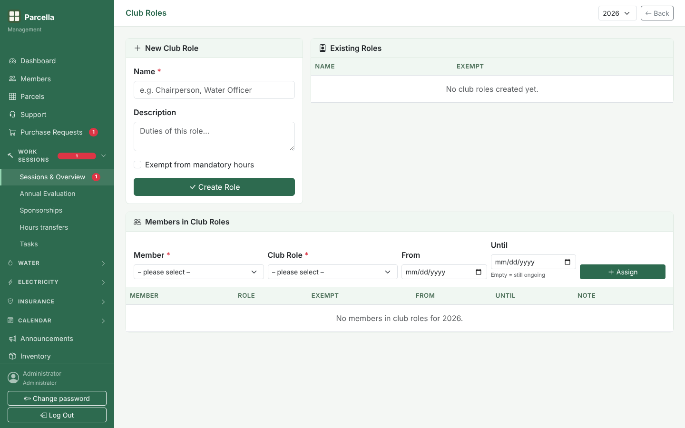

# Werkuren {#work-hours}

!!! note "Machinevertaling"
    Deze pagina is machinaal vertaald uit het Engels en nog niet nagekeken. Als iets onduidelijk is, geldt de Engelse versie (taal wisselt u bovenaan).

De meeste volkstuinverenigingen verwachten dat elk lid of elk perceel
per jaar een aantal [verplichte werkuren](../glossary.md) maakt, of
betaalt voor de uren die niet zijn gemaakt. Deze module plant de
werksessies van de vereniging, legt vast wie aanwezig was, rekent
sponsorschappen en vrijstellingen mee, en berekent aan het einde van het
jaar wie nog uren schuldig is en hoeveel geld dat is.

!!! info "Wie kan dit gebruiken"
    De module staat standaard aan. U kunt haar uitschakelen onder
    **Administratie → Instellingen** (**Werktijdenbeheer**) als uw
    vereniging geen verplichte uren hanteert -- zie
    [Modules in- en uitschakelen](../administration/modules.md). Er wordt
    niets verwijderd als u haar uitschakelt.

    Gebruikers met de rol Beheerder of Bestuur kunnen alles. Andere
    gebruikers hebben een [groep](../administration/groups.md) nodig die
    rechten op **Werksessies** geeft: *lezen* om de pagina's te zien,
    *schrijven* om dingen aan te maken en te wijzigen, *verwijderen* om
    sessies, deelnemers, sponsorschappen, overdrachten, taken,
    verenigingsrollen en jaarconfiguraties te verwijderen. Zonder
    minstens leesrecht verschijnt het menu **Werksessies** niet.

U vindt de module in het zijmenu onder **Werksessies**, met deze items:
**Sessies & Overzicht**, **Jaarlijkse evaluatie**, **Sponsorschappen**,
**Uren overdragen** en **Taken**. De urenconfiguratie en de
verenigingsrollen bereikt u via knoppen op de overzichtspagina.

## Hoe de uren worden geteld {#how-the-hours-are-counted}

Voordat u naar de afzonderlijke schermen kijkt, helpt het te weten hoe
Parcella een jaar optelt. Voor elk lid telt het:

- **Werksessies** -- elke sessie in dat kalenderjaar waarbij de status
  van het lid **Aanwezig** is. Elke aanwezigheid telt met de uren die
  voor die persoon zijn ingevuld, of, als er geen zijn ingevuld, met de
  **Uren per deelnemer** van de sessie. **Geregistreerd** en **Niet
  verschenen** tellen niets.
- **Sponsorschappen** -- de **Te crediteren uren/jaar** van elk
  sponsorschap van het lid waarvan de periode het jaar overlapt. Een
  sponsorschap telt pas als het zowel een lid als een datum **Geldig
  vanaf** heeft.
- **Urenoverdrachten** -- uren die andere leden hem gaven (plus), min de
  uren die hij weggaf (min).

Wat er daarna gebeurt, hangt af van de **Facturatiemodus** die u voor
het jaar instelt in de [configuratie](#mandatory-hours-configuration):

| Facturatiemodus | Wat het voor de vereniging betekent |
|---|---|
| **Per huur / perceel** | Elk perceel is de jaarlijkse uren één keer verschuldigd. De uren van alle huurders worden opgeteld: doet de ene huurder 2 uur en de andere 3, dan is een eis van 5 uur voldaan. |
| **Per lid** | Elk lid dat in het jaar een perceel huurde, is de uren afzonderlijk verschuldigd. |

Openstaande uren worden vermenigvuldigd met het **Uurtarief** om het
verschuldigde bedrag te krijgen.

### Vrijstellingen {#exemptions}

Een lid is voor een jaar vrijgesteld als het voor dat jaar een
[verenigingsrol](#club-roles) heeft die als **Vrijgesteld van verplichte
uren** is gemarkeerd -- meestal bestuurswerk.

!!! warning "Eén vrijgestelde huurder stelt het hele perceel vrij"
    In de modus **Per huur / perceel** is een perceel vrijgesteld zodra
    **minstens één** van de huurders is vrijgesteld. De medehuurders van
    een bestuurslid zijn dat jaar dus ook niets verschuldigd: de
    bestuursfunctie „dekt“ het hele perceel. Het maakt niet uit of de
    andere huurders zelf zijn vrijgesteld.

    In de modus **Per lid** is alleen het vrijgestelde lid vrijgesteld.

Een vrijstelling geldt altijd voor het **hele kalenderjaar** waarvoor de
roltoewijzing is ingevoerd. Een bestuurslid dat in oktober aftreedt,
blijft de rest van dat jaar vrijgesteld; de datums bij **Van** en
**Tot** zijn voor uw administratie en verkorten de vrijstelling niet.
Volgend jaar wijst u de rol opnieuw toe (of niet).

### Wie in een jaar als huurder telt {#who-counts-as-a-tenant-in-a-year}

De evaluatie kijkt naar wie *in het geëvalueerde jaar* een perceel
huurde, niet naar wie het vandaag huurt:

- Een huur beëindigen schrapt de uren van dat jaar niet. Een huurder die
  in juni vertrekt, is nog steeds het hele jaar verschuldigd. In de
  modus **Per huur / perceel** blijft hij op de rij van het perceel,
  samen met wie het perceel overnam; hoe dan ook krijgt hij een badge
  **pacht beëindigd**.
- Een huur die eindigde vóór het jaar begon, of erna begint, telt niet.
- Een lid dat in de loop van het jaar binnen de vereniging naar een
  ander perceel verhuisde, telt alleen op het perceel waarheen hij
  verhuisde.
- Een lid dat tegelijk twee percelen huurt, is de uren voor elk perceel
  verschuldigd. Zijn eigen uren vullen de percelen in volgorde van
  perceelnummer: elk perceel krijgt wat het nog nodig heeft, het laatste
  krijgt de rest. Bijvoorbeeld 7,5 uur tegenover een eis van 5 uur: het
  eerste perceel is voldaan met 5 uur, het tweede heeft 2,5 uur en 2,5
  uur open. De evaluatie toont zo'n huurder als „5.0 van 7.5 h“.
- Verwijderde leden vallen uit elke evaluatie, ook van eerdere jaren.
  Moeten de uren van iemand die vertrekt toch worden gefactureerd,
  beëindig dan het lidmaatschap met een einddatum in plaats van het lid
  te verwijderen -- zie [Leden](members.md).

## Sessies & Overzicht {#sessions-overview}

De startpagina van de module, met de titel **Verplichte uren** plus het
jaar. Hier plant u sessies en ziet u in één oogopslag of er nieuwe
aanmeldingen zijn binnengekomen.

Is er voor het gekozen jaar nog geen configuratie, dan zegt een gele
balk **Nog geen configuratie voor verplichte uren voor ....** met een
link **Nu aanmaken →**. Anders tonen drie tegels de instellingen van het
jaar.

| Veld / knop | Wat het doet |
|---|---|
| Jaarkeuze (rechtsboven) | Wisselt naar een ander jaar. Alleen jaren met een [configuratie](#mandatory-hours-configuration) worden aangeboden. |
| **Nieuwe sessie** | Opent het [sessieformulier](#new-work-session-and-edit-session). Vraagt schrijfrecht. |
| Tegel **Verplichte uren** | De vereiste uren dit jaar, en **tegen** het uurtarief. |
| Tegel **Modus** | **Per huur** of **Per lid** -- de factuureenheid voor dit jaar. |
| Tegel **Max. openstaand bedrag** | Uren × tarief: wat één perceel of lid **bij nul uur** verschuldigd is. |
| **Jaarlijkse evaluatie** | Opent de [Jaarlijkse evaluatie](#annual-evaluation) voor dit jaar. |
| **CSV-export** | Downloadt de evaluatie als spreadsheet (zie [CSV-export](#csv-export)). |

### Tabel Werksessies {#work-sessions-table}

Toont elke sessie van het gekozen jaar, de nieuwste eerst.

| Kolom | Wat ze toont |
|---|---|
| **Datum** | De datum van de sessie. |
| **Titel** | Linkt naar de [sessiepagina](#session-page). Een rood getal ernaast telt nieuwe aanmeldingen (zie hieronder). |
| **Type** | **Standaard** (gepland) of **Speciaal** (spontaan). |
| **Tijd** | Van -- tot, of „–“ als er geen tijd is ingevuld. |
| **Deelnemers** | Aantal deelnemers, „/ maximum“ als er een limiet is, en tussen haakjes hoeveel er **aanwezig** waren en hoeveel **nieuw** zijn. |
| Oogknop | Opent de sessiepagina. |

Heeft het jaar nog geen sessies, dan zegt de tabel **Nog geen
werksessies voor ....** en biedt (met schrijfrecht) **Eerste sessie
aanmaken** aan.

### Snelkoppelingen {#quick-access}

De knoppen onder de tabel leiden naar **Urenconfiguratie**,
**Verenigingsrollen**, **Sponsorschappen** en **Taken**.

### Nieuwe aanmeldingen: badges, dashboardtegel en e-mails {#new-sign-ups-badges-dashboard-tile-and-e-mails}

Parcella markeert een deelname 14 dagen na het aanmaken als *nieuw* --
of een tuinder zich nu via de website van de vereniging aanmeldde of een
bestuurslid iemand met de hand toevoegde. Alleen **Standaard**-sessies
die nog niet hebben plaatsgevonden, tellen mee; aanwezigheid vastleggen
voor een voorbije sessie of een **Speciaal**-sessie verschijnt nooit als
„nieuw“.

U ziet nieuwe aanmeldingen op vier plaatsen:

- een rood getal naast **Werksessies** en **Sessies & Overzicht** in het
  zijmenu,
- de tegel **Nieuwe aanmeldingen** op het
  [dashboard](../getting-started/dashboard.md), met een knop **Toon
  alles** die hierheen leidt,
- het rode getal naast de sessietitel in de tabel hierboven,
- een rode badge **Nieuw** naast de deelnemer op de sessiepagina.

Hebt u ernaar gekeken, klik dan op **Markeren als bekeken** op de
[sessiepagina](#session-page). Dat wist de markering „nieuw“ voor
iedereen die op dat moment op de sessie staat. Wie zich daarna aanmeldt,
wordt opnieuw als nieuw gemarkeerd.

Parcella stuurt ook e-mails aan elke actieve gebruiker met de rol
Beheerder of Bestuur:

- **Voegt een bestuurslid met de hand een deelnemer toe**, dan krijgen
  de andere gebruikers met Beheerder of Bestuur één e-mail per deelnemer
  („Nieuwe aanmelding voor een werksessie in ...“). Wie de deelnemer
  toevoegde, krijgt er geen.
- **Melden tuinders zich via de website van de vereniging aan**, dan
  krijgt iedereen één samenvattende e-mail per inzending („... nieuwe
  aanmelding(en) voor werksessies in ...“), hoeveel sessies en
  huisgenoten er ook mee werden aangemeld.

<!-- TODO(verify): users who only have full access through a group (not the Admin/Board role itself) don't receive these notification e-mails -- confirm this is intended. -->

## Aanmeldingen via de website van de vereniging {#sign-ups-through-the-club-website}

Heeft de website van uw vereniging (bijvoorbeeld WordPress) een
aanmeldformulier voor werksessies, dan kunnen tuinders zich aanmelden
zonder Parcella-account. Daarvoor is de module **Publieke aanmeld-API**
nodig, die **standaard uit** staat omdat ze Parcella openstelt voor
inzendingen vanaf internet. Schakel haar in onder **Administratie →
Instellingen** en richt dan de websiteverbinding in op
[Integraties](../administration/integrations.md). Wat tuinders zien,
staat in [Voor tuinders](../gardeners/index.md).

Vanuit het bestuur gezien gebeurt het volgende:

- **Welke sessies worden aangeboden.** Alleen **Standaard**-sessies
  waarvan de datum niet voorbij is. Een sessie met een
  **Aanmeldingstermijn (dagen vooraf)** verdwijnt zoveel dagen eerder
  van de website. **Speciaal**-sessies verschijnen nooit op de website.
- **Wie wordt aangemeld.** De tuinder vult zijn perceelnummer in en,
  optioneel, zijn naam. Parcella vergelijkt de naam met de *huidige*
  huurders van het perceel. Komt die met precies één persoon overeen,
  dan wordt alleen die persoon aangemeld. Is er geen naam opgegeven, of
  komt die niet duidelijk met één persoon overeen, dan wordt **elke
  huidige huurder van het perceel** aangemeld, zodat geen aanmelding
  verloren gaat. Een perceel zonder huidige huurders kan zich niet
  aanmelden.
- **Volle sessies.** Heeft de sessie niet genoeg vrije plaatsen voor
  iedereen die zou worden aangemeld, dan wordt de aanmelding voor die
  sessie in haar geheel geweigerd. Deelnemers met **Niet verschenen**
  nemen geen plaats in.
- **Geen dubbele.** Twee keer aanmelden voor dezelfde sessie maakt geen
  tweede item aan.
- **Wat u ziet.** De aanmeldingen verschijnen als gewone deelnemers met
  status **Geregistreerd**, een badge **Nieuw** en een **Notitie** zoals
  „Public signup, matched by name (parcel G012) | Phone: ...“. Zijn alle
  huurders aangemeld, dan zegt de notitie dat en vraagt ze u wie zich
  niet echt heeft aangemeld te verwijderen.
- **Bevestiging aan de tuinder.** Elk nieuw aangemeld lid krijgt een
  bevestigingsmail op het adres in zijn ledengegevens -- nooit op een
  adres dat in het websiteformulier is getypt. U kunt de tekst wijzigen
  of de mail uitschakelen in de [configuratie](#sign-up-confirmation-email).

!!! tip "Nadat aanmeldingen via de website binnenkomen"
    Open de sessie, controleer de notities van de nieuwe deelnemers,
    verwijder wie alleen uit voorzorg is aangemeld (vraagt
    verwijderrecht), en klik op **Markeren als bekeken**.

## Sessiepagina {#session-page}

Klik op een sessietitel om haar te openen. Hier beheert u de
deelnemerslijst vóór de sessie en legt u daarna de aanwezigheid vast.

| Knop (bovenaan) | Wat het doet |
|---|---|
| **Bewerken** | Opent het [sessieformulier](#new-work-session-and-edit-session). Vraagt schrijfrecht. |
| **Deelnemerslijst** | Downloadt een PDF om af te drukken en mee te nemen naar de sessie (zie hieronder). |
| **Verwijderen** | Verwijdert de sessie na bevestiging. **Alle deelnames gaan verloren**, zodat de uren voor niemand meer tellen. Taken die voor de sessie waren ingepland, gaan terug naar de achterstand. Vraagt verwijderrecht. |
| **Terug** | Terug naar het overzicht. |

### Details {#details}

Toont **Type** (**Standaard** of **Speciaal**), **Datum**, **Tijd**,
**Plaatsen** (deelnemers / maximum), **Uren/persoon** en de beschrijving.

### Deelnemers {#participants}

De kop van de kaart telt hoeveel deelnemers **aanwezig** waren en
hoeveel er **geregistreerd** zijn. Zijn er nieuwe aanmeldingen en hebt u
schrijfrecht, dan staat er ook **Markeren als bekeken** (zie
[Nieuwe aanmeldingen](#new-sign-ups-badges-dashboard-tile-and-e-mails)).

Typ in **Zoeken op lid of perceelnummer…** om de tabel te filteren.

| Kolom | Wat ze toont / doet |
|---|---|
| **Lid** | Naam, gelinkt aan de ledengegevens. Een rode badge **Nieuw** markeert een nieuwe aanmelding. |
| **Perceel** | Het huidige perceel of de huidige percelen van het lid. |
| **Status** | **Geregistreerd**, **Aanwezig** of **Niet verschenen**. Met schrijfrecht wordt een andere keuze meteen opgeslagen. Alleen **Aanwezig** telt mee voor de uren van het lid. |
| **Uren** | De uren die deze persoon worden toegekend. Het veld is vooraf ingevuld met de eigen uren of, als die er niet zijn, met de **Uren per deelnemer** van de sessie. Wijzig het en klik op **✓** om op te slaan. Zonder schrijfrecht ziet u alleen het getal. |
| **Notitie** | Bijvoorbeeld de gegevens die een tuinder in het websiteformulier invulde. |
| **×** | Verwijdert de deelnemer na bevestiging. Vraagt verwijderrecht. |

!!! tip "Leg de aanwezigheid na de sessie vast"
    Zet iedereen die kwam op **Aanwezig** en corrigeer de uren van wie
    korter of langer bleef. Laat wie niet kwam op **Niet verschenen**
    staan in plaats van hem te verwijderen, zodat u later ziet wie werd
    verwacht.

**Een deelnemer toevoegen** (schrijfrecht): begin onderaan de kaart een
naam of perceelnummer te typen in **Kies lid…** en kies het lid uit de
lijst -- u moet iemand uit de lijst kiezen, alleen een naam typen is
niet genoeg. Leden die al op de sessie staan, worden niet aangeboden.
Kies de status (**Aanwezig** is voorgeselecteerd, omdat dit vooral wordt
gebruikt om achteraf aanwezigheid vast te leggen), vul eventueel uren in
(leeg betekent de standaard van de sessie) en klik op **Toevoegen**.

Iemand met de hand toevoegen kan altijd, ook als de sessie vol is, de
aanmeldingstermijn voorbij is of de sessie in het verleden ligt -- de
limieten gelden alleen voor aanmeldingen via de website.

### Taken {#tasks}

Toont de [taken](#tasks_1) die voor deze sessie zijn ingepland, met
**Taak**, **Belasting** en **Toegewezen aan**. Met schrijfrecht kunt u
bij **Toegewezen aan** een van de deelnemers van de sessie kiezen (of
**Nog niet toegewezen**), en met de vinkknop een taak als voltooid of
niet voltooid markeren. Voltooide taken worden doorgestreept. **Taken
beheren** opent de achterstand.

### Deelnemerslijst {#attendee-sheet}

De PDF toont elke deelnemer van de sessie, gesorteerd op perceel en
naam, met de kolommen **Perceel**, **Lid**, **Uren**, **Toegewezen
taken** en **Handtekening**. **Uren** toont de individuele uren of de
standaard van de sessie, en blijft leeg als er geen van beide is.
**Toegewezen taken** blijft leeg als er nog geen taak is toegewezen,
zodat u er met de hand een kunt opschrijven. De lijst loopt zo nodig
over meerdere pagina's.

De afdruk verandert niets in Parcella: voer na de sessie de
gecorrigeerde status en uren in op de sessiepagina.

## Nieuwe werksessie en sessie bewerken {#new-work-session-and-edit-session}

Geopend met **Nieuwe sessie** op het overzicht, of **Bewerken** op een
sessiepagina. Vraagt schrijfrecht.

| Veld | Wat het doet |
|---|---|
| **Titel** | Verplicht. Bijvoorbeeld „Voorjaarsschoonmaak“. |
| **Type** | **Standaard (gepland)** voor vooraf geplande sessies, **Speciaal (spontaan)** voor ongeplande. Alleen Standaard-sessies verschijnen op de website van de vereniging en tellen als nieuwe aanmeldingen. |
| **Datum** | Verplicht. De uren van de sessie tellen voor het kalenderjaar van deze datum. |
| **Van** / **Tot** | Optionele begin- en eindtijd. |
| **Max. deelnemers** | Leeg = onbeperkt. Beperkt aanmeldingen via de website; bestuursleden kunnen nog steeds met de hand mensen toevoegen. |
| **Aanmeldingstermijn (dagen vooraf)** | Sluit de aanmelding via de website zoveel dagen vóór de sessie -- 1 sluit haar de dag ervoor. Laat leeg om haar open te houden tot de sessiedatum voorbij is. Heeft geen invloed op mensen toevoegen in Parcella. |
| **Uren per deelnemer** | De standaarduren die elke aanwezige krijgt, bijvoorbeeld 4.0. U kunt de uren per persoon nog wijzigen bij het vastleggen van de aanwezigheid. |
| **Beschrijving** | Taken, gereedschap, bijzondere opmerkingen. |
| **Annuleren** / **Sessie aanmaken** of **Wijzigingen opslaan** | Opslaan brengt u naar de sessiepagina. |

## Jaarlijkse evaluatie {#annual-evaluation}

Toont voor elk perceel of lid hoeveel uren vereist waren, hoeveel er
zijn gemaakt en wat nog openstaat. Open haar via het menu (**Jaarlijkse
evaluatie**) of het overzicht. Dit is de lijst waarmee u aan het einde
van het jaar werkt, en die de facturatie gebruikt voor de post **Tekort
werkuren (uit module)** (zie [Factuurrondes](finances/invoice-runs.md)).

| Knop | Wat het doet |
|---|---|
| Jaarkeuze | Wisselt het jaar. Alleen geconfigureerde jaren worden aangeboden. |
| **CSV-export** | Downloadt de evaluatie (zie hieronder). |
| **Terug** | Terug naar het overzicht. |

Zonder configuratie voor het jaar toont de pagina alleen de gele balk
**Nog geen configuratie voor verplichte uren voor ....**

De vier tegels bovenaan tonen hoeveel rijen **Voldaan** zijn (bijv.
„18 / 25“), het totaal aan **Openstaande uren**, het **Totaal
openstaand bedrag** en de **Modus** met uren en tarief.

### De tabel {#the-table}

Rijen zijn groen als ze voldaan zijn en geel als er uren openstaan.

| Kolom | Wat ze toont |
|---|---|
| **Perceel** en **Huurder** (modus Per huur) | Eén rij per perceel dat in het jaar minstens één huurder had, ook percelen waarvan de huur is opgezegd. Elke huurder staat erbij met zijn uren tussen haakjes, een badge **vrijgesteld** als hij is vrijgesteld, een badge **pacht beëindigd** met de datum als zijn huur in het jaar eindigde, en „x van y h“ als hij meerdere percelen huurt. |
| **Lid** (modus Per lid) | Eén rij per lid dat in het jaar een perceel huurde, waar van toepassing met een badge **pacht beëindigd**. |
| **Vereist** | De jaarlijkse eis. |
| **Sessies** | Uren uit bijgewoonde werksessies. |
| **Sponsorschap** | Uren die uit sponsorschappen worden toegekend. |
| **Overgedragen** | Ontvangen (+) of weggegeven (−) uren. „–“ als er geen zijn. |
| **Totaal** | Sessies + sponsorschap + overdrachten. |
| **Openstaand** | Uren die nog ontbreken. „–“ bij vrijgestelde rijen. |
| **Schuld** | Openstaande uren × uurtarief. „–“ bij vrijgestelde rijen. |
| **Status** | **Vrijgesteld**, **Voldaan** of **Open**. |

Klik op de pijl vóór een rij (**Werksessies tonen**) om de **Bijgewoonde
werksessies** van dat jaar te zien: datum, sessie (gelinkt) en uren --
in de modus Per huur één lijst per huurder. De lijst telt altijd op tot
de kolom **Sessies**. Sponsorschappen en overdrachten horen er niet bij.

### CSV-export {#csv-export}

Het CSV-bestand gebruikt puntkomma's en de kolomkoppen van de
evaluatiepagina, in de taal van de vereniging: Perceel, Huurder,
Vereist (h), Sessies (h), Sponsorschap (h), Overgedragen (h), Totaal
(h), Openstaand (h), Schuld (EUR), Vrijgesteld en Voldaan, met „Ja“/„Nee“
in die taal voor ja/nee.

!!! warning "CSV-export werkt alleen in de modus Per huur"
    In een jaar dat als **Per lid** is geconfigureerd, bevat het
    CSV-bestand alleen de koprij. Gebruik dan de evaluatiepagina.

!!! warning "Percelen die niemand meer huurt"
    Vertrokken alle huurders van een perceel in de loop van het jaar en
    is het perceel niet opnieuw verhuurd, dan toont het perceel nog
    steeds zijn openstaande uren, maar kan de automatische factuur ze
    niet factureren omdat het perceel geen huidige huurder heeft om aan
    te schrijven. Factureer zo'n vertrokken huurder met de hand. Is het
    perceel opnieuw verhuurd, dan krijgt de nieuwe huurder de factuur
    van het perceel voor het jaar.

## Sponsorschappen {#sponsorships}

Een sponsorschap is een deel van het terrein dat een lid het hele jaar
verzorgt -- een haag, de speeltuin, de ingang -- in plaats van
werksessies bij te wonen. Elke sponsor krijgt per jaar een vast aantal
uren toegekend. Open het via **Sponsorschappen** in het menu of op het
overzicht.

De pagina heeft drie delen: het formulier om een sponsorschap aan te
maken (schrijfrecht), **Actieve sponsorschappen** en **Voormalige
sponsorschappen**.

### Sponsorschap aanmaken / lid toevoegen {#create-sponsorship-add-member}

| Veld | Wat het doet |
|---|---|
| **Gebied** | Verplicht. Stelt de al gebruikte gebiedsnamen voor. Kies een bestaand gebied om er nog een lid aan toe te voegen -- meerdere mensen kunnen een gebied delen, en **elk van hen** krijgt de volledige uren. |
| **Lid** | Gesorteerd op perceelnummer („G001 - Peter Ahnert“); leden zonder perceel komen als laatste. Laat het op **– nog niet toegewezen –** om een gebied aan te bieden dat nog niemand heeft genomen. |
| **Beschrijving** | Wat er precies wordt onderhouden. |
| **Te crediteren uren/jaar** | Verplicht. Vooraf ingevuld met de verplichte uren uit de configuratie van het jaar, maar u kunt het wijzigen als het gebied meer of minder moeite kost. |
| **Geldig vanaf** | Leeg = nog door niemand overgenomen. |
| **Geldig tot** | Leeg = nog actief. Mag niet vóór **Geldig vanaf** liggen. |
| **Opslaan** | Maakt het item aan. |

!!! info "Wanneer een sponsorschap telt"
    Een sponsorschap kent zijn uren toe voor elk jaar dat zijn periode
    overlapt -- volledig, ook als het halverwege het jaar eindigde. Het
    telt pas als het een **Lid** en een datum **Geldig vanaf** heeft. Een
    item zonder begindatum is een staand aanbod en telt nog voor
    niemand.

Vult u een einddatum vóór de begindatum in, dan weigert Parcella op te
slaan en toont **De einddatum ligt vóór de begindatum.** Uw invoer blijft
staan, zodat u hem kunt corrigeren. Oudere items die met zulke datums
zijn opgeslagen, tonen een rode badge **Einde vóór begin** en tellen in
geen enkel jaar tot u ze herstelt.

### Actieve sponsorschappen {#active-sponsorships}

Toont de sponsorschappen voor het jaar in de kop van de kaart (**in
...**) die nog niet zijn geëindigd, plus alle nog niet overgenomen
aanbiedingen. Items met hetzelfde gebied worden gegroepeerd, met een
badge „... personen“.

| Kolom | Wat ze toont / doet |
|---|---|
| **Gebied** | Naam en beschrijving. |
| **Lid/leden** | Gelinkt lid, of *nog niet toegewezen*. |
| **Uren/jaar** | Toegekende uren. |
| **Periode** | Van – tot (of *actief*), of *nog niet overgenomen*. |
| Potlood | Opent [Sponsorschap bewerken](#edit-sponsorship). Vraagt schrijfrecht. |
| Prullenbak | Verwijdert het item na bevestiging. Vraagt verwijderrecht. |

Vanuit het menu toont de pagina het huidige jaar. De knop
**Sponsorschappen** op het overzicht opent haar voor het daar gekozen
jaar.

### Voormalige sponsorschappen {#former-sponsorships}

Elk sponsorschap waarvan de datum **Geldig tot** voorbij is, de
nieuwste einddatum eerst, ongeacht het getoonde jaar -- een blijvend
overzicht. Dezelfde kolommen en acties als hierboven.

## Sponsorschap bewerken {#edit-sponsorship}

<!-- TODO(verify): no screenshot -- the sample data contains no sponsorships, so the edit page can't be reached by the screenshot tool. -->

Geopend met het potlood op de pagina met sponsorschappen. Vraagt
schrijfrecht. Het heeft dezelfde velden als het aanmaakformulier:
**Gebied**, **Lid**, **Beschrijving**, **Te crediteren uren/jaar**,
**Geldig vanaf** en **Geldig tot**, met **Annuleren** en **Wijzigingen
opslaan**. Dezelfde datumcontrole geldt. Na het opslaan komt u terug op
de pagina met sponsorschappen voor het jaar waarin het sponsorschap
begint.

## Urenoverdrachten {#hours-transfers}

Een lid dat meer deed dan het verschuldigd is, kan uren aan een ander lid
geven, bijvoorbeeld om een buur te helpen. Open **Uren overdragen** in
het menu.

| Veld / knop | Wat het doet |
|---|---|
| Jaarkeuze | Wisselt het jaar. Toont geconfigureerde jaren. |
| **Evaluatie** | Opent de Jaarlijkse evaluatie voor dit jaar. |

### Uren overdragen {#give-hours}

Vraagt schrijfrecht en een configuratie voor het jaar; anders zegt de
kaart **Geen configuratie voor ...**.

| Veld | Wat het doet |
|---|---|
| **Van (geeft)** | Verplicht. Iedereen die in de loop van het jaar lid was, op perceelnummer. |
| **Aan (ontvangt)** | Verplicht. Mag niet hetzelfde lid zijn. |
| **Uren** | Verplicht, een positief getal (afgerond op één decimaal). Maximaal het overschot van de gever dit jaar. |
| **Notitie** | Optioneel, bijv. de reden. |
| **Uren overdragen** | Slaat de overdracht op. |

**Hoeveel er kan worden gegeven.** Parcella controleert het overschot
van de gever bij het opslaan:

- **Per lid**: het eigen totaal van de gever min de eis.
- **Per huur / perceel**: het overschot van het perceel van de gever --
  het perceel moet voldaan blijven -- en nooit meer dan de eigen uren
  van de gever. De uren van een medehuurder kan niemand anders
  weggeven.
- Vrijgestelde leden, en helpers zonder perceel in dat jaar, kunnen al
  hun eigen uren geven.

Is het te veel, dan zegt een rode balk hoeveel uren kunnen worden
gegeven, bijvoorbeeld **Er kunnen maar 2.0 u worden overgedragen -- dat
is het overschot van de gever dit jaar.**

!!! note
    De controle gebeurt maar één keer, bij het opslaan van de
    overdracht. Wordt de aanwezigheid later gecorrigeerd (of een
    overdracht waarop ze steunde verwijderd), dan kan de gever tekort
    komen; de evaluatie toont dan gewoon de openstaande uren.

### Overdrachten in ... {#transfers-in}

Toont de overdrachten van het jaar met **Van**, **Aan**, **Uren** en
**Notitie**, plus de datum en wie ze invoerde. De prullenbak verwijdert
een overdracht na de bevestiging **Deze overdracht verwijderen? De uren
gaan terug naar de gever.** (verwijderrecht). Foute items worden
verwijderd in plaats van als geschiedenis bewaard -- het zijn
correcties, geen verenigingsgeschiedenis.

## Taken {#tasks_1}

Een achterstand van klussen die moeten gebeuren, die u voor een
werksessie kunt inplannen en uitdelen aan wie zich heeft aangemeld. Open
**Taken** in het menu, op het overzicht, of **Taken beheren** op een
sessiepagina.

Elke taak heeft een label **Belasting** -- **Licht**, **Gemiddeld** of
**Zwaar** --, zodat wie een sessie coördineert iedereen passend werk kan
geven. Meer slaat Parcella niet op: er is geen veld voor de leeftijd of
gezondheid van een lid, en er wordt niets automatisch gekoppeld. Wie
wat doet, blijft de beslissing van de coördinator.

### Nieuwe taak {#new-task}

Vraagt schrijfrecht.

| Veld | Wat het doet |
|---|---|
| **Titel** | Verplicht. Bijvoorbeeld „Noordelijke heg snoeien“. |
| **Beschrijving** | Details die het waard zijn om vooraf te weten. |
| **Belasting** | **Licht**, **Gemiddeld** (voorgeselecteerd) of **Zwaar**. Alleen een richtlijn, wordt niet afgedwongen. |
| **Werksessie** | Een van de komende sessies, of **-- Achterstand (nog niet ingepland) --** om later in te plannen. |
| **Taak toevoegen** | Slaat de taak op. |

### Achterstand {#backlog}

Taken zonder sessie, de nieuwste eerst, met **Taak**, **Belasting** en
**Inplannen bij**. Een sessie kiezen in **Inplannen bij** verplaatst de
taak er meteen heen (schrijfrecht). Alleen sessies vanaf vandaag worden
aangeboden. De prullenbak verwijdert de taak (verwijderrecht).

### Ingeplande taken {#scheduled-tasks}

Onder de achterstand één kaart per sessie met taken (de nieuwste sessie
eerst), met de datum en titel van de sessie gelinkt. Kolommen: **Taak**,
**Belasting**, **Toegewezen aan**, een vinkknop om haar als voltooid of
niet voltooid te markeren (schrijfrecht), en een prullenbak om haar te
verwijderen (verwijderrecht). Voltooide taken worden doorgestreept.

U wijst een taak aan iemand toe op de [sessiepagina](#tasks), waar de
lijst **Toegewezen aan** de deelnemers van die sessie aanbiedt -- een
toewijzing heeft alleen zin voor iemand die zich voor die sessie heeft
aangemeld.

<!-- TODO(verify): the web pages offer no way to move a task that is already scheduled to a different session or back to the backlog (only the backlog has a "Schedule to" list). Moving it via the API clears the assignment. Confirm this is intended or a gap. -->

## Verenigingsrollen {#club-roles}

Functies in de vereniging -- voorzitter, penningmeester, waterbeheerder
-- en wie ze in welk jaar vervult. Een rol die als vrijgesteld is
gemarkeerd, stelt de houder (en in de modus Per huur het hele perceel)
voor dat jaar vrij van verplichte uren. Open de pagina met
**Verenigingsrollen** op het overzicht.

| Veld / knop | Wat het doet |
|---|---|
| Jaarkeuze | Het jaar waarvan de roltoewijzingen worden getoond en aangemaakt. Biedt het huidige jaar en de vier jaren ervoor. |
| **Terug** | Terug naar het overzicht. |

### Nieuwe verenigingsrol {#new-club-role}

Vraagt schrijfrecht.

| Veld | Wat het doet |
|---|---|
| **Naam** | Verplicht, bijv. „Voorzitter“. |
| **Beschrijving** | Taken van deze rol. |
| **Vrijgesteld van verplichte uren** | Vink aan als de houders geen werkuren hoeven te maken. |
| **Reden vrijstelling** | Verschijnt als het vakje is aangevinkt: **Bestuurswerk**, **Uitgebreid bestuur**, **Ziekte / Gezondheidsredenen**, **Leeftijdsvrijstelling** of **Andere reden**. Voor uw administratie; het verandert niets aan de werking van de vrijstelling. |
| **Rol aanmaken** | Slaat de rol op. |

### Bestaande rollen {#existing-roles}

Toont alle rollen met **Naam** (en beschrijving) en **Vrijgesteld**
(**Ja**/**Nee**). Het potlood opent
[Verenigingsrol bewerken](#edit-club-role) (schrijfrecht). De
prullenbak verwijdert de rol na de waarschuwing **Deze rol echt
verwijderen? Alle koppelingen gaan verloren.** (verwijderrecht).

!!! warning "Een rol verwijderen verandert eerdere jaren"
    De toewijzingen van *alle* jaren worden met de rol verwijderd, dus
    leden die in eerdere jaren waren vrijgesteld, zijn dat in de
    evaluaties van die jaren ook niet meer. Verwijder alleen een rol die
    u per vergissing hebt ingevoerd.

### Leden in verenigingsrollen {#members-in-club-roles}

Wijst leden toe aan rollen voor het bovenaan gekozen jaar. Vraagt
schrijfrecht.

| Veld | Wat het doet |
|---|---|
| **Lid** | Verplicht. Huidige leden, alfabetisch. |
| **Verenigingsrol** | Verplicht. |
| **Van** / **Tot** | Optionele datums van de ambtstermijn. Leeg **Tot** = nog actief. Alleen voor uw administratie -- de vrijstelling dekt altijd het hele jaar. |
| **Toewijzen** | Slaat de toewijzing op. Hetzelfde lid twee keer in één jaar aan dezelfde rol toewijzen doet niets. |

De tabel toont de toewijzingen van het jaar met **Lid**, **Rol**,
**Vrijgesteld**, **Van**, **Tot** (of *actief*) en **Notitie**. Het
potlood opent [Koppeling bewerken](#edit-assignment) (schrijfrecht);
**×** verwijdert de toewijzing na bevestiging (verwijderrecht).

!!! tip "Elk jaar opnieuw"
    Roltoewijzingen horen bij één jaar. Kies aan het begin van een nieuw
    jaar dat jaar bovenaan en wijs het bestuur opnieuw toe, anders is
    dat jaar niemand vrijgesteld. Om een toekomstig jaar in te voeren dat
    de jaarkeuze nog niet aanbiedt, maakt u de toewijzing aan en wijzigt
    u het **Jaar** in [Koppeling bewerken](#edit-assignment).

## Verenigingsrol bewerken {#edit-club-role}

<!-- TODO(verify): no screenshot -- the sample data contains no club roles. -->

Geopend met het potlood naast een rol. Dezelfde velden als bij het
aanmaken: **Naam**, **Beschrijving**, **Vrijgesteld van verplichte uren**
en **Reden vrijstelling**, met **Annuleren** en **Wijzigingen opslaan**.
Wijzigen of een rol vrijgesteld is, geldt voor elk jaar waarin ze was
toegewezen, ook eerdere jaren.

## Koppeling bewerken {#edit-assignment}

<!-- TODO(verify): no screenshot -- the sample data contains no club-role assignments. -->

Geopend met het potlood naast een toewijzing (**Lid in verenigingsrol
bewerken**).

| Veld | Wat het doet |
|---|---|
| **Lid** | Verplicht. |
| **Verenigingsrol** | Verplicht. |
| **Jaar** | Verplicht. De vrijstelling van verplichte uren geldt voor dit hele kalenderjaar. |
| **Van** / **Tot** | Optionele datums van de ambtstermijn; leeg **Tot** = nog actief. |
| **Notitie** | Bijv. reden voor aftreden, overdracht aan… |
| **Annuleren** / **Wijzigingen opslaan** | Opslaan brengt u terug naar de verenigingsrollen van het jaar van de toewijzing. |

## Configuratie verplichte uren {#mandatory-hours-configuration}

De jaarregels: hoeveel uren, wat een niet-gewerkt uur kost, en of u per
perceel of per lid telt. Elk jaar heeft een eigen configuratie, dus een
wijziging van het tarief voor volgend jaar raakt eerdere jaren niet.
Open de pagina met **Urenconfiguratie** op het overzicht, of **Nu
aanmaken →** in een waarschuwingsbalk.

Zonder configuratie voor een jaar kan dat jaar niet worden geëvalueerd,
kunnen geen uren worden overgedragen, en factureert de facturatie geen
tekort aan werkuren.

### Jaar aanmaken / bijwerken {#create-update-year}

Vraagt schrijfrecht.

| Veld | Wat het doet |
|---|---|
| **Jaar** | Verplicht, vooraf ingevuld met het huidige jaar. |
| **Totaal verplichte uren** | Verplicht, bijv. 5.0. |
| **Uurtarief** | Verplicht. Waarde per niet-gewerkt uur, in de valuta van de vereniging. |
| **Facturatiemodus** | **Per huur / perceel**: alle huurders van een perceel volbrengen gezamenlijk de verplichte uren. **Per lid**: elk lid volbrengt zijn uren individueel. |
| **Notitie** | Bijv. het besluit van de algemene ledenvergadering waar de cijfers vandaan komen. |
| **Opslaan** | Slaat het jaar op. Heeft het jaar al een configuratie, dan wordt die met deze waarden **overschreven**. |

### Bevestigingsmail bij aanmelding {#sign-up-confirmation-email}

Vraagt schrijfrecht. Regelt de e-mail die een lid krijgt na aanmelding
via de website van de vereniging (zie
[Aanmeldingen via de website van de vereniging](#sign-ups-through-the-club-website)).

| Veld | Wat het doet |
|---|---|
| **Bevestigingsmail versturen** | Standaard aan. Vink uit om geen bevestigingen te sturen. |
| **Jouw tekst** | Platte tekst; een lege regel begint een nieuwe alinea. Laat leeg om de standaardtekst te gebruiken die grijs wordt getoond. Maximaal 5.000 tekens. |
| **Opslaan** | Slaat beide instellingen op en toont **Aanmeldbevestiging opgeslagen.** |

De e-mail gaat naar het e-mailadres dat bij elk aangemeld lid is
opgeslagen, nooit naar een adres dat in het websiteformulier is getypt.
Het onderwerp is „RE: je aanmelding voor de werkdag op“ plus de datum.
Onder uw tekst voegt Parcella de titel, datum en tijd van de sessie toe,
en -- alleen als de naam met precies één lid overeenkwam -- de
opmerkingen die de bezoeker typte (maximaal 500 tekens). Mislukt het
verzenden, dan blijft de aanmelding toch bestaan.

### Historische configuraties {#historical-configurations}

Alle geconfigureerde jaren, de nieuwste eerst.

| Kolom | Wat ze toont / doet |
|---|---|
| **Jaar**, **Uren**, **Tarief** | De instellingen van het jaar. |
| **Max. openstaand** | Uren × tarief. |
| **Modus** | **Huur** of **Lid**. |
| **Notitie** | Uw notitie. |
| Potlood | Opent [Configuratie bewerken](#edit-configuration). Vraagt schrijfrecht. |
| Prullenbak | Verwijdert de configuratie van het jaar na bevestiging. Vraagt verwijderrecht. Sessies, sponsorschappen en overdrachten blijven, maar het jaar kan niet meer worden geëvalueerd of gefactureerd. |

## Configuratie bewerken {#edit-configuration}

Geopend met het potlood naast een jaar. De velden zijn dezelfde als
hierboven -- **Jaar**, **Totaal verplichte uren**, **Uurtarief**,
**Facturatiemodus** en **Notitie** -- met **Annuleren** en
**Wijzigingen opslaan**. U kunt het jaar zelf wijzigen; bestaat er voor
het nieuwe jaar al een andere configuratie, dan weigert Parcella met
**Er bestaat al een andere configuratie voor ....**

!!! warning
    Uren, tarief of modus wijzigen verandert meteen de evaluatie van dat
    jaar. Zijn de facturen voor het jaar al aangemaakt, dan worden die
    niet bijgewerkt.

<!-- TODO(verify): confirm that already-created invoices keep their amounts when the work-hours configuration changes afterwards. -->

## Gerelateerd {#related}

- [Een werksessie organiseren](../guides/work-session.md) -- stap voor
  stap van plannen tot factureren
- [De jaarfacturen opmaken](../guides/annual-invoicing.md) en
  [Factuurrondes](finances/invoice-runs.md) -- de openstaande uren
  factureren
- [Leden](members.md) en [Percelen](parcels.md) -- de huren bepalen wie
  uren verschuldigd is
- [Kalender](calendar.md) -- Standaard-sessies verschijnen ook in de
  verenigingskalender
- [Integraties](../administration/integrations.md) -- het
  aanmeldformulier op de website koppelen
- [E-maillogboek](../administration/email-log.md) -- controleren of
  meldingen en bevestigingen zijn verstuurd
