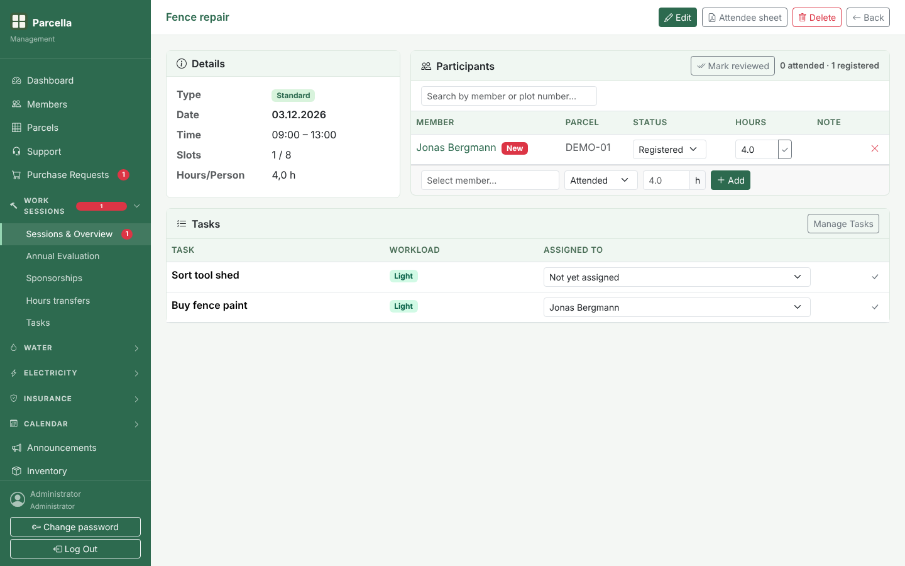
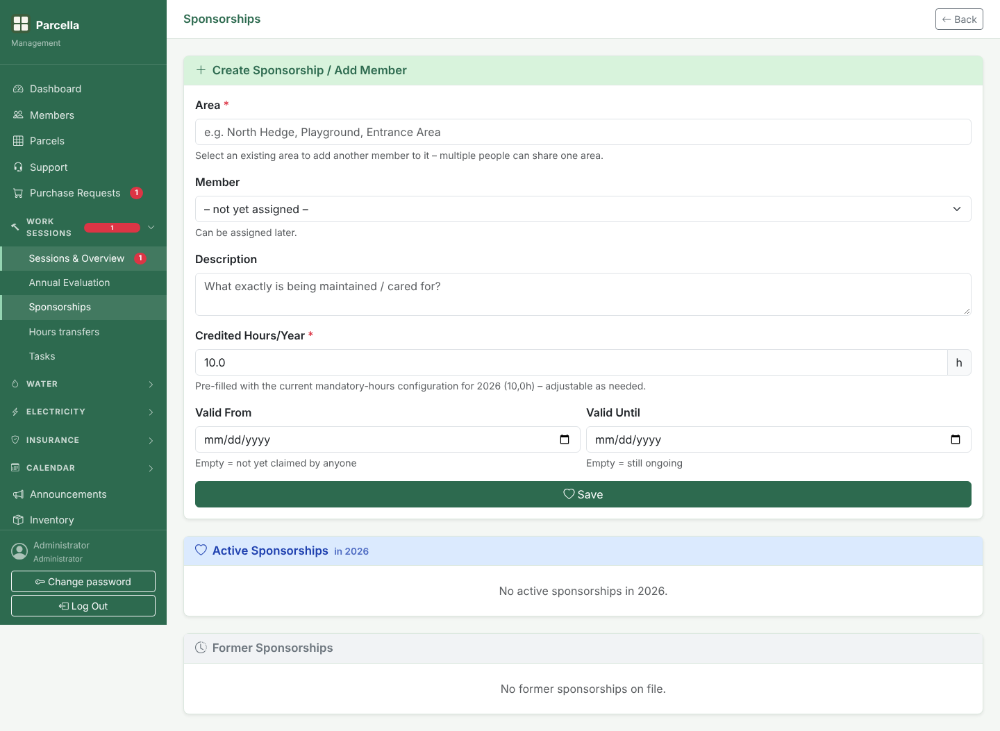
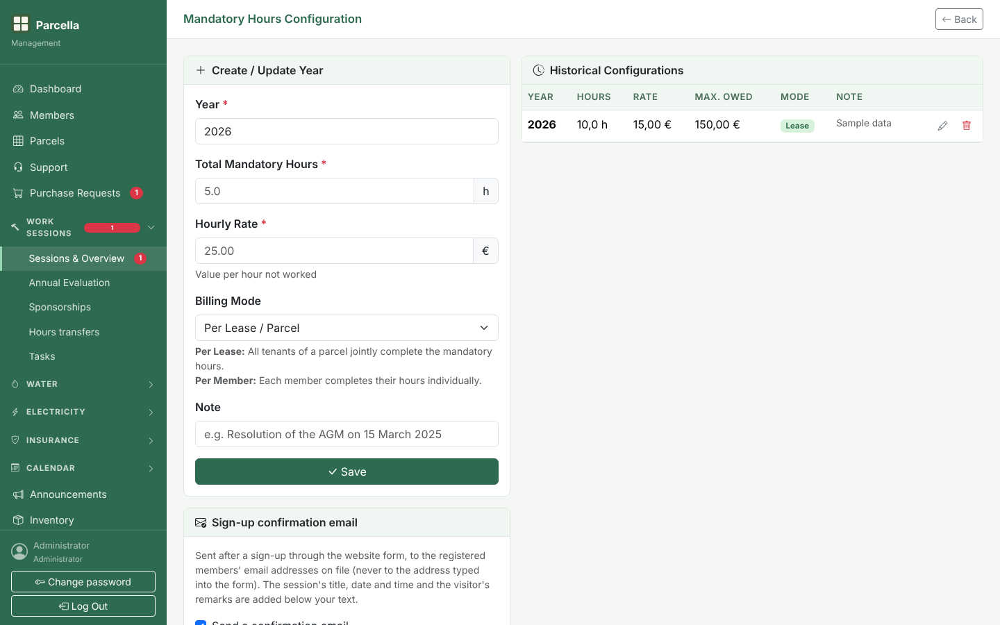

# Prace społeczne {#work-hours}

!!! note "Tłumaczenie maszynowe"
    Ta strona została przetłumaczona maszynowo z języka angielskiego i nie została jeszcze sprawdzona. Jeśli coś jest niejasne, obowiązuje wersja angielska (język zmienisz u góry).

Większość stowarzyszeń ogrodów działkowych oczekuje, że każdy członek
lub każda działka odpracuje w roku określoną liczbę
[obowiązkowych godzin](../glossary.md) albo zapłaci za godziny
nieodpracowane. Ten moduł planuje terminy prac stowarzyszenia,
zapisuje, kto był obecny, zalicza patronaty i zwolnienia, a na koniec
roku oblicza, kto jest jeszcze winien godziny i ile to pieniędzy.

!!! info "Kto może z tego korzystać"
    Moduł jest domyślnie włączony. Możesz go wyłączyć w **Administracja
    → Ustawienia** (**Zarządzanie pracami społecznymi**), jeśli Twoje
    stowarzyszenie nie wymaga obowiązkowych godzin -- zob.
    [Włączanie i wyłączanie modułów](../administration/modules.md). Przy
    wyłączeniu nic nie jest usuwane.

    Użytkownicy Administrator i Zarząd mogą wszystko. Inni użytkownicy
    potrzebują [grupy](../administration/groups.md), która nadaje
    uprawnienia do **Prace społeczne**: *odczyt*, aby oglądać strony,
    *zapis*, aby tworzyć i zmieniać rzeczy, *usuwanie*, aby usuwać
    terminy, uczestników, patronaty, przekazania, zadania, role klubowe
    i konfiguracje roczne. Bez co najmniej prawa odczytu menu **Prace
    społeczne** się nie pojawia.

Moduł znajdziesz w menu bocznym pod **Prace społeczne**, z pozycjami:
**Wpisy i przegląd**, **Rozliczenie roczne**, **Patronaty**,
**Przekazywanie godzin** i **Zadania**. Do konfiguracji godzin i ról
klubowych prowadzą przyciski na stronie przeglądu.

## Jak liczone są godziny {#how-the-hours-are-counted}

Zanim przyjrzysz się poszczególnym ekranom, warto wiedzieć, jak Parcella
sumuje rok. Dla każdego członka liczy:

- **Terminy prac** -- każdy termin w danym roku kalendarzowym, w którym
  status członka to **Obecny**. Każda obecność liczy się z godzinami
  wpisanymi dla tej osoby albo, jeśli ich nie wpisano, z **Godziny na
  uczestnika** terminu. **Zgłoszony** i **Nieobecny** nic nie liczą.
- **Patronaty** -- **Godziny zaliczane/rok** każdego patronatu
  przypisanego członkowi, którego okres nakłada się na rok. Patronat
  liczy się dopiero, gdy ma zarówno członka, jak i datę **Obowiązuje
  od**.
- **Przekazania godzin** -- godziny, które dali im inni członkowie
  (plus), minus godziny, które sami oddali (minus).

Co dalej, zależy od **Tryb rozliczenia** ustawionego dla roku w
[konfiguracji](#mandatory-hours-configuration):

| Tryb rozliczenia | Co oznacza dla stowarzyszenia |
|---|---|
| **Na dzierżawę / działkę** | Każda działka jest winna roczne godziny raz. Godziny wszystkich jej dzierżawców są sumowane: jeśli jeden dzierżawca przepracuje 2 godziny, a drugi 3, wymóg 5 godzin jest spełniony. |
| **Na członka** | Każdy członek, który miał dzierżawę w ciągu roku, jest winien godziny indywidualnie. |

Brakujące godziny mnoży się przez **Stawka godzinowa**, aby uzyskać
kwotę należną.

### Zwolnienia {#exemptions}

Członek jest zwolniony na dany rok, gdy pełni w tym roku
[rolę klubową](#club-roles) oznaczoną **Zwolniony z prac społecznych**
-- zwykle pracę w zarządzie.

!!! warning "Jeden zwolniony dzierżawca zwalnia całą działkę"
    W trybie **Na dzierżawę / działkę** działka jest zwolniona, gdy tylko
    **co najmniej jeden** z jej dzierżawców jest zwolniony.
    Współdzierżawcy członka zarządu nie są więc w tym roku nic winni:
    funkcja w zarządzie „pokrywa” całą działkę. Nie ma znaczenia, czy
    pozostali dzierżawcy sami są zwolnieni.

    W trybie **Na członka** zwolniony jest tylko zwolniony członek.

Zwolnienie zawsze dotyczy **całego roku kalendarzowego**, na który
wpisano przypisanie roli. Członek zarządu, który ustępuje w
październiku, pozostaje zwolniony do końca tego roku; daty w **Od** i
**Do** służą Twojej dokumentacji i nie skracają zwolnienia. W następnym
roku przypisujesz rolę ponownie (albo nie).

### Kto liczy się jako dzierżawca w danym roku {#who-counts-as-a-tenant-in-a-year}

Rozliczenie patrzy na to, kto miał działkę *w rozliczanym roku*, a nie
na to, kto ma ją dziś:

- Zakończenie dzierżawy nie anuluje godzin z tego roku. Dzierżawca,
  który odchodzi w czerwcu, jest nadal winien cały rok. W trybie **Na
  dzierżawę / działkę** zostaje w wierszu działki, razem z tym, kto
  przejął działkę; tak czy inaczej dostaje oznaczenie **dzierżawa
  zakończona**.
- Dzierżawa, która zakończyła się przed początkiem roku lub zaczyna się
  po nim, się nie liczy.
- Członek, który w ciągu roku przeniósł się z jednej działki na inną w
  stowarzyszeniu, liczy się tylko na działce, na którą się przeniósł.
- Członek, który ma jednocześnie dwie działki, jest winien godziny za
  każdą działkę. Jego godziny wypełniają działki w kolejności numerów
  działek: każda działka dostaje to, czego jeszcze potrzebuje, ostatnia
  dostaje resztę. Na przykład 7,5 godziny przy wymogu 5 godzin: pierwsza
  działka jest wypełniona 5 godzinami, druga ma 2,5 godziny i 2,5
  godziny brakuje. Rozliczenie pokazuje takiego dzierżawcę jako „5.0 z
  7.5 h”.
- Usunięci członkowie znikają ze wszystkich rozliczeń, także z minionych
  lat. Jeśli godziny odchodzącego mają być nadal fakturowane, zakończ
  jego członkostwo datą końcową zamiast go usuwać -- zob.
  [Członkowie](members.md).

## Wpisy i przegląd {#sessions-overview}

Strona startowa modułu, z tytułem **Prace społeczne** i rokiem.
Przychodź tu, aby planować terminy i od razu widzieć, czy przyszły nowe
zgłoszenia.

Jeśli dla wybranego roku nie ma jeszcze konfiguracji, żółty baner mówi
**Brak konfiguracji prac społecznych dla ....** z linkiem **Utwórz
teraz →**. W przeciwnym razie trzy kafelki pokazują ustawienia roku.

| Pole / przycisk | Do czego służy |
|---|---|
| Wybór roku (u góry po prawej) | Przełącza na inny rok. Wymieniane są tylko lata, które mają [konfigurację](#mandatory-hours-configuration). |
| **Nowy wpis** | Otwiera [formularz terminu](#new-work-session-and-edit-session). Wymaga prawa zapisu. |
| Kafelek **Wymagane** | Godziny wymagane w tym roku, **po** stawce godzinowej. |
| Kafelek **Tryb** | **Na dzierżawę** lub **Na członka** -- jednostka rozliczenia w tym roku. |
| Kafelek **Maks. kwota zaległości** | Godziny × stawka: ile jedna działka lub jeden członek jest winien **przy zero godzinach**. |
| **Rozliczenie roczne** | Otwiera [Rozliczenie roczne](#annual-evaluation) za ten rok. |
| **Eksport CSV** | Pobiera rozliczenie jako arkusz kalkulacyjny (zob. [Eksport CSV](#csv-export)). |

### Tabela terminów prac {#work-sessions-table}

Pokazuje każdy termin wybranego roku, od najnowszych.

| Kolumna | Co pokazuje |
|---|---|
| **Data** | Data terminu. |
| **Tytuł** | Link do [strony terminu](#session-page). Czerwona liczba obok liczy nowe zgłoszenia (zob. niżej). |
| **Typ** | **Standardowy** (planowany) lub **Specjalny** (spontaniczny). |
| **Godzina** | Od -- do albo „–”, jeśli nie wpisano godziny. |
| **Uczestnicy** | Liczba uczestników, „/ maksimum”, jeśli ustawiono limit, a w nawiasie ilu było **obecnych** i ilu jest **nowych**. |
| Przycisk oka | Otwiera stronę terminu. |

Jeśli rok nie ma jeszcze terminów, tabela mówi **Nie utworzono jeszcze
wpisów prac za ....** i proponuje **Utwórz pierwszy wpis** (z prawem
zapisu).

### Szybki dostęp {#quick-access}

Przyciski pod tabelą prowadzą do **Konfiguracja godzin**, **Role
klubowe**, **Patronaty** i **Zadania**.

### Nowe zgłoszenia: oznaczenia, kafelek na panelu i e-maile {#new-sign-ups-badges-dashboard-tile-and-e-mails}

Parcella oznacza udział jako *nowy* przez 14 dni od jego utworzenia --
niezależnie od tego, czy działkowiec zapisał się przez stronę
stowarzyszenia, czy członek zarządu dodał kogoś ręcznie. Liczą się tylko
terminy **Standardowy**, które się jeszcze nie odbyły; zapisanie
obecności na minionym terminie lub terminie **Specjalny** nigdy nie
pojawia się jako „nowe”.

Nowe zgłoszenia widzisz w czterech miejscach:

- czerwona liczba obok **Prace społeczne** i **Wpisy i przegląd** w
  menu bocznym,
- kafelek **Nowe zgłoszenia** na [panelu głównym](../getting-started/dashboard.md),
  z przyciskiem **Pokaż wszystkie**, który prowadzi tutaj,
- czerwona liczba obok tytułu terminu w tabeli powyżej,
- czerwone oznaczenie **Nowy** obok uczestnika na stronie terminu.

Gdy je przejrzysz, kliknij **Oznacz jako przejrzane** na
[stronie terminu](#session-page). Usuwa to oznaczenia „nowy” dla
wszystkich, którzy są w tym momencie na terminie. Każdy, kto zapisze się
później, jest znowu oznaczony jako nowy.

Parcella wysyła też e-maile do każdego aktywnego użytkownika z rolą
Administrator lub Zarząd:

- **Gdy członek zarządu dodaje uczestnika ręcznie**, pozostali
  użytkownicy Administrator i Zarząd dostają jeden e-mail na uczestnika
  („Nowe zgłoszenie do prac społecznych w ...”). Osoba, która go dodała,
  nie dostaje e-maila.
- **Gdy działkowcy zapisują się przez stronę stowarzyszenia**, wszyscy
  dostają jeden zbiorczy e-mail na zgłoszenie („... nowe(-ych)
  zgłoszenie(a) do prac społecznych w ...”), niezależnie od tego, ile
  terminów i członków gospodarstwa domowego zarejestrowano.

<!-- TODO(verify): users who only have full access through a group (not the Admin/Board role itself) don't receive these notification e-mails -- confirm this is intended. -->

## Zapisy przez stronę stowarzyszenia {#sign-ups-through-the-club-website}

Jeśli strona internetowa Twojego stowarzyszenia (np. WordPress) ma
formularz zapisu na terminy prac, działkowcy mogą się zapisywać bez
logowania do Parcelli. Wymaga to modułu **Publiczne API zgłoszeń**,
który jest **domyślnie wyłączony**, bo otwiera Parcellę na zgłoszenia z
internetu. Włącz go w **Administracja → Ustawienia**, a potem
skonfiguruj połączenie ze stroną w [Integracjach](../administration/integrations.md).
Co widzą działkowcy, opisuje strona [Dla działkowców](../gardeners/index.md).

Od strony zarządu dzieje się to:

- **Które terminy są proponowane.** Tylko terminy **Standardowy**,
  których data nie minęła. Termin z **Termin zamknięcia zapisów (dni
  wcześniej)** znika ze strony tyle dni wcześniej. Terminy **Specjalny**
  nigdy nie pojawiają się na stronie.
- **Kto zostaje zapisany.** Działkowiec wpisuje numer działki i
  opcjonalnie swoje imię i nazwisko. Parcella porównuje nazwisko z
  *obecnymi* dzierżawcami działki. Jeśli pasuje dokładnie do jednej
  osoby, zapisywana jest tylko ta osoba. Jeśli nie podano nazwiska albo
  nie pasuje jednoznacznie do jednej osoby, zapisywani są **wszyscy
  obecni dzierżawcy działki**, aby żaden zapis nie zginął. Działka bez
  obecnych dzierżawców nie może się zapisać.
- **Pełne terminy.** Jeśli termin nie ma dość wolnych miejsc dla
  wszystkich, którzy zostaliby zapisani, zapis na ten termin jest
  odrzucany w całości. Uczestnicy oznaczeni **Nieobecny** nie zajmują
  miejsca.
- **Bez duplikatów.** Dwukrotny zapis na ten sam termin nie tworzy
  drugiego wpisu.
- **Co widzisz.** Zapisy pojawiają się jako zwykli uczestnicy ze
  statusem **Zgłoszony**, oznaczeniem **Nowy** i **Notatka**, np.
  „Zgłoszenie publiczne, przypisane po nazwisku (działka G012) |
  Telefon: ...”. Gdy zapisano wszystkich dzierżawców, notatka to mówi i
  prosi o usunięcie tych, którzy faktycznie się nie zapisali.
- **Potwierdzenie dla działkowca.** Każdy nowo zapisany członek dostaje
  e-mail z potwierdzeniem na adres zapisany w jego rekordzie członka --
  nigdy na adres wpisany w formularzu na stronie. Tekst możesz zmienić
  lub wyłączyć w [konfiguracji](#sign-up-confirmation-email).

!!! tip "Po nadejściu zapisów ze strony"
    Otwórz termin, sprawdź notatki nowych uczestników, usuń tych, którzy
    zostali zapisani tylko na wszelki wypadek (wymaga prawa usuwania), i
    kliknij **Oznacz jako przejrzane**.

## Strona terminu {#session-page}

Kliknij tytuł terminu, aby go otworzyć. Tu zarządzasz listą uczestników
przed terminem i zapisujesz obecność po nim.

| Przycisk (na górze) | Do czego służy |
|---|---|
| **Edytuj** | Otwiera [formularz terminu](#new-work-session-and-edit-session). Wymaga prawa zapisu. |
| **Lista uczestników** | Pobiera PDF do wydrukowania i zabrania na termin (zob. niżej). |
| **Usuń** | Usuwa termin po potwierdzeniu. **Wszystkie udziały przepadają**, więc godziny przestają się komukolwiek liczyć. Zadania zaplanowane na termin wracają do zaległości. Wymaga prawa usuwania. |
| **Wstecz** | Wraca do przeglądu. |

### Szczegóły {#details}

Pokazuje **Typ** (**Standardowy** lub **Specjalny**), **Data**,
**Godzina**, **Miejsca** (uczestnicy / maksimum), **Godz./osoba** i
opis.

### Uczestnicy {#participants}

Nagłówek karty liczy, ilu uczestników było **obecnych**, a ilu jest
**zgłoszonych**. Jeśli są nowe zgłoszenia i masz prawo zapisu, pokazuje
też **Oznacz jako przejrzane** (zob.
[Nowe zgłoszenia](#new-sign-ups-badges-dashboard-tile-and-e-mails)).

Wpisz tekst w **Szukaj po członku lub numerze działki…**, aby
przefiltrować tabelę.

| Kolumna | Co pokazuje / robi |
|---|---|
| **Członek** | Imię i nazwisko, z linkiem do rekordu członka. Czerwone oznaczenie **Nowy** wskazuje nowe zgłoszenie. |
| **Działka** | Obecna działka (działki) członka. |
| **Status** | **Zgłoszony**, **Obecny** lub **Nieobecny**. Z prawem zapisu wybór innej wartości zapisuje się od razu. Tylko **Obecny** liczy się do godzin członka. |
| **Godziny** | Godziny zaliczone tej osobie. Pole jest wstępnie wypełnione jej własnymi godzinami albo, jeśli ich nie wpisano, **Godziny na uczestnika** terminu. Zmień je i kliknij **✓**, aby zapisać. Bez prawa zapisu widzisz tylko liczbę. |
| **Notatka** | Np. dane, które działkowiec wpisał w formularzu na stronie. |
| **×** | Usuwa uczestnika po potwierdzeniu. Wymaga prawa usuwania. |

!!! tip "Zapisz obecność po terminie"
    Ustaw każdego, kto przyszedł, na **Obecny** i popraw godziny osób,
    które zostały krócej lub dłużej. Tych, którzy nie przyszli, zostaw
    na **Nieobecny** zamiast ich usuwać, aby później było widać, kogo
    się spodziewano.

**Dodawanie uczestnika** (prawo zapisu): na dole karty zacznij wpisywać
nazwisko lub numer działki w **Wybierz członka…** i wybierz członka z
listy -- musisz wybrać kogoś z listy, samo wpisanie nazwiska nie
wystarczy. Członkowie już zapisani na termin nie są proponowani. Wybierz
status (wstępnie wybrany jest **Obecny**, bo zwykle zapisuje się tak
obecność po fakcie), opcjonalnie wpisz godziny (puste oznacza domyślne
godziny terminu) i kliknij **Dodaj**.

Ręczne dodanie kogoś jest zawsze możliwe, nawet gdy termin jest pełny,
termin zapisów minął lub termin jest w przeszłości -- limity dotyczą
tylko zapisów przez stronę.

### Zadania {#tasks}

Pokazuje [zadania](#tasks_1) zaplanowane na ten termin, z kolumnami
**Zadanie**, **Nakład pracy** i **Przydzielone do**. Z prawem zapisu
możesz wybrać jednego z uczestników terminu w **Przydzielone do** (lub
**Jeszcze nie przydzielone**) i oznaczyć zadanie jako wykonane lub
niewykonane przyciskiem haczyka. Wykonane zadania są przekreślone.
**Zarządzaj zadaniami** otwiera zaległości zadań.

### Lista uczestników {#attendee-sheet}

PDF wymienia każdego uczestnika terminu, posortowanego według działki i
nazwiska, z kolumnami **Działka**, **Członek**, **Godziny**,
**Przydzielone zadania** i **Podpis**. **Godziny** pokazuje godziny
indywidualne lub domyślne godziny terminu i jest puste, jeśli nie ma
żadnych. **Przydzielone zadania** zostaje puste, gdy nie przydzielono
jeszcze zadania, więc możesz je wpisać ręcznie. W razie potrzeby lista
zajmuje kilka stron.

Wydruk niczego nie zmienia w Parcelli: po terminie wpisz poprawiony
status i godziny na stronie terminu.

## Nowy termin prac i edycja terminu {#new-work-session-and-edit-session}

Otwierany przez **Nowy wpis** w przeglądzie albo **Edytuj** na stronie
terminu. Wymaga prawa zapisu. Tytuły formularza to **Nowy wpis prac
społecznych** i **Edytuj wpis**.

| Pole | Do czego służy |
|---|---|
| **Tytuł** | Wymagany. Np. „Wiosenne porządki”. |
| **Typ** | **Standardowy (planowany)** dla terminów planowanych z wyprzedzeniem, **Specjalny (spontaniczny)** dla niezaplanowanych. Tylko terminy Standardowe pojawiają się na stronie stowarzyszenia i liczą się jako nowe zgłoszenia. |
| **Data** | Wymagana. Godziny terminu liczą się do roku kalendarzowego tej daty. |
| **Od** / **Do** | Opcjonalna godzina rozpoczęcia i zakończenia. |
| **Maks. liczba uczestników** | Puste = bez limitu. Ogranicza zapisy przez stronę; członkowie zarządu nadal mogą dodawać więcej osób ręcznie. |
| **Termin zamknięcia zapisów (dni wcześniej)** | Zamyka zapisy przez stronę tyle dni przed terminem -- 1 zamyka je dzień wcześniej. Zostaw puste, aby były otwarte, dopóki nie minie data terminu. Nie wpływa na dodawanie osób w Parcelli. |
| **Godziny na uczestnika** | Domyślne godziny dla każdego obecnego, np. 4.0. Przy zapisywaniu obecności nadal możesz zmienić godziny dla każdej osoby. |
| **Opis** | Zadania, narzędzia, szczególne uwagi. |
| **Anuluj** / **Utwórz wpis** lub **Zapisz zmiany** | Zapis prowadzi na stronę terminu. |

## Rozliczenie roczne {#annual-evaluation}

Pokazuje dla każdej działki lub członka, ile godzin było wymaganych, ile
przepracowano i ile jest jeszcze winnych. Otwórz je z menu
(**Rozliczenie roczne**) albo z przeglądu. To lista, z którą pracujesz na
koniec roku, i to jej używa fakturowanie dla pozycji **Niedobór godzin
pracy (z modułu)** (zob. [Serie faktur](finances/invoice-runs.md)).

| Przycisk | Do czego służy |
|---|---|
| Wybór roku | Przełącza rok. Wymieniane są tylko skonfigurowane lata. |
| **Eksport CSV** | Pobiera rozliczenie (zob. niżej). |
| **Wstecz** | Wraca do przeglądu. |

Bez konfiguracji na dany rok strona pokazuje tylko żółty baner **Brak
konfiguracji prac społecznych dla ....**

Cztery kafelki na górze pokazują, ile wierszy jest **Zrealizowane** (np.
„18 / 25”), łączne **Godziny do zrealizowania**, **Łączna kwota
zaległości** oraz **Tryb** z godzinami i stawką.

### Tabela {#the-table}

Wiersze są zielone, gdy obowiązek jest spełniony, i żółte, gdy brakuje
godzin.

| Kolumna | Co pokazuje |
|---|---|
| **Działka** i **Dzierżawca** (tryb na dzierżawę) | Jeden wiersz na działkę, która w ciągu roku miała co najmniej jednego dzierżawcę, łącznie z działkami, których dzierżawa została wypowiedziana. Każdy dzierżawca jest wymieniony z godzinami w nawiasie, oznaczeniem **zwolniony**, jeśli jest zwolniony, oznaczeniem **dzierżawa zakończona** z datą, jeśli jego dzierżawa zakończyła się w ciągu roku, i „x z y h”, jeśli ma kilka działek. |
| **Członek** (tryb na członka) | Jeden wiersz na członka, który w ciągu roku miał dzierżawę, z oznaczeniem **dzierżawa zakończona**, gdzie to dotyczy. |
| **Wymagane** | Roczny wymóg. |
| **Wpisy prac** | Godziny z terminów prac z obecnością. |
| **Patronat** | Godziny zaliczone z patronatów. |
| **Przekazania** | Godziny otrzymane (+) lub oddane (−). „–”, jeśli nie ma. |
| **Razem** | Wpisy prac + patronat + przekazania. |
| **Pozostało** | Wciąż brakujące godziny. „–” dla zwolnionych wierszy. |
| **Zaległość** | Brakujące godziny × stawka godzinowa. „–” dla zwolnionych wierszy. |
| **Status** | **Zwolniony**, **Zrealizowane** lub **Otwarte**. |

Kliknij strzałkę przed wierszem (**Pokaż wpisy prac**), aby zobaczyć
**Wpisy prac z obecnością** w tym roku: datę, termin (z linkiem) i
godziny -- w trybie na dzierżawę jedną listę na dzierżawcę. Lista zawsze
sumuje się do kolumny **Wpisy prac**. Patronaty i przekazania nie są jej
częścią.

### Eksport CSV {#csv-export}

Plik CSV używa średników i nagłówków kolumn ze strony rozliczenia, w
języku stowarzyszenia: działka, dzierżawca, wymagane (h), wpisy prac
(h), patronat (h), przekazania (h), razem (h), pozostało (h), zaległość
(EUR), zwolniony i zrealizowane, z „Tak”/„Nie” dla tak/nie.

!!! warning "Eksport CSV działa tylko w trybie na dzierżawę"
    W roku skonfigurowanym jako **Na członka** plik CSV zawiera tylko
    wiersz nagłówka. Użyj zamiast tego strony rozliczenia.

!!! warning "Działki, których nikt już nie ma"
    Jeśli wszyscy dzierżawcy działki odeszli w ciągu roku, a działka nie
    została ponownie wydzierżawiona, działka nadal pokazuje brakujące
    godziny, ale automatyczna faktura nie może ich rozliczyć, bo działka
    nie ma obecnego dzierżawcy, do którego można ją zaadresować. Rozlicz
    takiego odchodzącego ręcznie. Jeśli działka została ponownie
    wydzierżawiona, nowy dzierżawca dostaje fakturę działki za ten rok.

## Patronaty {#sponsorships}

Patronat to część terenu, którą członek opiekuje się przez cały rok --
żywopłot, plac zabaw, wejście -- zamiast uczestniczyć w terminach prac.
Każdemu opiekunowi zaliczana jest stała liczba godzin rocznie. Otwórz
go przez **Patronaty** w menu lub w przeglądzie.

Strona ma trzy części: formularz tworzenia patronatu (prawo zapisu),
**Aktywne patronaty** i **Dawne patronaty**.

### Utwórz patronat / dodaj członka {#create-sponsorship-add-member}

| Pole | Do czego służy |
|---|---|
| **Obszar** | Wymagany. Podpowiada już używane nazwy obszarów. Wybierz istniejący obszar, aby dodać do niego kolejnego członka -- kilka osób może dzielić obszar i **każda z nich** dostaje pełne zaliczane godziny. |
| **Członek** | Wymienieni najpierw według numeru działki („G001 - Peter Ahnert”); członkowie bez działki są na końcu. Zostaw **– jeszcze nie przydzielono –**, aby ogłosić obszar, którego nikt jeszcze nie przejął. |
| **Opis** | Czym dokładnie trzeba się opiekować. |
| **Godziny zaliczane/rok** | Wymagane. Wstępnie wypełnione wymaganymi godzinami z konfiguracji roku, ale możesz je zmienić, jeśli obszar wymaga więcej lub mniej pracy. |
| **Obowiązuje od** | Puste = jeszcze nikt się nie zgłosił. |
| **Obowiązuje do** | Puste = nadal trwa. Nie może być przed **Obowiązuje od**. |
| **Zapisz** | Tworzy wpis. |

!!! info "Kiedy patronat się liczy"
    Patronat zalicza swoje godziny za każdy rok, na który nakłada się
    jego okres -- w całości, nawet jeśli skończył się w połowie roku.
    Liczy się dopiero, gdy ma **Członek** i datę **Obowiązuje od**. Wpis
    bez daty rozpoczęcia to stała oferta i jeszcze nikomu się nie liczy.

Jeśli wpiszesz datę zakończenia przed datą rozpoczęcia, Parcella odmawia
zapisu i pokazuje **Data zakończenia jest wcześniejsza niż data
rozpoczęcia. ...** Twoje dane zostają, abyś mógł je poprawić. Starsze
wpisy zapisane z takimi datami pokazują czerwone oznaczenie **Koniec
przed początkiem** i nie liczą się w żadnym roku, dopóki ich nie
poprawisz.

### Aktywne patronaty {#active-sponsorships}

Pokazuje patronaty na rok podany w nagłówku karty (**w ...**), które
jeszcze się nie skończyły, plus wszystkie nieprzejęte oferty. Wpisy z tym
samym obszarem są pogrupowane, z oznaczeniem „... osób”.

| Kolumna | Co pokazuje / robi |
|---|---|
| **Obszar** | Nazwa i opis. |
| **Członek(-owie)** | Powiązany członek albo *jeszcze nie przydzielono*. |
| **Godziny/rok** | Zaliczane godziny. |
| **Okres** | Od – do (lub *trwa*) albo *jeszcze nie przejęto*. |
| Ołówek | Otwiera [Edytuj patronat](#edit-sponsorship). Wymaga prawa zapisu. |
| Kosz | Usuwa wpis po potwierdzeniu. Wymaga prawa usuwania. |

Strona pokazuje bieżący rok, gdy otworzysz ją z menu. Przycisk
**Patronaty** w przeglądzie otwiera ją dla roku tam wybranego.

### Dawne patronaty {#former-sponsorships}

Każdy patronat, którego data **Obowiązuje do** minęła, od najnowszej
daty zakończenia, niezależnie od pokazywanego roku -- stały zapis. Te
same kolumny i działania co wyżej.

## Edytuj patronat {#edit-sponsorship}

<!-- TODO(verify): no screenshot -- the sample data contains no sponsorships, so the edit page can't be reached by the screenshot tool. -->

Otwierany ołówkiem na stronie patronatów. Wymaga prawa zapisu. Ma te
same pola co formularz tworzenia: **Obszar**, **Członek**, **Opis**,
**Godziny zaliczane/rok**, **Obowiązuje od** i **Obowiązuje do**, z
**Anuluj** i **Zapisz zmiany**. Obowiązuje ta sama kontrola dat. Po
zapisaniu wracasz na stronę patronatów dla roku, w którym zaczyna się
patronat.

## Przekazywanie godzin {#hours-transfers}

Członek, który przepracował więcej, niż jest winien, może przekazać
godziny innemu członkowi, np. aby pomóc sąsiadowi. Otwórz
**Przekazywanie godzin** w menu.

| Pole / przycisk | Do czego służy |
|---|---|
| Wybór roku | Przełącza rok. Wymienia skonfigurowane lata. |
| **Rozliczenie** | Otwiera Rozliczenie roczne za ten rok. |

### Przekaż godziny {#give-hours}

Wymaga prawa zapisu i konfiguracji na dany rok; w przeciwnym razie karta
mówi **Brak konfiguracji dla ...**.

| Pole | Do czego służy |
|---|---|
| **Od (przekazuje)** | Wymagane. Każdy, kto był członkiem w którymś momencie roku, według numeru działki. |
| **Do (otrzymuje)** | Wymagane. Nie może być tym samym członkiem. |
| **Godziny** | Wymagane, liczba dodatnia (zaokrąglana do jednego miejsca po przecinku). Najwyżej nadwyżka przekazującego w tym roku. |
| **Notatka** | Opcjonalna, np. powód. |
| **Przekaż godziny** | Zapisuje przekazanie. |

**Ile można przekazać.** Parcella sprawdza nadwyżkę przekazującego przy
zapisie:

- **Na członka**: własna suma przekazującego minus wymóg.
- **Na dzierżawę / działkę**: nadwyżka działki przekazującego --
  działka musi pozostać spełniona -- i nigdy więcej niż własne godziny
  przekazującego. Godzin współdzierżawcy nie może oddać ktoś inny.
- Zwolnieni członkowie i pomocnicy bez działki w danym roku mogą
  przekazać wszystkie swoje godziny.

Jeśli to za dużo, czerwony baner mówi, ile godzin można przekazać, np.
**Można przekazać tylko 2.0 h -- to nadwyżka przekazującego w tym
roku.**

!!! note
    Kontrola odbywa się tylko raz, przy zapisie przekazania. Jeśli
    obecność zostanie później poprawiona (albo przekazanie, na którym
    się opierała, zostanie usunięte), przekazującemu może zabraknąć
    godzin; rozliczenie pokazuje wtedy po prostu brakujące godziny.

### Przekazania w ... {#transfers-in}

Pokazuje przekazania roku z kolumnami **Od**, **Do**, **Godziny** i
**Notatka**, plus datę i kto je wpisał. Kosz usuwa przekazanie po
potwierdzeniu **Usunąć to przekazanie? Godziny wrócą do
przekazującego.** (prawo usuwania). Błędne wpisy są usuwane, a nie
zachowywane jako historia -- to poprawki, a nie historia stowarzyszenia.

## Zadania {#tasks_1}

Zaległości prac do wykonania, które możesz zaplanować na termin prac i
rozdać osobom, które się zapisały. Otwórz **Zadania** w menu, w
przeglądzie albo przez **Zarządzaj zadaniami** na stronie terminu.

Każde zadanie ma etykietę **Nakład pracy** -- **Lekkie**,
**Umiarkowane** lub **Wymagające** -- aby koordynator terminu mógł dać
każdemu odpowiednią pracę. Tylko tę etykietę Parcella przechowuje: nie
ma pola na wiek ani zdrowie członka i nic nie jest dopasowywane
automatycznie. Kto co robi, pozostaje decyzją koordynatora.

### Nowe zadanie {#new-task}

Wymaga prawa zapisu.

| Pole | Do czego służy |
|---|---|
| **Tytuł** | Wymagany. Np. „Przyciąć północny żywopłot”. |
| **Opis** | Wszelkie szczegóły, które warto znać przed rozpoczęciem. |
| **Nakład pracy** | **Lekkie**, **Umiarkowane** (wstępnie wybrane) lub **Wymagające**. Tylko wskazówka, nie jest egzekwowana. |
| **Wpis prac** | Jeden z nadchodzących terminów albo **-- Zaległości (jeszcze nie zaplanowane) --**, aby zaplanować później. |
| **Dodaj zadanie** | Zapisuje zadanie. |

### Zaległości {#backlog}

Zadania bez terminu, od najnowszych, z kolumnami **Zadanie**, **Nakład
pracy** i **Zaplanuj do**. Wybór terminu w **Zaplanuj do** od razu
przenosi tam zadanie (prawo zapisu). Proponowane są tylko terminy od
dziś. Kosz usuwa zadanie (prawo usuwania).

### Zaplanowane zadania {#scheduled-tasks}

Pod zaległościami jedna karta na każdy termin, który ma zadania (od
najnowszego terminu), z datą i tytułem terminu jako linkiem. Kolumny:
**Zadanie**, **Nakład pracy**, **Przydzielone do**, przycisk haczyka do
oznaczenia jako wykonane lub niewykonane (prawo zapisu) i kosz do
usunięcia (prawo usuwania). Wykonane zadania są przekreślone.

Zadanie przydzielasz osobie na [stronie terminu](#tasks), gdzie lista
**Przydzielone do** proponuje uczestników tego terminu -- przydział ma
sens tylko dla kogoś, kto zapisał się na ten termin.

<!-- TODO(verify): the web pages offer no way to move a task that is already scheduled to a different session or back to the backlog (only the backlog has a "Schedule to" list). Moving it via the API clears the assignment. Confirm this is intended or a gap. -->

## Role klubowe {#club-roles}

Funkcje w stowarzyszeniu -- prezes, skarbnik, opiekun wodociągu -- i
kto pełni je w którym roku. Rola oznaczona jako zwolniona zwalnia swojego
posiadacza (a w trybie na dzierżawę całą jego działkę) z obowiązkowych
godzin w tym roku. Otwórz ją przyciskiem **Role klubowe** w przeglądzie.

| Pole / przycisk | Do czego służy |
|---|---|
| Wybór roku | Rok, którego przypisania ról są pokazywane i tworzone. Proponuje bieżący rok i cztery poprzednie. |
| **Wstecz** | Wraca do przeglądu. |

### Nowa rola klubowa {#new-club-role}

Wymaga prawa zapisu.

| Pole | Do czego służy |
|---|---|
| **Nazwa** | Wymagana, np. „Prezes”. |
| **Opis** | Obowiązki tej roli. |
| **Zwolniony z prac społecznych** | Zaznacz, jeśli posiadacze nie muszą odpracowywać godzin. |
| **Powód zwolnienia** | Pojawia się po zaznaczeniu pola: **Praca w zarządzie**, **Rozszerzony zarząd**, **Choroba / powody zdrowotne**, **Zwolnienie wiekowe** lub **Inny powód**. Dla Twojej dokumentacji; nie zmienia sposobu działania zwolnienia. |
| **Utwórz rolę** | Zapisuje rolę. |

### Istniejące role {#existing-roles}

Pokazuje wszystkie role z kolumnami **Nazwa** (i opis) oraz
**Zwolniony** (**Tak**/**Nie**). Ołówek otwiera
[Edytuj rolę klubową](#edit-club-role) (prawo zapisu). Kosz usuwa rolę
po ostrzeżeniu **Czy na pewno usunąć rolę? Wszystkie przypisania
zostaną utracone.** (prawo usuwania).

!!! warning "Usunięcie roli zmienia minione lata"
    Przypisania ze *wszystkich* lat są usuwane razem z rolą, więc
    członkowie, którzy byli zwolnieni we wcześniejszych latach, nie są
    już zwolnieni także w rozliczeniach tych lat. Usuwaj tylko rolę
    wpisaną przez pomyłkę.

### Członkowie w rolach klubowych {#members-in-club-roles}

Przypisuje członków do ról na rok wybrany na górze. Wymaga prawa zapisu.

| Pole | Do czego służy |
|---|---|
| **Członek** | Wymagany. Obecni członkowie, alfabetycznie. |
| **Rola klubowa** | Wymagana. |
| **Od** / **Do** | Opcjonalne daty kadencji. Puste **Do** = nadal trwa. Tylko dla Twojej dokumentacji -- zwolnienie zawsze obejmuje cały rok. |
| **Przypisz** | Zapisuje przypisanie. Dwukrotne przypisanie tego samego członka do tej samej roli w jednym roku nic nie robi. |

Tabela pokazuje przypisania roku z kolumnami **Członek**, **Rola**,
**Zwolniony**, **Od**, **Do** (lub *trwa*) i **Notatka**. Ołówek otwiera
[Edytuj przypisanie](#edit-assignment) (prawo zapisu); **×** usuwa
przypisanie po potwierdzeniu (prawo usuwania).

!!! tip "Co roku na nowo"
    Przypisania ról należą do jednego roku. Na początku nowego roku
    wybierz go na górze i przypisz zarząd ponownie, w przeciwnym razie
    nikt nie jest w tym roku zwolniony. Aby wpisać przyszły rok, którego
    wybór jeszcze nie proponuje, utwórz przypisanie i zmień jego **Rok**
    w [Edytuj przypisanie](#edit-assignment).

## Edytuj rolę klubową {#edit-club-role}

<!-- TODO(verify): no screenshot -- the sample data contains no club roles. -->

Otwierana ołówkiem obok roli. Te same pola co przy tworzeniu: **Nazwa**,
**Opis**, **Zwolniony z prac społecznych** i **Powód zwolnienia**, z
**Anuluj** i **Zapisz zmiany**. Zmiana tego, czy rola jest zwolniona,
dotyczy każdego roku, w którym była przypisana, łącznie z minionymi.

## Edytuj przypisanie {#edit-assignment}

<!-- TODO(verify): no screenshot -- the sample data contains no club-role assignments. -->

Otwierane ołówkiem obok przypisania (**Edytuj członka w roli
klubowej**).

| Pole | Do czego służy |
|---|---|
| **Członek** | Wymagany. |
| **Rola klubowa** | Wymagana. |
| **Rok** | Wymagany. Zwolnienie z prac społecznych obowiązuje przez cały ten rok kalendarzowy. |
| **Od** / **Do** | Opcjonalne daty kadencji; puste **Do** = nadal trwa. |
| **Notatka** | Np. powód ustąpienia, przekazanie funkcji… |
| **Anuluj** / **Zapisz zmiany** | Zapis wraca do ról klubowych roku przypisania. |

## Konfiguracja prac społecznych {#mandatory-hours-configuration}

Roczne zasady: ile godzin, ile kosztuje nieprzepracowana godzina i czy
liczysz na działkę, czy na członka. Każdy rok ma własną konfigurację,
więc zmiana stawki na przyszły rok nie dotyka minionych lat. Otwórz ją
przyciskiem **Konfiguracja godzin** w przeglądzie albo **Utwórz teraz →**
w banerze ostrzegawczym.

Bez konfiguracji na dany rok ten rok nie może być rozliczony, godzin nie
można przekazywać, a fakturowanie nie rozlicza niedoboru godzin pracy.

### Utwórz / zaktualizuj rok {#create-update-year}

Wymaga prawa zapisu.

| Pole | Do czego służy |
|---|---|
| **Rok** | Wymagany, wstępnie wypełniony bieżącym rokiem. |
| **Łączna liczba wymaganych godzin** | Wymagana, np. 5.0. |
| **Stawka godzinowa** | Wymagana. Wartość za nieprzepracowaną godzinę, w walucie stowarzyszenia. |
| **Tryb rozliczenia** | **Na dzierżawę / działkę**: wszyscy dzierżawcy działki wspólnie odpracowują godziny. **Na członka**: każdy członek odpracowuje swoje godziny indywidualnie. |
| **Notatka** | Np. uchwała walnego zebrania, z której pochodzą liczby. |
| **Zapisz** | Zapisuje rok. Jeśli rok ma już konfigurację, zostaje ona **nadpisana** tymi wartościami. |

### E-mail z potwierdzeniem zgłoszenia {#sign-up-confirmation-email}

Wymaga prawa zapisu. Steruje e-mailem, który członek dostaje po zapisie
przez stronę stowarzyszenia (zob.
[Zapisy przez stronę stowarzyszenia](#sign-ups-through-the-club-website)).

| Pole | Do czego służy |
|---|---|
| **Wysyłaj e-mail z potwierdzeniem** | Domyślnie włączone. Odznacz, aby nie wysyłać potwierdzeń. |
| **Twój tekst** | Zwykły tekst; pusty wiersz zaczyna nowy akapit. Zostaw puste, aby użyć standardowego tekstu pokazanego na szaro. Do 5000 znaków. |
| **Zapisz** | Zapisuje oba ustawienia i pokazuje **Zapisano potwierdzenie zgłoszenia.** |

E-mail trafia na adres e-mail zapisany przy każdym zapisanym członku,
nigdy na adres wpisany w formularzu na stronie. Jego temat to „Odp.:
Twoje zgłoszenie na prace społeczne w dniu” plus data. Pod Twoim
tekstem Parcella dodaje tytuł, datę i godzinę terminu oraz -- tylko
jeśli nazwisko pasowało dokładnie do jednego członka -- uwagi wpisane
przez odwiedzającego (do 500 znaków). Jeśli wysyłka się nie uda,
rejestracja i tak zostaje.

### Historyczne konfiguracje {#historical-configurations}

Wszystkie skonfigurowane lata, od najnowszych.

| Kolumna | Co pokazuje / robi |
|---|---|
| **Rok**, **Godziny**, **Stawka** | Ustawienia roku. |
| **Maks. zaległość** | Godziny × stawka. |
| **Tryb** | **Dzierżawa** lub **Członek**. |
| **Notatka** | Twoja notatka. |
| Ołówek | Otwiera [Edytuj konfigurację](#edit-configuration). Wymaga prawa zapisu. |
| Kosz | Usuwa konfigurację roku po potwierdzeniu. Wymaga prawa usuwania. Terminy, patronaty i przekazania zostają, ale roku nie można już rozliczyć ani zafakturować. |

## Edytuj konfigurację {#edit-configuration}

Otwierana ołówkiem obok roku. Pola są takie same jak wyżej -- **Rok**,
**Łączna liczba wymaganych godzin**, **Stawka godzinowa**, **Tryb
rozliczenia** i **Notatka** -- z **Anuluj** i **Zapisz zmiany**. Możesz
zmienić sam rok; jeśli dla nowego roku istnieje już inna konfiguracja,
Parcella odmawia z komunikatem **Dla ... istnieje już inna
konfiguracja.**

!!! warning
    Zmiana godzin, stawki lub trybu od razu zmienia rozliczenie tego
    roku. Jeśli faktury za ten rok zostały już utworzone, nie są
    aktualizowane.

<!-- TODO(verify): confirm that already-created invoices keep their amounts when the work-hours configuration changes afterwards. -->

## Powiązane {#related}

- [Organizacja terminu prac](../guides/work-session.md) -- krok po kroku
  od planowania do rozliczenia
- [Roczne fakturowanie](../guides/annual-invoicing.md) i
  [Serie faktur](finances/invoice-runs.md) -- fakturowanie brakujących
  godzin
- [Członkowie](members.md) i [Działki](parcels.md) -- dzierżawy
  decydują, kto jest winien godziny
- [Kalendarz](calendar.md) -- terminy Standardowe pojawiają się też w
  kalendarzu stowarzyszenia
- [Integracje](../administration/integrations.md) -- podłączenie
  formularza zapisów na stronie stowarzyszenia
- [Dziennik e-maili](../administration/email-log.md) -- sprawdzenie, czy
  e-maile z powiadomieniami i potwierdzeniami wyszły
