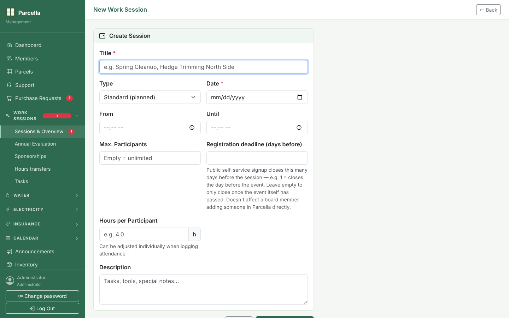
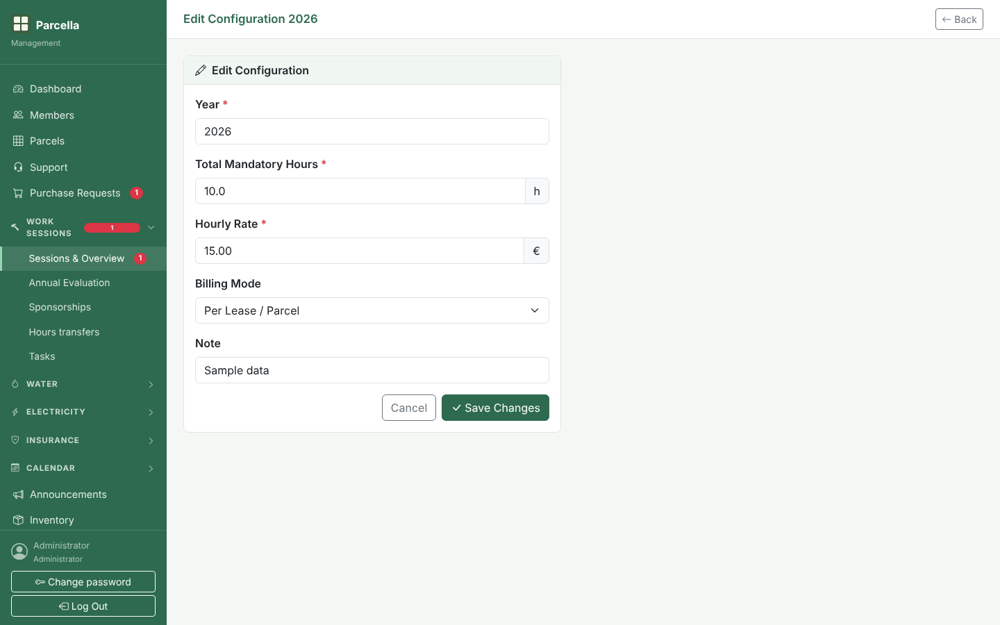

# Pracovné hodiny {#work-hours}

!!! note "Strojový preklad"
    Táto stránka bola strojovo preložená z angličtiny a zatiaľ nebola skontrolovaná. Ak je niečo nejasné, platí anglická verzia (jazyk prepnete hore).

Väčšina záhradkárskych spolkov očakáva, že každý člen alebo každá
parcela odpracuje za rok určitý počet [povinných pracovných
hodín](../glossary.md) alebo zaplatí za hodiny, ktoré neodpracoval.
Tento modul plánuje pracovné zmeny spolku, zaznamenáva, kto prišiel,
pripisuje sponzorstvá a oslobodenia a na konci roka vypočíta, kto ešte
dlží hodiny a koľko peňazí to robí.

!!! info "Kto to môže používať"
    Modul je predvolene zapnutý. Môžete ho vypnúť v **Administrácia →
    Nastavenia** (**Správa pracovných hodín**), ak váš spolok povinné
    hodiny nevyžaduje -- pozri
    [Zapínanie a vypínanie modulov](../administration/modules.md). Pri
    vypnutí sa nič nezmaže.

    Používatelia Admin a Výbor môžu všetko. Ostatní používatelia
    potrebujú [skupinu](../administration/groups.md), ktorá udeľuje
    oprávnenia pre **Pracovné sedenia**: *čítanie* na zobrazenie
    stránok, *zápis* na vytváranie a zmeny, *mazanie* na odstraňovanie
    zmien, účastníkov, sponzorstiev, prevodov, úloh, rolí v spolku a
    ročných konfigurácií. Bez aspoň oprávnenia na čítanie sa menu
    **Pracovné sedenia** nezobrazí.

Modul nájdete v bočnom menu pod **Pracovné sedenia** s týmito
položkami: **Sedenia a prehľad**, **Ročné hodnotenie**, **Sponzorstvá**,
**Prevody hodín** a **Úlohy**. Ku konfigurácii hodín a rolám v spolku
sa dostanete tlačidlami na stránke prehľadu.

## Ako sa hodiny počítajú {#how-the-hours-are-counted}

Skôr než sa pozriete na jednotlivé obrazovky, pomôže vedieť, ako
Parcella sčítava rok. Pre každého člena počíta:

- **Pracovné zmeny** -- každú zmenu v danom kalendárnom roku, kde má
  člen stav **Zúčastnený**. Každá účasť sa počíta s hodinami zadanými
  pre túto osobu, alebo, ak neboli zadané, s **Hodiny na účastníka**
  danej zmeny. **Zaregistrovaný** a **Nedostavil sa** sa nepočítajú.
- **Sponzorstvá** -- **Pripísané hodiny/rok** každého sponzorstva
  prideleného členovi, ktorého obdobie sa prekrýva s rokom. Sponzorstvo
  sa počíta, až keď má člena aj dátum **Platné od**.
- **Prevody hodín** -- hodiny, ktoré mu dali iní členovia (plus), mínus
  hodiny, ktoré odovzdal (mínus).

Čo nasleduje, závisí od **Fakturačný režim**, ktorý pre rok nastavíte v
[konfigurácii](#mandatory-hours-configuration):

| Fakturačný režim | Čo to znamená pre spolok |
|---|---|
| **Na nájom / parcelu** | Každá parcela dlží ročné hodiny raz. Hodiny všetkých jej nájomcov sa sčítajú: ak jeden nájomca odpracuje 2 hodiny a druhý 3, požiadavka 5 hodín je splnená. |
| **Na člena** | Každý člen, ktorý mal počas roka nájom, dlží hodiny individuálne. |

Otvorené hodiny sa vynásobia **Hodinová sadzba**, čím vznikne dlžná
suma.

### Oslobodenia {#exemptions}

Člen je za rok oslobodený, keď má na tento rok [rolu v
spolku](#club-roles) označenú **Oslobodený od povinných hodín** --
typicky prácu vo výbore.

!!! warning "Jeden oslobodený nájomca oslobodí celú parcelu"
    V režime **Na nájom / parcelu** je parcela oslobodená, hneď ako je
    oslobodený **aspoň jeden** z jej nájomcov. Spolunájomcovia člena
    výboru preto v tom roku tiež nič nedlžia: funkcia vo výbore
    „pokrýva“ celú parcelu. Nezáleží na tom, či sú ostatní nájomcovia
    oslobodení sami.

    V režime **Na člena** je oslobodený len oslobodený člen.

Oslobodenie vždy platí pre **celý kalendárny rok**, pre ktorý je
pridelenie roly zadané. Člen výboru, ktorý v októbri odstúpi, zostáva
oslobodený do konca roka; dátumy v **Od** a **Do** sú pre vašu evidenciu
a oslobodenie neskracujú. Budúci rok rolu pridelíte znova (alebo nie).

### Kto sa v roku počíta ako nájomca {#who-counts-as-a-tenant-in-a-year}

Hodnotenie sa pozerá na to, kto mal parcelu *počas hodnoteného roka*,
nie kto ju má dnes:

- Ukončenie nájmu nezruší hodiny daného roka. Nájomca, ktorý odíde v
  júni, stále dlží celý rok. V režime **Na nájom / parcelu** zostáva v
  riadku parcely, spolu s tým, kto parcelu prevzal; v každom prípade
  dostane odznak **nájom ukončený**.
- Nájom, ktorý skončil pred začiatkom roka alebo začína po ňom, sa
  nepočíta.
- Člen, ktorý sa počas roka presunul z jednej parcely na inú v rámci
  spolku, sa počíta len na parcele, na ktorú sa presunul.
- Člen, ktorý má súčasne dve parcely, dlží hodiny za každú parcelu.
  Jeho vlastné hodiny napĺňajú parcely v poradí čísel parciel: každá
  parcela dostane, čo ešte potrebuje, posledná dostane zvyšok.
  Napríklad 7,5 hodiny pri požiadavke 5 hodín: prvá parcela je splnená s
  5 hodinami, druhá má 2,5 hodiny a 2,5 hodiny otvorené. Hodnotenie
  takého nájomcu ukazuje ako „5.0 z 7.5 h“.
- Členovia, ktorí boli zmazaní, vypadnú z každého hodnotenia, aj z
  minulých rokov. Ak sa majú hodiny odchádzajúceho stále fakturovať,
  ukončite jeho členstvo dátumom ukončenia namiesto zmazania -- pozri
  [Členovia](members.md).

## Sedenia a prehľad {#sessions-overview}

Úvodná stránka modulu s nadpisom **Povinné hodiny** a rokom. Príďte
sem plánovať zmeny a na prvý pohľad vidieť, či prišli nové prihlásenia.

Ak pre vybraný rok ešte neexistuje konfigurácia, žltý pruh hovorí **Pre
... zatiaľ neexistuje konfigurácia povinných hodín.** s odkazom
**Vytvoriť teraz →**. Inak tri dlaždice ukazujú nastavenia roka.

| Pole / tlačidlo | Čo robí |
|---|---|
| Výber roka (vpravo hore) | Prepne na iný rok. Uvedené sú len roky, ktoré majú [konfiguráciu](#mandatory-hours-configuration). |
| **Nové sedenie** | Otvorí [formulár zmeny](#new-work-session-and-edit-session). Potrebuje oprávnenie na zápis. |
| Dlaždica **Povinné hodiny** | Hodiny požadované v tomto roku a **pri** hodinovej sadzbe. |
| Dlaždica **Režim** | **Na nájom** alebo **Na člena** -- fakturačná jednotka pre tento rok. |
| Dlaždica **Max. dlžná suma** | Hodiny × sadzba: čo jedna parcela alebo člen dlží **pri nula hodinách**. |
| **Ročné hodnotenie** | Otvorí [Ročné hodnotenie](#annual-evaluation) za tento rok. |
| **CSV export** | Stiahne hodnotenie ako tabuľku (pozri [Export CSV](#csv-export)). |

### Tabuľka pracovných zmien {#work-sessions-table}

Uvádza každú zmenu vybraného roka, najnovšie prvé.

| Stĺpec | Čo ukazuje |
|---|---|
| **Dátum** | Dátum zmeny. |
| **Názov** | Odkazuje na [stránku zmeny](#session-page). Červené číslo vedľa neho počíta nové prihlásenia (pozri nižšie). |
| **Typ** | **Štandard** (plánovaná) alebo **Špeciál** (spontánna). |
| **Čas** | Od -- do alebo „–“, ak čas nebol zadaný. |
| **Účastníci** | Počet účastníkov, „/ maximum“, ak je nastavený limit, a v zátvorkách koľkí sa **zúčastnili** a koľkí sú **noví**. |
| Tlačidlo s okom | Otvorí stránku zmeny. |

Ak rok ešte nemá žiadne zmeny, tabuľka hovorí **Zatiaľ žiadne pracovné
sedenia pre ....** a ponúka **Vytvoriť prvé sedenie** (s oprávnením na
zápis).

### Rýchly prístup {#quick-access}

Tlačidlá pod tabuľkou vedú na **Konfigurácia hodín**, **Roly v
spolku**, **Sponzorstvá** a **Úlohy**.

### Nové prihlásenia: odznaky, dlaždica na dashboarde a e-maily {#new-sign-ups-badges-dashboard-tile-and-e-mails}

Parcella označí účasť ako *novú* na 14 dní od jej vytvorenia -- či už
sa záhradkár prihlásil cez web spolku, alebo niekoho pridal ručne člen
výboru. Počítajú sa len zmeny **Štandard**, ktoré sa ešte nekonali;
zaznamenanie účasti na minulej zmene alebo na zmene **Špeciál** sa
nikdy neukáže ako „nové“.

Nové prihlásenia vidíte na štyroch miestach:

- červené číslo vedľa **Pracovné sedenia** a **Sedenia a prehľad** v
  bočnom menu,
- dlaždica **Nové prihlásenia** na [dashboarde](../getting-started/dashboard.md)
  s tlačidlom **Zobraziť všetko**, ktoré vedie sem,
- červené číslo vedľa názvu zmeny v tabuľke vyššie,
- červený odznak **Nový** vedľa účastníka na stránke zmeny.

Keď si ich pozriete, kliknite na **Označiť ako skontrolované** na
[stránke zmeny](#session-page). Tým sa zrušia „nové“ značky u každého,
kto je v tej chvíli na zmene. Ktokoľvek, kto sa prihlási neskôr, je
znova označený ako nový.

Parcella posiela aj e-maily každému aktívnemu používateľovi s rolou
Admin alebo Výbor:

- **Keď člen výboru ručne pridá účastníka**, ostatní používatelia Admin
  a Výbor dostanú jeden e-mail na účastníka („New work-session sign-up
  in ...“ v jazyku spolku). Ten, kto ho pridal, žiadny nedostane.
- **Keď sa záhradkári prihlásia cez web spolku**, každý dostane jeden
  súhrnný e-mail na odoslanie formulára, bez ohľadu na to, koľko zmien a
  členov domácnosti sa prihlásilo.

<!-- TODO(verify): users who only have full access through a group (not the Admin/Board role itself) don't receive these notification e-mails -- confirm this is intended. -->

## Prihlásenia cez web spolku {#sign-ups-through-the-club-website}

Ak má web vášho spolku (napríklad WordPress) prihlasovací formulár na
pracovné zmeny, záhradkári sa môžu prihlásiť bez prihlásenia do
Parcelly. Potrebuje to modul **Verejné API pre prihlášky**, ktorý je
**predvolene vypnutý**, pretože otvára Parcellu odosielaniu z
internetu. Zapnite ho v **Administrácia → Nastavenia**, potom nastavte
prepojenie s webom v časti [Integrácie](../administration/integrations.md).
Čo vidia záhradkári, je opísané v časti [Pre záhradkárov](../gardeners/index.md).

Zo strany výboru sa deje toto:

- **Ktoré zmeny sa ponúkajú.** Len zmeny **Štandard**, ktorých dátum
  neuplynul. Zmena s **Uzávierka prihlášok (dní vopred)** zmizne z
  webu o toľko dní skôr. Zmeny **Špeciál** sa na webe nikdy nezobrazia.
- **Kto sa prihlási.** Záhradkár zadá číslo parcely a voliteľne svoje
  meno. Parcella porovná meno so *súčasnými* nájomcami parcely. Ak sa
  zhoduje s presne jednou osobou, prihlási sa len táto osoba. Ak meno
  nebolo zadané alebo sa jednoznačne nezhoduje s jednou osobou,
  prihlásia sa **všetci súčasní nájomcovia parcely**, aby sa žiadna
  prihláška nestratila. Parcela bez súčasných nájomcov sa prihlásiť
  nemôže.
- **Plné zmeny.** Ak zmena nemá dosť voľných miest pre všetkých, ktorí
  by sa prihlásili, prihlásenie na túto zmenu sa odmietne celé.
  Účastníci so stavom **Nedostavil sa** miesto nezaberajú.
- **Žiadne duplicity.** Dvojité prihlásenie na tú istú zmenu nevytvorí
  druhý záznam.
- **Čo vidíte.** Prihlásenia sa zobrazia ako bežní účastníci so stavom
  **Zaregistrovaný**, odznakom **Nový** a **Poznámka** ako „Public
  signup, matched by name (parcel G012) | Phone: ...“ (v jazyku
  spolku). Keď boli prihlásení všetci nájomcovia, poznámka to uvádza a
  žiada vás, aby ste odstránili toho, kto sa v skutočnosti neprihlásil.
- **Potvrdenie záhradkárovi.** Každý novo prihlásený člen dostane
  potvrdzujúci e-mail na adresu uloženú v jeho zázname člena -- nikdy na
  adresu zadanú vo formulári na webe. Text môžete zmeniť alebo ho vypnúť
  v [konfigurácii](#sign-up-confirmation-email).

!!! tip "Keď prídu prihlásenia z webu"
    Otvorte zmenu, skontrolujte poznámky nových účastníkov, odstráňte
    tých, ktorí boli prihlásení len pre istotu (potrebuje oprávnenie na
    mazanie), a kliknite na **Označiť ako skontrolované**.

## Stránka zmeny {#session-page}

Kliknutím na názov zmeny ju otvoríte. Tu spravujete zoznam účastníkov
pred zmenou a potom zaznamenávate účasť.

| Tlačidlo (hore) | Čo robí |
|---|---|
| **Upraviť** | Otvorí [formulár zmeny](#new-work-session-and-edit-session). Potrebuje oprávnenie na zápis. |
| **Zoznam účastníkov** | Stiahne PDF na vytlačenie a prinesenie na zmenu (pozri nižšie). |
| **Vymazať** | Po potvrdení zmaže zmenu. **Všetky účasti sa stratia**, takže hodiny sa už nikomu nepočítajú. Úlohy naplánované na zmenu sa vrátia medzi nezaradené. Potrebuje oprávnenie na mazanie. |
| **Späť** | Vráti sa na prehľad. |

### Podrobnosti {#details}

Ukazuje **Typ** (**Štandard** alebo **Špeciál**), **Dátum**, **Čas**,
**Miesta** (účastníci / maximum), **Hodiny/osoba** a popis.

### Účastníci {#participants}

Hlavička karty počíta, koľkí účastníci sa **zúčastnili** a koľkí sú
**zaregistrovaní**. Ak sú nové prihlásenia a máte oprávnenie na zápis,
ukazuje aj **Označiť ako skontrolované** (pozri
[Nové prihlásenia](#new-sign-ups-badges-dashboard-tile-and-e-mails)).

Píšte do **Hľadať podľa člena alebo čísla záhradky…**, aby ste tabuľku
vyfiltrovali.

| Stĺpec | Čo ukazuje / robí |
|---|---|
| **Člen** | Meno s odkazom na záznam člena. Červený odznak **Nový** označuje nové prihlásenie. |
| **Záhradka** | Súčasné parcely člena. |
| **Stav** | **Zaregistrovaný**, **Zúčastnený** alebo **Nedostavil sa**. S oprávnením na zápis sa výber inej hodnoty uloží okamžite. Do hodín člena sa počíta len **Zúčastnený**. |
| **Hodiny** | Hodiny pripísané tejto osobe. Pole je predvyplnené jej vlastnými hodinami alebo, ak neboli zadané, **Hodiny na účastníka** danej zmeny. Zmeňte ho a kliknite na **✓**, aby ste ho uložili. Bez oprávnenia na zápis vidíte len číslo. |
| **Poznámka** | Napríklad údaje, ktoré záhradkár zadal do formulára na webe. |
| **×** | Po potvrdení odstráni účastníka. Potrebuje oprávnenie na mazanie. |

!!! tip "Účasť zaznamenajte po zmene"
    Každému, kto prišiel, nastavte **Zúčastnený** a opravte hodiny
    tým, ktorí zostali kratšie alebo dlhšie. Ľudí, ktorí neprišli,
    nechajte na **Nedostavil sa** namiesto odstránenia, aby ste neskôr
    videli, koho ste čakali.

**Pridanie účastníka** (oprávnenie na zápis): na konci karty začnite
písať meno alebo číslo záhradky do **Vyberte člena…** a vyberte člena zo
zoznamu -- musíte niekoho vybrať zo zoznamu, samotné napísanie mena
nestačí. Členovia, ktorí už na zmene sú, sa neponúkajú. Vyberte stav
(**Zúčastnený** je predvybraný, pretože sa to väčšinou používa na
dodatočné zaznamenanie účasti), voliteľne zadajte hodiny (prázdne
znamená predvolené hodiny zmeny) a kliknite na **Pridať**.

Ručné pridanie je vždy možné, aj keď je zmena plná, uzávierka prihlášok
uplynula alebo je zmena v minulosti -- obmedzenia platia len pre
prihlásenia cez web.

### Úlohy {#tasks}

Uvádza [úlohy](#tasks_1) naplánované na túto zmenu s **Úloha**,
**Náročnosť** a **Pridelené komu**. S oprávnením na zápis môžete v
**Pridelené komu** vybrať jedného z účastníkov zmeny (alebo **Zatiaľ
nepridelené**) a tlačidlom s fajkou označiť úlohu ako hotovú alebo
nehotovú. Hotové úlohy sú prečiarknuté. **Spravovať úlohy** otvorí
nezaradené úlohy.

### Zoznam účastníkov {#attendee-sheet}

PDF uvádza každého účastníka zmeny, zoradeného podľa parcely a mena, so
stĺpcami **Parcela**, **Člen**, **Hodiny**, **Pridelené úlohy** a
**Podpis**. **Hodiny** ukazuje individuálne hodiny alebo predvolené
hodiny zmeny a zostane prázdne, ak neexistuje ani jedno. **Pridelené
úlohy** zostane prázdne, keď ešte nebola pridelená žiadna úloha, takže
ju môžete dopísať ručne. Zoznam v prípade potreby pokračuje na
viacerých stranách.

Výtlačok v Parcelle nič nemení: po zmene zadajte opravený stav a hodiny
na stránke zmeny.

## Nové pracovné sedenie a úprava sedenia {#new-work-session-and-edit-session}

Otvorí sa tlačidlom **Nové sedenie** v prehľade alebo **Upraviť** na
stránke zmeny. Potrebuje oprávnenie na zápis.

| Pole | Čo robí |
|---|---|
| **Názov** | Povinné. Napríklad „Jarný upratovací deň“. |
| **Typ** | **Štandard (plánované)** pre zmeny plánované vopred, **Špeciál (spontánne)** pre neplánované. Len zmeny Štandard sa zobrazujú na webe spolku a počítajú sa ako nové prihlásenia. |
| **Dátum** | Povinné. Hodiny zmeny sa počítajú do kalendárneho roka tohto dátumu. |
| **Od** / **Do** | Voliteľný čas začiatku a konca. |
| **Max. účastníkov** | Prázdne = neobmedzené. Obmedzuje prihlásenia cez web; členovia výboru môžu ručne pridať ďalších ľudí. |
| **Uzávierka prihlášok (dní vopred)** | Uzavrie prihlasovanie cez web toľko dní pred zmenou -- 1 ho uzavrie deň vopred. Nechajte prázdne, aby zostalo otvorené, kým dátum zmeny neuplynie. Neovplyvňuje pridávanie ľudí v Parcelle. |
| **Hodiny na účastníka** | Predvolené hodiny, ktoré dostane každý zúčastnený, napríklad 4.0. Pri zaznamenávaní účasti môžete hodiny pre každú osobu ešte zmeniť. |
| **Popis** | Úlohy, nástroje, špeciálne poznámky. |
| **Zrušiť** / **Vytvoriť sedenie** alebo **Uložiť zmeny** | Uloženie vás zavedie na stránku zmeny. |

## Ročné hodnotenie {#annual-evaluation}

Ukazuje pre každú parcelu alebo člena, koľko hodín sa vyžadovalo,
koľko sa odpracovalo a čo ešte zostáva dlžné. Otvoríte ho z menu
(**Ročné hodnotenie**) alebo z prehľadu. S týmto zoznamom pracujete na
konci roka a používa ho aj fakturácia pre položku **Nedoplatok
pracovných hodín (z modulu)** (pozri [Vyúčtovania](finances/invoice-runs.md)).

| Tlačidlo | Čo robí |
|---|---|
| Výber roka | Prepne rok. Uvedené sú len nakonfigurované roky. |
| **CSV export** | Stiahne hodnotenie (pozri nižšie). |
| **Späť** | Vráti sa na prehľad. |

Bez konfigurácie pre rok stránka ukazuje len žltý pruh **Pre ...
zatiaľ neexistuje konfigurácia povinných hodín.**

Štyri dlaždice hore ukazujú, koľko riadkov je **Splnené** (napr.
„18 / 25“), celkové **Otvorené hodiny**, **Celková dlžná suma** a
**Režim** s hodinami a sadzbou.

### Tabuľka {#the-table}

Riadky sú zelené, keď sú splnené, a žlté, keď sú hodiny otvorené.

| Stĺpec | Čo ukazuje |
|---|---|
| **Parcela** a **Nájomca** (režim Na nájom) | Jeden riadok na parcelu, ktorá mala počas roka aspoň jedného nájomcu, vrátane parciel, ktorých nájom bol vypovedaný. Každý nájomca je uvedený so svojimi hodinami v zátvorkách, odznakom **oslobodený**, ak je oslobodený, odznakom **nájom ukončený** s dátumom, ak jeho nájom počas roka skončil, a „x z y h“, ak má viac parciel. |
| **Člen** (režim Na člena) | Jeden riadok na člena, ktorý mal počas roka nájom, prípadne s odznakom **nájom ukončený**. |
| **Požadované** | Ročná požiadavka. |
| **Sedenia** | Hodiny z navštívených pracovných zmien. |
| **Sponzorstvo** | Hodiny pripísané zo sponzorstiev. |
| **Prevedené** | Prijaté (+) alebo odovzdané (−) hodiny. „–“, ak žiadne. |
| **Celkom** | Sedenia + sponzorstvo + prevody. |
| **Otvorené** | Hodiny, ktoré ešte chýbajú. „–“ pri oslobodených riadkoch. |
| **Dlh** | Otvorené hodiny × hodinová sadzba. „–“ pri oslobodených riadkoch. |
| **Stav** | **Oslobodený**, **Splnené** alebo **Otvorené**. |

Kliknite na šípku pred riadkom (**Zobraziť pracovné sedenia**) a uvidíte
**Navštívené pracovné sedenia** toho roka: dátum, zmenu (s odkazom) a
hodiny -- v režime Na nájom jeden zoznam na nájomcu. Zoznam sa vždy
rovná stĺpcu **Sedenia**. Sponzorstvá a prevody v ňom nie sú.

### Export CSV {#csv-export}

Súbor CSV používa bodkočiarky a nadpisy stĺpcov stránky hodnotenia v
jazyku spolku: Parcela, Nájomca, Požadované (h), Sedenia (h),
Sponzorstvo (h), Prevedené (h), Celkom (h), Otvorené (h), Dlh (EUR),
Oslobodený a Splnené, s „Áno“/„Nie“ v tomto jazyku pre áno/nie.

!!! warning "Export CSV funguje len v režime Na nájom"
    V roku nakonfigurovanom ako **Na člena** obsahuje súbor CSV len
    hlavičkový riadok. Použite namiesto toho stránku hodnotenia.

!!! warning "Parcely, ktoré už nikto nemá"
    Ak všetci nájomcovia parcely počas roka odišli a parcela nebola
    znova prenajatá, parcela stále ukazuje svoje otvorené hodiny, ale
    automatická faktúra ich nemôže vyúčtovať, pretože parcela nemá
    súčasného nájomcu, ktorému by ju adresovala. Takému odchádzajúcemu
    fakturujte ručne. Ak bola parcela znova prenajatá, faktúru parcely za
    rok dostane nový nájomca.

## Sponzorstvá {#sponsorships}

Sponzorstvo je časť areálu, o ktorú sa člen stará celý rok -- živý plot,
ihrisko, vstup -- namiesto účasti na pracovných zmenách. Každému
sponzorovi sa pripíše pevný počet hodín za rok. Otvoríte ich cez
**Sponzorstvá** v menu alebo v prehľade.

Stránka má tri časti: formulár na vytvorenie sponzorstva (oprávnenie na
zápis), **Aktívne sponzorstvá** a **Predchádzajúce sponzorstvá**.

### Vytvoriť sponzorstvo / pridať člena {#create-sponsorship-add-member}

| Pole | Čo robí |
|---|---|
| **Oblasť** | Povinné. Navrhuje už použité názvy oblastí. Vyberte existujúcu oblasť, ak do nej chcete pridať ďalšieho člena -- viac ľudí môže zdieľať oblasť a **každý z nich** dostane plné pripísané hodiny. |
| **Člen** | Uvedení najprv podľa čísla parcely („G001 - Peter Ahnert“); členovia bez parcely sú na konci. Nechajte **– zatiaľ nepriradené –**, ak chcete ponúknuť oblasť, ktorú zatiaľ nikto neprevzal. |
| **Popis** | Čo presne sa udržiava. |
| **Pripísané hodiny/rok** | Povinné. Predvyplnené povinnými hodinami z konfigurácie roka, ale môžete ich zmeniť, ak oblasť vyžaduje viac alebo menej úsilia. |
| **Platné od** | Prázdne = zatiaľ nikým neprevzaté. |
| **Platné do** | Prázdne = stále prebieha. Nesmie byť pred **Platné od**. |
| **Uložiť** | Vytvorí záznam. |

!!! info "Kedy sa sponzorstvo počíta"
    Sponzorstvo pripisuje svoje hodiny za každý rok, s ktorým sa jeho
    obdobie prekrýva -- v plnej výške, aj keď skončilo v polovici roka.
    Počíta sa, až keď má **Člen** a dátum **Platné od**. Záznam bez
    dátumu začiatku je trvalá ponuka a zatiaľ sa nepočíta nikomu.

Ak zadáte dátum konca pred dátumom začiatku, Parcella odmietne uloženie
a ukáže hlásenie, že dátum ukončenia je pred dátumom začiatku. Váš
vstup sa zachová, aby ste ho mohli opraviť. Staršie záznamy uložené s
takýmito dátumami ukazujú červený odznak **Koniec pred začiatkom** a
nepočítajú sa v žiadnom roku, kým ich neopravíte.

### Aktívne sponzorstvá {#active-sponsorships}

Uvádza sponzorstvá pre rok uvedený v hlavičke karty (**v ...**), ktoré
ešte neskončili, plus všetky neprevzaté ponuky. Záznamy s rovnakou
oblasťou sú zoskupené s odznakom „... osôb“.

| Stĺpec | Čo ukazuje / robí |
|---|---|
| **Oblasť** | Názov a popis. |
| **Člen(ovia)** | Člen s odkazom alebo *zatiaľ nepriradené*. |
| **Hodiny/rok** | Pripísané hodiny. |
| **Obdobie** | Od – do (alebo *prebieha*) alebo *zatiaľ neprevzaté*. |
| Ceruzka | Otvorí [Upraviť sponzorstvo](#edit-sponsorship). Potrebuje oprávnenie na zápis. |
| Kôš | Po potvrdení zmaže záznam. Potrebuje oprávnenie na mazanie. |

Stránka ukazuje aktuálny rok, keď ju otvoríte z menu. Tlačidlo
**Sponzorstvá** v prehľade ju otvorí pre rok vybraný tam.

### Predchádzajúce sponzorstvá {#former-sponsorships}

Každé sponzorstvo, ktorého dátum **Platné do** uplynul, najnovší dátum
konca prvý, bez ohľadu na zobrazený rok -- trvalý záznam. Rovnaké
stĺpce a akcie ako vyššie.

## Upraviť sponzorstvo {#edit-sponsorship}

<!-- TODO(verify): no screenshot -- the sample data contains no sponsorships, so the edit page can't be reached by the screenshot tool. -->

Otvorí sa ceruzkou na stránke sponzorstiev. Potrebuje oprávnenie na
zápis. Má rovnaké polia ako formulár vytvorenia: **Oblasť**, **Člen**,
**Popis**, **Pripísané hodiny/rok**, **Platné od** a **Platné do**, s
**Zrušiť** a **Uložiť zmeny**. Platí rovnaká kontrola dátumov. Po
uložení sa vrátite na stránku sponzorstiev pre rok, v ktorom
sponzorstvo začína.

## Prevody hodín {#hours-transfers}

Člen, ktorý odpracoval viac, ako dlží, môže dať hodiny inému členovi,
napríklad aby pomohol susedovi. Otvorte **Prevody hodín** v menu.

| Pole / tlačidlo | Čo robí |
|---|---|
| Výber roka | Prepne rok. Uvádza nakonfigurované roky. |
| **Vyhodnotenie** | Otvorí Ročné hodnotenie za tento rok. |

### Previesť hodiny {#give-hours}

Potrebuje oprávnenie na zápis a konfiguráciu pre rok; inak karta hovorí
**Pre ... neexistuje žiadna konfigurácia**.

| Pole | Čo robí |
|---|---|
| **Od (odovzdáva)** | Povinné. Každý, kto bol niekedy počas roka členom, podľa čísla parcely. |
| **Komu (prijíma)** | Povinné. Nemôže to byť ten istý člen. |
| **Hodiny** | Povinné, kladné číslo (zaokrúhlené na jedno desatinné miesto). Najviac prebytok odovzdávajúceho v tomto roku. |
| **Poznámka** | Voliteľné, napr. dôvod. |
| **Previesť hodiny** | Uloží prevod. |

**Koľko sa dá dať.** Parcella pri uložení kontroluje prebytok
odovzdávajúceho:

- **Na člena**: vlastný súčet odovzdávajúceho mínus požiadavka.
- **Na nájom / parcelu**: prebytok parcely odovzdávajúceho -- parcela
  musí zostať splnená -- a nikdy viac ako vlastné hodiny
  odovzdávajúceho. Hodiny spolunájomcu nemôže odovzdať niekto iný.
- Oslobodení členovia a pomocníci bez parcely v danom roku môžu dať
  všetky svoje vlastné hodiny.

Ak je to priveľa, červený pruh povie, koľko hodín sa dá dať, napríklad
**Previesť sa dá len 2.0 h -- to je prebytok odovzdávajúceho v tomto
roku.**

!!! note
    Kontrola prebehne len raz, pri uložení prevodu. Ak sa účasť neskôr
    opraví (alebo sa zmaže prevod, na ktorý sa spoliehal),
    odovzdávajúcemu môže chýbať; hodnotenie potom jednoducho ukáže
    otvorené hodiny.

### Prevody v roku ... {#transfers-in}

Uvádza prevody roka s **Od**, **Komu**, **Hodiny** a **Poznámka**,
plus dátum a kto ho zadal. Kôš zmaže prevod po potvrdení **Zmazať tento
prevod? Hodiny sa vrátia odovzdávajúcemu.** (oprávnenie na mazanie).
Chybné záznamy sa mažú namiesto uchovávania ako história -- sú to
opravy, nie história spolku.

## Úlohy {#tasks_1}

Zásobník prác, ktoré treba urobiť, ktoré môžete naplánovať na pracovnú
zmenu a rozdeliť medzi prihlásených. Otvorte **Úlohy** v menu, v
prehľade alebo **Spravovať úlohy** na stránke zmeny.

Každá úloha nesie značku **Náročnosť** -- **Ľahká**, **Stredná** alebo
**Náročná** --, aby ten, kto koordinuje zmenu, mohol každému dať
vhodnú prácu. Táto značka je všetko, čo Parcella ukladá: neexistuje
pole pre vek alebo zdravie člena a nič sa automaticky nepriraďuje. Kto
čo robí, zostáva rozhodnutím koordinátora.

### Nová úloha {#new-task}

Potrebuje oprávnenie na zápis.

| Pole | Čo robí |
|---|---|
| **Názov** | Povinné. Napríklad „Orezať severný živý plot“. |
| **Popis** | Akékoľvek podrobnosti, ktoré treba vedieť pred začatím. |
| **Náročnosť** | **Ľahká**, **Stredná** (predvybraná) alebo **Náročná**. Len orientácia, nevynucuje sa. |
| **Pracovná zmena** | Jedna z nadchádzajúcich zmien alebo **-- Nezaradené (zatiaľ neplánované) --**, aby ste ju naplánovali neskôr. |
| **Pridať úlohu** | Uloží úlohu. |

### Nezaradené úlohy {#backlog}

Úlohy bez zmeny, najnovšie prvé, s **Úloha**, **Náročnosť** a
**Naplánovať do**. Výber zmeny v **Naplánovať do** presunie úlohu tam
okamžite (oprávnenie na zápis). Ponúkajú sa len zmeny od dneška ďalej.
Kôš úlohu zmaže (oprávnenie na mazanie).

### Naplánované úlohy {#scheduled-tasks}

Pod nezaradenými úlohami je jedna karta na každú zmenu, ktorá má úlohy
(najnovšia zmena prvá), s dátumom a názvom zmeny s odkazom. Stĺpce:
**Úloha**, **Náročnosť**, **Pridelené komu**, tlačidlo s fajkou na
označenie hotové alebo nehotové (oprávnenie na zápis) a kôš na zmazanie
(oprávnenie na mazanie). Hotové úlohy sú prečiarknuté.

Úlohu osobe pridelíte na [stránke zmeny](#tasks), kde zoznam **Pridelené
komu** ponúka účastníkov tejto zmeny -- pridelenie má zmysel len pre
niekoho, kto sa na túto zmenu prihlásil.

<!-- TODO(verify): the web pages offer no way to move a task that is already scheduled to a different session or back to the backlog (only the backlog has a "Schedule to" list). Moving it via the API clears the assignment. Confirm this is intended or a gap. -->

## Roly v spolku {#club-roles}

Funkcie v spolku -- predseda, pokladník, správca vody -- a kto ich má v
ktorom roku. Rola označená ako oslobodená oslobodí svojho nositeľa (a v
režime Na nájom celú jeho parcelu) od povinných hodín v tom roku.
Otvoríte ju tlačidlom **Roly v spolku** v prehľade.

| Pole / tlačidlo | Čo robí |
|---|---|
| Výber roka | Rok, ktorého pridelenia rolí sa zobrazujú a vytvárajú. Ponúka aktuálny rok a štyri predchádzajúce. |
| **Späť** | Vráti sa na prehľad. |

### Nová rola v spolku {#new-club-role}

Potrebuje oprávnenie na zápis.

| Pole | Čo robí |
|---|---|
| **Názov** | Povinné, napr. „Predseda“. |
| **Popis** | Povinnosti tejto roly. |
| **Oslobodený od povinných hodín** | Zaškrtnite, ak nositelia nemusia odpracovať pracovné hodiny. |
| **Dôvod oslobodenia** | Objaví sa, keď je políčko zaškrtnuté: **Výborová práca**, **Rozšírený výbor**, **Choroba / Zdravotné dôvody**, **Oslobodenie z dôvodu veku** alebo **Iný dôvod**. Pre vašu evidenciu; nemení, ako oslobodenie funguje. |
| **Vytvoriť rolu** | Uloží rolu. |

### Existujúce roly {#existing-roles}

Uvádza všetky roly s **Názov** (a popisom) a **Oslobodený**
(**Áno**/**Nie**). Ceruzka otvorí [Upraviť rolu v spolku](#edit-club-role)
(oprávnenie na zápis). Kôš zmaže rolu po varovaní **Naozaj chcete
vymazať túto rolu? Všetky priradenia budú stratené.** (oprávnenie na
mazanie).

!!! warning "Zmazanie roly mení minulé roky"
    Spolu s rolou sa zmažú priradenia *všetkých* rokov, takže členovia,
    ktorí boli v skorších rokoch oslobodení, už nie sú oslobodení ani v
    hodnoteniach týchto rokov. Zmažte len rolu, ktorú ste zadali
    omylom.

### Členovia v rolách spolku {#members-in-club-roles}

Prideľuje členov k rolám pre rok vybraný hore. Potrebuje oprávnenie na
zápis.

| Pole | Čo robí |
|---|---|
| **Člen** | Povinné. Súčasní členovia, abecedne. |
| **Rola v spolku** | Povinné. |
| **Od** / **Do** | Voliteľné dátumy funkčného obdobia. Prázdne **Do** = stále prebieha. Len pre vašu evidenciu -- oslobodenie vždy pokrýva celý rok. |
| **Priradiť** | Uloží pridelenie. Dvojité pridelenie toho istého člena k tej istej role v jednom roku nič neurobí. |

Tabuľka ukazuje pridelenia roka s **Člen**, **Rola**, **Oslobodený**,
**Od**, **Do** (alebo *prebieha*) a **Poznámka**. Ceruzka otvorí
[Upraviť priradenie](#edit-assignment) (oprávnenie na zápis); **×** po
potvrdení odstráni pridelenie (oprávnenie na mazanie).

!!! tip "Každý rok znova"
    Pridelenia rolí patria k jednému roku. Na začiatku nového roka ho
    hore vyberte a výbor priraďte znova, inak v tom roku nikto nie je
    oslobodený. Ak chcete zadať budúci rok, ktorý výber ešte neponúka,
    vytvorte pridelenie a zmeňte jeho **Rok** v
    [Upraviť priradenie](#edit-assignment).

## Upraviť rolu v spolku {#edit-club-role}

<!-- TODO(verify): no screenshot -- the sample data contains no club roles. -->

Otvorí sa ceruzkou pri role. Rovnaké polia ako pri vytváraní: **Názov**,
**Popis**, **Oslobodený od povinných hodín** a **Dôvod oslobodenia**, s
**Zrušiť** a **Uložiť zmeny**. Zmena toho, či je rola oslobodená, platí
pre každý rok, v ktorom bola pridelená, vrátane minulých rokov.

## Upraviť priradenie {#edit-assignment}

<!-- TODO(verify): no screenshot -- the sample data contains no club-role assignments. -->

Otvorí sa ceruzkou pri pridelení (**Upraviť člena v role spolku**).

| Pole | Čo robí |
|---|---|
| **Člen** | Povinné. |
| **Rola v spolku** | Povinné. |
| **Rok** | Povinné. Oslobodenie od povinných hodín platí pre celý tento kalendárny rok. |
| **Od** / **Do** | Voliteľné dátumy obdobia; prázdne **Do** = stále prebieha. |
| **Poznámka** | Napr. dôvod odstúpenia, odovzdanie… |
| **Zrušiť** / **Uložiť zmeny** | Uloženie sa vráti k rolám v spolku roka pridelenia. |

## Konfigurácia povinných hodín {#mandatory-hours-configuration}

Ročné pravidlá: koľko hodín, koľko stojí neodpracovaná hodina a či sa
počíta na parcelu alebo na člena. Každý rok má vlastnú konfiguráciu,
takže zmena sadzby na budúci rok sa minulých rokov nedotkne. Otvoríte
ju tlačidlom **Konfigurácia hodín** v prehľade alebo **Vytvoriť
teraz →** vo výstražnom pruhu.

Bez konfigurácie pre rok sa tento rok nedá hodnotiť, hodiny sa nedajú
prevádzať a fakturácia neúčtuje žiadny nedoplatok pracovných hodín.

### Vytvoriť / aktualizovať rok {#create-update-year}

Potrebuje oprávnenie na zápis.

| Pole | Čo robí |
|---|---|
| **Rok** | Povinné, predvyplnené aktuálnym rokom. |
| **Celkové povinné hodiny** | Povinné, napr. 5.0. |
| **Hodinová sadzba** | Povinné. Hodnota za neodpracovanú hodinu v mene spolku. |
| **Fakturačný režim** | **Na nájom / parcelu**: všetci nájomcovia parcely spoločne plnia povinné hodiny. **Na člena**: každý člen plní svoje hodiny individuálne. |
| **Poznámka** | Napr. uznesenie členskej schôdze, z ktorého čísla pochádzajú. |
| **Uložiť** | Uloží rok. Ak rok už konfiguráciu má, **prepíše sa** týmito hodnotami. |

### Potvrdzovací e-mail k prihláške {#sign-up-confirmation-email}

Potrebuje oprávnenie na zápis. Riadi e-mail, ktorý člen dostane po
prihlásení cez web spolku (pozri
[Prihlásenia cez web spolku](#sign-ups-through-the-club-website)).

| Pole | Čo robí |
|---|---|
| **Odosielať potvrdzovací e-mail** | Predvolene zapnuté. Odškrtnite, ak nechcete posielať žiadne potvrdenia. |
| **Váš text** | Obyčajný text; prázdny riadok začína nový odsek. Nechajte prázdne pre štandardný text zobrazený sivou. Najviac 5 000 znakov. |
| **Uložiť** | Uloží obe nastavenia a ukáže **Potvrdenie prihlášky uložené.** |

E-mail ide na e-mailovú adresu uloženú pri každom prihlásenom členovi,
nikdy na adresu zadanú vo formulári na webe. Jeho predmet je „Re: Vaša
prihláška na brigádu dňa“ plus dátum. Pod váš text Parcella pridá
názov, dátum a čas zmeny a -- len ak sa meno zhodovalo s presne jedným
členom -- poznámky, ktoré návštevník napísal (najviac 500 znakov). Ak
odoslanie zlyhá, prihlásenie sa aj tak zachová.

### Historické konfigurácie {#historical-configurations}

Všetky nakonfigurované roky, najnovšie prvé.

| Stĺpec | Čo ukazuje / robí |
|---|---|
| **Rok**, **Hodiny**, **Sadzba** | Nastavenia roka. |
| **Max. dlh** | Hodiny × sadzba. |
| **Režim** | **Nájom** alebo **Člen**. |
| **Poznámka** | Vaša poznámka. |
| Ceruzka | Otvorí [Upraviť konfiguráciu](#edit-configuration). Potrebuje oprávnenie na zápis. |
| Kôš | Po potvrdení zmaže konfiguráciu roka. Potrebuje oprávnenie na mazanie. Zmeny, sponzorstvá a prevody zostanú, ale rok sa už nedá hodnotiť ani fakturovať. |

## Upraviť konfiguráciu {#edit-configuration}

Otvorí sa ceruzkou pri roku. Polia sú rovnaké ako vyššie -- **Rok**,
**Celkové povinné hodiny**, **Hodinová sadzba**, **Fakturačný režim** a
**Poznámka** -- s **Zrušiť** a **Uložiť zmeny**. Zmeniť môžete aj samotný
rok; ak pre nový rok už existuje iná konfigurácia, Parcella to odmietne
hlásením **Pre ... už existuje iná konfigurácia.**

!!! warning
    Zmena hodín, sadzby alebo režimu okamžite zmení hodnotenie toho
    roka. Ak už boli faktúry za rok vytvorené, neaktualizujú sa.

<!-- TODO(verify): confirm that already-created invoices keep their amounts when the work-hours configuration changes afterwards. -->

## Súvisiace {#related}

- [Organizácia pracovnej zmeny](../guides/work-session.md) -- krok za
  krokom od plánovania po fakturáciu
- [Ročné vyúčtovanie](../guides/annual-invoicing.md) a
  [Vyúčtovania](finances/invoice-runs.md) -- fakturácia otvorených hodín
- [Členovia](members.md) a [Parcely](parcels.md) -- nájmy rozhodujú, kto
  dlží hodiny
- [Kalendár](calendar.md) -- zmeny Štandard sa zobrazujú aj v kalendári
  spolku
- [Integrácie](../administration/integrations.md) -- prepojenie
  prihlasovacieho formulára na webe spolku
- [Protokol e-mailov](../administration/email-log.md) -- overenie, či
  upozornenia a potvrdzujúce e-maily odišli
